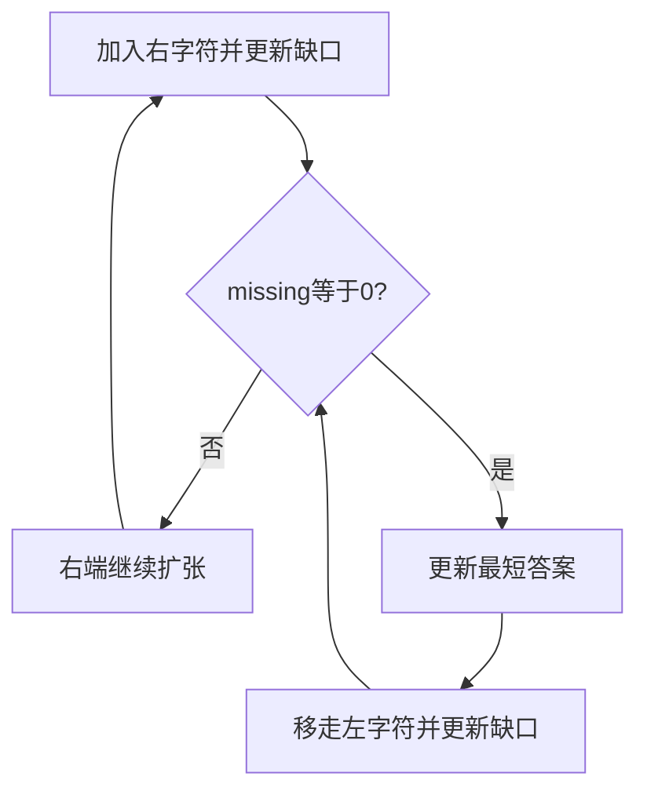
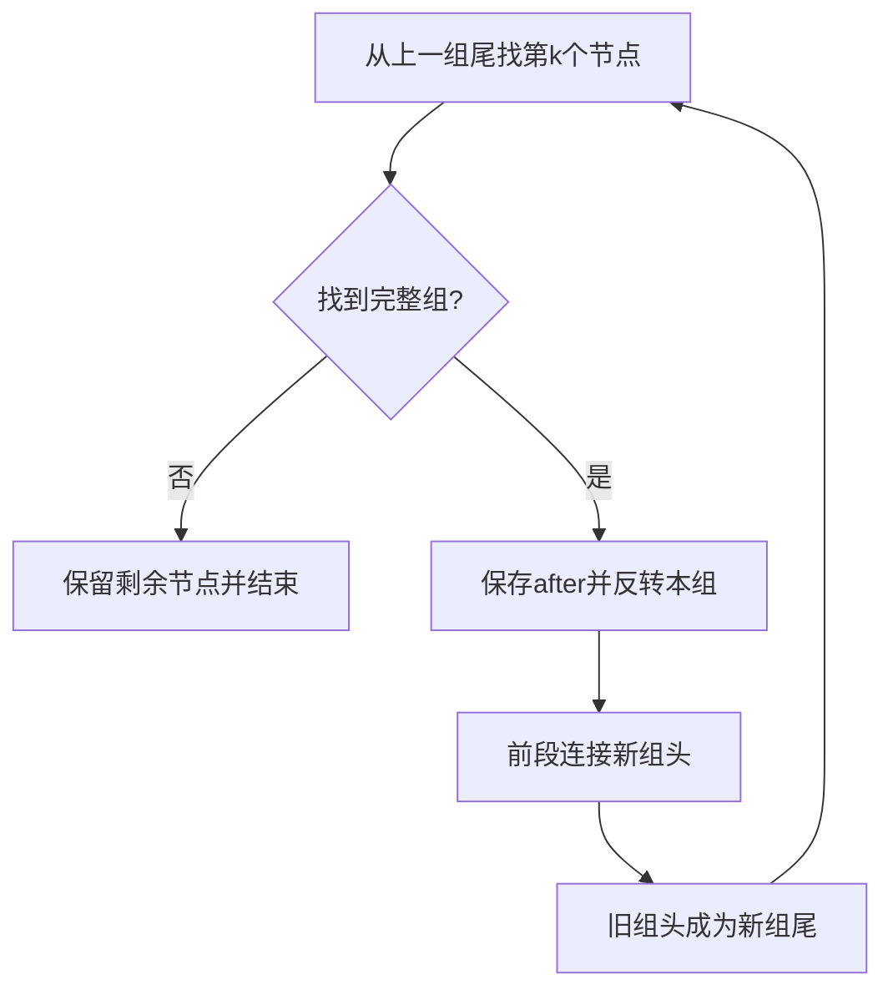
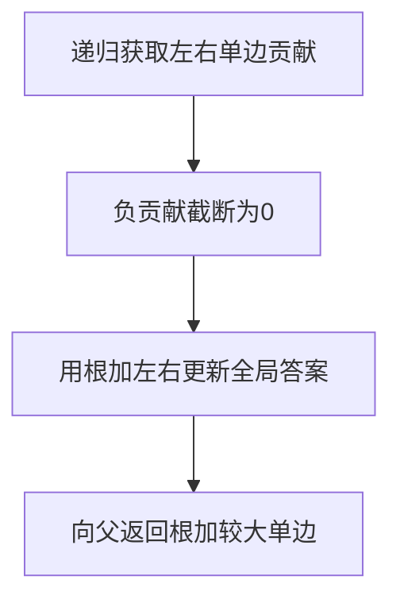
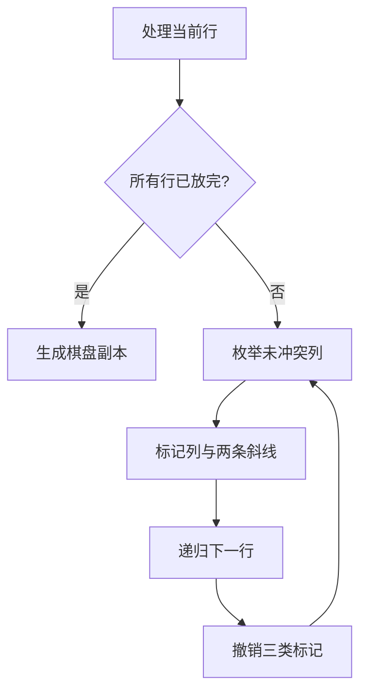
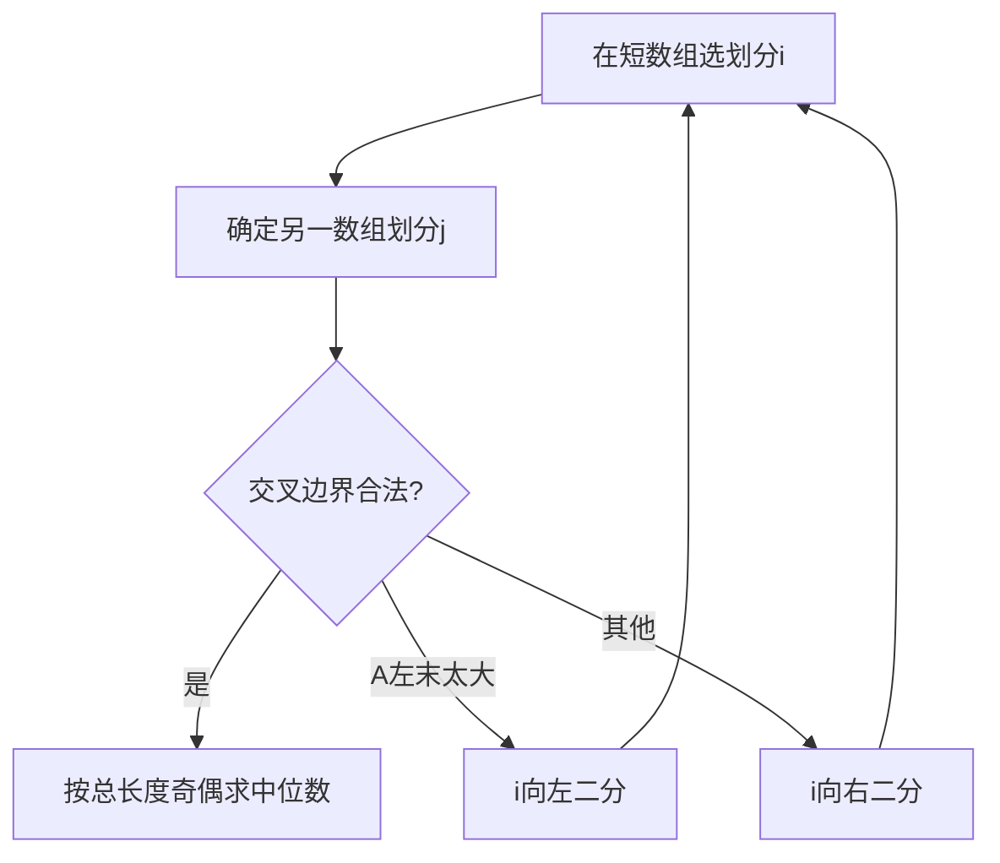
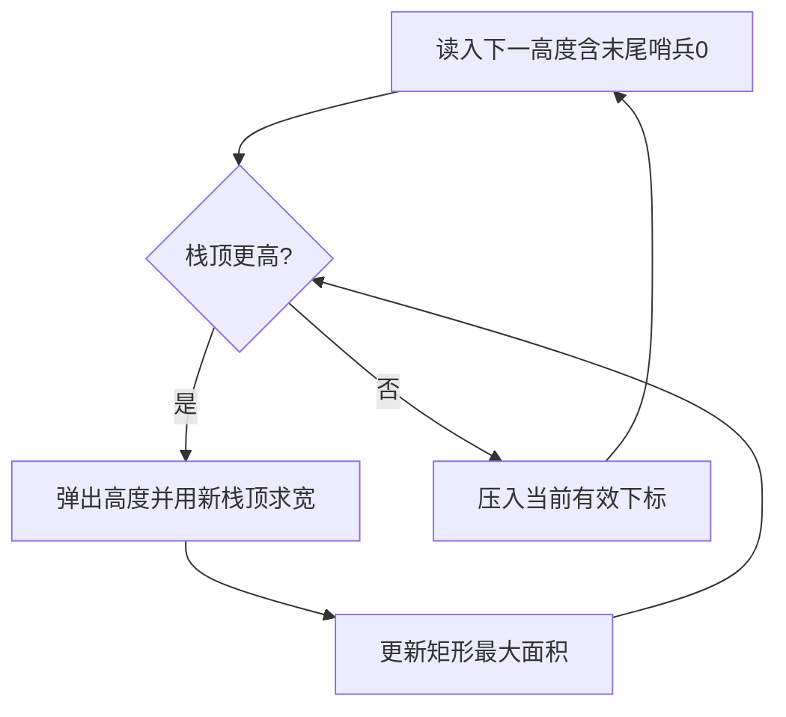
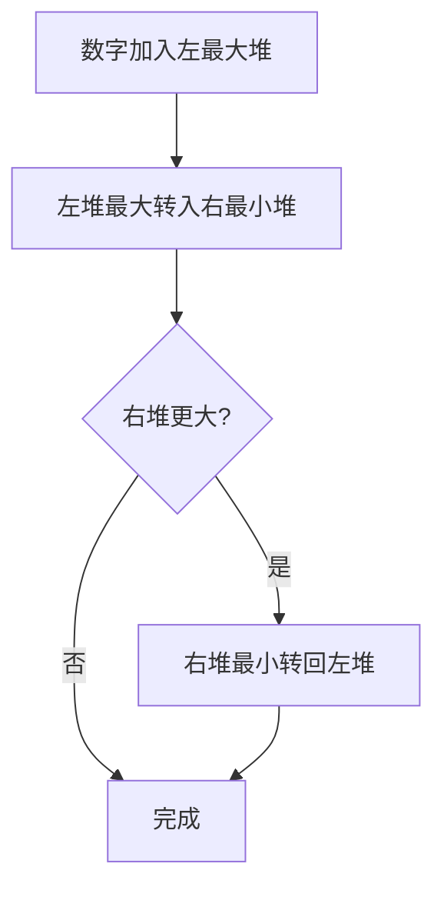
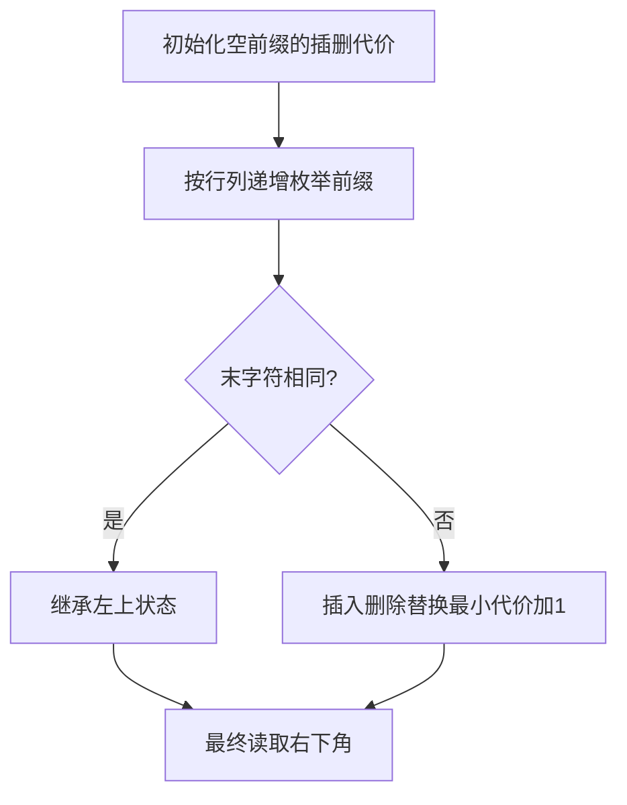

# LeetCode Hot 100 Java 完整题解与知识点学习手册

适合正在学习JavaSE的读者，兼容Java 17。核对日期：2026-11-25（Asia/Shanghai）。

来源：[力扣官方LeetCode热题100](https://leetcode.cn/studyplan/top-100-liked/)。这是Hot 100，不是“面试经典150题”。网页正文的静态提取未显示题目，本项目直接读取官方HTML中的`__NEXT_DATA__ → props.pageProps.dehydratedState.queries → studyPlanV2Detail.planSubGroups`，得到17组、100个唯一题号。原始快照在sources中保留，题单今后可能更新。

所有题意由本项目自行概括，未复制官方题面或题解。例子是帮助理解的局部输入，具体输入约束以各题官方页面为准。每个提交实现采用独立文件；有意选择易读版本，例如300用O(n²)DP、148用递归归并并明确栈空间。

学习建议：先看Java基础，再按推荐顺序练习；遇到集合API时回到附录，不必先背完全部API。源码中文注释与各题第3、6节配合阅读。树示例用层序数组表示，null为空孩子；链表示例中的箭头表示next，特别标明共享节点时才表示引用相同；设计题示例按调用先后列出。

## 100题清单

|题号|中文名称|难度|官方专题|官方链接|
|---|---|---|---|---|
|1|[两数之和](#p1)|简单|哈希|[原题](https://leetcode.cn/problems/two-sum/)|
|49|[字母异位词分组](#p49)|中等|哈希|[原题](https://leetcode.cn/problems/group-anagrams/)|
|128|[最长连续序列](#p128)|中等|哈希|[原题](https://leetcode.cn/problems/longest-consecutive-sequence/)|
|283|[移动零](#p283)|简单|双指针|[原题](https://leetcode.cn/problems/move-zeroes/)|
|11|[盛最多水的容器](#p11)|中等|双指针|[原题](https://leetcode.cn/problems/container-with-most-water/)|
|15|[三数之和](#p15)|中等|双指针|[原题](https://leetcode.cn/problems/3sum/)|
|42|[接雨水](#p42)|困难|双指针|[原题](https://leetcode.cn/problems/trapping-rain-water/)|
|3|[无重复字符的最长子串](#p3)|中等|滑动窗口|[原题](https://leetcode.cn/problems/longest-substring-without-repeating-characters/)|
|438|[找到字符串中所有字母异位词](#p438)|中等|滑动窗口|[原题](https://leetcode.cn/problems/find-all-anagrams-in-a-string/)|
|560|[和为 K 的子数组](#p560)|中等|子串|[原题](https://leetcode.cn/problems/subarray-sum-equals-k/)|
|239|[滑动窗口最大值](#p239)|困难|子串|[原题](https://leetcode.cn/problems/sliding-window-maximum/)|
|76|[最小覆盖子串](#p76)|困难|子串|[原题](https://leetcode.cn/problems/minimum-window-substring/)|
|53|[最大子数组和](#p53)|中等|普通数组|[原题](https://leetcode.cn/problems/maximum-subarray/)|
|56|[合并区间](#p56)|中等|普通数组|[原题](https://leetcode.cn/problems/merge-intervals/)|
|189|[轮转数组](#p189)|中等|普通数组|[原题](https://leetcode.cn/problems/rotate-array/)|
|238|[除了自身以外数组的乘积](#p238)|中等|普通数组|[原题](https://leetcode.cn/problems/product-of-array-except-self/)|
|41|[缺失的第一个正数](#p41)|困难|普通数组|[原题](https://leetcode.cn/problems/first-missing-positive/)|
|73|[矩阵置零](#p73)|中等|矩阵|[原题](https://leetcode.cn/problems/set-matrix-zeroes/)|
|54|[螺旋矩阵](#p54)|中等|矩阵|[原题](https://leetcode.cn/problems/spiral-matrix/)|
|48|[旋转图像](#p48)|中等|矩阵|[原题](https://leetcode.cn/problems/rotate-image/)|
|240|[搜索二维矩阵 II](#p240)|中等|矩阵|[原题](https://leetcode.cn/problems/search-a-2d-matrix-ii/)|
|160|[相交链表](#p160)|简单|链表|[原题](https://leetcode.cn/problems/intersection-of-two-linked-lists/)|
|206|[反转链表](#p206)|简单|链表|[原题](https://leetcode.cn/problems/reverse-linked-list/)|
|234|[回文链表](#p234)|简单|链表|[原题](https://leetcode.cn/problems/palindrome-linked-list/)|
|141|[环形链表](#p141)|简单|链表|[原题](https://leetcode.cn/problems/linked-list-cycle/)|
|142|[环形链表 II](#p142)|中等|链表|[原题](https://leetcode.cn/problems/linked-list-cycle-ii/)|
|21|[合并两个有序链表](#p21)|简单|链表|[原题](https://leetcode.cn/problems/merge-two-sorted-lists/)|
|2|[两数相加](#p2)|中等|链表|[原题](https://leetcode.cn/problems/add-two-numbers/)|
|19|[删除链表的倒数第 N 个结点](#p19)|中等|链表|[原题](https://leetcode.cn/problems/remove-nth-node-from-end-of-list/)|
|24|[两两交换链表中的节点](#p24)|中等|链表|[原题](https://leetcode.cn/problems/swap-nodes-in-pairs/)|
|25|[K 个一组翻转链表](#p25)|困难|链表|[原题](https://leetcode.cn/problems/reverse-nodes-in-k-group/)|
|138|[随机链表的复制](#p138)|中等|链表|[原题](https://leetcode.cn/problems/copy-list-with-random-pointer/)|
|148|[排序链表](#p148)|中等|链表|[原题](https://leetcode.cn/problems/sort-list/)|
|23|[合并 K 个升序链表](#p23)|困难|链表|[原题](https://leetcode.cn/problems/merge-k-sorted-lists/)|
|146|[LRU 缓存](#p146)|中等|链表|[原题](https://leetcode.cn/problems/lru-cache/)|
|94|[二叉树的中序遍历](#p94)|简单|二叉树|[原题](https://leetcode.cn/problems/binary-tree-inorder-traversal/)|
|104|[二叉树的最大深度](#p104)|简单|二叉树|[原题](https://leetcode.cn/problems/maximum-depth-of-binary-tree/)|
|226|[翻转二叉树](#p226)|简单|二叉树|[原题](https://leetcode.cn/problems/invert-binary-tree/)|
|101|[对称二叉树](#p101)|简单|二叉树|[原题](https://leetcode.cn/problems/symmetric-tree/)|
|543|[二叉树的直径](#p543)|简单|二叉树|[原题](https://leetcode.cn/problems/diameter-of-binary-tree/)|
|102|[二叉树的层序遍历](#p102)|中等|二叉树|[原题](https://leetcode.cn/problems/binary-tree-level-order-traversal/)|
|108|[将有序数组转换为二叉搜索树](#p108)|简单|二叉树|[原题](https://leetcode.cn/problems/convert-sorted-array-to-binary-search-tree/)|
|98|[验证二叉搜索树](#p98)|中等|二叉树|[原题](https://leetcode.cn/problems/validate-binary-search-tree/)|
|230|[二叉搜索树中第 K 小的元素](#p230)|中等|二叉树|[原题](https://leetcode.cn/problems/kth-smallest-element-in-a-bst/)|
|199|[二叉树的右视图](#p199)|中等|二叉树|[原题](https://leetcode.cn/problems/binary-tree-right-side-view/)|
|114|[二叉树展开为链表](#p114)|中等|二叉树|[原题](https://leetcode.cn/problems/flatten-binary-tree-to-linked-list/)|
|105|[从前序与中序遍历序列构造二叉树](#p105)|中等|二叉树|[原题](https://leetcode.cn/problems/construct-binary-tree-from-preorder-and-inorder-traversal/)|
|437|[路径总和 III](#p437)|中等|二叉树|[原题](https://leetcode.cn/problems/path-sum-iii/)|
|236|[二叉树的最近公共祖先](#p236)|中等|二叉树|[原题](https://leetcode.cn/problems/lowest-common-ancestor-of-a-binary-tree/)|
|124|[二叉树中的最大路径和](#p124)|困难|二叉树|[原题](https://leetcode.cn/problems/binary-tree-maximum-path-sum/)|
|200|[岛屿数量](#p200)|中等|图论|[原题](https://leetcode.cn/problems/number-of-islands/)|
|994|[腐烂的橘子](#p994)|中等|图论|[原题](https://leetcode.cn/problems/rotting-oranges/)|
|207|[课程表](#p207)|中等|图论|[原题](https://leetcode.cn/problems/course-schedule/)|
|208|[实现 Trie (前缀树)](#p208)|中等|图论|[原题](https://leetcode.cn/problems/implement-trie-prefix-tree/)|
|46|[全排列](#p46)|中等|回溯|[原题](https://leetcode.cn/problems/permutations/)|
|78|[子集](#p78)|中等|回溯|[原题](https://leetcode.cn/problems/subsets/)|
|17|[电话号码的字母组合](#p17)|中等|回溯|[原题](https://leetcode.cn/problems/letter-combinations-of-a-phone-number/)|
|39|[组合总和](#p39)|中等|回溯|[原题](https://leetcode.cn/problems/combination-sum/)|
|22|[括号生成](#p22)|中等|回溯|[原题](https://leetcode.cn/problems/generate-parentheses/)|
|79|[单词搜索](#p79)|中等|回溯|[原题](https://leetcode.cn/problems/word-search/)|
|131|[分割回文串](#p131)|中等|回溯|[原题](https://leetcode.cn/problems/palindrome-partitioning/)|
|51|[N 皇后](#p51)|困难|回溯|[原题](https://leetcode.cn/problems/n-queens/)|
|35|[搜索插入位置](#p35)|简单|二分查找|[原题](https://leetcode.cn/problems/search-insert-position/)|
|74|[搜索二维矩阵](#p74)|中等|二分查找|[原题](https://leetcode.cn/problems/search-a-2d-matrix/)|
|34|[在排序数组中查找元素的第一个和最后一个位置](#p34)|中等|二分查找|[原题](https://leetcode.cn/problems/find-first-and-last-position-of-element-in-sorted-array/)|
|33|[搜索旋转排序数组](#p33)|中等|二分查找|[原题](https://leetcode.cn/problems/search-in-rotated-sorted-array/)|
|153|[寻找旋转排序数组中的最小值](#p153)|中等|二分查找|[原题](https://leetcode.cn/problems/find-minimum-in-rotated-sorted-array/)|
|4|[寻找两个正序数组的中位数](#p4)|困难|二分查找|[原题](https://leetcode.cn/problems/median-of-two-sorted-arrays/)|
|20|[有效的括号](#p20)|简单|栈|[原题](https://leetcode.cn/problems/valid-parentheses/)|
|155|[最小栈](#p155)|中等|栈|[原题](https://leetcode.cn/problems/min-stack/)|
|394|[字符串解码](#p394)|中等|栈|[原题](https://leetcode.cn/problems/decode-string/)|
|739|[每日温度](#p739)|中等|栈|[原题](https://leetcode.cn/problems/daily-temperatures/)|
|84|[柱状图中最大的矩形](#p84)|困难|栈|[原题](https://leetcode.cn/problems/largest-rectangle-in-histogram/)|
|215|[数组中的第K个最大元素](#p215)|中等|堆|[原题](https://leetcode.cn/problems/kth-largest-element-in-an-array/)|
|347|[前 K 个高频元素](#p347)|中等|堆|[原题](https://leetcode.cn/problems/top-k-frequent-elements/)|
|295|[数据流的中位数](#p295)|困难|堆|[原题](https://leetcode.cn/problems/find-median-from-data-stream/)|
|121|[买卖股票的最佳时机](#p121)|简单|贪心算法|[原题](https://leetcode.cn/problems/best-time-to-buy-and-sell-stock/)|
|55|[跳跃游戏](#p55)|中等|贪心算法|[原题](https://leetcode.cn/problems/jump-game/)|
|45|[跳跃游戏 II](#p45)|中等|贪心算法|[原题](https://leetcode.cn/problems/jump-game-ii/)|
|763|[划分字母区间](#p763)|中等|贪心算法|[原题](https://leetcode.cn/problems/partition-labels/)|
|70|[爬楼梯](#p70)|简单|动态规划|[原题](https://leetcode.cn/problems/climbing-stairs/)|
|118|[杨辉三角](#p118)|简单|动态规划|[原题](https://leetcode.cn/problems/pascals-triangle/)|
|198|[打家劫舍](#p198)|中等|动态规划|[原题](https://leetcode.cn/problems/house-robber/)|
|279|[完全平方数](#p279)|中等|动态规划|[原题](https://leetcode.cn/problems/perfect-squares/)|
|322|[零钱兑换](#p322)|中等|动态规划|[原题](https://leetcode.cn/problems/coin-change/)|
|139|[单词拆分](#p139)|中等|动态规划|[原题](https://leetcode.cn/problems/word-break/)|
|300|[最长递增子序列](#p300)|中等|动态规划|[原题](https://leetcode.cn/problems/longest-increasing-subsequence/)|
|152|[乘积最大子数组](#p152)|中等|动态规划|[原题](https://leetcode.cn/problems/maximum-product-subarray/)|
|416|[分割等和子集](#p416)|中等|动态规划|[原题](https://leetcode.cn/problems/partition-equal-subset-sum/)|
|32|[最长有效括号](#p32)|困难|动态规划|[原题](https://leetcode.cn/problems/longest-valid-parentheses/)|
|62|[不同路径](#p62)|中等|多维动态规划|[原题](https://leetcode.cn/problems/unique-paths/)|
|64|[最小路径和](#p64)|中等|多维动态规划|[原题](https://leetcode.cn/problems/minimum-path-sum/)|
|5|[最长回文子串](#p5)|中等|多维动态规划|[原题](https://leetcode.cn/problems/longest-palindromic-substring/)|
|1143|[最长公共子序列](#p1143)|中等|多维动态规划|[原题](https://leetcode.cn/problems/longest-common-subsequence/)|
|72|[编辑距离](#p72)|中等|多维动态规划|[原题](https://leetcode.cn/problems/edit-distance/)|
|136|[只出现一次的数字](#p136)|简单|技巧|[原题](https://leetcode.cn/problems/single-number/)|
|169|[多数元素](#p169)|简单|技巧|[原题](https://leetcode.cn/problems/majority-element/)|
|75|[颜色分类](#p75)|中等|技巧|[原题](https://leetcode.cn/problems/sort-colors/)|
|31|[下一个排列](#p31)|中等|技巧|[原题](https://leetcode.cn/problems/next-permutation/)|
|287|[寻找重复数](#p287)|中等|技巧|[原题](https://leetcode.cn/problems/find-the-duplicate-number/)|

# 学习 Hot 100 前需要掌握的 Java 知识

本附录以Java 17语法为准。先学变量、数组、循环和方法，再边刷题边学习集合、对象与递归；不必等整套JavaSE课程结束才开始。代码片段有些需要放在类或方法内，不是每段都能单独提交。

<a id="java-1"></a>
## 1. 基本数据类型和变量

变量像带类型标签的盒子。int保存32位有符号整数，long保存64位整数，boolean只有true/false，char保存一个UTF-16代码单元，double保存浮点数。整数/整数会截断小数。

```java
int count = 0;
long sum = 0L;
boolean found = false;
char letter = 'a';
double average = ((double) 2 + 3) / 2;
```

常用语法与API：Integer.MIN_VALUE/MAX_VALUE是int边界；Long.MIN_VALUE/MAX_VALUE对应long。强转(double)在运算前提升类型。

Hot 100使用场景：437路径总和使用long，4中位数使用double。

初学者注意：int乘法可能先溢出再赋给long，应写(long)a*b；局部变量必须初始化后使用。

<a id="java-2"></a>
## 2. 数组及二维数组

数组长度创建后固定，从下标0开始。int[]是整数数组，int[][]是“数组的数组”，本手册矩阵题使用每行等长的矩形。

```java
int[] nums = {2, 7, 11};
int[] zeros = new int[3];
int[][] grid = {{1, 2}, {3, 4}};
int value = grid[1][0]; // 第二行第一列，值3
```

常用语法与API：a.length是字段，不带括号；a[i]读写元素；a.clone()只复制一层，二维数组深复制要逐行clone。

Hot 100使用场景：283原地移动，73用首行首列标记。

初学者注意：合法下标0..length-1；二维数组的行数grid.length，列数grid[0].length；访问grid[0]前需满足非空约束。

<a id="java-3"></a>
## 3. for、while、增强for

for适合知道遍历范围，while适合按条件反复，增强for适合逐个读取元素。break结束整个当前循环，continue跳过本轮剩余语句。

```java
int[] a = {1, 2, 3};
for (int i = 0; i < a.length; i++) { a[i]++; }
for (int value : a) { System.out.println(value); }
int left = 0, right = a.length - 1;
while (left < right) { left++; right--; }
```

常用语法与API：i++返回旧值再自增，++i先自增再返回；独立语句中两者效果相同。

Hot 100使用场景：1按下标返回答案，239用while清理队列。

初学者注意：增强for中的基本类型变量是副本，对value赋值不会修改数组；需要下标时用普通for。

<a id="java-4"></a>
## 4. 方法、参数和返回值

方法封装一段操作，参数是调用时传入的信息，return返回计算结果并结束当前调用。void表示不返回值。

```java
class Demo {
    int add(int a, int b) { return a + b; }
    void clear(int[] a) { java.util.Arrays.fill(a, 0); }
}
```

常用语法与API：签名由方法名和参数类型等决定；调用add(2,3)得到int 5；void方法可以使用return;提前结束。

Hot 100使用场景：Solution公开方法供力扣调用，private辅助方法拆分算法。

初学者注意：非void方法的正常执行路径必须返回值；参数名只在方法内部有效；题目方法名和参数类型不可随意改动。

<a id="java-5"></a>
## 5. 类与对象

类是描述数据和操作的模板，对象是用new创建的具体实例；两个new一般得到不同对象，即使字段值相同。

```java
class Box { int value; }
// 在方法内部：
// Box a = new Box();
// Box b = new Box();
// a.value = 3; // 不会改变b.value
```

常用语法与API：new分配对象并调用构造器；点号访问字段或方法；引用变量保存对象的引用。

Hot 100使用场景：链表节点和树节点都是对象；160根据对象身份判断相交。

初学者注意：a==b比较引用是否指向同一对象；两个值相同的节点不代表同一个节点。

<a id="java-6"></a>
## 6. 构造方法、成员变量、成员方法

成员变量保存对象状态，构造方法初始化对象，成员方法读取或修改状态。构造方法与类同名且没有返回类型。

```java
class Counter {
    private int value;
    Counter(int start) { this.value = start; }
    int next() { return ++value; }
}
```

常用语法与API：new Counter(3)调用有参构造器；c.next()返回4并保存新状态；对象成员默认初始化，而局部变量不会。

Hot 100使用场景：146缓存保存容量和链表，208节点保存孩子和终点标记。

初学者注意：构造方法不能写void；定义有参构造后不会自动提供无参构造；不要在算法多次调用间遗留旧答案。

<a id="java-7"></a>
## 7. this与static

this指向当前对象；static属于类本身，各实例共享，常用来存不变配置或独立工具方法。实例方法才能直接使用this。

```java
class Demo {
    private int value;
    static final int LIMIT = 100;
    Demo(int value) { this.value = value; }
    static int twice(int x) { return x * 2; }
}
```

常用语法与API：this.value区分字段和同名参数；Demo.twice(3)返回6；final引用不能再指向别处，但指向的数组仍可能被修改。

Hot 100使用场景：17用static final保存字母映射，146用static嵌套节点类。

初学者注意：不要把每题结果列表设为共享static可变状态；static方法不能直接读取非static字段。

<a id="java-8"></a>
## 8. 封装、继承、多态

封装把内部状态藏在private后，通过方法维护规则。继承用extends表达一种更具体的类型；多态让父类型引用调用实际对象的重写实现。

```java
class Animal { String sound() { return "?"; } }
class Cat extends Animal {
    @Override String sound() { return "喵"; }
}
// Animal pet = new Cat(); pet.sound()实际返回“喵”
```

常用语法与API：private限制类内访问，public开放；@Override帮助编译器检查确实在重写；super可调用父类构造或方法。

Hot 100使用场景：List<Integer> list = new ArrayList<>();体现面向抽象类型编程。

初学者注意：Java类只能extends一个类；方法重载看参数列表，方法重写发生在继承实现关系中，二者不同。

<a id="java-9"></a>
## 9. 接口与抽象类

接口描述对象能做什么，抽象类可保存共享状态和部分实现。接口可被多个类实现，抽象类不能直接new。

```java
interface Task { int run(); }
abstract class BaseTask {
    protected int count;
    abstract int run();
}
class SimpleTask implements Task {
    public int run() { return 1; }
}
```

常用语法与API：implements实现接口，extends继承类；抽象方法由具体类实现；接口也可以有default方法。

Hot 100使用场景：List、Map、Set、Queue、Deque是接口，ArrayList、HashMap等是实现类。

初学者注意：不能new List<>()；声明接口类型时只能直接使用该接口暴露的方法。

<a id="java-10"></a>
## 10. String与StringBuilder

String不可变，每次改变文本实际上创建新串；StringBuilder是可变字符缓冲，适合循环拼接或回溯路径。

```java
String s = "abc";
char c = s.charAt(1); // b
String part = s.substring(0, 2); // ab
StringBuilder path = new StringBuilder();
path.append('a');
String snapshot = path.toString();
path.deleteCharAt(path.length() - 1);
```

常用语法与API：length()返回长度；charAt(i)返回char；substring(l,r)左闭右开；toCharArray()创建新char[]；append返回当前builder，toString生成不可变快照。

Hot 100使用场景：17/22回溯生成字符串，394多层解码。

初学者注意：字符串内容比较用equals；下标要小于length()；循环s+=可能制造大量临时对象；char不总等同一个Unicode字符，本题按官方输入字符范围处理。

<a id="java-11"></a>
## 11. ArrayList与List

List是有序可重复列表接口，ArrayList用可扩容数组实现；尾部添加通常快，插入中间或头部需要搬移。

```java
java.util.List<Integer> path = new java.util.ArrayList<>();
path.add(2);
int first = path.get(0);
java.util.List<Integer> copy = new java.util.ArrayList<>(path);
path.remove(path.size() - 1);
```

常用语法与API：add(E)追加并返回true，get(i)读取，set(i,x)替换并返回旧值，remove(int)删下标并返回旧值，size()元素数。get/set O(1)，尾add摊还O(1)，中间remove O(n)。

Hot 100使用场景：回溯结果和路径，102层序二维列表。

初学者注意：remove(1)删除下标1；remove(Integer.valueOf(1))删值1；new ArrayList<>(path)是浅复制，嵌套可变对象仍共享。

<a id="java-12"></a>
## 12. HashMap与Map

Map建立键到值的映射，每个键至多一个当前值。HashMap按equals和hashCode确定键，平均查找O(1)，不保证遍历顺序。

```java
java.util.Map<Integer, Integer> count = new java.util.HashMap<>();
count.put(7, count.getOrDefault(7, 0) + 1);
boolean exists = count.containsKey(7);
int times = count.get(7);
count.remove(7);
```

常用语法与API：put(k,v)返回旧值或null；get(k)返回对应值或null；getOrDefault(k,d)缺失用默认值d；entrySet()遍历键值对；size()返回键数。

Hot 100使用场景：1数值到下标，560前缀到次数。

初学者注意：get缺失返回null，拆箱成int会空指针；频次必须累加而非覆盖为1；Integer比较值不要依赖==缓存。

<a id="java-13"></a>
## 13. HashSet与Set

Set只保存不重复元素，HashSet平均查找、插入、删除O(1)，顺序未定义。

```java
java.util.Set<Integer> seen = new java.util.HashSet<>();
boolean first = seen.add(2); // true
boolean again = seen.add(2); // false
boolean has = seen.contains(2);
seen.remove(2);
```

常用语法与API：add返回是否真的新增；contains返回是否存在；remove返回是否存在并删除；size是不同元素个数。

Hot 100使用场景：128去重并找前驱，3维护窗口字符。

初学者注意：不要把无序集合当有序数组；自定义可变对象作为键时修改参与哈希的字段会破坏查找；节点默认按身份比较。

<a id="java-14"></a>
## 14. Deque、ArrayDeque和栈

Deque双端队列可在两头操作；ArrayDeque是数组实现。栈是一端进一端出的后进先出结构，优先用Deque而非旧Stack类。

```java
java.util.Deque<Integer> stack = new java.util.ArrayDeque<>();
stack.push(3); stack.push(5);
int top = stack.peek(); // 5，未删除
int popped = stack.pop(); // 5，删除
boolean empty = stack.isEmpty();
```

常用语法与API：push/pop/peek操作头部；addLast/removeLast/peekLast操作尾部；offerLast/pollFirst可作队列。两端操作通常摊还O(1)。

Hot 100使用场景：20括号匹配、84单调栈、239单调双端队列。

初学者注意：ArrayDeque不接受null；pop空栈抛异常，peek空栈返回null，拆箱仍会出错；不要混淆队首队尾。

<a id="java-15"></a>
## 15. Queue与PriorityQueue

普通Queue按先入先出供BFS使用；PriorityQueue按优先级出队，是堆，不按插入顺序。默认最小堆。

```java
java.util.Queue<Integer> queue = new java.util.ArrayDeque<>();
queue.offer(1); queue.offer(2);
int first = queue.poll(); // 1
java.util.PriorityQueue<Integer> heap = new java.util.PriorityQueue<>();
heap.offer(5); heap.offer(2);
int min = heap.peek(); // 2
```

常用语法与API：offer插入，poll取出并删除队首/堆顶，peek只读；空poll/peek返回null。堆offer/poll O(log n)，peek O(1)；遍历堆不保证有序。

Hot 100使用场景：102层序使用队列，215保留前k大，295双堆中位数。

初学者注意：优先队列不能代替BFS队列；最大堆须传反向比较器；不可插入null。

<a id="java-16"></a>
## 16. 泛型

泛型用类型参数表达集合里装什么，让编译器提前发现类型错误。List<Integer>保存整数包装对象，不是原生int。

```java
java.util.List<Integer> numbers = new java.util.ArrayList<>();
numbers.add(3); // int自动装箱为Integer
int x = numbers.get(0); // 自动拆箱
java.util.List<java.util.List<Integer>> groups = new java.util.ArrayList<>();
```

常用语法与API：尖括号中是引用类型；<>菱形语法让右侧类型由上下文推断；List<List<Integer>>是列表的列表。

Hot 100使用场景：回溯二维结果、哈希表键值类型、节点队列。

初学者注意：不能写List<int>；List<Integer>不是List<Number>的子类型；拆箱null会抛NullPointerException。

<a id="java-17"></a>
## 17. Lambda表达式

Lambda是函数式接口的简写实现；函数式接口只有一个抽象方法。参数从目标类型推断，->右侧是执行体。

```java
java.util.List<int[]> rows = new java.util.ArrayList<>();
rows.sort((a, b) -> Integer.compare(a[0], b[0]));
java.util.Map<String, java.util.List<String>> map = new java.util.HashMap<>();
map.computeIfAbsent("key", k -> new java.util.ArrayList<>()).add("value");
```

常用语法与API：computeIfAbsent(key,fn)在键未关联非null值时调用fn建立值并返回该值；k是传入的键，new ArrayList<>()是新组；返回List后可继续add。传统写法：if(!map.containsKey(key)) map.put(key,new ArrayList<>()); map.get(key).add(value);

Hot 100使用场景：56排序区间、23堆按节点值比较；49正文采用更容易读的传统写法。

初学者注意：Lambda参数不是字符串；捕获的局部变量须final或有效final；不要为简短而使用不理解的链式调用。

<a id="java-18"></a>
## 18. Comparator与Comparable

Comparable定义类型的自然顺序（compareTo），Comparator是独立比较规则（compare），可为同一类型指定不同排序。

```java
java.util.Comparator<Integer> ascending = Integer::compare;
java.util.PriorityQueue<Integer> maxHeap =
    new java.util.PriorityQueue<>(java.util.Comparator.reverseOrder());
int cmp = Integer.compare(2, 5); // 负数，表示2应在5之前
```

常用语法与API：compare(a,b)<0表示a在前，=0同序，>0表示b在前；reverseOrder()反转自然顺序；Integer::compare是方法引用，等价(a,b)->Integer.compare(a,b)。

Hot 100使用场景：56区间排序，295左侧最大堆。

初学者注意：不要写a-b比较极值，可能溢出；比较器应保持反对称和传递性；原生int[]不能传Comparator逐元素排序。

<a id="java-19"></a>
## 19. Arrays、Collections、Math常用API

这些工具类提供静态方法，不需要new；Arrays作用于数组，Collections作用于集合，Math做数学比较。

```java
int[] a = {3, 1, 2};
java.util.Arrays.sort(a);
boolean same = java.util.Arrays.equals(a, new int[]{1, 2, 3});
java.util.Arrays.fill(a, 0);
int larger = Math.max(2, 5);
java.util.List<Integer> list = new java.util.ArrayList<>(java.util.Arrays.asList(3, 1));
java.util.Collections.sort(list);
```

常用语法与API：sort修改原容器；equals比较一维数组内容，deepEquals比较嵌套对象数组；fill全部赋值；asList返回定长列表；Collections.reverse反转列表；Math.max/min返回较大/小值。

Hot 100使用场景：49排序字符，438比较计数数组，DP初始化和最优值更新。

初学者注意：Arrays.asList(int[])会得到只含整个int[]的列表；asList不能add/remove；数组==比较引用而非内容。

<a id="java-20"></a>
## 20. 递归

方法调用自身处理更小子问题。每层调用有自己的参数与局部变量，通过调用栈保留现场；必须明确终止条件、递归过程、返回含义。

```java
class Demo {
    int sum(int n) {
        if (n == 0) return 0; // 终止
        return n + sum(n - 1); // 子问题变小，返回前n项和
    }
}
```

常用语法与API：sum(3)展开3+sum(2)，再2+sum(1)，最终sum(0)=0，自底向上返回1、3、6。栈深度也占空间。

Hot 100使用场景：104返回子树高度，46回溯排列。

初学者注意：没有终止会无限递归；输入退化成长链时Java可能StackOverflowError，需要显式栈；不要把递归栈算成O(1)。

<a id="java-21"></a>
## 21. 引用、null、对象传参

Java始终按值传参；对象参数传入的是“引用值的副本”。方法能经引用修改同一对象，但给参数重新赋new不会替换调用者变量。null表示没有指向对象。

```java
class Demo {
    void edit(int[] a) { a[0] = 9; } // 调用者可看到
    void replace(int[] a) { a = new int[]{9}; } // 只改局部参数
    boolean empty(int[] a) { return a == null; }
}
```

常用语法与API：p.next=null切断链接；p=q只复制引用，不复制对象；&&与||会短路，p!=null && p.next!=null能防止访问空引用。

Hot 100使用场景：206必须保存next，138必须new新节点，146维护共享节点引用。

初学者注意：不能调用null的方法或字段；引用副本不是深拷贝；Java没有C++式引用传递。

<a id="java-22"></a>
## 22. 位运算基础

整数按二进制逐位计算：&两位都1才1，|任一为1即1，^相异为1，~按位取反；<<左移，>>保留符号右移，>>>补0右移。

```java
int xor = 5 ^ 3; // 101 ^ 011 = 110，即6
int lowBit = 6 & -6; // 得最低位的1，值2
boolean odd = (5 & 1) != 0;
int doubled = 3 << 1; // 6
```

常用语法与API：x^x=0，x^0=x，异或交换结合；移位优先级容易误读，应加括号。int移位距离只使用低5位，1<<32等于1。

Hot 100使用场景：136成对抵消；进阶可位掩码枚举78子集。

初学者注意：^不是指数运算；&与&&不同，前者不短路；负数按补码表示，不要把逻辑右移与算术右移混用。

## Java 常用 API 速查表

|语法/API|作用与返回值|注意|
|---|---|---|
|`a.length / s.length() / list.size()`|数组长度 / 字符串长度 / 集合元素数|只有数组length不带括号|
|`Arrays.sort(a)`|原地排序，无返回值|原生数组排序通常O(n log n)，对象数组额外空间需另计|
|`Arrays.fill(a,v)`|所有元素设v，无返回值|DP不可达状态初始化|
|`Arrays.equals(a,b)`|一维数组内容相等返回true|二维int数组用Arrays.deepEquals|
|`Arrays.asList(a,b)`|返回定长列表|不能add/remove，int[]单参数会成为一个元素|
|`Collections.sort(list)`|原地自然顺序排序，无返回值|列表必须支持替换|
|`Math.max(a,b) / min(a,b)`|返回较大/小值|不修改参数|
|`Integer.compare(a,b)`|负/零/正表示比较结果|优于a-b防溢出|
|`String.charAt(i)`|返回位置i的char|0≤i<length()|
|`String.substring(l,r)`|新字符串，范围[l,r)|l≤r≤length()|
|`String.toCharArray()`|创建char[]副本|可排序副本而不改String|
|`StringBuilder.append(x)`|追加，返回同一builder|可链式调用|
|`StringBuilder.deleteCharAt(i)`|删除一字符，返回builder|回溯常删length()-1|
|`StringBuilder.toString()`|当前内容的String快照|builder之后更改不会改旧String|
|`List.add(x) / get(i)`|追加返回true / 获取元素|尾add摊还O(1)，get O(1)适用于ArrayList|
|`List.remove(i) / remove(obj)`|删下标返回元素 / 删对象返回boolean|Integer列表的重载要小心|
|`new ArrayList<>(path)`|浅复制列表|对二维可变对象不等于深拷贝|
|`Map.put(k,v) / get(k)`|写入返回旧值 / 读取或null|null拆箱有风险|
|`Map.getOrDefault(k,d)`|存在时返回值，否则d|默认值不会自动写进Map|
|`Map.containsKey(k)`|是否含该键，boolean|区别于值是否null|
|`Map.entrySet() / values()`|键值对视图 / 值视图|视图通常与原Map关联|
|`Map.computeIfAbsent(k,fn)`|缺值时创建并返回映射值|fn参数为键，不要误写成值|
|`Set.add(x) / contains(x) / remove(x)`|是否新增 / 存在 / 删除成功|平均O(1)，不保序|
|`Deque.push/pop/peek`|栈顶压入/删除返回/只读返回|peek空为null，pop空抛异常|
|`Deque.addLast/removeFirst/peekLast`|尾入/头出/读尾|先isEmpty避免非法读取|
|`Queue.offer/poll/peek`|入队/出队/只读队首|ArrayDeque作BFS，PriorityQueue按优先级|
|`PriorityQueue(Comparator.reverseOrder())`|创建最大堆|默认构造是最小堆|
|`Map.Entry.getKey/getValue`|返回键/值|遍历entrySet时常用|
|`== / equals`|基本值或引用身份 / 对象内容规则|String用equals，节点身份用==|

## 力扣提交与本地运行

普通题复制对应.java全部内容（含import与class Solution）。设计题使用题目指定类名：LRUCache、Trie、MinStack、MedianFinder。链表、树的节点由力扣提供，不要把本地测试桩一起粘进去。各题都叫Solution，因此不能把全部源码放同一默认包一起编译；验证工具按题号隔离编译目录。

本地验证命令见README。递归在极深输入时可能受JVM栈限制；局部用例通过不代表完整覆盖所有合法输入，也不等于官方判题通过。

# Hot 100 算法与数据结构附录

下列模板服务于理解，涉及nums、target、节点等外部变量的片段需放入相应题目方法。通用框架中的注释条件需要按具体问题实现；完整可提交代码始终以每题源码为准。

## 1. 哈希表

含义与适用问题：把键映射到值或存在性，适合补数、去重、频次、前缀状态查询。

```java
Map<Integer,Integer> count = new HashMap<>();
for (int x : nums) count.put(x, count.getOrDefault(x, 0) + 1);
```

常见复杂度：平均查找/插入O(1)，总计O(n)时间、O(n)空间；碰撞严重时不能保证简单常数。

代表题与复习重点：1、49、128、560；区分映射的值是下标还是次数。

## 2. 双指针

含义与适用问题：两个位置协调扫描，把不可能的候选整体排除，适合有序配对、原地压缩、快慢链表。

```java
int l = 0, r = a.length - 1;
while (l < r) {
    int sum = a[l] + a[r];
    if (sum < target) l++; else if (sum > target) r--; else break;
}
```

常见复杂度：有序两数配对O(n)时间O(1)空间，若先排序另计O(n log n)。

代表题与复习重点：11、15、283、141；先证明为什么某一侧可被舍弃。

## 3. 滑动窗口

含义与适用问题：维护连续区间及其统计量，通过扩张和收缩避免重复扫描。适合不重复字符、固定窗口频次、最小覆盖。

```java
Set<Character> window = new HashSet<>();
int left = 0, best = 0;
for (int right = 0; right < s.length(); right++) {
    char c = s.charAt(right);
    while (window.contains(c)) window.remove(s.charAt(left++));
    window.add(c);
    best = Math.max(best, right - left + 1);
}
```

常见复杂度：两端各移动至多n次且维护O(1)时，总O(n)时间；空间取决于频次数组或集合。

代表题与复习重点：3、438、76；模板演示无重复字符窗口；其他问题需要重设合法条件和更新答案时机。含负数的和不具简单单调性，560改用前缀。

## 4. 前缀和

含义与适用问题：前缀累计把区间和转为两个前缀之差，适合区间查询与统计目标和区间。

```java
long[] pre = new long[nums.length + 1];
for (int i = 0; i < nums.length; i++) pre[i + 1] = pre[i] + nums[i];
long sum = pre[r + 1] - pre[l]; // 闭区间[l,r]
```

常见复杂度：预处理O(n)，每次区间查询O(1)，数组空间O(n)。

代表题与复习重点：560、437；历史前缀计数初始0出现一次，查完再登记。

## 5. 链表

含义与适用问题：节点保存值和后继，按引用连接；访问中间项需从头走，已知前驱时插删O(1)。

```java
ListNode prev = null, cur = head;
while (cur != null) {
    ListNode next = cur.next;
    cur.next = prev; prev = cur; cur = next;
}
return prev;
```

常见复杂度：反转O(n)时间O(1)空间；随机定位O(n)。

代表题与复习重点：206、21、19、25；先保存后继再改next，dummy统一处理头部。

## 6. 栈和队列

含义与适用问题：栈后进先出管理嵌套和待处理状态，队列先进先出管理距离层次。

```java
Deque<Integer> stack = new ArrayDeque<>();
stack.push(1); int top = stack.pop();
Queue<Integer> q = new ArrayDeque<>();
q.offer(1); int first = q.poll();
```

常见复杂度：两端操作摊还O(1)，处理n个元素O(n)时间，最坏O(n)空间。

代表题与复习重点：20、155、102、994；不要混淆栈顶和队首。

## 7. 二叉树

含义与适用问题：每节点至多两个孩子，递归结构适合分治；BST额外具有左小右大的全子树约束。

```java
int height(TreeNode node) {
    if (node == null) return 0;
    return Math.max(height(node.left), height(node.right)) + 1;
}
```

常见复杂度：遍历O(n)，递归O(h)空间；平衡BST查找O(log n)，退化树O(n)。

代表题与复习重点：94、98、104、236、124；说明递归返回值，是高度、布尔还是路径贡献。

## 8. DFS与BFS

含义与适用问题：DFS先走深处再回退，适合连通块和路径；BFS按边数逐层扩展，适合无权图最短距离。

```java
Queue<TreeNode> q = new ArrayDeque<>();
if (root != null) q.offer(root);
while (!q.isEmpty()) {
    int size = q.size();
    for (int i = 0; i < size; i++) {
        TreeNode node = q.poll();
        if (node.left != null) q.offer(node.left);
        if (node.right != null) q.offer(node.right);
    }
}
```

常见复杂度：图遍历O(V+E)时间O(V)辅助空间（不含图存储），网格O(mn)。

代表题与复习重点：200、994、207、102；一般图必须标记访问，BFS在入队时标记。

## 9. 回溯

含义与适用问题：在决策树逐步构造路径，失败或收集后撤销选择。用于穷举解集及约束搜索。

```java
void dfs(int[] a, int start, List<Integer> path, List<List<Integer>> ans) {
    ans.add(new ArrayList<>(path));
    for (int i = start; i < a.length; i++) {
        path.add(a[i]);
        dfs(a, i + 1, path, ans);
        path.remove(path.size() - 1);
    }
}
```

常见复杂度：复杂度由搜索树和输出决定，子集O(n2^n)，排列O(n·n!)；辅助空间一般O(深度)。

代表题与复习重点：46、78、39、51；明确路径、选择列表、结束条件、撤销动作；结果需要快照。

## 10. 二分查找

含义与适用问题：在有单调判断的候选区间不断排除一半，适合有序查找、上下界、答案划分。

```java
int l = 0, r = a.length;
while (l < r) {
    int mid = l + (r - l) / 2;
    if (a[mid] < target) l = mid + 1; else r = mid;
}
return l; // 第一个>=target的位置，可等于n
```

常见复杂度：O(log n)时间O(1)空间；前提是每步能保持不变量并缩短区间。

代表题与复习重点：35、34、33、153、4；闭区间与半开区间模板不能随意拼接。

## 11. 堆

含义与适用问题：堆是局部有序结构，可快速取最小或最大；不保证内部遍历完整有序。适合Top K和多路归并。

```java
PriorityQueue<Integer> heap = new PriorityQueue<>();
for (int x : nums) {
    heap.offer(x);
    if (heap.size() > k) heap.poll();
}
return heap.peek();
```

常见复杂度：入出堆O(log k)，读顶O(1)，保留k大O(n log(k+1))时间O(k)空间。

代表题与复习重点：215、23、295；保留最大的k个通常用最小堆淘汰小值。

## 12. 贪心

含义与适用问题：每步做有证明的局部最优，压缩搜索空间；必须解释为什么不会丢掉全局最优。

```java
int far = 0;
for (int i = 0; i < nums.length; i++) {
    if (i > far) return false;
    far = Math.max(far, i + nums[i]);
}
return true;
```

常见复杂度：取决于问题；跳跃O(n)时间O(1)空间，若先排序则常为O(n log n)。

代表题与复习重点：55、45、763、121；322任意币值不能直接最大币优先，反例[1,3,4]凑6。

## 13. 动态规划

含义与适用问题：把重复子问题抽成状态，按依赖顺序计算，每个状态只求一次。适合计数、最优值、可行性。

```java
int[] dp = new int[amount + 1];
Arrays.fill(dp, amount + 1); dp[0] = 0;
for (int a = 1; a <= amount; a++) {
    for (int coin : coins) if (coin <= a) {
        dp[a] = Math.min(dp[a], dp[a - coin] + 1);
    }
}
```

常见复杂度：通常为状态数×每状态转移数；322为O(A·C)时间O(A)空间，不能一概说O(n)。

代表题与复习重点：70、198、322、300、416、72；写清状态、转移、初始化、遍历顺序，最后才考虑压缩空间。

## 14. 单调栈

含义与适用问题：栈内对应值保持单调，利用新元素结算旧元素的第一个更大/更小边界。

```java
Deque<Integer> stack = new ArrayDeque<>();
for (int i = 0; i < a.length; i++) {
    while (!stack.isEmpty() && a[i] > a[stack.peek()]) {
        int j = stack.pop();
        answer[j] = i - j;
    }
    stack.push(i);
}
```

常见复杂度：每元素入出一次，O(n)时间O(n)空间；双层while并不自动代表O(n²)。

代表题与复习重点：739、84；相等时弹不弹依题意决定，84弹出后算宽度。

## 15. 位运算

含义与适用问题：按位规律可压缩状态或抵消成对元素；需要明确整数表示及输入结构。

```java
int answer = 0;
for (int x : nums) answer ^= x;
return answer;
```

常见复杂度：136为O(n)时间O(1)空间；位掩码枚举子集仍有2^n个状态。

代表题与复习重点：136；技巧专题169使用投票而非位运算，287使用函数图。

## 如何自己推复杂度

先定输入规模：数组n，字符串m和n，图V和E，树高h，结果数量S。顺序执行的循环相加，嵌套且范围独立时相乘；单调栈、滑窗要数每个元素实际入出次数。递归既要算调用总数，也要算最大同时存活的栈深度。必须区分辅助空间与返回结果空间，并把排序、子串创建、复制路径的代价算进去。

## 从基础到后端

HashMap与LRU有助于理解缓存，但本题LRU不是线程安全生产缓存；队列与拓扑排序帮助理解任务依赖；二分与树帮助建立索引直觉，但MySQL索引要另学B+树。完成题目后再将集合、异常、IO、多线程知识与Spring Boot、MySQL、Redis项目结合，不把刷题等同于后端开发。

# Java 初学者 Hot 100 推荐刷题顺序

学习顺序与正文专题顺序分开维护。先用数组练语法，再学集合和指针，然后利用节点对象练引用与递归，最后深入状态设计。困难题统一留到综合阶段；其中76可在掌握滑窗后提前挑战。复习优先级不等于难度：P0为基础模式或高复用转移，P1为常规巩固，P2为困难综合。

## 阶段1：Java基础语法、数组、字符串

|推荐顺序|题号|名称|难度|提前掌握的Java知识|复习优先级|
|---|---|---|---|---|---|
|1|283|[移动零](https://leetcode.cn/problems/move-zeroes/)|简单|数组与下标|P0|
|2|136|[只出现一次的数字](https://leetcode.cn/problems/single-number/)|简单|数组与下标、异或与复合赋值|P0|
|3|169|[多数元素](https://leetcode.cn/problems/majority-element/)|简单|数组与下标|P1|
|4|121|[买卖股票的最佳时机](https://leetcode.cn/problems/best-time-to-buy-and-sell-stock/)|简单|数组与下标、Math.max / Math.min、整数边界与数值提升|P0|
|5|118|[杨辉三角](https://leetcode.cn/problems/pascals-triangle/)|简单|对象、引用与null、List、ArrayList与泛型|P1|
|6|53|[最大子数组和](https://leetcode.cn/problems/maximum-subarray/)|中等|数组与下标、Math.max / Math.min|P0|
|7|189|[轮转数组](https://leetcode.cn/problems/rotate-array/)|中等|数组与下标|P1|
|8|238|[除了自身以外数组的乘积](https://leetcode.cn/problems/product-of-array-except-self/)|中等|数组与下标、对象、引用与null|P0|
|9|48|[旋转图像](https://leetcode.cn/problems/rotate-image/)|中等|数组与下标、二维数组|P1|
|10|54|[螺旋矩阵](https://leetcode.cn/problems/spiral-matrix/)|中等|数组与下标、二维数组、对象、引用与null、List、ArrayList与泛型|P1|
|11|73|[矩阵置零](https://leetcode.cn/problems/set-matrix-zeroes/)|中等|数组与下标、二维数组|P1|
|12|240|[搜索二维矩阵 II](https://leetcode.cn/problems/search-a-2d-matrix-ii/)|中等|数组与下标、二维数组|P1|
## 阶段2：HashMap、HashSet、ArrayList

|推荐顺序|题号|名称|难度|提前掌握的Java知识|复习优先级|
|---|---|---|---|---|---|
|13|1|[两数之和](https://leetcode.cn/problems/two-sum/)|简单|数组与下标、对象、引用与null、Map、HashMap|P0|
|14|49|[字母异位词分组](https://leetcode.cn/problems/group-anagrams/)|中等|数组与下标、对象、引用与null、List、ArrayList与泛型、列表快照与集合构造器、Map、HashMap|P0|
|15|128|[最长连续序列](https://leetcode.cn/problems/longest-consecutive-sequence/)|中等|数组与下标、对象、引用与null、Set、HashSet、Math.max / Math.min、整数边界与数值提升|P0|
|16|560|[和为 K 的子数组](https://leetcode.cn/problems/subarray-sum-equals-k/)|中等|数组与下标、对象、引用与null、Map、HashMap、Map.getOrDefault(key, defaultValue)|P0|
## 阶段3：双指针、滑动窗口、二分查找

|推荐顺序|题号|名称|难度|提前掌握的Java知识|复习优先级|
|---|---|---|---|---|---|
|17|35|[搜索插入位置](https://leetcode.cn/problems/search-insert-position/)|简单|数组与下标|P0|
|18|11|[盛最多水的容器](https://leetcode.cn/problems/container-with-most-water/)|中等|数组与下标、Math.max / Math.min|P1|
|19|15|[三数之和](https://leetcode.cn/problems/3sum/)|中等|数组与下标、对象、引用与null、List、ArrayList与泛型、Arrays.sort(array[, comparator])、Arrays.asList(...)|P1|
|20|3|[无重复字符的最长子串](https://leetcode.cn/problems/longest-substring-without-repeating-characters/)|中等|对象、引用与null、Set、HashSet、String、String.charAt(index)、Math.max / Math.min|P0|
|21|438|[找到字符串中所有字母异位词](https://leetcode.cn/problems/find-all-anagrams-in-a-string/)|中等|数组与下标、对象、引用与null、List、ArrayList与泛型、String、String.charAt(index)|P1|
|22|74|[搜索二维矩阵](https://leetcode.cn/problems/search-a-2d-matrix/)|中等|数组与下标、二维数组|P1|
|23|34|[在排序数组中查找元素的第一个和最后一个位置](https://leetcode.cn/problems/find-first-and-last-position-of-element-in-sorted-array/)|中等|数组与下标、对象、引用与null|P0|
|24|33|[搜索旋转排序数组](https://leetcode.cn/problems/search-in-rotated-sorted-array/)|中等|数组与下标|P1|
|25|153|[寻找旋转排序数组中的最小值](https://leetcode.cn/problems/find-minimum-in-rotated-sorted-array/)|中等|数组与下标|P1|
|26|75|[颜色分类](https://leetcode.cn/problems/sort-colors/)|中等|数组与下标|P1|
|27|31|[下一个排列](https://leetcode.cn/problems/next-permutation/)|中等|数组与下标|P1|
|28|287|[寻找重复数](https://leetcode.cn/problems/find-the-duplicate-number/)|中等|数组与下标|P1|
## 阶段4：链表、栈、队列

|推荐顺序|题号|名称|难度|提前掌握的Java知识|复习优先级|
|---|---|---|---|---|---|
|29|160|[相交链表](https://leetcode.cn/problems/intersection-of-two-linked-lists/)|简单|对象、引用与null|P1|
|30|206|[反转链表](https://leetcode.cn/problems/reverse-linked-list/)|简单|对象、引用与null|P0|
|31|234|[回文链表](https://leetcode.cn/problems/palindrome-linked-list/)|简单|对象、引用与null|P1|
|32|141|[环形链表](https://leetcode.cn/problems/linked-list-cycle/)|简单|对象、引用与null|P0|
|33|21|[合并两个有序链表](https://leetcode.cn/problems/merge-two-sorted-lists/)|简单|对象、引用与null|P0|
|34|20|[有效的括号](https://leetcode.cn/problems/valid-parentheses/)|简单|对象、引用与null、Deque、ArrayDeque、push / pop / peek、String、String.toCharArray()|P0|
|35|142|[环形链表 II](https://leetcode.cn/problems/linked-list-cycle-ii/)|中等|对象、引用与null|P1|
|36|2|[两数相加](https://leetcode.cn/problems/add-two-numbers/)|中等|对象、引用与null|P1|
|37|19|[删除链表的倒数第 N 个结点](https://leetcode.cn/problems/remove-nth-node-from-end-of-list/)|中等|对象、引用与null|P0|
|38|24|[两两交换链表中的节点](https://leetcode.cn/problems/swap-nodes-in-pairs/)|中等|对象、引用与null|P1|
|39|138|[随机链表的复制](https://leetcode.cn/problems/copy-list-with-random-pointer/)|中等|对象、引用与null、Map、HashMap|P1|
|40|148|[排序链表](https://leetcode.cn/problems/sort-list/)|中等|对象、引用与null|P1|
|41|146|[LRU 缓存](https://leetcode.cn/problems/lru-cache/)|中等|对象、引用与null、Map、HashMap、Map.remove(key)、this、static、final|P0|
|42|155|[最小栈](https://leetcode.cn/problems/min-stack/)|中等|对象、引用与null、Deque、ArrayDeque、push / pop / peek、Math.max / Math.min、this、static、final|P1|
|43|394|[字符串解码](https://leetcode.cn/problems/decode-string/)|中等|对象、引用与null、Deque、ArrayDeque、push / pop / peek、String、String.toCharArray()|P1|
|44|739|[每日温度](https://leetcode.cn/problems/daily-temperatures/)|中等|数组与下标、对象、引用与null、Deque、ArrayDeque、push / pop / peek|P0|
|45|215|[数组中的第K个最大元素](https://leetcode.cn/problems/kth-largest-element-in-an-array/)|中等|数组与下标、对象、引用与null、push / pop / peek、Queue.offer / poll / peek、PriorityQueue|P0|
|46|347|[前 K 个高频元素](https://leetcode.cn/problems/top-k-frequent-elements/)|中等|数组与下标、对象、引用与null、List、ArrayList与泛型、Map、HashMap、Map.getOrDefault(key, defaultValue)|P1|
## 阶段5：二叉树、递归、图论

|推荐顺序|题号|名称|难度|提前掌握的Java知识|复习优先级|
|---|---|---|---|---|---|
|47|94|[二叉树的中序遍历](https://leetcode.cn/problems/binary-tree-inorder-traversal/)|简单|对象、引用与null、List、ArrayList与泛型|P0|
|48|104|[二叉树的最大深度](https://leetcode.cn/problems/maximum-depth-of-binary-tree/)|简单|对象、引用与null、Math.max / Math.min|P0|
|49|226|[翻转二叉树](https://leetcode.cn/problems/invert-binary-tree/)|简单|对象、引用与null|P1|
|50|101|[对称二叉树](https://leetcode.cn/problems/symmetric-tree/)|简单|对象、引用与null|P1|
|51|543|[二叉树的直径](https://leetcode.cn/problems/diameter-of-binary-tree/)|简单|对象、引用与null、Math.max / Math.min|P1|
|52|108|[将有序数组转换为二叉搜索树](https://leetcode.cn/problems/convert-sorted-array-to-binary-search-tree/)|简单|数组与下标、对象、引用与null|P1|
|53|102|[二叉树的层序遍历](https://leetcode.cn/problems/binary-tree-level-order-traversal/)|中等|对象、引用与null、List、ArrayList与泛型、Deque、ArrayDeque、Queue.offer / poll / peek|P0|
|54|98|[验证二叉搜索树](https://leetcode.cn/problems/validate-binary-search-tree/)|中等|对象、引用与null、整数边界与数值提升、long与L后缀|P0|
|55|230|[二叉搜索树中第 K 小的元素](https://leetcode.cn/problems/kth-smallest-element-in-a-bst/)|中等|对象、引用与null、Deque、ArrayDeque、push / pop / peek|P1|
|56|199|[二叉树的右视图](https://leetcode.cn/problems/binary-tree-right-side-view/)|中等|对象、引用与null、List、ArrayList与泛型、Deque、ArrayDeque、Queue.offer / poll / peek|P1|
|57|114|[二叉树展开为链表](https://leetcode.cn/problems/flatten-binary-tree-to-linked-list/)|中等|对象、引用与null|P1|
|58|105|[从前序与中序遍历序列构造二叉树](https://leetcode.cn/problems/construct-binary-tree-from-preorder-and-inorder-traversal/)|中等|数组与下标、对象、引用与null、Map、HashMap|P1|
|59|437|[路径总和 III](https://leetcode.cn/problems/path-sum-iii/)|中等|对象、引用与null、Map、HashMap、Map.getOrDefault(key, defaultValue)、Map.remove(key)、long与L后缀|P1|
|60|236|[二叉树的最近公共祖先](https://leetcode.cn/problems/lowest-common-ancestor-of-a-binary-tree/)|中等|对象、引用与null|P0|
|61|200|[岛屿数量](https://leetcode.cn/problems/number-of-islands/)|中等|数组与下标、二维数组、对象、引用与null、Deque、ArrayDeque、push / pop / peek|P0|
|62|994|[腐烂的橘子](https://leetcode.cn/problems/rotting-oranges/)|中等|数组与下标、二维数组、对象、引用与null、Deque、ArrayDeque、Queue.offer / poll / peek|P0|
|63|207|[课程表](https://leetcode.cn/problems/course-schedule/)|中等|数组与下标、二维数组、对象、引用与null、List、ArrayList与泛型、Deque、ArrayDeque|P0|
|64|208|[实现 Trie (前缀树)](https://leetcode.cn/problems/implement-trie-prefix-tree/)|中等|对象、引用与null、String、String.toCharArray()、this、static、final|P1|
## 阶段6：回溯、贪心、动态规划

|推荐顺序|题号|名称|难度|提前掌握的Java知识|复习优先级|
|---|---|---|---|---|---|
|65|70|[爬楼梯](https://leetcode.cn/problems/climbing-stairs/)|简单||P0|
|66|56|[合并区间](https://leetcode.cn/problems/merge-intervals/)|中等|数组与下标、二维数组、对象、引用与null、List、ArrayList与泛型、Arrays.sort(array[, comparator])|P1|
|67|46|[全排列](https://leetcode.cn/problems/permutations/)|中等|数组与下标、对象、引用与null、List、ArrayList与泛型、列表快照与集合构造器、List.remove(int)|P0|
|68|78|[子集](https://leetcode.cn/problems/subsets/)|中等|数组与下标、对象、引用与null、List、ArrayList与泛型、列表快照与集合构造器、List.remove(int)|P0|
|69|17|[电话号码的字母组合](https://leetcode.cn/problems/letter-combinations-of-a-phone-number/)|中等|对象、引用与null、List、ArrayList与泛型、String、String.charAt(index)、String.toCharArray()|P1|
|70|39|[组合总和](https://leetcode.cn/problems/combination-sum/)|中等|数组与下标、对象、引用与null、List、ArrayList与泛型、列表快照与集合构造器、List.remove(int)|P1|
|71|22|[括号生成](https://leetcode.cn/problems/generate-parentheses/)|中等|对象、引用与null、List、ArrayList与泛型、String、StringBuilder|P1|
|72|79|[单词搜索](https://leetcode.cn/problems/word-search/)|中等|数组与下标、二维数组、String、String.charAt(index)|P1|
|73|131|[分割回文串](https://leetcode.cn/problems/palindrome-partitioning/)|中等|数组与下标、二维数组、对象、引用与null、List、ArrayList与泛型、列表快照与集合构造器|P1|
|74|55|[跳跃游戏](https://leetcode.cn/problems/jump-game/)|中等|数组与下标、Math.max / Math.min|P0|
|75|45|[跳跃游戏 II](https://leetcode.cn/problems/jump-game-ii/)|中等|数组与下标、Math.max / Math.min|P1|
|76|763|[划分字母区间](https://leetcode.cn/problems/partition-labels/)|中等|数组与下标、对象、引用与null、List、ArrayList与泛型、String、String.charAt(index)|P1|
|77|198|[打家劫舍](https://leetcode.cn/problems/house-robber/)|中等|数组与下标、Math.max / Math.min|P0|
|78|279|[完全平方数](https://leetcode.cn/problems/perfect-squares/)|中等|数组与下标、对象、引用与null、Arrays.fill(array, value)、Math.max / Math.min|P1|
|79|322|[零钱兑换](https://leetcode.cn/problems/coin-change/)|中等|数组与下标、对象、引用与null、Arrays.fill(array, value)、Math.max / Math.min|P0|
|80|139|[单词拆分](https://leetcode.cn/problems/word-break/)|中等|数组与下标、对象、引用与null、List、ArrayList与泛型、Set、HashSet、String|P1|
|81|300|[最长递增子序列](https://leetcode.cn/problems/longest-increasing-subsequence/)|中等|数组与下标、对象、引用与null、Arrays.fill(array, value)、Math.max / Math.min|P0|
|82|152|[乘积最大子数组](https://leetcode.cn/problems/maximum-product-subarray/)|中等|数组与下标、Math.max / Math.min|P1|
|83|416|[分割等和子集](https://leetcode.cn/problems/partition-equal-subset-sum/)|中等|数组与下标、对象、引用与null|P0|
|84|62|[不同路径](https://leetcode.cn/problems/unique-paths/)|中等|数组与下标、对象、引用与null、Arrays.fill(array, value)|P0|
|85|64|[最小路径和](https://leetcode.cn/problems/minimum-path-sum/)|中等|数组与下标、二维数组、对象、引用与null、Math.max / Math.min|P0|
|86|5|[最长回文子串](https://leetcode.cn/problems/longest-palindromic-substring/)|中等|数组与下标、二维数组、对象、引用与null、String、String.charAt(index)|P1|
|87|1143|[最长公共子序列](https://leetcode.cn/problems/longest-common-subsequence/)|中等|数组与下标、二维数组、对象、引用与null、String、String.charAt(index)|P0|
|88|72|[编辑距离](https://leetcode.cn/problems/edit-distance/)|中等|数组与下标、二维数组、对象、引用与null、String、String.charAt(index)|P0|
## 阶段7：困难题及综合复习

|推荐顺序|题号|名称|难度|提前掌握的Java知识|复习优先级|
|---|---|---|---|---|---|
|89|42|[接雨水](https://leetcode.cn/problems/trapping-rain-water/)|困难|数组与下标、Math.max / Math.min|P2|
|90|239|[滑动窗口最大值](https://leetcode.cn/problems/sliding-window-maximum/)|困难|数组与下标、对象、引用与null、Deque、ArrayDeque、双端队列的首尾API|P0|
|91|76|[最小覆盖子串](https://leetcode.cn/problems/minimum-window-substring/)|困难|数组与下标、对象、引用与null、String、String.charAt(index)、String.toCharArray()|P2|
|92|41|[缺失的第一个正数](https://leetcode.cn/problems/first-missing-positive/)|困难|数组与下标|P2|
|93|25|[K 个一组翻转链表](https://leetcode.cn/problems/reverse-nodes-in-k-group/)|困难|对象、引用与null|P2|
|94|23|[合并 K 个升序链表](https://leetcode.cn/problems/merge-k-sorted-lists/)|困难|对象、引用与null、Queue.offer / poll / peek、PriorityQueue、比较器、Lambda|P2|
|95|124|[二叉树中的最大路径和](https://leetcode.cn/problems/binary-tree-maximum-path-sum/)|困难|对象、引用与null、Math.max / Math.min、整数边界与数值提升|P2|
|96|51|[N 皇后](https://leetcode.cn/problems/n-queens/)|困难|数组与下标、对象、引用与null、List、ArrayList与泛型、String、Arrays.fill(array, value)|P2|
|97|4|[寻找两个正序数组的中位数](https://leetcode.cn/problems/median-of-two-sorted-arrays/)|困难|数组与下标、对象、引用与null、Math.max / Math.min、整数边界与数值提升|P2|
|98|84|[柱状图中最大的矩形](https://leetcode.cn/problems/largest-rectangle-in-histogram/)|困难|数组与下标、对象、引用与null、Deque、ArrayDeque、push / pop / peek、Math.max / Math.min|P2|
|99|295|[数据流的中位数](https://leetcode.cn/problems/find-median-from-data-stream/)|困难|对象、引用与null、push / pop / peek、Queue.offer / poll / peek、PriorityQueue、比较器、Lambda|P2|
|100|32|[最长有效括号](https://leetcode.cn/problems/longest-valid-parentheses/)|困难|数组与下标、对象、引用与null、String、String.charAt(index)、Math.max / Math.min|P2|

## 30～60天如何安排

推荐60天作为排程框架，每天约1.5～3小时；尚未学完JavaSE时可延长，困难题可拆成两天。30天版是加速选项，每个新题日4题，通常需要更多时间，不必为了赶表跳过API与手动模拟。

每天先复习再做新题：到期题中选1题从零重写，另选1～2题口述思路和API；P0或做错的优先，其余延后。表中列出全部到期候选，允许分配到后续复习日。复习间隔是学后第1、3、7天；第14、30天继续在progress里自行安排。全复习日重点清理积压。

遇到不会的题：先自行尝试20～30分钟，再读思路，手动画变量，然后关闭答案重写。若连数组/方法还生疏，当天只做1题，并把后续编号整体顺延；一次重写通过且能说明复杂度才勾选掌握。

### 60天排程

|天数|每日新题（题号）|到期复习候选（题号）|
|---|---|---|
|1|283, 136|预习基础附录 / 清理积压|
|2|169, 121|283, 136|
|3|118, 53|169, 121|
|4|189, 238|118, 53, 283, 136|
|5|48, 54|189, 238, 169, 121|
|6|无：集中复习、补欠题|48, 54, 118, 53|
|7|73, 240|189, 238|
|8|1, 49|73, 240, 48, 54, 283, 136|
|9|128, 560|1, 49, 169, 121|
|10|35, 11|128, 560, 73, 240, 118, 53|
|11|15, 3|35, 11, 1, 49, 189, 238|
|12|无：集中复习、补欠题|15, 3, 128, 560, 48, 54|
|13|438, 74|35, 11|
|14|34, 33|438, 74, 15, 3, 73, 240|
|15|153, 75|34, 33, 1, 49|
|16|31, 287|153, 75, 438, 74, 128, 560|
|17|160, 206|31, 287, 34, 33, 35, 11|
|18|无：集中复习、补欠题|160, 206, 153, 75, 15, 3|
|19|234, 141|31, 287|
|20|21, 20|234, 141, 160, 206, 438, 74|
|21|142, 2|21, 20, 34, 33|
|22|19, 24|142, 2, 234, 141, 153, 75|
|23|138, 148|19, 24, 21, 20, 31, 287|
|24|无：集中复习、补欠题|138, 148, 142, 2, 160, 206|
|25|146, 155|19, 24|
|26|394, 739|146, 155, 138, 148, 234, 141|
|27|215, 347|394, 739, 21, 20|
|28|94, 104|215, 347, 146, 155, 142, 2|
|29|226, 101|94, 104, 394, 739, 19, 24|
|30|无：集中复习、补欠题|226, 101, 215, 347, 138, 148|
|31|543, 108|94, 104|
|32|102, 98|543, 108, 226, 101, 146, 155|
|33|230, 199|102, 98, 394, 739|
|34|114, 105|230, 199, 543, 108, 215, 347|
|35|437, 236|114, 105, 102, 98, 94, 104|
|36|无：集中复习、补欠题|437, 236, 230, 199, 226, 101|
|37|200, 994|114, 105|
|38|207, 208|200, 994, 437, 236, 543, 108|
|39|70, 56|207, 208, 102, 98|
|40|46, 78|70, 56, 200, 994, 230, 199|
|41|17, 39|46, 78, 207, 208, 114, 105|
|42|无：集中复习、补欠题|17, 39, 70, 56, 437, 236|
|43|22, 79|46, 78|
|44|131, 55|22, 79, 17, 39, 200, 994|
|45|45, 763|131, 55, 207, 208|
|46|198, 279|45, 763, 22, 79, 70, 56|
|47|322, 139|198, 279, 131, 55, 46, 78|
|48|无：集中复习、补欠题|322, 139, 45, 763, 17, 39|
|49|300, 152|198, 279|
|50|416, 62|300, 152, 322, 139, 22, 79|
|51|64, 5|416, 62, 131, 55|
|52|1143, 72|64, 5, 300, 152, 45, 763|
|53|42, 239|1143, 72, 416, 62, 198, 279|
|54|无：集中复习、补欠题|42, 239, 64, 5, 322, 139|
|55|76, 41|1143, 72|
|56|25, 23|76, 41, 42, 239, 300, 152|
|57|124, 51|25, 23, 416, 62|
|58|4, 84|124, 51, 76, 41, 64, 5|
|59|295, 32|4, 84, 25, 23, 1143, 72|
|60|无：集中复习、补欠题|295, 32, 124, 51, 42, 239|

最后一批新题学后的第1、3、7天复习可能超出排程结束日，需继续追加；完成排程不代表永久掌握。

### 30天排程

|天数|每日新题（题号）|到期复习候选（题号）|
|---|---|---|
|1|283, 136, 169, 121|预习基础附录 / 清理积压|
|2|118, 53, 189, 238|283, 136, 169, 121|
|3|48, 54, 73, 240|118, 53, 189, 238|
|4|1, 49, 128, 560|48, 54, 73, 240, 283, 136, 169, 121|
|5|35, 11, 15, 3|1, 49, 128, 560, 118, 53, 189, 238|
|6|无：集中复习、补欠题|35, 11, 15, 3, 48, 54, 73, 240|
|7|438, 74, 34, 33|1, 49, 128, 560|
|8|153, 75, 31, 287|438, 74, 34, 33, 35, 11, 15, 3, 283, 136, 169, 121|
|9|160, 206, 234, 141|153, 75, 31, 287, 118, 53, 189, 238|
|10|21, 20, 142, 2|160, 206, 234, 141, 438, 74, 34, 33, 48, 54, 73, 240|
|11|19, 24, 138, 148|21, 20, 142, 2, 153, 75, 31, 287, 1, 49, 128, 560|
|12|无：集中复习、补欠题|19, 24, 138, 148, 160, 206, 234, 141, 35, 11, 15, 3|
|13|146, 155, 394, 739|21, 20, 142, 2|
|14|215, 347, 94, 104|146, 155, 394, 739, 19, 24, 138, 148, 438, 74, 34, 33|
|15|226, 101, 543, 108|215, 347, 94, 104, 153, 75, 31, 287|
|16|102, 98, 230, 199|226, 101, 543, 108, 146, 155, 394, 739, 160, 206, 234, 141|
|17|114, 105, 437, 236|102, 98, 230, 199, 215, 347, 94, 104, 21, 20, 142, 2|
|18|无：集中复习、补欠题|114, 105, 437, 236, 226, 101, 543, 108, 19, 24, 138, 148|
|19|200, 994, 207, 208|102, 98, 230, 199|
|20|70, 56, 46, 78|200, 994, 207, 208, 114, 105, 437, 236, 146, 155, 394, 739|
|21|17, 39, 22, 79|70, 56, 46, 78, 215, 347, 94, 104|
|22|131, 55, 45, 763|17, 39, 22, 79, 200, 994, 207, 208, 226, 101, 543, 108|
|23|198, 279, 322, 139|131, 55, 45, 763, 70, 56, 46, 78, 102, 98, 230, 199|
|24|无：集中复习、补欠题|198, 279, 322, 139, 17, 39, 22, 79, 114, 105, 437, 236|
|25|300, 152, 416, 62|131, 55, 45, 763|
|26|64, 5, 1143, 72|300, 152, 416, 62, 198, 279, 322, 139, 200, 994, 207, 208|
|27|42, 239, 76, 41|64, 5, 1143, 72, 70, 56, 46, 78|
|28|25, 23, 124, 51|42, 239, 76, 41, 300, 152, 416, 62, 17, 39, 22, 79|
|29|4, 84, 295, 32|25, 23, 124, 51, 64, 5, 1143, 72, 131, 55, 45, 763|
|30|无：集中复习、补欠题|4, 84, 295, 32, 42, 239, 76, 41, 198, 279, 322, 139|

最后一批新题学后的第1、3、7天复习可能超出排程结束日，需继续追加；完成排程不代表永久掌握。

# 01 哈希

本专题共3题。按简单、中等、困难稳定排序；同难度保留官方顺序。先复习算法附录中的对应结构，再学习各题的变量不变量与边界。

[1 两数之和](#p1) | [49 字母异位词分组](#p49) | [128 最长连续序列](#p128)

<a id="p1"></a>
## 1. 两数之和

### 1. 题目基本信息

|字段|内容|
|---|---|
|力扣题号|1|
|中文名称|两数之和|
|难度|简单|
|算法专题|哈希|
|官方原题|[两数之和](https://leetcode.cn/problems/two-sum/)|
|推荐前置知识|数组与下标、循环、条件与短路、方法与返回值、对象、引用与null、Map、HashMap|

验证状态：已编译：是；本地测试：通过；LeetCode官方测试：未提交，未验证。

### 2. 题目描述

输入整数数组和目标值，返回两个不同位置的下标，使对应数字之和等于目标。题目保证恰有一组解；同一元素不能使用两次。

输入与输出示例：`nums=[2,7,11,15], target=9 → [0,1]`

### 3. 解题思路详细分析

**从直观方案开始**：枚举所有下标对需要 O(n²) 次比较。

**推荐方案、变量含义与正确性依据**：从左往右扫描，用哈希表保存已经见过的数及下标。当前值 x 需要 target-x；先查找补数，再存当前值，保证不会配对自己。找到后立即返回。表只保存扫描位置左边的元素，这是循环不变量。

### 4. 完整 Java 解题代码

标准库导入列在代码开头；没有import表示仅使用java.lang自动导入类型及力扣节点。普通题使用`class Solution`，设计题保留指定类名。

```java
import java.util.HashMap;
import java.util.Map;
class Solution {
    public int[] twoSum(int[] nums, int target) {
        Map<Integer, Integer> seen = new HashMap<>();
        for (int i = 0; i < nums.length; i++) {
            int need = target - nums[i];
            // 先查左侧元素，避免使用当前下标两次
            if (seen.containsKey(need)) return new int[]{seen.get(need), i};
            seen.put(nums[i], i); // 数值映射到已扫描的下标
        }
        return new int[0];
    }
}
```

### 5. Java 知识点详解

以下只复习本题实际出现的语法和关键API；数字锚点对应前面的Java基础章节。

- **数组与下标**（[基础第2节](#java-2)）：固定长度容器；new int[n]初值为0，boolean初值false；a[i]读取或写入第i项。本题用数组承载输入或索引状态，索引必须在0..length-1；a.length是字段，不是方法。示例：int[] a={2,7}; a[0]为2。
- **循环**（[基础第3节](#java-3)）：for控制初始化、条件、更新；while先判断再执行。本题循环反复处理元素或缩小区间；必须保证每轮有进展。i++先产生旧值再加1，例如a[i++]使用旧下标。增强for读取元素副本，给基本类型循环变量赋值不会改数组。
- **条件与短路**（[基础第3节](#java-3)）：if仅在boolean条件为true时执行；条件?A:B只求被选择的一个分支。&&左侧false不算右侧，||左侧true不算右侧；本题利用它们保护边界或选择算法分支。检查p!=null须放在读取p.next之前。
- **方法与返回值**（[基础第4节](#java-4)）：方法参数声明输入类型，return表达式交还结果并结束当前调用，void方法可只写return。public入口供力扣调用，private辅助方法只供本类使用。递归时每层局部变量独立，集合参数传的是同一对象的引用值副本。
- **对象、引用与null**（[基础第21节](#java-21)）：new创建对象；赋值p=q复制引用，不复制节点或集合。本题经引用修改对象内容，调用者可见；重新给参数赋new只改变局部参数。null没有可访问的字段或方法。对象==比较身份，String等内容要用equals。
- **Map、HashMap**（[基础第12节](#java-12)）：Map<K,V>把每个键映射到一个值；put(k,v)写入并返回旧值，get(k)读取或返回null，containsKey(k)检查存在。本题按键快速定位信息；平均查找O(1)，遍历不保序。get缺失后直接拆箱int会空指针。

### 6. 示例执行过程

对应本题示例或文中明确标出的同类小例子：

|步骤|扫描位置、变量或数据结构变化|
|---|---|
|1|i=0，x=2，补数7不在表中，存{2:0}|
|2|i=1，x=7，补数2命中下标0，返回[0,1]|

### 7. 复杂度分析

- **时间**：O(n) 平均时间，最多扫描 n 个元素且哈希查找平均 O(1)。
- **空间**：O(n) 额外空间，保存至多 n 个键。

复杂度中返回结果是否计入已明确说明；树高h、层宽w、总节点数N等规模按本题语境取值。哈希表相关分析使用平均情况；代码调用栈也计入辅助空间。

### 8. 常见错误和注意事项

1. 先存后查会把同一个位置用两次。
2. 返回数值而非下标。
3. 重复值仍可能组成答案，例如[3,3]。

### 9. 本题知识总结

- 核心思想：从左往右扫描，用哈希表保存已经见过的数及下标。
- Java重点：数组与下标、Map、HashMap。
- 必会技巧：先存后查会把同一个位置用两次。
- 推荐复习：遮住代码，用第6节的示例重走变量变化，再解释第3节的边界或状态含义，最后独立写出提交方法。

---

<a id="p49"></a>
## 49. 字母异位词分组

### 1. 题目基本信息

|字段|内容|
|---|---|
|力扣题号|49|
|中文名称|字母异位词分组|
|难度|中等|
|算法专题|哈希|
|官方原题|[字母异位词分组](https://leetcode.cn/problems/group-anagrams/)|
|推荐前置知识|数组与下标、循环、条件与短路、方法与返回值、对象、引用与null、List、ArrayList与泛型、列表快照与集合构造器|

验证状态：已编译：是；本地测试：通过；LeetCode官方测试：未提交，未验证。

### 2. 题目描述

输入字符串数组，将字母出现次数完全相同的字符串放进同一组。组与组以及组内顺序不限；空字符串也要归组。

输入与输出示例：`["eat","tea","tan","ate","nat","bat"] → [["eat","tea","ate"],["tan","nat"],["bat"]]（顺序可不同）`

### 3. 解题思路详细分析

**从直观方案开始**：逐对比较字符频率会重复比较很多次。

**推荐方案、变量含义与正确性依据**：异位词排序后得到同一个字符串。把排序结果作为 Map 的键，把原字符串列表作为值。遍历时复制字符数组再排序，原字符串不改变；若键不存在先创建空组，再追加原字符串。

### 4. 完整 Java 解题代码

标准库导入列在代码开头；没有import表示仅使用java.lang自动导入类型及力扣节点。普通题使用`class Solution`，设计题保留指定类名。

```java
import java.util.*;
class Solution {
    public List<List<String>> groupAnagrams(String[] strs) {
        Map<String, List<String>> groups = new HashMap<>();
        for (String s : strs) {
            char[] chars = s.toCharArray(); // 新数组可以排序，String 本身不可变
            Arrays.sort(chars);
            String key = new String(chars);
            if (!groups.containsKey(key)) groups.put(key, new ArrayList<>());
            groups.get(key).add(s); // 同一个排序键对应同一组
        }
        return new ArrayList<>(groups.values());
    }
}
```

### 5. Java 知识点详解

以下只复习本题实际出现的语法和关键API；数字锚点对应前面的Java基础章节。

- **数组与下标**（[基础第2节](#java-2)）：固定长度容器；new int[n]初值为0，boolean初值false；a[i]读取或写入第i项。本题用数组承载输入或索引状态，索引必须在0..length-1；a.length是字段，不是方法。示例：int[] a={2,7}; a[0]为2。
- **循环**（[基础第3节](#java-3)）：for控制初始化、条件、更新；while先判断再执行。本题循环反复处理元素或缩小区间；必须保证每轮有进展。i++先产生旧值再加1，例如a[i++]使用旧下标。增强for读取元素副本，给基本类型循环变量赋值不会改数组。
- **条件与短路**（[基础第3节](#java-3)）：if仅在boolean条件为true时执行；条件?A:B只求被选择的一个分支。&&左侧false不算右侧，||左侧true不算右侧；本题利用它们保护边界或选择算法分支。检查p!=null须放在读取p.next之前。
- **方法与返回值**（[基础第4节](#java-4)）：方法参数声明输入类型，return表达式交还结果并结束当前调用，void方法可只写return。public入口供力扣调用，private辅助方法只供本类使用。递归时每层局部变量独立，集合参数传的是同一对象的引用值副本。
- **对象、引用与null**（[基础第21节](#java-21)）：new创建对象；赋值p=q复制引用，不复制节点或集合。本题经引用修改对象内容，调用者可见；重新给参数赋new只改变局部参数。null没有可访问的字段或方法。对象==比较身份，String等内容要用equals。
- **List、ArrayList与泛型**（[基础第11节](#java-11)）：List<E>是有序可重复列表接口，new ArrayList<>()创建实现；E必须是引用类型，int需用Integer自动装箱。本题收集可变长结果或路径。add(x)尾部追加，get(i)读取，size()给元素数；get越界会抛异常。尾add摊还O(1)。
- **列表快照与集合构造器**（[基础第11节](#java-11)）：new ArrayList<>(collection)把集合元素复制到新列表；本题用来保留当前路径或导出分组。复制的是元素引用，属于浅复制。回溯不能直接ans.add(path)，否则多个结果共享随后被清空的路径对象。
- **Map、HashMap**（[基础第12节](#java-12)）：Map<K,V>把每个键映射到一个值；put(k,v)写入并返回旧值，get(k)读取或返回null，containsKey(k)检查存在。本题按键快速定位信息；平均查找O(1)，遍历不保序。get缺失后直接拆箱int会空指针。
- **Map.values()**（[基础第12节](#java-12)）：返回所有值的集合视图，不是独立拷贝。本题将每个分组列表导出，再用new ArrayList<>(...)形成结果外层列表。内层列表仍是原对象，后续不要继续修改它们来破坏已返回结果。
- **String**（[基础第10节](#java-10)）：不可变字符序列；length()返回字符单元数，equals比较文本。作为本题输入、键或结果；修改内容须创建新String或用StringBuilder。String==只比较引用，不能替代内容比较。
- **String.toCharArray()**（[基础第10节](#java-10)）：把字符串复制为新的char[]，可修改或排序。本题用增强for遍历字符或排序生成特征键；排序数组不会修改原字符串。char数组直接toString()不是内容，要new String(chars)。
- **Arrays.sort(array[, comparator])**（[基础第19节](#java-19)）：原地排序且无返回值。原生char/int数组按自然顺序，对象数组可传Comparator。本题用排序建立单调性或统一特征；排序会改变输入。通常O(n log n)，不同数组类型的辅助空间不同，见本题复杂度。

### 6. 示例执行过程

对应本题示例或文中明确标出的同类小例子：

|步骤|扫描位置、变量或数据结构变化|
|---|---|
|1|eat排序成aet，新建aet组[eat]|
|2|tea也得到aet，追加成[eat,tea]|
|3|tan得到ant，建立另一组|

### 7. 复杂度分析

- **时间**：O(n k log k) 时间，n 是字符串数，k 是最大长度，每个字符串排序。
- **空间**：O(nk) 空间，保存分组及键（含返回结果）。

复杂度中返回结果是否计入已明确说明；树高h、层宽w、总节点数N等规模按本题语境取值。哈希表相关分析使用平均情况；代码调用栈也计入辅助空间。

### 8. 常见错误和注意事项

1. 不能直接用char[]作按内容比较的键。
2. 输出顺序不固定，测试应规范化。
3. 空字符串的排序键是空串。

### 9. 本题知识总结

- 核心思想：异位词排序后得到同一个字符串。
- Java重点：数组与下标、List、ArrayList与泛型、列表快照与集合构造器、Map、HashMap、Map.values()、String、String.toCharArray()、Arrays.sort(array[, comparator])。
- 必会技巧：不能直接用char[]作按内容比较的键。
- 推荐复习：遮住代码，用第6节的示例重走变量变化，再解释第3节的边界或状态含义，最后独立写出提交方法。

---

<a id="p128"></a>
## 128. 最长连续序列

### 1. 题目基本信息

|字段|内容|
|---|---|
|力扣题号|128|
|中文名称|最长连续序列|
|难度|中等|
|算法专题|哈希|
|官方原题|[最长连续序列](https://leetcode.cn/problems/longest-consecutive-sequence/)|
|推荐前置知识|数组与下标、循环、条件与短路、方法与返回值、对象、引用与null、Set、HashSet、Math.max / Math.min|

验证状态：已编译：是；本地测试：通过；LeetCode官方测试：未提交，未验证。

### 2. 题目描述

输入无序整数数组，求其中数值连续的最长序列长度，不要求在原数组位置连续。重复数字只算一次；空数组返回0。

输入与输出示例：`[100,4,200,1,3,2] → 4（1,2,3,4）`

### 3. 解题思路详细分析

**从直观方案开始**：排序后扫描可以完成，但需要 O(n log n) 时间。

**推荐方案、变量含义与正确性依据**：把所有数加入集合去重。只有找不到 x-1 的 x 才可能是序列起点；从起点不断查找 x+1。每个不同数字最多被一次向右扩展访问，因此不是二次复杂度。额外检查整数边界，避免 MAX_VALUE+1 回绕。

### 4. 完整 Java 解题代码

标准库导入列在代码开头；没有import表示仅使用java.lang自动导入类型及力扣节点。普通题使用`class Solution`，设计题保留指定类名。

```java
import java.util.*;
class Solution {
    public int longestConsecutive(int[] nums) {
        Set<Integer> set = new HashSet<>();
        for (int x : nums) set.add(x);
        int best = 0;
        for (int x : set) {
            // 只从没有前驱的数字开始，避免重复扫描整条序列
            if (x != Integer.MIN_VALUE && set.contains(x - 1)) continue;
            int y = x, length = 1;
            while (y != Integer.MAX_VALUE && set.contains(y + 1)) { y++; length++; }
            best = Math.max(best, length);
        }
        return best;
    }
}
```

### 5. Java 知识点详解

以下只复习本题实际出现的语法和关键API；数字锚点对应前面的Java基础章节。

- **数组与下标**（[基础第2节](#java-2)）：固定长度容器；new int[n]初值为0，boolean初值false；a[i]读取或写入第i项。本题用数组承载输入或索引状态，索引必须在0..length-1；a.length是字段，不是方法。示例：int[] a={2,7}; a[0]为2。
- **循环**（[基础第3节](#java-3)）：for控制初始化、条件、更新；while先判断再执行。本题循环反复处理元素或缩小区间；必须保证每轮有进展。i++先产生旧值再加1，例如a[i++]使用旧下标。增强for读取元素副本，给基本类型循环变量赋值不会改数组。
- **条件与短路**（[基础第3节](#java-3)）：if仅在boolean条件为true时执行；条件?A:B只求被选择的一个分支。&&左侧false不算右侧，||左侧true不算右侧；本题利用它们保护边界或选择算法分支。检查p!=null须放在读取p.next之前。
- **方法与返回值**（[基础第4节](#java-4)）：方法参数声明输入类型，return表达式交还结果并结束当前调用，void方法可只写return。public入口供力扣调用，private辅助方法只供本类使用。递归时每层局部变量独立，集合参数传的是同一对象的引用值副本。
- **对象、引用与null**（[基础第21节](#java-21)）：new创建对象；赋值p=q复制引用，不复制节点或集合。本题经引用修改对象内容，调用者可见；重新给参数赋new只改变局部参数。null没有可访问的字段或方法。对象==比较身份，String等内容要用equals。
- **Set、HashSet**（[基础第13节](#java-13)）：集合不保存重复项，add(x)返回是否新增，contains(x)检查，remove(x)返回是否删除成功。本题用它维护已出现元素或合法窗口。平均操作O(1)，不保证顺序；不要依赖其迭代顺序生成固定顺序答案。
- **Math.max / Math.min**（[基础第19节](#java-19)）：静态方法传两个同类数值，返回较大/较小值，不修改实参。本题维护最优值、边界或DP转移。必须把结果赋回变量：Math.max(best,x)单独调用不会改变best。
- **整数边界与数值提升**（[基础第1节](#java-1)）：Integer常量为32位上下界，Long为64位上下界。本题作为初始最优值、哨兵或安全边界。MIN_VALUE取负会溢出；相加前转long/double而非运算后再转换，例如((double)a+b)/2避免int加法溢出。

### 6. 示例执行过程

对应本题示例或文中明确标出的同类小例子：

|步骤|扫描位置、变量或数据结构变化|
|---|---|
|1|集合{100,4,200,1,3,2}中，1没有前驱，从1连续走到4，长度4|
|2|2、3、4有前驱，跳过|
|3|100和200各长1|

### 7. 复杂度分析

- **时间**：O(n) 平均时间，建集合加上每条连续链的一次遍历。
- **空间**：O(n) 空间。哈希操作按平均 O(1) 计算。

复杂度中返回结果是否计入已明确说明；树高h、层宽w、总节点数N等规模按本题语境取值。哈希表相关分析使用平均情况；代码调用栈也计入辅助空间。

### 8. 常见错误和注意事项

1. 从每个数字都向右扩展会退化。
2. 要对集合而非含重复值的原数组枚举起点。
3. 加减1注意整数边界。

### 9. 本题知识总结

- 核心思想：把所有数加入集合去重。
- Java重点：数组与下标、Set、HashSet、Math.max / Math.min、整数边界与数值提升。
- 必会技巧：从每个数字都向右扩展会退化。
- 推荐复习：遮住代码，用第6节的示例重走变量变化，再解释第3节的边界或状态含义，最后独立写出提交方法。

---


# 02 双指针

本专题共4题。按简单、中等、困难稳定排序；同难度保留官方顺序。先复习算法附录中的对应结构，再学习各题的变量不变量与边界。

[283 移动零](#p283) | [11 盛最多水的容器](#p11) | [15 三数之和](#p15) | [42 接雨水](#p42)

<a id="p283"></a>
## 283. 移动零

### 1. 题目基本信息

|字段|内容|
|---|---|
|力扣题号|283|
|中文名称|移动零|
|难度|简单|
|算法专题|双指针|
|官方原题|[移动零](https://leetcode.cn/problems/move-zeroes/)|
|推荐前置知识|数组与下标、循环、条件与短路|

验证状态：已编译：是；本地测试：通过；LeetCode官方测试：未提交，未验证。

### 2. 题目描述

原地把数组中的0移到末尾，非零数字保持原相对顺序。没有返回数组，直接修改输入。

输入与输出示例：`[0,1,0,3,12] → [1,3,12,0,0]`

### 3. 解题思路详细分析

**从直观方案开始**：借助新数组收集非零数字可行，但额外占用 O(n) 空间。

**推荐方案、变量含义与正确性依据**：write 表示下一个非零元素应写入的位置。扫描时把非零元素依次写入前段，扫描完从 write 到末尾补0。始终有 write 不超过当前扫描位置，所以覆盖不会破坏尚未读取的数据。

### 4. 完整 Java 解题代码

标准库导入列在代码开头；没有import表示仅使用java.lang自动导入类型及力扣节点。普通题使用`class Solution`，设计题保留指定类名。

```java
class Solution {
    public void moveZeroes(int[] nums) {
        int write = 0;
        for (int x : nums) {
            if (x != 0) nums[write++] = x; // 稳定地压紧非零元素
        }
        while (write < nums.length) nums[write++] = 0; // 剩余位置补零
    }
}
```

### 5. Java 知识点详解

以下只复习本题实际出现的语法和关键API；数字锚点对应前面的Java基础章节。

- **数组与下标**（[基础第2节](#java-2)）：固定长度容器；new int[n]初值为0，boolean初值false；a[i]读取或写入第i项。本题用数组承载输入或索引状态，索引必须在0..length-1；a.length是字段，不是方法。示例：int[] a={2,7}; a[0]为2。
- **循环**（[基础第3节](#java-3)）：for控制初始化、条件、更新；while先判断再执行。本题循环反复处理元素或缩小区间；必须保证每轮有进展。i++先产生旧值再加1，例如a[i++]使用旧下标。增强for读取元素副本，给基本类型循环变量赋值不会改数组。
- **条件与短路**（[基础第3节](#java-3)）：if仅在boolean条件为true时执行；条件?A:B只求被选择的一个分支。&&左侧false不算右侧，||左侧true不算右侧；本题利用它们保护边界或选择算法分支。检查p!=null须放在读取p.next之前。

### 6. 示例执行过程

对应本题示例或文中明确标出的同类小例子：

|步骤|扫描位置、变量或数据结构变化|
|---|---|
|1|扫描0不写|
|2|读1写到下标0，write=1|
|3|读3写到1|
|4|读12写到2|
|5|最后下标3、4补0|

### 7. 复杂度分析

- **时间**：O(n) 时间，每个位置至多读写常数次。
- **空间**：O(1) 额外空间，只使用下标。

复杂度中返回结果是否计入已明确说明；树高h、层宽w、总节点数N等规模按本题语境取值。哈希表相关分析使用平均情况；代码调用栈也计入辅助空间。

### 8. 常见错误和注意事项

1. 非零元素必须稳定保序。
2. 不要边遍历边删除数组元素。
3. 全零时write保持0。

### 9. 本题知识总结

- 核心思想：write 表示下一个非零元素应写入的位置。
- Java重点：数组与下标。
- 必会技巧：非零元素必须稳定保序。
- 推荐复习：遮住代码，用第6节的示例重走变量变化，再解释第3节的边界或状态含义，最后独立写出提交方法。

---

<a id="p11"></a>
## 11. 盛最多水的容器

### 1. 题目基本信息

|字段|内容|
|---|---|
|力扣题号|11|
|中文名称|盛最多水的容器|
|难度|中等|
|算法专题|双指针|
|官方原题|[盛最多水的容器](https://leetcode.cn/problems/container-with-most-water/)|
|推荐前置知识|数组与下标、循环、条件与短路、方法与返回值、Math.max / Math.min|

验证状态：已编译：是；本地测试：通过；LeetCode官方测试：未提交，未验证。

### 2. 题目描述

输入各位置竖线高度，选两条与横轴围出最大水量。容积为下标距离乘较矮高度；数组至少有两个元素。

输入与输出示例：`[1,8,6,2,5,4,8,3,7] → 49`

### 3. 解题思路详细分析

**从直观方案开始**：枚举每对边界，O(n²) 计算面积。

**推荐方案、变量含义与正确性依据**：左右指针从两端开始。当前面积取宽度乘短板；移动短板一侧。若只移动长板，宽度减少且短板不增加，不可能改善当前面积；因此可以安全舍弃当前短板。每一步更新最大面积。

### 4. 完整 Java 解题代码

标准库导入列在代码开头；没有import表示仅使用java.lang自动导入类型及力扣节点。普通题使用`class Solution`，设计题保留指定类名。

```java
class Solution {
    public int maxArea(int[] height) {
        int left=0, right=height.length-1, best=0;
        while (left < right) {
            best=Math.max(best,(right-left)*Math.min(height[left],height[right]));
            // 舍弃短板，才可能提高下一次的限制高度
            if (height[left] < height[right]) left++; else right--;
        }
        return best;
    }
}
```

### 5. Java 知识点详解

以下只复习本题实际出现的语法和关键API；数字锚点对应前面的Java基础章节。

- **数组与下标**（[基础第2节](#java-2)）：固定长度容器；new int[n]初值为0，boolean初值false；a[i]读取或写入第i项。本题用数组承载输入或索引状态，索引必须在0..length-1；a.length是字段，不是方法。示例：int[] a={2,7}; a[0]为2。
- **循环**（[基础第3节](#java-3)）：for控制初始化、条件、更新；while先判断再执行。本题循环反复处理元素或缩小区间；必须保证每轮有进展。i++先产生旧值再加1，例如a[i++]使用旧下标。增强for读取元素副本，给基本类型循环变量赋值不会改数组。
- **条件与短路**（[基础第3节](#java-3)）：if仅在boolean条件为true时执行；条件?A:B只求被选择的一个分支。&&左侧false不算右侧，||左侧true不算右侧；本题利用它们保护边界或选择算法分支。检查p!=null须放在读取p.next之前。
- **方法与返回值**（[基础第4节](#java-4)）：方法参数声明输入类型，return表达式交还结果并结束当前调用，void方法可只写return。public入口供力扣调用，private辅助方法只供本类使用。递归时每层局部变量独立，集合参数传的是同一对象的引用值副本。
- **Math.max / Math.min**（[基础第19节](#java-19)）：静态方法传两个同类数值，返回较大/较小值，不修改实参。本题维护最优值、边界或DP转移。必须把结果赋回变量：Math.max(best,x)单独调用不会改变best。

### 6. 示例执行过程

对应本题示例或文中明确标出的同类小例子：

|步骤|扫描位置、变量或数据结构变化|
|---|---|
|1|l=0,r=8面积8，左短板移动|
|2|l=1,r=8面积7×7=49|
|3|右侧7较短，右移入|
|4|后续宽度缩小，没有超过49|

### 7. 复杂度分析

- **时间**：O(n) 时间，每步至少一个指针靠近且总步数至多 n-1。
- **空间**：O(1) 空间。

复杂度中返回结果是否计入已明确说明；树高h、层宽w、总节点数N等规模按本题语境取值。哈希表相关分析使用平均情况；代码调用栈也计入辅助空间。

### 8. 常见错误和注意事项

1. 宽度是r-l而非r-l+1。
2. 不能移动较高边来保证优化。
3. 最大值要在移动前计算。

### 9. 本题知识总结

- 核心思想：左右指针从两端开始。
- Java重点：数组与下标、Math.max / Math.min。
- 必会技巧：宽度是r-l而非r-l+1。
- 推荐复习：遮住代码，用第6节的示例重走变量变化，再解释第3节的边界或状态含义，最后独立写出提交方法。

---

<a id="p15"></a>
## 15. 三数之和

### 1. 题目基本信息

|字段|内容|
|---|---|
|力扣题号|15|
|中文名称|三数之和|
|难度|中等|
|算法专题|双指针|
|官方原题|[三数之和](https://leetcode.cn/problems/3sum/)|
|推荐前置知识|数组与下标、循环、条件与短路、方法与返回值、对象、引用与null、List、ArrayList与泛型、Arrays.sort(array[, comparator])|

验证状态：已编译：是；本地测试：通过；LeetCode官方测试：未提交，未验证。

### 2. 题目描述

返回数组中和为0的所有不同数值三元组。三个位置必须不同，结果不能包含重复组合；不足三个数返回空列表。

输入与输出示例：`[-1,0,1,2,-1,-4] → [[-1,-1,2],[-1,0,1]]`

### 3. 解题思路详细分析

**从直观方案开始**：三重循环 O(n³)，还需要额外处理重复结果。

**推荐方案、变量含义与正确性依据**：先排序。固定第一个数 i，在右侧用左右指针找两数之和。总和小于0就增大左值，大于0就减小右值；等于0记录并同时跳过重复值。固定值也必须去重。排序后 nums[i]>0 时，后续不可能再凑出0。

### 4. 完整 Java 解题代码

标准库导入列在代码开头；没有import表示仅使用java.lang自动导入类型及力扣节点。普通题使用`class Solution`，设计题保留指定类名。

```java
import java.util.*;
class Solution {
    public List<List<Integer>> threeSum(int[] nums) {
        Arrays.sort(nums);
        List<List<Integer>> ans=new ArrayList<>();
        for(int i=0;i<nums.length-2;i++) {
            if(i>0 && nums[i]==nums[i-1]) continue; // 固定值去重
            if(nums[i]>0) break;
            int l=i+1,r=nums.length-1;
            while(l<r) {
                int sum=nums[i]+nums[l]+nums[r];
                if(sum<0) l++;
                else if(sum>0) r--;
                else {
                    ans.add(Arrays.asList(nums[i],nums[l],nums[r]));
                    int a=nums[l],b=nums[r];
                    // 同一固定值下，跳过重复的左右值
                    while(l<r && nums[l]==a) l++;
                    while(l<r && nums[r]==b) r--;
                }
            }
        }
        return ans;
    }
}
```

### 5. Java 知识点详解

以下只复习本题实际出现的语法和关键API；数字锚点对应前面的Java基础章节。

- **数组与下标**（[基础第2节](#java-2)）：固定长度容器；new int[n]初值为0，boolean初值false；a[i]读取或写入第i项。本题用数组承载输入或索引状态，索引必须在0..length-1；a.length是字段，不是方法。示例：int[] a={2,7}; a[0]为2。
- **循环**（[基础第3节](#java-3)）：for控制初始化、条件、更新；while先判断再执行。本题循环反复处理元素或缩小区间；必须保证每轮有进展。i++先产生旧值再加1，例如a[i++]使用旧下标。增强for读取元素副本，给基本类型循环变量赋值不会改数组。
- **条件与短路**（[基础第3节](#java-3)）：if仅在boolean条件为true时执行；条件?A:B只求被选择的一个分支。&&左侧false不算右侧，||左侧true不算右侧；本题利用它们保护边界或选择算法分支。检查p!=null须放在读取p.next之前。
- **方法与返回值**（[基础第4节](#java-4)）：方法参数声明输入类型，return表达式交还结果并结束当前调用，void方法可只写return。public入口供力扣调用，private辅助方法只供本类使用。递归时每层局部变量独立，集合参数传的是同一对象的引用值副本。
- **对象、引用与null**（[基础第21节](#java-21)）：new创建对象；赋值p=q复制引用，不复制节点或集合。本题经引用修改对象内容，调用者可见；重新给参数赋new只改变局部参数。null没有可访问的字段或方法。对象==比较身份，String等内容要用equals。
- **List、ArrayList与泛型**（[基础第11节](#java-11)）：List<E>是有序可重复列表接口，new ArrayList<>()创建实现；E必须是引用类型，int需用Integer自动装箱。本题收集可变长结果或路径。add(x)尾部追加，get(i)读取，size()给元素数；get越界会抛异常。尾add摊还O(1)。
- **Arrays.sort(array[, comparator])**（[基础第19节](#java-19)）：原地排序且无返回值。原生char/int数组按自然顺序，对象数组可传Comparator。本题用排序建立单调性或统一特征；排序会改变输入。通常O(n log n)，不同数组类型的辅助空间不同，见本题复杂度。
- **Arrays.asList(...)**（[基础第19节](#java-19)）：把传入对象元素包装成定长List，可读取/替换但不能add/remove。本题只用于记录不再修改的三元组；int值自动装箱成Integer。单独传int[]会被当成一个对象，不会自动拆成Integer列表。

### 6. 示例执行过程

对应本题示例或文中明确标出的同类小例子：

|步骤|扫描位置、变量或数据结构变化|
|---|---|
|1|排序[-4,-1,-1,0,1,2]|
|2|固定-4无解|
|3|固定第一个-1，配-1和2得到0，再配0和1得到0|
|4|第二个-1作为固定值跳过|

### 7. 复杂度分析

- **时间**：O(n²) 时间，排序 O(n log n) 后每个固定值扫描至多 n 步。
- **空间**：排序栈 O(log n) 额外空间，不含最多 O(n²) 的输出。

复杂度中返回结果是否计入已明确说明；树高h、层宽w、总节点数N等规模按本题语境取值。哈希表相关分析使用平均情况；代码调用栈也计入辅助空间。

### 8. 常见错误和注意事项

1. 去重不能在记录答案前错误跳过合法元素。
2. 左右指针不能越过数组边界。
3. 排序会修改输入。

### 9. 本题知识总结

- 核心思想：先排序。
- Java重点：数组与下标、List、ArrayList与泛型、Arrays.sort(array[, comparator])、Arrays.asList(...)。
- 必会技巧：去重不能在记录答案前错误跳过合法元素。
- 推荐复习：遮住代码，用第6节的示例重走变量变化，再解释第3节的边界或状态含义，最后独立写出提交方法。

---

<a id="p42"></a>
## 42. 接雨水

### 1. 题目基本信息

|字段|内容|
|---|---|
|力扣题号|42|
|中文名称|接雨水|
|难度|困难|
|算法专题|双指针|
|官方原题|[接雨水](https://leetcode.cn/problems/trapping-rain-water/)|
|推荐前置知识|数组与下标、循环、条件与短路、方法与返回值、Math.max / Math.min|

验证状态：已编译：是；本地测试：通过；LeetCode官方测试：未提交，未验证。

### 2. 题目描述

非负数组表示柱高，求下雨后柱间可以存下的总水量。每格宽1；不足三根柱子不能积水。

输入与输出示例：`[4,2,0,3,2,5] → 9`

### 3. 解题思路详细分析

**从直观方案开始**：对每格分别向左右找最高柱，O(n²)；预处理两侧最大高度可降到 O(n)，但占 O(n) 空间。

**推荐方案、变量含义与正确性依据**：两个指针维护尚未处理区间，leftMax/rightMax记录已遇到的最高边界。更新两侧最高值后，哪侧上界较小，就可以确定那格水量：另一侧已有足够高的墙。加上该侧最高值减当前高度，再向内移动。

### 4. 完整 Java 解题代码

标准库导入列在代码开头；没有import表示仅使用java.lang自动导入类型及力扣节点。普通题使用`class Solution`，设计题保留指定类名。

```java
class Solution {
    public int trap(int[] height) {
        int l=0,r=height.length-1,lm=0,rm=0,water=0;
        while(l<r) {
            lm=Math.max(lm,height[l]); rm=Math.max(rm,height[r]);
            // 较低的已知最高墙足以确定本侧水位
            if(lm<=rm) { water+=lm-height[l]; l++; }
            else { water+=rm-height[r]; r--; }
        }
        return water;
    }
}
```

### 5. Java 知识点详解

以下只复习本题实际出现的语法和关键API；数字锚点对应前面的Java基础章节。

- **数组与下标**（[基础第2节](#java-2)）：固定长度容器；new int[n]初值为0，boolean初值false；a[i]读取或写入第i项。本题用数组承载输入或索引状态，索引必须在0..length-1；a.length是字段，不是方法。示例：int[] a={2,7}; a[0]为2。
- **循环**（[基础第3节](#java-3)）：for控制初始化、条件、更新；while先判断再执行。本题循环反复处理元素或缩小区间；必须保证每轮有进展。i++先产生旧值再加1，例如a[i++]使用旧下标。增强for读取元素副本，给基本类型循环变量赋值不会改数组。
- **条件与短路**（[基础第3节](#java-3)）：if仅在boolean条件为true时执行；条件?A:B只求被选择的一个分支。&&左侧false不算右侧，||左侧true不算右侧；本题利用它们保护边界或选择算法分支。检查p!=null须放在读取p.next之前。
- **方法与返回值**（[基础第4节](#java-4)）：方法参数声明输入类型，return表达式交还结果并结束当前调用，void方法可只写return。public入口供力扣调用，private辅助方法只供本类使用。递归时每层局部变量独立，集合参数传的是同一对象的引用值副本。
- **Math.max / Math.min**（[基础第19节](#java-19)）：静态方法传两个同类数值，返回较大/较小值，不修改实参。本题维护最优值、边界或DP转移。必须把结果赋回变量：Math.max(best,x)单独调用不会改变best。

### 6. 示例执行过程

对应本题示例或文中明确标出的同类小例子：

|步骤|扫描位置、变量或数据结构变化|
|---|---|
|1|[4,2,0,3,2,5]：左最高4小于右最高5，依次结算左侧水量0、2、4、1、2|
|2|最后两指针相遇，总和9|

### 7. 复杂度分析

- **时间**：O(n) 时间，每个位置处理一次。
- **空间**：O(1) 额外空间，用两侧最大值代替辅助数组。

复杂度中返回结果是否计入已明确说明；树高h、层宽w、总节点数N等规模按本题语境取值。哈希表相关分析使用平均情况；代码调用栈也计入辅助空间。

### 8. 常见错误和注意事项

1. 水量使用较低的两侧最高墙。
2. 更新最高值后再相减，避免负数。
3. 相遇位置无需重复结算。

### 9. 本题知识总结

- 核心思想：两个指针维护尚未处理区间，leftMax/rightMax记录已遇到的最高边界。
- Java重点：数组与下标、Math.max / Math.min。
- 必会技巧：水量使用较低的两侧最高墙。
- 推荐复习：遮住代码，用第6节的示例重走变量变化，再解释第3节的边界或状态含义，最后独立写出提交方法。

---


# 03 滑动窗口

本专题共2题。按简单、中等、困难稳定排序；同难度保留官方顺序。先复习算法附录中的对应结构，再学习各题的变量不变量与边界。

[3 无重复字符的最长子串](#p3) | [438 找到字符串中所有字母异位词](#p438)

<a id="p3"></a>
## 3. 无重复字符的最长子串

### 1. 题目基本信息

|字段|内容|
|---|---|
|力扣题号|3|
|中文名称|无重复字符的最长子串|
|难度|中等|
|算法专题|滑动窗口|
|官方原题|[无重复字符的最长子串](https://leetcode.cn/problems/longest-substring-without-repeating-characters/)|
|推荐前置知识|循环、方法与返回值、对象、引用与null、Set、HashSet、String、String.charAt(index)、Math.max / Math.min|

验证状态：已编译：是；本地测试：通过；LeetCode官方测试：未提交，未验证。

### 2. 题目描述

求字符串中不含重复字符的最长连续子串长度。子串必须连续；空串返回0。本实现按题目字符范围处理Java char。

输入与输出示例：`"abcabcbb" → 3`

### 3. 解题思路详细分析

**从直观方案开始**：从每个起点重新检查重复，可能 O(n²)。

**推荐方案、变量含义与正确性依据**：用集合维护窗口[left,right]的字符。加入右字符前，如果它已经存在，就持续删除左端字符并右移left，直到窗口合法。加入当前字符后更新长度。两个端点都只向右走。

### 4. 完整 Java 解题代码

标准库导入列在代码开头；没有import表示仅使用java.lang自动导入类型及力扣节点。普通题使用`class Solution`，设计题保留指定类名。

```java
import java.util.*;
class Solution {
    public int lengthOfLongestSubstring(String s) {
        Set<Character> window=new HashSet<>();
        int left=0,best=0;
        for(int right=0;right<s.length();right++) {
            char c=s.charAt(right);
            // 不断收缩，直到当前字符可以安全加入
            while(window.contains(c)) window.remove(s.charAt(left++));
            window.add(c);
            best=Math.max(best,right-left+1);
        }
        return best;
    }
}
```

### 5. Java 知识点详解

以下只复习本题实际出现的语法和关键API；数字锚点对应前面的Java基础章节。

- **循环**（[基础第3节](#java-3)）：for控制初始化、条件、更新；while先判断再执行。本题循环反复处理元素或缩小区间；必须保证每轮有进展。i++先产生旧值再加1，例如a[i++]使用旧下标。增强for读取元素副本，给基本类型循环变量赋值不会改数组。
- **方法与返回值**（[基础第4节](#java-4)）：方法参数声明输入类型，return表达式交还结果并结束当前调用，void方法可只写return。public入口供力扣调用，private辅助方法只供本类使用。递归时每层局部变量独立，集合参数传的是同一对象的引用值副本。
- **对象、引用与null**（[基础第21节](#java-21)）：new创建对象；赋值p=q复制引用，不复制节点或集合。本题经引用修改对象内容，调用者可见；重新给参数赋new只改变局部参数。null没有可访问的字段或方法。对象==比较身份，String等内容要用equals。
- **Set、HashSet**（[基础第13节](#java-13)）：集合不保存重复项，add(x)返回是否新增，contains(x)检查，remove(x)返回是否删除成功。本题用它维护已出现元素或合法窗口。平均操作O(1)，不保证顺序；不要依赖其迭代顺序生成固定顺序答案。
- **String**（[基础第10节](#java-10)）：不可变字符序列；length()返回字符单元数，equals比较文本。作为本题输入、键或结果；修改内容须创建新String或用StringBuilder。String==只比较引用，不能替代内容比较。
- **String.charAt(index)**（[基础第10节](#java-10)）：传入0到length()-1的下标，返回对应char。本题逐字符扫描或检查两端。越界抛异常；char是UTF-16单元，本题实现按题目保证的字符范围处理，不声称覆盖任意Unicode字符。
- **Math.max / Math.min**（[基础第19节](#java-19)）：静态方法传两个同类数值，返回较大/较小值，不修改实参。本题维护最优值、边界或DP转移。必须把结果赋回变量：Math.max(best,x)单独调用不会改变best。

### 6. 示例执行过程

对应本题示例或文中明确标出的同类小例子：

|步骤|扫描位置、变量或数据结构变化|
|---|---|
|1|读a、b、c，窗口增长到abc长度3|
|2|再读a，先删左端a，left变1，再加入a，窗口bca仍长3|
|3|最终答案3|

### 7. 复杂度分析

- **时间**：O(n) 平均时间，每个字符各入集合、出集合至多一次。
- **空间**：O(min(n,Σ)) 空间，Σ为字符集大小。

复杂度中返回结果是否计入已明确说明；树高h、层宽w、总节点数N等规模按本题语境取值。哈希表相关分析使用平均情况；代码调用栈也计入辅助空间。

### 8. 常见错误和注意事项

1. 遇到重复时只移一次左指针可能仍重复。
2. 窗口长度是right-left+1。
3. 子序列不能当子串。

### 9. 本题知识总结

- 核心思想：用集合维护窗口[left,right]的字符。
- Java重点：Set、HashSet、String、String.charAt(index)、Math.max / Math.min。
- 必会技巧：遇到重复时只移一次左指针可能仍重复。
- 推荐复习：遮住代码，用第6节的示例重走变量变化，再解释第3节的边界或状态含义，最后独立写出提交方法。

---

<a id="p438"></a>
## 438. 找到字符串中所有字母异位词

### 1. 题目基本信息

|字段|内容|
|---|---|
|力扣题号|438|
|中文名称|找到字符串中所有字母异位词|
|难度|中等|
|算法专题|滑动窗口|
|官方原题|[找到字符串中所有字母异位词](https://leetcode.cn/problems/find-all-anagrams-in-a-string/)|
|推荐前置知识|数组与下标、循环、条件与短路、方法与返回值、对象、引用与null、List、ArrayList与泛型、String|

验证状态：已编译：是；本地测试：通过；LeetCode官方测试：未提交，未验证。

### 2. 题目描述

在小写字母串 s 中找出所有长度等于 p 且字母计数与 p 相同的子串，返回起点列表；p比s长时无解。

输入与输出示例：`s="cbaebabacd", p="abc" → [0,6]`

### 3. 解题思路详细分析

**从直观方案开始**：每个子串排序比较会重复工作。

**推荐方案、变量含义与正确性依据**：维护长度为 p.length 的固定窗口，用26格计数数组描述窗口和目标。右侧加入字符，若窗口超长则移走左侧；达到长度后用 Arrays.equals 比较频率。由于字符集固定，比较是常数开销。

### 4. 完整 Java 解题代码

标准库导入列在代码开头；没有import表示仅使用java.lang自动导入类型及力扣节点。普通题使用`class Solution`，设计题保留指定类名。

```java
import java.util.*;
class Solution {
    public List<Integer> findAnagrams(String s,String p) {
        List<Integer> ans=new ArrayList<>();
        int[] target=new int[26],window=new int[26];
        for(char c:p.toCharArray()) target[c-'a']++;
        int m=p.length();
        for(int r=0;r<s.length();r++) {
            window[s.charAt(r)-'a']++;
            if(r>=m) window[s.charAt(r-m)-'a']--; // 保持固定长度
            if(r>=m-1 && Arrays.equals(window,target)) ans.add(r-m+1);
        }
        return ans;
    }
}
```

### 5. Java 知识点详解

以下只复习本题实际出现的语法和关键API；数字锚点对应前面的Java基础章节。

- **数组与下标**（[基础第2节](#java-2)）：固定长度容器；new int[n]初值为0，boolean初值false；a[i]读取或写入第i项。本题用数组承载输入或索引状态，索引必须在0..length-1；a.length是字段，不是方法。示例：int[] a={2,7}; a[0]为2。
- **循环**（[基础第3节](#java-3)）：for控制初始化、条件、更新；while先判断再执行。本题循环反复处理元素或缩小区间；必须保证每轮有进展。i++先产生旧值再加1，例如a[i++]使用旧下标。增强for读取元素副本，给基本类型循环变量赋值不会改数组。
- **条件与短路**（[基础第3节](#java-3)）：if仅在boolean条件为true时执行；条件?A:B只求被选择的一个分支。&&左侧false不算右侧，||左侧true不算右侧；本题利用它们保护边界或选择算法分支。检查p!=null须放在读取p.next之前。
- **方法与返回值**（[基础第4节](#java-4)）：方法参数声明输入类型，return表达式交还结果并结束当前调用，void方法可只写return。public入口供力扣调用，private辅助方法只供本类使用。递归时每层局部变量独立，集合参数传的是同一对象的引用值副本。
- **对象、引用与null**（[基础第21节](#java-21)）：new创建对象；赋值p=q复制引用，不复制节点或集合。本题经引用修改对象内容，调用者可见；重新给参数赋new只改变局部参数。null没有可访问的字段或方法。对象==比较身份，String等内容要用equals。
- **List、ArrayList与泛型**（[基础第11节](#java-11)）：List<E>是有序可重复列表接口，new ArrayList<>()创建实现；E必须是引用类型，int需用Integer自动装箱。本题收集可变长结果或路径。add(x)尾部追加，get(i)读取，size()给元素数；get越界会抛异常。尾add摊还O(1)。
- **String**（[基础第10节](#java-10)）：不可变字符序列；length()返回字符单元数，equals比较文本。作为本题输入、键或结果；修改内容须创建新String或用StringBuilder。String==只比较引用，不能替代内容比较。
- **String.charAt(index)**（[基础第10节](#java-10)）：传入0到length()-1的下标，返回对应char。本题逐字符扫描或检查两端。越界抛异常；char是UTF-16单元，本题实现按题目保证的字符范围处理，不声称覆盖任意Unicode字符。
- **String.toCharArray()**（[基础第10节](#java-10)）：把字符串复制为新的char[]，可修改或排序。本题用增强for遍历字符或排序生成特征键；排序数组不会修改原字符串。char数组直接toString()不是内容，要new String(chars)。
- **Arrays.equals(a, b)**（[基础第19节](#java-19)）：按长度和每项内容比较两个一维数组，返回boolean。本题比较固定窗口的26个字母频次；不是引用比较a==b。长度为26时比较O(26)，若数组随n变长则不是常数。

### 6. 示例执行过程

对应本题示例或文中明确标出的同类小例子：

|步骤|扫描位置、变量或数据结构变化|
|---|---|
|1|right=2时窗口cba，频率a1b1c1，记录0|
|2|继续右移时加入新字符并移走最旧字符|
|3|right=8时窗口bac，记录6|

### 7. 复杂度分析

- **时间**：O(26n)=O(n) 时间，每个位置比较26个计数。
- **空间**：O(26)=O(1) 额外空间，不含答案。

复杂度中返回结果是否计入已明确说明；树高h、层宽w、总节点数N等规模按本题语境取值。哈希表相关分析使用平均情况；代码调用栈也计入辅助空间。

### 8. 常见错误和注意事项

1. 只有窗口长度足够才比较。
2. 移出位置是right-m。
3. 该26格实现仅适用于小写英文字母。

### 9. 本题知识总结

- 核心思想：维护长度为 p.length 的固定窗口，用26格计数数组描述窗口和目标。
- Java重点：数组与下标、List、ArrayList与泛型、String、String.charAt(index)、String.toCharArray()、Arrays.equals(a, b)。
- 必会技巧：只有窗口长度足够才比较。
- 推荐复习：遮住代码，用第6节的示例重走变量变化，再解释第3节的边界或状态含义，最后独立写出提交方法。

---


# 04 子串

本专题共3题。按简单、中等、困难稳定排序；同难度保留官方顺序。先复习算法附录中的对应结构，再学习各题的变量不变量与边界。

[560 和为 K 的子数组](#p560) | [239 滑动窗口最大值](#p239) | [76 最小覆盖子串](#p76)

<a id="p560"></a>
## 560. 和为 K 的子数组

### 1. 题目基本信息

|字段|内容|
|---|---|
|力扣题号|560|
|中文名称|和为 K 的子数组|
|难度|中等|
|算法专题|子串|
|官方原题|[和为 K 的子数组](https://leetcode.cn/problems/subarray-sum-equals-k/)|
|推荐前置知识|数组与下标、循环、方法与返回值、对象、引用与null、Map、HashMap、Map.getOrDefault(key, defaultValue)|

验证状态：已编译：是；本地测试：通过；LeetCode官方测试：未提交，未验证。

### 2. 题目描述

统计整数数组中和恰好等于k的连续子数组个数。允许负数和0；子数组非空。

输入与输出示例：`nums=[1,1,1], k=2 → 2`

### 3. 解题思路详细分析

**从直观方案开始**：枚举每个起点并累加到各终点，O(n²)。负数存在时不能使用普通伸缩窗口。

**推荐方案、变量含义与正确性依据**：前缀和sum表示当前之前所有数的总和。若历史前缀为sum-k，两者之间的子数组和就是k。Map保存各历史前缀出现次数，先查询再登记当前前缀；最初前缀0出现一次，以便统计从下标0开始的答案。

### 4. 完整 Java 解题代码

标准库导入列在代码开头；没有import表示仅使用java.lang自动导入类型及力扣节点。普通题使用`class Solution`，设计题保留指定类名。

```java
import java.util.*;
class Solution {
    public int subarraySum(int[] nums,int k) {
        Map<Integer,Integer> count=new HashMap<>();
        count.put(0,1); // 空前缀用于匹配从下标0开始的子数组
        int sum=0,ans=0;
        for(int x:nums) {
            sum+=x;
            ans+=count.getOrDefault(sum-k,0); // 统计所有匹配的历史前缀
            count.put(sum,count.getOrDefault(sum,0)+1);
        }
        return ans;
    }
}
```

### 5. Java 知识点详解

以下只复习本题实际出现的语法和关键API；数字锚点对应前面的Java基础章节。

- **数组与下标**（[基础第2节](#java-2)）：固定长度容器；new int[n]初值为0，boolean初值false；a[i]读取或写入第i项。本题用数组承载输入或索引状态，索引必须在0..length-1；a.length是字段，不是方法。示例：int[] a={2,7}; a[0]为2。
- **循环**（[基础第3节](#java-3)）：for控制初始化、条件、更新；while先判断再执行。本题循环反复处理元素或缩小区间；必须保证每轮有进展。i++先产生旧值再加1，例如a[i++]使用旧下标。增强for读取元素副本，给基本类型循环变量赋值不会改数组。
- **方法与返回值**（[基础第4节](#java-4)）：方法参数声明输入类型，return表达式交还结果并结束当前调用，void方法可只写return。public入口供力扣调用，private辅助方法只供本类使用。递归时每层局部变量独立，集合参数传的是同一对象的引用值副本。
- **对象、引用与null**（[基础第21节](#java-21)）：new创建对象；赋值p=q复制引用，不复制节点或集合。本题经引用修改对象内容，调用者可见；重新给参数赋new只改变局部参数。null没有可访问的字段或方法。对象==比较身份，String等内容要用equals。
- **Map、HashMap**（[基础第12节](#java-12)）：Map<K,V>把每个键映射到一个值；put(k,v)写入并返回旧值，get(k)读取或返回null，containsKey(k)检查存在。本题按键快速定位信息；平均查找O(1)，遍历不保序。get缺失后直接拆箱int会空指针。
- **Map.getOrDefault(key, defaultValue)**（[基础第12节](#java-12)）：键不存在时返回defaultValue，存在时返回其值，不自动修改Map。本题用默认0统计次数，例如count.put(x,count.getOrDefault(x,0)+1)。不能误以为查询默认值就已经插入了键。

### 6. 示例执行过程

对应本题示例或文中明确标出的同类小例子：

|步骤|扫描位置、变量或数据结构变化|
|---|---|
|1|初始{0:1}|
|2|第一个1，sum=1查-1无，存1|
|3|第二个1，sum=2查0有1个，ans=1|
|4|第三个1，sum=3查1有1个，ans=2|

### 7. 复杂度分析

- **时间**：O(n) 平均时间，单次遍历加平均 O(1) 哈希操作。
- **空间**：O(n) 空间保存前缀和频次。

复杂度中返回结果是否计入已明确说明；树高h、层宽w、总节点数N等规模按本题语境取值。哈希表相关分析使用平均情况；代码调用栈也计入辅助空间。

### 8. 常见错误和注意事项

1. 忘记初始0前缀。
2. Map必须存次数而非仅存是否出现。
3. 先登记会在k=0时统计空子数组。

### 9. 本题知识总结

- 核心思想：前缀和sum表示当前之前所有数的总和。
- Java重点：数组与下标、Map、HashMap、Map.getOrDefault(key, defaultValue)。
- 必会技巧：忘记初始0前缀。
- 推荐复习：遮住代码，用第6节的示例重走变量变化，再解释第3节的边界或状态含义，最后独立写出提交方法。

---

<a id="p239"></a>
## 239. 滑动窗口最大值

### 1. 题目基本信息

|字段|内容|
|---|---|
|力扣题号|239|
|中文名称|滑动窗口最大值|
|难度|困难|
|算法专题|子串|
|官方原题|[滑动窗口最大值](https://leetcode.cn/problems/sliding-window-maximum/)|
|推荐前置知识|数组与下标、循环、条件与短路、方法与返回值、对象、引用与null、Deque、ArrayDeque、双端队列的首尾API|

验证状态：已编译：是；本地测试：通过；LeetCode官方测试：未提交，未验证。

### 2. 题目描述

窗口长度k每次右移一格，返回每个完整窗口的最大值。1≤k≤数组长度。

输入与输出示例：`[1,3,-1,-3,5,3,6,7], k=3 → [3,3,5,5,6,7]`

### 3. 解题思路详细分析

**从直观方案开始**：每个窗口重新扫描 O(nk)。

**推荐方案、变量含义与正确性依据**：双端队列存下标，并让对应值从队首到队尾递减。队首过期就弹出；新值比队尾大或相等时，旧队尾既更小又更早过期，可以永久删除。当前下标入队，窗口形成后队首就是最大值。

### 4. 完整 Java 解题代码

标准库导入列在代码开头；没有import表示仅使用java.lang自动导入类型及力扣节点。普通题使用`class Solution`，设计题保留指定类名。

```java
import java.util.*;
class Solution {
    public int[] maxSlidingWindow(int[] nums,int k) {
        int[] ans=new int[nums.length-k+1];
        Deque<Integer> q=new ArrayDeque<>();
        for(int i=0;i<nums.length;i++) {
            while(!q.isEmpty() && q.peekFirst()<=i-k) q.removeFirst(); // 去掉过期下标
            while(!q.isEmpty() && nums[q.peekLast()]<=nums[i]) q.removeLast();
            q.addLast(i); // 保留从大到小的候选
            if(i>=k-1) ans[i-k+1]=nums[q.peekFirst()];
        }
        return ans;
    }
}
```

### 5. Java 知识点详解

以下只复习本题实际出现的语法和关键API；数字锚点对应前面的Java基础章节。

- **数组与下标**（[基础第2节](#java-2)）：固定长度容器；new int[n]初值为0，boolean初值false；a[i]读取或写入第i项。本题用数组承载输入或索引状态，索引必须在0..length-1；a.length是字段，不是方法。示例：int[] a={2,7}; a[0]为2。
- **循环**（[基础第3节](#java-3)）：for控制初始化、条件、更新；while先判断再执行。本题循环反复处理元素或缩小区间；必须保证每轮有进展。i++先产生旧值再加1，例如a[i++]使用旧下标。增强for读取元素副本，给基本类型循环变量赋值不会改数组。
- **条件与短路**（[基础第3节](#java-3)）：if仅在boolean条件为true时执行；条件?A:B只求被选择的一个分支。&&左侧false不算右侧，||左侧true不算右侧；本题利用它们保护边界或选择算法分支。检查p!=null须放在读取p.next之前。
- **方法与返回值**（[基础第4节](#java-4)）：方法参数声明输入类型，return表达式交还结果并结束当前调用，void方法可只写return。public入口供力扣调用，private辅助方法只供本类使用。递归时每层局部变量独立，集合参数传的是同一对象的引用值副本。
- **对象、引用与null**（[基础第21节](#java-21)）：new创建对象；赋值p=q复制引用，不复制节点或集合。本题经引用修改对象内容，调用者可见；重新给参数赋new只改变局部参数。null没有可访问的字段或方法。对象==比较身份，String等内容要用equals。
- **Deque、ArrayDeque**（[基础第14节](#java-14)）：Deque支持两端操作，ArrayDeque是数组实现且不能存null。本题将其作为栈、队列或单调候选容器。isEmpty()检查是否为空，size()返回元素数；两端写操作摊还O(1)，不要在中间位置做线性删除来破坏复杂度。
- **双端队列的首尾API**（[基础第14节](#java-14)）：addLast(x)尾部加入，removeFirst()/removeLast()删除并返回首/尾，peekFirst()/peekLast()只读取首/尾。本题分别淘汰过期队首和较差队尾，必须保持两端含义一致；remove前先检查非空。

### 6. 示例执行过程

对应本题示例或文中明确标出的同类小例子：

|步骤|扫描位置、变量或数据结构变化|
|---|---|
|1|i=0队列[0]|
|2|i=1值3淘汰值1，队列[1]|
|3|i=2队列[1,2]，输出3|
|4|i=4值5淘汰所有较小尾部，输出5|

### 7. 复杂度分析

- **时间**：O(n) 时间，每个下标入队一次、出队至多一次。
- **空间**：O(k) 空间保存窗口候选，不含输出。

复杂度中返回结果是否计入已明确说明；树高h、层宽w、总节点数N等规模按本题语境取值。哈希表相关分析使用平均情况；代码调用栈也计入辅助空间。

### 8. 常见错误和注意事项

1. 必须保存下标才能判断过期。
2. 过期条件是下标≤i-k。
3. 结果从i=k-1开始写。

### 9. 本题知识总结

- 核心思想：双端队列存下标，并让对应值从队首到队尾递减。
- Java重点：数组与下标、Deque、ArrayDeque、双端队列的首尾API。
- 必会技巧：必须保存下标才能判断过期。
- 推荐复习：遮住代码，用第6节的示例重走变量变化，再解释第3节的边界或状态含义，最后独立写出提交方法。

---

<a id="p76"></a>
## 76. 最小覆盖子串

### 1. 题目基本信息

|字段|内容|
|---|---|
|力扣题号|76|
|中文名称|最小覆盖子串|
|难度|困难|
|算法专题|子串|
|官方原题|[最小覆盖子串](https://leetcode.cn/problems/minimum-window-substring/)|
|推荐前置知识|数组与下标、循环、条件与短路、方法与返回值、对象、引用与null、String、String.charAt(index)|

验证状态：已编译：是；本地测试：通过；LeetCode官方测试：未提交，未验证。

### 2. 题目描述

在s中找最短连续子串，覆盖t中的全部字符及其重复次数。无解返回空串；字符按题目英文字母范围计数。

输入与输出示例：`s="ADOBECODEBANC", t="ABC" → "BANC"`

### 3. 解题思路详细分析

**从直观方案开始**：枚举所有子串再检查覆盖，代价很高。

**推荐方案、变量含义与正确性依据**：need[c]记录还缺多少个字符c，missing记录缺少字符总数。扩张右端时，若need[c]>0就满足一个缺口，然后递减need[c]。missing为0时窗口覆盖成功，循环收缩左端并更新最短答案；移出字符后need变正，说明丢失了必要字符，停止收缩。负计数代表多余字符。

执行流程图：



### 4. 完整 Java 解题代码

标准库导入列在代码开头；没有import表示仅使用java.lang自动导入类型及力扣节点。普通题使用`class Solution`，设计题保留指定类名。

```java
class Solution {
    public String minWindow(String s,String t) {
        if(t.isEmpty()) return "";
        int[] need=new int[128];
        for(char c:t.toCharArray()) need[c]++;
        int missing=t.length(),left=0,start=0,best=Integer.MAX_VALUE;
        for(int right=0;right<s.length();right++) {
            char c=s.charAt(right);
            if(need[c]>0) missing--;
            need[c]--; // 负数代表窗口中有富余
            while(missing==0) {
                if(right-left+1<best) { best=right-left+1; start=left; }
                char out=s.charAt(left++);
                need[out]++;
                if(need[out]>0) missing++; // 移出了必要字符，覆盖失效
            }
        }
        return best==Integer.MAX_VALUE ? "" : s.substring(start,start+best);
    }
}
```

### 5. Java 知识点详解

以下只复习本题实际出现的语法和关键API；数字锚点对应前面的Java基础章节。

- **数组与下标**（[基础第2节](#java-2)）：固定长度容器；new int[n]初值为0，boolean初值false；a[i]读取或写入第i项。本题用数组承载输入或索引状态，索引必须在0..length-1；a.length是字段，不是方法。示例：int[] a={2,7}; a[0]为2。
- **循环**（[基础第3节](#java-3)）：for控制初始化、条件、更新；while先判断再执行。本题循环反复处理元素或缩小区间；必须保证每轮有进展。i++先产生旧值再加1，例如a[i++]使用旧下标。增强for读取元素副本，给基本类型循环变量赋值不会改数组。
- **条件与短路**（[基础第3节](#java-3)）：if仅在boolean条件为true时执行；条件?A:B只求被选择的一个分支。&&左侧false不算右侧，||左侧true不算右侧；本题利用它们保护边界或选择算法分支。检查p!=null须放在读取p.next之前。
- **方法与返回值**（[基础第4节](#java-4)）：方法参数声明输入类型，return表达式交还结果并结束当前调用，void方法可只写return。public入口供力扣调用，private辅助方法只供本类使用。递归时每层局部变量独立，集合参数传的是同一对象的引用值副本。
- **对象、引用与null**（[基础第21节](#java-21)）：new创建对象；赋值p=q复制引用，不复制节点或集合。本题经引用修改对象内容，调用者可见；重新给参数赋new只改变局部参数。null没有可访问的字段或方法。对象==比较身份，String等内容要用equals。
- **String**（[基础第10节](#java-10)）：不可变字符序列；length()返回字符单元数，equals比较文本。作为本题输入、键或结果；修改内容须创建新String或用StringBuilder。String==只比较引用，不能替代内容比较。
- **String.charAt(index)**（[基础第10节](#java-10)）：传入0到length()-1的下标，返回对应char。本题逐字符扫描或检查两端。越界抛异常；char是UTF-16单元，本题实现按题目保证的字符范围处理，不声称覆盖任意Unicode字符。
- **String.toCharArray()**（[基础第10节](#java-10)）：把字符串复制为新的char[]，可修改或排序。本题用增强for遍历字符或排序生成特征键；排序数组不会修改原字符串。char数组直接toString()不是内容，要new String(chars)。
- **String.substring(begin, end)**（[基础第10节](#java-10)）：返回左闭右开[begin,end)的子串，长度end-begin。本题构造结果片段或查询候选单词；闭区间结尾j需传j+1。Java 17会复制子串内容，不能把创建与哈希代价一概算成O(1)。
- **整数边界与数值提升**（[基础第1节](#java-1)）：Integer常量为32位上下界，Long为64位上下界。本题作为初始最优值、哨兵或安全边界。MIN_VALUE取负会溢出；相加前转long/double而非运算后再转换，例如((double)a+b)/2避免int加法溢出。

### 6. 示例执行过程

对应本题示例或文中明确标出的同类小例子：

|步骤|扫描位置、变量或数据结构变化|
|---|---|
|1|右端到C时ADOBEC首次覆盖ABC，记录长度6|
|2|收缩丢掉A后不再覆盖|
|3|后面补A再次收缩|
|4|最终BANC长度4，继续收缩会丢B|

### 7. 复杂度分析

- **时间**：O(|s|+|t|) 时间，每个字符进出窗口至多一次。
- **空间**：O(128)=O(1) 空间，依赖英文字母输入约束。

复杂度中返回结果是否计入已明确说明；树高h、层宽w、总节点数N等规模按本题语境取值。哈希表相关分析使用平均情况；代码调用栈也计入辅助空间。

### 8. 常见错误和注意事项

1. 不能只比较不同字符种类，t可重复。
2. 收缩须使用while。
3. 返回substring的右端是排他下标。

### 9. 本题知识总结

- 核心思想：need[c]记录还缺多少个字符c，missing记录缺少字符总数。
- Java重点：数组与下标、String、String.charAt(index)、String.toCharArray()、String.substring(begin, end)、整数边界与数值提升。
- 必会技巧：不能只比较不同字符种类，t可重复。
- 推荐复习：遮住代码，用第6节的示例重走变量变化，再解释第3节的边界或状态含义，最后独立写出提交方法。

---


# 05 普通数组

本专题共5题。按简单、中等、困难稳定排序；同难度保留官方顺序。先复习算法附录中的对应结构，再学习各题的变量不变量与边界。

[53 最大子数组和](#p53) | [56 合并区间](#p56) | [189 轮转数组](#p189) | [238 除了自身以外数组的乘积](#p238) | [41 缺失的第一个正数](#p41)

<a id="p53"></a>
## 53. 最大子数组和

### 1. 题目基本信息

|字段|内容|
|---|---|
|力扣题号|53|
|中文名称|最大子数组和|
|难度|中等|
|算法专题|普通数组|
|官方原题|[最大子数组和](https://leetcode.cn/problems/maximum-subarray/)|
|推荐前置知识|数组与下标、循环、方法与返回值、Math.max / Math.min|

验证状态：已编译：是；本地测试：通过；LeetCode官方测试：未提交，未验证。

### 2. 题目描述

求非空整数数组中，连续非空子数组的最大和。全负数时也必须选至少一个数。

输入与输出示例：`[-2,1,-3,4,-1,2,1,-5,4] → 6`

### 3. 解题思路详细分析

**从直观方案开始**：枚举所有区间并累计求和，O(n²)。

**推荐方案、变量含义与正确性依据**：设end为必须以当前元素结尾的最大和。前一个end若为负，接上它反而变差，应从当前值重新开始；因此end=max(x,end+x)。初始end=nums[0]，从下标1向右遍历，每步更新全局best。

### 4. 完整 Java 解题代码

标准库导入列在代码开头；没有import表示仅使用java.lang自动导入类型及力扣节点。普通题使用`class Solution`，设计题保留指定类名。

```java
class Solution {
    public int maxSubArray(int[] nums) {
        int end=nums[0],best=end;
        for(int i=1;i<nums.length;i++) {
            end=Math.max(nums[i],end+nums[i]); // 延长旧区间或从当前位置重启
            best=Math.max(best,end);
        }
        return best;
    }
}
```

### 5. Java 知识点详解

以下只复习本题实际出现的语法和关键API；数字锚点对应前面的Java基础章节。

- **数组与下标**（[基础第2节](#java-2)）：固定长度容器；new int[n]初值为0，boolean初值false；a[i]读取或写入第i项。本题用数组承载输入或索引状态，索引必须在0..length-1；a.length是字段，不是方法。示例：int[] a={2,7}; a[0]为2。
- **循环**（[基础第3节](#java-3)）：for控制初始化、条件、更新；while先判断再执行。本题循环反复处理元素或缩小区间；必须保证每轮有进展。i++先产生旧值再加1，例如a[i++]使用旧下标。增强for读取元素副本，给基本类型循环变量赋值不会改数组。
- **方法与返回值**（[基础第4节](#java-4)）：方法参数声明输入类型，return表达式交还结果并结束当前调用，void方法可只写return。public入口供力扣调用，private辅助方法只供本类使用。递归时每层局部变量独立，集合参数传的是同一对象的引用值副本。
- **Math.max / Math.min**（[基础第19节](#java-19)）：静态方法传两个同类数值，返回较大/较小值，不修改实参。本题维护最优值、边界或DP转移。必须把结果赋回变量：Math.max(best,x)单独调用不会改变best。

### 6. 示例执行过程

对应本题示例或文中明确标出的同类小例子：

|步骤|扫描位置、变量或数据结构变化|
|---|---|
|1|end从-2开始|
|2|读1重新开始为1|
|3|读-3为-2|
|4|读4重新开始为4|
|5|接-1、2、1得到3、5、6，全局最好6|

### 7. 复杂度分析

- **时间**：O(n) 时间，每个元素一次转移。
- **空间**：O(1) 空间，只保留前一状态。

复杂度中返回结果是否计入已明确说明；树高h、层宽w、总节点数N等规模按本题语境取值。哈希表相关分析使用平均情况；代码调用栈也计入辅助空间。

### 8. 常见错误和注意事项

1. best初始化0会导致全负数出错。
2. 子数组必须连续。
3. 不能把所有正数直接相加。

### 9. 本题知识总结

- 核心思想：设end为必须以当前元素结尾的最大和。
- Java重点：数组与下标、Math.max / Math.min。
- 必会技巧：best初始化0会导致全负数出错。
- 推荐复习：遮住代码，用第6节的示例重走变量变化，再解释第3节的边界或状态含义，最后独立写出提交方法。

---

<a id="p56"></a>
## 56. 合并区间

### 1. 题目基本信息

|字段|内容|
|---|---|
|力扣题号|56|
|中文名称|合并区间|
|难度|中等|
|算法专题|普通数组|
|官方原题|[合并区间](https://leetcode.cn/problems/merge-intervals/)|
|推荐前置知识|数组与下标、二维数组、循环、条件与短路、方法与返回值、对象、引用与null、List、ArrayList与泛型|

验证状态：已编译：是；本地测试：通过；LeetCode官方测试：未提交，未验证。

### 2. 题目描述

合并所有重叠闭区间，返回互不重叠的区间。端点相等也算重叠。

输入与输出示例：`[[1,3],[2,6],[8,10],[15,18]] → [[1,6],[8,10],[15,18]]`

### 3. 解题思路详细分析

**从直观方案开始**：不断两两寻找重叠区间，合并后可能又要重新扫描。

**推荐方案、变量含义与正确性依据**：按左端点排序。结果列表最后一个区间是唯一可能与当前区间重叠的区间；若当前起点大于其终点就新建，否则扩大最后终点。排序保证后续不可能再影响更早的已封闭区间。

### 4. 完整 Java 解题代码

标准库导入列在代码开头；没有import表示仅使用java.lang自动导入类型及力扣节点。普通题使用`class Solution`，设计题保留指定类名。

```java
import java.util.*;
class Solution {
    public int[][] merge(int[][] intervals) {
        Arrays.sort(intervals,(a,b)->Integer.compare(a[0],b[0]));
        List<int[]> ans=new ArrayList<>();
        for(int[] cur:intervals) {
            if(ans.isEmpty() || ans.get(ans.size()-1)[1]<cur[0]) {
                ans.add(new int[]{cur[0],cur[1]}); // 复制端点，避免改写原区间内容
            } else {
                int[] last=ans.get(ans.size()-1);
                last[1]=Math.max(last[1],cur[1]); // 只扩大最后区间的右端点
            }
        }
        return ans.toArray(new int[ans.size()][]);
    }
}
```

### 5. Java 知识点详解

以下只复习本题实际出现的语法和关键API；数字锚点对应前面的Java基础章节。

- **数组与下标**（[基础第2节](#java-2)）：固定长度容器；new int[n]初值为0，boolean初值false；a[i]读取或写入第i项。本题用数组承载输入或索引状态，索引必须在0..length-1；a.length是字段，不是方法。示例：int[] a={2,7}; a[0]为2。
- **二维数组**（[基础第2节](#java-2)）：a[r][c]先取第r行再取第c列；行数a.length，列数a[0].length。本题用它表示矩阵或二维状态。不要把行列维度写反，空外数组不能访问a[0]。
- **循环**（[基础第3节](#java-3)）：for控制初始化、条件、更新；while先判断再执行。本题循环反复处理元素或缩小区间；必须保证每轮有进展。i++先产生旧值再加1，例如a[i++]使用旧下标。增强for读取元素副本，给基本类型循环变量赋值不会改数组。
- **条件与短路**（[基础第3节](#java-3)）：if仅在boolean条件为true时执行；条件?A:B只求被选择的一个分支。&&左侧false不算右侧，||左侧true不算右侧；本题利用它们保护边界或选择算法分支。检查p!=null须放在读取p.next之前。
- **方法与返回值**（[基础第4节](#java-4)）：方法参数声明输入类型，return表达式交还结果并结束当前调用，void方法可只写return。public入口供力扣调用，private辅助方法只供本类使用。递归时每层局部变量独立，集合参数传的是同一对象的引用值副本。
- **对象、引用与null**（[基础第21节](#java-21)）：new创建对象；赋值p=q复制引用，不复制节点或集合。本题经引用修改对象内容，调用者可见；重新给参数赋new只改变局部参数。null没有可访问的字段或方法。对象==比较身份，String等内容要用equals。
- **List、ArrayList与泛型**（[基础第11节](#java-11)）：List<E>是有序可重复列表接口，new ArrayList<>()创建实现；E必须是引用类型，int需用Integer自动装箱。本题收集可变长结果或路径。add(x)尾部追加，get(i)读取，size()给元素数；get越界会抛异常。尾add摊还O(1)。
- **Arrays.sort(array[, comparator])**（[基础第19节](#java-19)）：原地排序且无返回值。原生char/int数组按自然顺序，对象数组可传Comparator。本题用排序建立单调性或统一特征；排序会改变输入。通常O(n log n)，不同数组类型的辅助空间不同，见本题复杂度。
- **List.toArray(T[] a)**（[基础第11节](#java-11)）：把列表元素复制到数组，所传数组提供结果数组类型；本题int[]元素组成int[][]，写new int[ans.size()][]。这是外层复制，内部int[]仍共享，不能误称深复制。
- **比较器、Lambda**（[基础第18节](#java-18)）：Comparator.compare(a,b)返回负/零/正分别表示a在前/同序/b在前。(a,b)->Integer.compare(a.val,b.val)是按节点值比较的简写；Integer.compare避免a-b溢出。Comparator.reverseOrder()反转自然顺序。本题把规则交给排序或堆。
- **Math.max / Math.min**（[基础第19节](#java-19)）：静态方法传两个同类数值，返回较大/较小值，不修改实参。本题维护最优值、边界或DP转移。必须把结果赋回变量：Math.max(best,x)单独调用不会改变best。

### 6. 示例执行过程

对应本题示例或文中明确标出的同类小例子：

|步骤|扫描位置、变量或数据结构变化|
|---|---|
|1|先放[1,3]|
|2|[2,6]的2≤3，扩大为[1,6]|
|3|8>6，新建[8,10]|
|4|15>10，新建[15,18]|

### 7. 复杂度分析

- **时间**：O(n log n) 时间，由排序决定。
- **空间**：O(n) 空间存结果引用及新区间，排序也需要辅助空间。

复杂度中返回结果是否计入已明确说明；树高h、层宽w、总节点数N等规模按本题语境取值。哈希表相关分析使用平均情况；代码调用栈也计入辅助空间。

### 8. 常见错误和注意事项

1. 闭区间接触必须合并。
2. 比较器用Integer.compare避免相减溢出。
3. 排序改变输入排列。

### 9. 本题知识总结

- 核心思想：按左端点排序。
- Java重点：数组与下标、二维数组、List、ArrayList与泛型、Arrays.sort(array[, comparator])、List.toArray(T[] a)、比较器、Lambda、Math.max / Math.min。
- 必会技巧：闭区间接触必须合并。
- 推荐复习：遮住代码，用第6节的示例重走变量变化，再解释第3节的边界或状态含义，最后独立写出提交方法。

---

<a id="p189"></a>
## 189. 轮转数组

### 1. 题目基本信息

|字段|内容|
|---|---|
|力扣题号|189|
|中文名称|轮转数组|
|难度|中等|
|算法专题|普通数组|
|官方原题|[轮转数组](https://leetcode.cn/problems/rotate-array/)|
|推荐前置知识|数组与下标、循环、条件与短路、方法与返回值|

验证状态：已编译：是；本地测试：通过；LeetCode官方测试：未提交，未验证。

### 2. 题目描述

将数组原地向右轮转k步。k是非负数，超过数组长度时按长度取模。

输入与输出示例：`nums=[1,2,3,4,5,6,7], k=3 → [5,6,7,1,2,3,4]`

### 3. 解题思路详细分析

**从直观方案开始**：每轮搬移最后一个数到开头，O(nk)。

**推荐方案、变量含义与正确性依据**：把数组看成前段A和长度k的后段B，目标BA。整体翻转得到reverse(B)reverse(A)，再分别翻转前k个和后n-k个即可。辅助reverse使用左右交换直到相遇。

### 4. 完整 Java 解题代码

标准库导入列在代码开头；没有import表示仅使用java.lang自动导入类型及力扣节点。普通题使用`class Solution`，设计题保留指定类名。

```java
class Solution {
    public void rotate(int[] nums,int k) {
        if(nums.length==0) return;
        k%=nums.length;
        reverse(nums,0,nums.length-1); // 先交换前后两段的整体位置
        reverse(nums,0,k-1);
        reverse(nums,k,nums.length-1); // 恢复各段内部次序
    }
    private void reverse(int[] a,int l,int r) {
        while(l<r) { int t=a[l]; a[l++]=a[r]; a[r--]=t; }
    }
}
```

### 5. Java 知识点详解

以下只复习本题实际出现的语法和关键API；数字锚点对应前面的Java基础章节。

- **数组与下标**（[基础第2节](#java-2)）：固定长度容器；new int[n]初值为0，boolean初值false；a[i]读取或写入第i项。本题用数组承载输入或索引状态，索引必须在0..length-1；a.length是字段，不是方法。示例：int[] a={2,7}; a[0]为2。
- **循环**（[基础第3节](#java-3)）：for控制初始化、条件、更新；while先判断再执行。本题循环反复处理元素或缩小区间；必须保证每轮有进展。i++先产生旧值再加1，例如a[i++]使用旧下标。增强for读取元素副本，给基本类型循环变量赋值不会改数组。
- **条件与短路**（[基础第3节](#java-3)）：if仅在boolean条件为true时执行；条件?A:B只求被选择的一个分支。&&左侧false不算右侧，||左侧true不算右侧；本题利用它们保护边界或选择算法分支。检查p!=null须放在读取p.next之前。
- **方法与返回值**（[基础第4节](#java-4)）：方法参数声明输入类型，return表达式交还结果并结束当前调用，void方法可只写return。public入口供力扣调用，private辅助方法只供本类使用。递归时每层局部变量独立，集合参数传的是同一对象的引用值副本。

### 6. 示例执行过程

对应本题示例或文中明确标出的同类小例子：

|步骤|扫描位置、变量或数据结构变化|
|---|---|
|1|整体翻转得[7,6,5,4,3,2,1]|
|2|前3个翻转得[5,6,7,4,3,2,1]|
|3|后4个翻转得到目标|

### 7. 复杂度分析

- **时间**：O(n) 时间，三次翻转总计线性次交换。
- **空间**：O(1) 空间。

复杂度中返回结果是否计入已明确说明；树高h、层宽w、总节点数N等规模按本题语境取值。哈希表相关分析使用平均情况；代码调用栈也计入辅助空间。

### 8. 常见错误和注意事项

1. 先k%=n避免越界。
2. 辅助区间是闭区间。
3. k=0时前段为空，不应交换。

### 9. 本题知识总结

- 核心思想：把数组看成前段A和长度k的后段B，目标BA。
- Java重点：数组与下标。
- 必会技巧：先k%=n避免越界。
- 推荐复习：遮住代码，用第6节的示例重走变量变化，再解释第3节的边界或状态含义，最后独立写出提交方法。

---

<a id="p238"></a>
## 238. 除了自身以外数组的乘积

### 1. 题目基本信息

|字段|内容|
|---|---|
|力扣题号|238|
|中文名称|除了自身以外数组的乘积|
|难度|中等|
|算法专题|普通数组|
|官方原题|[除了自身以外数组的乘积](https://leetcode.cn/problems/product-of-array-except-self/)|
|推荐前置知识|数组与下标、循环、方法与返回值、对象、引用与null|

验证状态：已编译：是；本地测试：通过；LeetCode官方测试：未提交，未验证。

### 2. 题目描述

返回数组，使答案第i项等于输入中除第i项以外所有数的乘积。不能用除法，允许存在0；题目保证所需乘积在32位范围。

输入与输出示例：`[1,2,3,4] → [24,12,8,6]`

### 3. 解题思路详细分析

**从直观方案开始**：每个位置重新遍历其他数，O(n²)；总乘积除以当前值无法直接处理0。

**推荐方案、变量含义与正确性依据**：第一次从左向右，把当前位置左边所有数的乘积写到ans[i]，初始乘积1。第二次从右向左维护右侧乘积并乘进ans[i]。两部分都不包含当前位置，因此合并后恰好满足要求。

### 4. 完整 Java 解题代码

标准库导入列在代码开头；没有import表示仅使用java.lang自动导入类型及力扣节点。普通题使用`class Solution`，设计题保留指定类名。

```java
class Solution {
    public int[] productExceptSelf(int[] nums) {
        int[] ans=new int[nums.length];
        int product=1;
        for(int i=0;i<nums.length;i++) {
            ans[i]=product; // 先写左侧乘积，再纳入当前元素
            product*=nums[i];
        }
        product=1;
        for(int i=nums.length-1;i>=0;i--) {
            ans[i]*=product;
            product*=nums[i]; // 留给左边位置使用的右侧乘积
        }
        return ans;
    }
}
```

### 5. Java 知识点详解

以下只复习本题实际出现的语法和关键API；数字锚点对应前面的Java基础章节。

- **数组与下标**（[基础第2节](#java-2)）：固定长度容器；new int[n]初值为0，boolean初值false；a[i]读取或写入第i项。本题用数组承载输入或索引状态，索引必须在0..length-1；a.length是字段，不是方法。示例：int[] a={2,7}; a[0]为2。
- **循环**（[基础第3节](#java-3)）：for控制初始化、条件、更新；while先判断再执行。本题循环反复处理元素或缩小区间；必须保证每轮有进展。i++先产生旧值再加1，例如a[i++]使用旧下标。增强for读取元素副本，给基本类型循环变量赋值不会改数组。
- **方法与返回值**（[基础第4节](#java-4)）：方法参数声明输入类型，return表达式交还结果并结束当前调用，void方法可只写return。public入口供力扣调用，private辅助方法只供本类使用。递归时每层局部变量独立，集合参数传的是同一对象的引用值副本。
- **对象、引用与null**（[基础第21节](#java-21)）：new创建对象；赋值p=q复制引用，不复制节点或集合。本题经引用修改对象内容，调用者可见；重新给参数赋new只改变局部参数。null没有可访问的字段或方法。对象==比较身份，String等内容要用equals。

### 6. 示例执行过程

对应本题示例或文中明确标出的同类小例子：

|步骤|扫描位置、变量或数据结构变化|
|---|---|
|1|前缀写入[1,1,2,6]|
|2|右乘积初始1，从右依次乘入1、4、12、24，得到[24,12,8,6]|

### 7. 复杂度分析

- **时间**：O(n) 时间，两次扫描。
- **空间**：不计返回数组为 O(1) 额外空间，计入输出则 O(n)。

复杂度中返回结果是否计入已明确说明；树高h、层宽w、总节点数N等规模按本题语境取值。哈希表相关分析使用平均情况；代码调用栈也计入辅助空间。

### 8. 常见错误和注意事项

1. 乘完当前值再写前缀会错误包含自身。
2. 乘法单位元是1。
3. 存在两个0时所有答案均为0。

### 9. 本题知识总结

- 核心思想：第一次从左向右，把当前位置左边所有数的乘积写到ans[i]，初始乘积1。
- Java重点：数组与下标。
- 必会技巧：乘完当前值再写前缀会错误包含自身。
- 推荐复习：遮住代码，用第6节的示例重走变量变化，再解释第3节的边界或状态含义，最后独立写出提交方法。

---

<a id="p41"></a>
## 41. 缺失的第一个正数

### 1. 题目基本信息

|字段|内容|
|---|---|
|力扣题号|41|
|中文名称|缺失的第一个正数|
|难度|困难|
|算法专题|普通数组|
|官方原题|[缺失的第一个正数](https://leetcode.cn/problems/first-missing-positive/)|
|推荐前置知识|数组与下标、循环、条件与短路、方法与返回值|

验证状态：已编译：是；本地测试：通过；LeetCode官方测试：未提交，未验证。

### 2. 题目描述

在线性时间和常量额外空间内，返回数组没有出现的最小正整数。可修改数组，忽略0和负数。

输入与输出示例：`[3,4,-1,1] → 2`

### 3. 解题思路详细分析

**从直观方案开始**：集合保存所有正整数再从1找起，时间合适但空间O(n)。

**推荐方案、变量含义与正确性依据**：长度n的数组答案必在1..n+1。把值x放到下标x-1：仅当x在1..n且目标位置尚非x时交换，并重新检查换回来的值。最后从左找第一个nums[i]!=i+1的位置，返回i+1；全部正确则返回n+1。

### 4. 完整 Java 解题代码

标准库导入列在代码开头；没有import表示仅使用java.lang自动导入类型及力扣节点。普通题使用`class Solution`，设计题保留指定类名。

```java
class Solution {
    public int firstMissingPositive(int[] nums) {
        int n=nums.length;
        for(int i=0;i<n;i++) {
            // 重复值已就位时停止，避免无限交换
            while(nums[i]>=1 && nums[i]<=n && nums[nums[i]-1]!=nums[i]) {
                int target=nums[i]-1;
                int t=nums[target]; nums[target]=nums[i]; nums[i]=t;
            }
        }
        for(int i=0;i<n;i++) if(nums[i]!=i+1) return i+1;
        return n+1;
    }
}
```

### 5. Java 知识点详解

以下只复习本题实际出现的语法和关键API；数字锚点对应前面的Java基础章节。

- **数组与下标**（[基础第2节](#java-2)）：固定长度容器；new int[n]初值为0，boolean初值false；a[i]读取或写入第i项。本题用数组承载输入或索引状态，索引必须在0..length-1；a.length是字段，不是方法。示例：int[] a={2,7}; a[0]为2。
- **循环**（[基础第3节](#java-3)）：for控制初始化、条件、更新；while先判断再执行。本题循环反复处理元素或缩小区间；必须保证每轮有进展。i++先产生旧值再加1，例如a[i++]使用旧下标。增强for读取元素副本，给基本类型循环变量赋值不会改数组。
- **条件与短路**（[基础第3节](#java-3)）：if仅在boolean条件为true时执行；条件?A:B只求被选择的一个分支。&&左侧false不算右侧，||左侧true不算右侧；本题利用它们保护边界或选择算法分支。检查p!=null须放在读取p.next之前。
- **方法与返回值**（[基础第4节](#java-4)）：方法参数声明输入类型，return表达式交还结果并结束当前调用，void方法可只写return。public入口供力扣调用，private辅助方法只供本类使用。递归时每层局部变量独立，集合参数传的是同一对象的引用值副本。

### 6. 示例执行过程

对应本题示例或文中明确标出的同类小例子：

|步骤|扫描位置、变量或数据结构变化|
|---|---|
|1|[3,4,-1,1]先把3放下标2得[-1,4,3,1]|
|2|把4放下标3得[-1,1,3,4]|
|3|把1放下标0得[1,-1,3,4]|
|4|下标1不等2，返回2|

### 7. 复杂度分析

- **时间**：O(n) 时间，每次有效交换至少把一个正数放入最终位置，总交换数至多n。
- **空间**：O(1) 空间。

复杂度中返回结果是否计入已明确说明；树高h、层宽w、总节点数N等规模按本题语境取值。哈希表相关分析使用平均情况；代码调用栈也计入辅助空间。

### 8. 常见错误和注意事项

1. 范围检查须先于索引访问。
2. 重复数要用目标值相等判断停止。
3. 必须while而非只交换一次。

### 9. 本题知识总结

- 核心思想：长度n的数组答案必在1..n+1。
- Java重点：数组与下标。
- 必会技巧：范围检查须先于索引访问。
- 推荐复习：遮住代码，用第6节的示例重走变量变化，再解释第3节的边界或状态含义，最后独立写出提交方法。

---


# 06 矩阵

本专题共4题。按简单、中等、困难稳定排序；同难度保留官方顺序。先复习算法附录中的对应结构，再学习各题的变量不变量与边界。

[73 矩阵置零](#p73) | [54 螺旋矩阵](#p54) | [48 旋转图像](#p48) | [240 搜索二维矩阵 II](#p240)

<a id="p73"></a>
## 73. 矩阵置零

### 1. 题目基本信息

|字段|内容|
|---|---|
|力扣题号|73|
|中文名称|矩阵置零|
|难度|中等|
|算法专题|矩阵|
|官方原题|[矩阵置零](https://leetcode.cn/problems/set-matrix-zeroes/)|
|推荐前置知识|数组与下标、二维数组、循环、条件与短路|

验证状态：已编译：是；本地测试：通过；LeetCode官方测试：未提交，未验证。

### 2. 题目描述

原地修改二维矩阵：原矩阵中含0的行和列都变为0。不能把修改产生的0继续作为新标记扩散。

输入与输出示例：`[[1,1,1],[1,0,1],[1,1,1]] → [[1,0,1],[0,0,0],[1,0,1]]`

### 3. 解题思路详细分析

**从直观方案开始**：另存需要清零的行列集合，空间O(m+n)。

**推荐方案、变量含义与正确性依据**：用第一行、第一列记录内部格子的清零标记，另外两个布尔值保存原第一行和第一列是否含0。先扫描并标记，再清内部，最后按布尔值清第一行、列；顺序保证标记不被提前破坏。

### 4. 完整 Java 解题代码

标准库导入列在代码开头；没有import表示仅使用java.lang自动导入类型及力扣节点。普通题使用`class Solution`，设计题保留指定类名。

```java
class Solution {
    public void setZeroes(int[][] matrix) {
        int m=matrix.length,n=matrix[0].length;
        boolean row=false,col=false;
        for(int j=0;j<n;j++) if(matrix[0][j]==0) row=true;
        for(int i=0;i<m;i++) if(matrix[i][0]==0) col=true;
        for(int i=1;i<m;i++) for(int j=1;j<n;j++) {
            if(matrix[i][j]==0) { matrix[i][0]=0; matrix[0][j]=0; } // 借首行列标记
        }
        for(int i=1;i<m;i++) for(int j=1;j<n;j++) {
            if(matrix[i][0]==0 || matrix[0][j]==0) matrix[i][j]=0;
        }
        // 内部处理完，再处理首行首列，避免破坏标记
        if(row) for(int j=0;j<n;j++) matrix[0][j]=0;
        if(col) for(int i=0;i<m;i++) matrix[i][0]=0;
    }
}
```

### 5. Java 知识点详解

以下只复习本题实际出现的语法和关键API；数字锚点对应前面的Java基础章节。

- **数组与下标**（[基础第2节](#java-2)）：固定长度容器；new int[n]初值为0，boolean初值false；a[i]读取或写入第i项。本题用数组承载输入或索引状态，索引必须在0..length-1；a.length是字段，不是方法。示例：int[] a={2,7}; a[0]为2。
- **二维数组**（[基础第2节](#java-2)）：a[r][c]先取第r行再取第c列；行数a.length，列数a[0].length。本题用它表示矩阵或二维状态。不要把行列维度写反，空外数组不能访问a[0]。
- **循环**（[基础第3节](#java-3)）：for控制初始化、条件、更新；while先判断再执行。本题循环反复处理元素或缩小区间；必须保证每轮有进展。i++先产生旧值再加1，例如a[i++]使用旧下标。增强for读取元素副本，给基本类型循环变量赋值不会改数组。
- **条件与短路**（[基础第3节](#java-3)）：if仅在boolean条件为true时执行；条件?A:B只求被选择的一个分支。&&左侧false不算右侧，||左侧true不算右侧；本题利用它们保护边界或选择算法分支。检查p!=null须放在读取p.next之前。

### 6. 示例执行过程

对应本题示例或文中明确标出的同类小例子：

|步骤|扫描位置、变量或数据结构变化|
|---|---|
|1|中心(1,1)为0，标记(1,0)和(0,1)|
|2|内部所有位于第1行或第1列的格子清零|
|3|第一行列按标记保留相应0|

### 7. 复杂度分析

- **时间**：O(mn) 时间，常数轮矩阵扫描。
- **空间**：O(1) 空间，借输入的首行首列存标记。

复杂度中返回结果是否计入已明确说明；树高h、层宽w、总节点数N等规模按本题语境取值。哈希表相关分析使用平均情况；代码调用栈也计入辅助空间。

### 8. 常见错误和注意事项

1. 必须先单独保存首行首列状态。
2. 不能边发现边直接清整行。
3. 不要提前覆盖用于判断的标记。

### 9. 本题知识总结

- 核心思想：用第一行、第一列记录内部格子的清零标记，另外两个布尔值保存原第一行和第一列是否含0。
- Java重点：数组与下标、二维数组。
- 必会技巧：必须先单独保存首行首列状态。
- 推荐复习：遮住代码，用第6节的示例重走变量变化，再解释第3节的边界或状态含义，最后独立写出提交方法。

---

<a id="p54"></a>
## 54. 螺旋矩阵

### 1. 题目基本信息

|字段|内容|
|---|---|
|力扣题号|54|
|中文名称|螺旋矩阵|
|难度|中等|
|算法专题|矩阵|
|官方原题|[螺旋矩阵](https://leetcode.cn/problems/spiral-matrix/)|
|推荐前置知识|数组与下标、二维数组、循环、条件与短路、方法与返回值、对象、引用与null、List、ArrayList与泛型|

验证状态：已编译：是；本地测试：通过；LeetCode官方测试：未提交，未验证。

### 2. 题目描述

按顺时针螺旋次序访问矩形矩阵全部元素，返回列表。只有一行或一列也要各访问一次。

输入与输出示例：`[[1,2,3],[4,5,6],[7,8,9]] → [1,2,3,6,9,8,7,4,5]`

### 3. 解题思路详细分析

**从直观方案开始**：维护方向和访问矩阵可以模拟，但额外空间O(mn)。

**推荐方案、变量含义与正确性依据**：维护top、bottom、left、right四条未访问边界。依次走上边、右边、下边、左边，每走完一边缩小对应边界；走下边和左边前重新检查边界，避免单行单列重复。

### 4. 完整 Java 解题代码

标准库导入列在代码开头；没有import表示仅使用java.lang自动导入类型及力扣节点。普通题使用`class Solution`，设计题保留指定类名。

```java
import java.util.*;
class Solution {
    public List<Integer> spiralOrder(int[][] matrix) {
        List<Integer> ans=new ArrayList<>();
        int top=0,bottom=matrix.length-1,left=0,right=matrix[0].length-1;
        while(top<=bottom && left<=right) {
            for(int j=left;j<=right;j++) ans.add(matrix[top][j]); top++;
            for(int i=top;i<=bottom;i++) ans.add(matrix[i][right]); right--;
            // 检查边界，避免最后一行或一列被重复遍历
            if(top<=bottom) { for(int j=right;j>=left;j--) ans.add(matrix[bottom][j]); bottom--; }
            if(left<=right) { for(int i=bottom;i>=top;i--) ans.add(matrix[i][left]); left++; }
        }
        return ans;
    }
}
```

### 5. Java 知识点详解

以下只复习本题实际出现的语法和关键API；数字锚点对应前面的Java基础章节。

- **数组与下标**（[基础第2节](#java-2)）：固定长度容器；new int[n]初值为0，boolean初值false；a[i]读取或写入第i项。本题用数组承载输入或索引状态，索引必须在0..length-1；a.length是字段，不是方法。示例：int[] a={2,7}; a[0]为2。
- **二维数组**（[基础第2节](#java-2)）：a[r][c]先取第r行再取第c列；行数a.length，列数a[0].length。本题用它表示矩阵或二维状态。不要把行列维度写反，空外数组不能访问a[0]。
- **循环**（[基础第3节](#java-3)）：for控制初始化、条件、更新；while先判断再执行。本题循环反复处理元素或缩小区间；必须保证每轮有进展。i++先产生旧值再加1，例如a[i++]使用旧下标。增强for读取元素副本，给基本类型循环变量赋值不会改数组。
- **条件与短路**（[基础第3节](#java-3)）：if仅在boolean条件为true时执行；条件?A:B只求被选择的一个分支。&&左侧false不算右侧，||左侧true不算右侧；本题利用它们保护边界或选择算法分支。检查p!=null须放在读取p.next之前。
- **方法与返回值**（[基础第4节](#java-4)）：方法参数声明输入类型，return表达式交还结果并结束当前调用，void方法可只写return。public入口供力扣调用，private辅助方法只供本类使用。递归时每层局部变量独立，集合参数传的是同一对象的引用值副本。
- **对象、引用与null**（[基础第21节](#java-21)）：new创建对象；赋值p=q复制引用，不复制节点或集合。本题经引用修改对象内容，调用者可见；重新给参数赋new只改变局部参数。null没有可访问的字段或方法。对象==比较身份，String等内容要用equals。
- **List、ArrayList与泛型**（[基础第11节](#java-11)）：List<E>是有序可重复列表接口，new ArrayList<>()创建实现；E必须是引用类型，int需用Integer自动装箱。本题收集可变长结果或路径。add(x)尾部追加，get(i)读取，size()给元素数；get越界会抛异常。尾add摊还O(1)。

### 6. 示例执行过程

对应本题示例或文中明确标出的同类小例子：

|步骤|扫描位置、变量或数据结构变化|
|---|---|
|1|先取上边1,2,3，top变1|
|2|右边6,9，right变1|
|3|下边8,7，bottom变1|
|4|左边4，left变1|
|5|下一轮只取中心5|

### 7. 复杂度分析

- **时间**：O(mn) 时间，每格恰好输出一次。
- **空间**：O(1) 额外空间，不含 O(mn) 返回列表。

复杂度中返回结果是否计入已明确说明；树高h、层宽w、总节点数N等规模按本题语境取值。哈希表相关分析使用平均情况；代码调用栈也计入辅助空间。

### 8. 常见错误和注意事项

1. 下边、左边需额外检查剩余区域。
2. 收缩方向不要写反。
3. 矩阵不一定是方阵。

### 9. 本题知识总结

- 核心思想：维护top、bottom、left、right四条未访问边界。
- Java重点：数组与下标、二维数组、List、ArrayList与泛型。
- 必会技巧：下边、左边需额外检查剩余区域。
- 推荐复习：遮住代码，用第6节的示例重走变量变化，再解释第3节的边界或状态含义，最后独立写出提交方法。

---

<a id="p48"></a>
## 48. 旋转图像

### 1. 题目基本信息

|字段|内容|
|---|---|
|力扣题号|48|
|中文名称|旋转图像|
|难度|中等|
|算法专题|矩阵|
|官方原题|[旋转图像](https://leetcode.cn/problems/rotate-image/)|
|推荐前置知识|数组与下标、二维数组、循环|

验证状态：已编译：是；本地测试：通过；LeetCode官方测试：未提交，未验证。

### 2. 题目描述

把n×n方阵原地顺时针旋转90度，不能创建另一个同尺寸矩阵。

输入与输出示例：`[[1,2],[3,4]] → [[3,1],[4,2]]`

### 3. 解题思路详细分析

**从直观方案开始**：新建矩阵并令new[j][n-1-i]=old[i][j]，但违反原地要求。

**推荐方案、变量含义与正确性依据**：先沿主对角线转置，再对每一行左右翻转。原(i,j)转置后到(j,i)，行内翻转后到(j,n-1-i)，恰好是顺时针旋转坐标。只交换上三角与下三角，防止抵消。

### 4. 完整 Java 解题代码

标准库导入列在代码开头；没有import表示仅使用java.lang自动导入类型及力扣节点。普通题使用`class Solution`，设计题保留指定类名。

```java
class Solution {
    public void rotate(int[][] matrix) {
        int n=matrix.length;
        for(int i=0;i<n;i++) for(int j=i+1;j<n;j++) {
            int t=matrix[i][j]; matrix[i][j]=matrix[j][i]; matrix[j][i]=t; // 主对角线转置
        }
        for(int[] row:matrix) {
            for(int l=0,r=n-1;l<r;l++,r--) {
                int t=row[l]; row[l]=row[r]; row[r]=t; // 行内镜像
            }
        }
    }
}
```

### 5. Java 知识点详解

以下只复习本题实际出现的语法和关键API；数字锚点对应前面的Java基础章节。

- **数组与下标**（[基础第2节](#java-2)）：固定长度容器；new int[n]初值为0，boolean初值false；a[i]读取或写入第i项。本题用数组承载输入或索引状态，索引必须在0..length-1；a.length是字段，不是方法。示例：int[] a={2,7}; a[0]为2。
- **二维数组**（[基础第2节](#java-2)）：a[r][c]先取第r行再取第c列；行数a.length，列数a[0].length。本题用它表示矩阵或二维状态。不要把行列维度写反，空外数组不能访问a[0]。
- **循环**（[基础第3节](#java-3)）：for控制初始化、条件、更新；while先判断再执行。本题循环反复处理元素或缩小区间；必须保证每轮有进展。i++先产生旧值再加1，例如a[i++]使用旧下标。增强for读取元素副本，给基本类型循环变量赋值不会改数组。

### 6. 示例执行过程

对应本题示例或文中明确标出的同类小例子：

|步骤|扫描位置、变量或数据结构变化|
|---|---|
|1|[[1,2],[3,4]]转置为[[1,3],[2,4]]|
|2|各行反转后为[[3,1],[4,2]]|

### 7. 复杂度分析

- **时间**：O(n²) 时间，每格参与常数次交换。
- **空间**：O(1) 空间。

复杂度中返回结果是否计入已明确说明；树高h、层宽w、总节点数N等规模按本题语境取值。哈希表相关分析使用平均情况；代码调用栈也计入辅助空间。

### 8. 常见错误和注意事项

1. 转置时j必须从i+1开始。
2. 只能用于方阵。
3. 先行反转再转置会变成逆时针。

### 9. 本题知识总结

- 核心思想：先沿主对角线转置，再对每一行左右翻转。
- Java重点：数组与下标、二维数组。
- 必会技巧：转置时j必须从i+1开始。
- 推荐复习：遮住代码，用第6节的示例重走变量变化，再解释第3节的边界或状态含义，最后独立写出提交方法。

---

<a id="p240"></a>
## 240. 搜索二维矩阵 II

### 1. 题目基本信息

|字段|内容|
|---|---|
|力扣题号|240|
|中文名称|搜索二维矩阵 II|
|难度|中等|
|算法专题|矩阵|
|官方原题|[搜索二维矩阵 II](https://leetcode.cn/problems/search-a-2d-matrix-ii/)|
|推荐前置知识|数组与下标、二维数组、循环、条件与短路、方法与返回值|

验证状态：已编译：是；本地测试：通过；LeetCode官方测试：未提交，未验证。

### 2. 题目描述

矩阵每行从左到右递增，每列从上到下递增，判断目标值是否存在。行间不保证整体有序。

输入与输出示例：`[[1,4,7],[2,5,8],[3,6,9]], target=6 → true`

### 3. 解题思路详细分析

**从直观方案开始**：逐格扫描 O(mn)，或每行二分 O(m log n)。

**推荐方案、变量含义与正确性依据**：从右上角开始。如果当前值比目标大，当前列以下更大，整列可排除，向左；当前值比目标小，当前行左侧更小，整行可排除，向下。剩余区域始终是左下方矩形。

### 4. 完整 Java 解题代码

标准库导入列在代码开头；没有import表示仅使用java.lang自动导入类型及力扣节点。普通题使用`class Solution`，设计题保留指定类名。

```java
class Solution {
    public boolean searchMatrix(int[][] matrix,int target) {
        int i=0,j=matrix[0].length-1;
        while(i<matrix.length && j>=0) {
            if(matrix[i][j]==target) return true;
            if(matrix[i][j]>target) j--; // 当前列全部过大
            else i++; // 当前行全部过小
        }
        return false;
    }
}
```

### 5. Java 知识点详解

以下只复习本题实际出现的语法和关键API；数字锚点对应前面的Java基础章节。

- **数组与下标**（[基础第2节](#java-2)）：固定长度容器；new int[n]初值为0，boolean初值false；a[i]读取或写入第i项。本题用数组承载输入或索引状态，索引必须在0..length-1；a.length是字段，不是方法。示例：int[] a={2,7}; a[0]为2。
- **二维数组**（[基础第2节](#java-2)）：a[r][c]先取第r行再取第c列；行数a.length，列数a[0].length。本题用它表示矩阵或二维状态。不要把行列维度写反，空外数组不能访问a[0]。
- **循环**（[基础第3节](#java-3)）：for控制初始化、条件、更新；while先判断再执行。本题循环反复处理元素或缩小区间；必须保证每轮有进展。i++先产生旧值再加1，例如a[i++]使用旧下标。增强for读取元素副本，给基本类型循环变量赋值不会改数组。
- **条件与短路**（[基础第3节](#java-3)）：if仅在boolean条件为true时执行；条件?A:B只求被选择的一个分支。&&左侧false不算右侧，||左侧true不算右侧；本题利用它们保护边界或选择算法分支。检查p!=null须放在读取p.next之前。
- **方法与返回值**（[基础第4节](#java-4)）：方法参数声明输入类型，return表达式交还结果并结束当前调用，void方法可只写return。public入口供力扣调用，private辅助方法只供本类使用。递归时每层局部变量独立，集合参数传的是同一对象的引用值副本。

### 6. 示例执行过程

对应本题示例或文中明确标出的同类小例子：

|步骤|扫描位置、变量或数据结构变化|
|---|---|
|1|从7开始找6，7>6向左到4|
|2|4<6向下到5|
|3|5<6向下到6，命中|

### 7. 复杂度分析

- **时间**：O(m+n) 时间，每次排除一行或一列。
- **空间**：O(1) 空间。

复杂度中返回结果是否计入已明确说明；树高h、层宽w、总节点数N等规模按本题语境取值。哈希表相关分析使用平均情况；代码调用栈也计入辅助空间。

### 8. 常见错误和注意事项

1. 不能把整个矩阵当一维有序数组。
2. 从左上角不能单步排除一整行列。
3. 下标边界两侧都要检查。

### 9. 本题知识总结

- 核心思想：从右上角开始。
- Java重点：数组与下标、二维数组。
- 必会技巧：不能把整个矩阵当一维有序数组。
- 推荐复习：遮住代码，用第6节的示例重走变量变化，再解释第3节的边界或状态含义，最后独立写出提交方法。

---


# 07 链表

本专题共14题。按简单、中等、困难稳定排序；同难度保留官方顺序。先复习算法附录中的对应结构，再学习各题的变量不变量与边界。

[160 相交链表](#p160) | [206 反转链表](#p206) | [234 回文链表](#p234) | [141 环形链表](#p141) | [21 合并两个有序链表](#p21) | [142 环形链表 II](#p142) | [2 两数相加](#p2) | [19 删除链表的倒数第 N 个结点](#p19) | [24 两两交换链表中的节点](#p24) | [138 随机链表的复制](#p138) | [148 排序链表](#p148) | [146 LRU 缓存](#p146) | [25 K 个一组翻转链表](#p25) | [23 合并 K 个升序链表](#p23)

<a id="p160"></a>
## 160. 相交链表

### 1. 题目基本信息

|字段|内容|
|---|---|
|力扣题号|160|
|中文名称|相交链表|
|难度|简单|
|算法专题|链表|
|官方原题|[相交链表](https://leetcode.cn/problems/intersection-of-two-linked-lists/)|
|推荐前置知识|循环、条件与短路、方法与返回值、对象、引用与null|

验证状态：已编译：是；本地测试：通过；LeetCode官方测试：未提交，未验证。

### 2. 题目描述

给两个无环单链表，返回第一个公共节点对象；没有交点返回null。公共指的是同一对象，不只是值相等。

输入与输出示例：`A=1→8→9，B=2→3→8→9，其中8节点共享 → 返回共享8节点`

### 3. 解题思路详细分析

**从直观方案开始**：用集合存A的节点，再扫描B，额外空间O(m)。

**推荐方案、变量含义与正确性依据**：指针p走完A后改走B，q走完B后改走A。两人走过总长度相同，前段长度差被抵消；有交点时在公共后缀入口相遇，无交点时最终同时为null。循环比较节点引用。

### 4. 完整 Java 解题代码

标准库导入列在代码开头；没有import表示仅使用java.lang自动导入类型及力扣节点。普通题使用`class Solution`，设计题保留指定类名。

力扣提供`ListNode`节点，核心字段为`int val`和`ListNode next`，常用构造为`ListNode(int val)`及`ListNode(int val, ListNode next)`。`next==null`表示尾部。下面的提交代码直接引用它；本地测试定义在tests文件中，提交时不要重复粘贴。

```java
class Solution {
    public ListNode getIntersectionNode(ListNode headA,ListNode headB) {
        ListNode p=headA,q=headB;
        while(p!=q) {
            p=(p==null)?headB:p.next; // 走完自己的链后换另一条链
            q=(q==null)?headA:q.next;
        }
        return p; // 无交点时两者都为null
    }
}
```

### 5. Java 知识点详解

以下只复习本题实际出现的语法和关键API；数字锚点对应前面的Java基础章节。

- **循环**（[基础第3节](#java-3)）：for控制初始化、条件、更新；while先判断再执行。本题循环反复处理元素或缩小区间；必须保证每轮有进展。i++先产生旧值再加1，例如a[i++]使用旧下标。增强for读取元素副本，给基本类型循环变量赋值不会改数组。
- **条件与短路**（[基础第3节](#java-3)）：if仅在boolean条件为true时执行；条件?A:B只求被选择的一个分支。&&左侧false不算右侧，||左侧true不算右侧；本题利用它们保护边界或选择算法分支。检查p!=null须放在读取p.next之前。
- **方法与返回值**（[基础第4节](#java-4)）：方法参数声明输入类型，return表达式交还结果并结束当前调用，void方法可只写return。public入口供力扣调用，private辅助方法只供本类使用。递归时每层局部变量独立，集合参数传的是同一对象的引用值副本。
- **对象、引用与null**（[基础第21节](#java-21)）：new创建对象；赋值p=q复制引用，不复制节点或集合。本题经引用修改对象内容，调用者可见；重新给参数赋new只改变局部参数。null没有可访问的字段或方法。对象==比较身份，String等内容要用equals。

### 6. 示例执行过程

对应本题示例或文中明确标出的同类小例子：

|步骤|扫描位置、变量或数据结构变化|
|---|---|
|1|A独有1个节点，B独有2个|
|2|p先经过公共8、9再切B，q走完B再切A|
|3|第二轮进入共享8时同步，返回该对象|

### 7. 复杂度分析

- **时间**：O(m+n) 时间，每个指针至多走两条链。
- **空间**：O(1) 空间。

复杂度中返回结果是否计入已明确说明；树高h、层宽w、总节点数N等规模按本题语境取值。哈希表相关分析使用平均情况；代码调用栈也计入辅助空间。

### 8. 常见错误和注意事项

1. 用==比较对象引用而非val。
2. 切换应发生在指针为null时。
3. 题目要求链表无环。

### 9. 本题知识总结

- 核心思想：指针p走完A后改走B，q走完B后改走A。
- Java重点：。
- 必会技巧：用==比较对象引用而非val。
- 推荐复习：遮住代码，用第6节的示例重走变量变化，再解释第3节的边界或状态含义，最后独立写出提交方法。

---

<a id="p206"></a>
## 206. 反转链表

### 1. 题目基本信息

|字段|内容|
|---|---|
|力扣题号|206|
|中文名称|反转链表|
|难度|简单|
|算法专题|链表|
|官方原题|[反转链表](https://leetcode.cn/problems/reverse-linked-list/)|
|推荐前置知识|循环、方法与返回值、对象、引用与null|

验证状态：已编译：是；本地测试：通过；LeetCode官方测试：未提交，未验证。

### 2. 题目描述

反转单链表，返回新头节点；空链表返回null。节点对象沿用原链表。

输入与输出示例：`1→2→3 → 3→2→1`

### 3. 解题思路详细分析

**从直观方案开始**：把节点放栈后重新连接可行，但多用O(n)空间。

**推荐方案、变量含义与正确性依据**：prev是已经反转的前段头，cur是未处理后段头。先保存next，再令cur.next指向prev，最后一起向前推进。终止时cur为null，prev就是新头。

### 4. 完整 Java 解题代码

标准库导入列在代码开头；没有import表示仅使用java.lang自动导入类型及力扣节点。普通题使用`class Solution`，设计题保留指定类名。

力扣提供`ListNode`节点，核心字段为`int val`和`ListNode next`，常用构造为`ListNode(int val)`及`ListNode(int val, ListNode next)`。`next==null`表示尾部。下面的提交代码直接引用它；本地测试定义在tests文件中，提交时不要重复粘贴。

```java
class Solution {
    public ListNode reverseList(ListNode head) {
        ListNode prev=null,cur=head;
        while(cur!=null) {
            ListNode next=cur.next; // 修改链接前保存后继
            cur.next=prev;
            prev=cur; cur=next; // 已反转区域向右扩展一个节点
        }
        return prev;
    }
}
```

### 5. Java 知识点详解

以下只复习本题实际出现的语法和关键API；数字锚点对应前面的Java基础章节。

- **循环**（[基础第3节](#java-3)）：for控制初始化、条件、更新；while先判断再执行。本题循环反复处理元素或缩小区间；必须保证每轮有进展。i++先产生旧值再加1，例如a[i++]使用旧下标。增强for读取元素副本，给基本类型循环变量赋值不会改数组。
- **方法与返回值**（[基础第4节](#java-4)）：方法参数声明输入类型，return表达式交还结果并结束当前调用，void方法可只写return。public入口供力扣调用，private辅助方法只供本类使用。递归时每层局部变量独立，集合参数传的是同一对象的引用值副本。
- **对象、引用与null**（[基础第21节](#java-21)）：new创建对象；赋值p=q复制引用，不复制节点或集合。本题经引用修改对象内容，调用者可见；重新给参数赋new只改变局部参数。null没有可访问的字段或方法。对象==比较身份，String等内容要用equals。

### 6. 示例执行过程

对应本题示例或文中明确标出的同类小例子：

|步骤|扫描位置、变量或数据结构变化|
|---|---|
|1|初始prev=null,cur=1|
|2|处理1后1→null|
|3|处理2后2→1|
|4|处理3后3→2→1，cur=null返回3|

### 7. 复杂度分析

- **时间**：O(n) 时间，每个节点修改一次next。
- **空间**：O(1) 空间，只存三个引用。

复杂度中返回结果是否计入已明确说明；树高h、层宽w、总节点数N等规模按本题语境取值。哈希表相关分析使用平均情况；代码调用栈也计入辅助空间。

### 8. 常见错误和注意事项

1. 必须先保存next否则丢失后半段。
2. 返回prev而非旧head。
3. 尾节点next要最终变为null。

### 9. 本题知识总结

- 核心思想：prev是已经反转的前段头，cur是未处理后段头。
- Java重点：。
- 必会技巧：必须先保存next否则丢失后半段。
- 推荐复习：遮住代码，用第6节的示例重走变量变化，再解释第3节的边界或状态含义，最后独立写出提交方法。

---

<a id="p234"></a>
## 234. 回文链表

### 1. 题目基本信息

|字段|内容|
|---|---|
|力扣题号|234|
|中文名称|回文链表|
|难度|简单|
|算法专题|链表|
|官方原题|[回文链表](https://leetcode.cn/problems/palindrome-linked-list/)|
|推荐前置知识|循环、条件与短路、方法与返回值、对象、引用与null|

验证状态：已编译：是；本地测试：通过；LeetCode官方测试：未提交，未验证。

### 2. 题目描述

判断单链表的值序列是否回文。返回布尔值，空链表也视为回文。

输入与输出示例：`1→2→2→1 → true`

### 3. 解题思路详细分析

**从直观方案开始**：复制值到数组再双指针比较，空间O(n)。

**推荐方案、变量含义与正确性依据**：快慢指针找前半段尾节点；反转后半段，用左右指针逐个比较；无论相等与否都把后半段再反转接回，恢复输入。只比较后半段长度，奇数链表中点自然忽略。

### 4. 完整 Java 解题代码

标准库导入列在代码开头；没有import表示仅使用java.lang自动导入类型及力扣节点。普通题使用`class Solution`，设计题保留指定类名。

力扣提供`ListNode`节点，核心字段为`int val`和`ListNode next`，常用构造为`ListNode(int val)`及`ListNode(int val, ListNode next)`。`next==null`表示尾部。下面的提交代码直接引用它；本地测试定义在tests文件中，提交时不要重复粘贴。

```java
class Solution {
    public boolean isPalindrome(ListNode head) {
        if(head==null || head.next==null) return true;
        ListNode slow=head,fast=head;
        while(fast.next!=null && fast.next.next!=null) { slow=slow.next; fast=fast.next.next; }
        ListNode right=reverse(slow.next),p=head,q=right;
        boolean ok=true;
        while(q!=null) {
            if(p.val!=q.val) ok=false;
            p=p.next; q=q.next;
        }
        slow.next=reverse(right); // 判断后恢复原链表
        return ok;
    }
    private ListNode reverse(ListNode cur) {
        ListNode prev=null;
        while(cur!=null) { ListNode next=cur.next; cur.next=prev; prev=cur; cur=next; }
        return prev;
    }
}
```

### 5. Java 知识点详解

以下只复习本题实际出现的语法和关键API；数字锚点对应前面的Java基础章节。

- **循环**（[基础第3节](#java-3)）：for控制初始化、条件、更新；while先判断再执行。本题循环反复处理元素或缩小区间；必须保证每轮有进展。i++先产生旧值再加1，例如a[i++]使用旧下标。增强for读取元素副本，给基本类型循环变量赋值不会改数组。
- **条件与短路**（[基础第3节](#java-3)）：if仅在boolean条件为true时执行；条件?A:B只求被选择的一个分支。&&左侧false不算右侧，||左侧true不算右侧；本题利用它们保护边界或选择算法分支。检查p!=null须放在读取p.next之前。
- **方法与返回值**（[基础第4节](#java-4)）：方法参数声明输入类型，return表达式交还结果并结束当前调用，void方法可只写return。public入口供力扣调用，private辅助方法只供本类使用。递归时每层局部变量独立，集合参数传的是同一对象的引用值副本。
- **对象、引用与null**（[基础第21节](#java-21)）：new创建对象；赋值p=q复制引用，不复制节点或集合。本题经引用修改对象内容，调用者可见；重新给参数赋new只改变局部参数。null没有可访问的字段或方法。对象==比较身份，String等内容要用equals。

### 6. 示例执行过程

对应本题示例或文中明确标出的同类小例子：

|步骤|扫描位置、变量或数据结构变化|
|---|---|
|1|1→2→2→1中slow停前一个2|
|2|后半段2→1反转成1→2|
|3|比较1=1、2=2|
|4|反转回来，返回true|

### 7. 复杂度分析

- **时间**：O(n) 时间，找中点、两次反转和比较均线性。
- **空间**：O(1) 额外空间。

复杂度中返回结果是否计入已明确说明；树高h、层宽w、总节点数N等规模按本题语境取值。哈希表相关分析使用平均情况；代码调用栈也计入辅助空间。

### 8. 常见错误和注意事项

1. 奇数中点不参与配对。
2. 不能反转前丢失后半段入口。
3. 提前return会跳过恢复操作。

### 9. 本题知识总结

- 核心思想：快慢指针找前半段尾节点；反转后半段，用左右指针逐个比较；无论相等与否都把后半段再反转接回，恢复输入。
- Java重点：。
- 必会技巧：奇数中点不参与配对。
- 推荐复习：遮住代码，用第6节的示例重走变量变化，再解释第3节的边界或状态含义，最后独立写出提交方法。

---

<a id="p141"></a>
## 141. 环形链表

### 1. 题目基本信息

|字段|内容|
|---|---|
|力扣题号|141|
|中文名称|环形链表|
|难度|简单|
|算法专题|链表|
|官方原题|[环形链表](https://leetcode.cn/problems/linked-list-cycle/)|
|推荐前置知识|循环、条件与短路、方法与返回值、对象、引用与null|

验证状态：已编译：是；本地测试：通过；LeetCode官方测试：未提交，未验证。

### 2. 题目描述

判断单链表是否有环。环指沿next最终回到之前的同一节点。不能根据重复值判断。

输入与输出示例：`1→2→3，3.next指向2 → true`

### 3. 解题思路详细分析

**从直观方案开始**：集合记录访问过的节点，空间O(n)。

**推荐方案、变量含义与正确性依据**：慢指针每次一步，快指针两步。若没有环，快指针先到null；若有环，两者在环内的相对距离每轮缩小一格，必然相遇。先移动再比较，避免初始都在头部被误判。

### 4. 完整 Java 解题代码

标准库导入列在代码开头；没有import表示仅使用java.lang自动导入类型及力扣节点。普通题使用`class Solution`，设计题保留指定类名。

力扣提供`ListNode`节点，核心字段为`int val`和`ListNode next`，常用构造为`ListNode(int val)`及`ListNode(int val, ListNode next)`。`next==null`表示尾部。下面的提交代码直接引用它；本地测试定义在tests文件中，提交时不要重复粘贴。

```java
class Solution {
    public boolean hasCycle(ListNode head) {
        ListNode slow=head,fast=head;
        while(fast!=null && fast.next!=null) {
            slow=slow.next; fast=fast.next.next;
            if(slow==fast) return true; // 移动后才判断是否相遇
        }
        return false;
    }
}
```

### 5. Java 知识点详解

以下只复习本题实际出现的语法和关键API；数字锚点对应前面的Java基础章节。

- **循环**（[基础第3节](#java-3)）：for控制初始化、条件、更新；while先判断再执行。本题循环反复处理元素或缩小区间；必须保证每轮有进展。i++先产生旧值再加1，例如a[i++]使用旧下标。增强for读取元素副本，给基本类型循环变量赋值不会改数组。
- **条件与短路**（[基础第3节](#java-3)）：if仅在boolean条件为true时执行；条件?A:B只求被选择的一个分支。&&左侧false不算右侧，||左侧true不算右侧；本题利用它们保护边界或选择算法分支。检查p!=null须放在读取p.next之前。
- **方法与返回值**（[基础第4节](#java-4)）：方法参数声明输入类型，return表达式交还结果并结束当前调用，void方法可只写return。public入口供力扣调用，private辅助方法只供本类使用。递归时每层局部变量独立，集合参数传的是同一对象的引用值副本。
- **对象、引用与null**（[基础第21节](#java-21)）：new创建对象；赋值p=q复制引用，不复制节点或集合。本题经引用修改对象内容，调用者可见；重新给参数赋new只改变局部参数。null没有可访问的字段或方法。对象==比较身份，String等内容要用equals。

### 6. 示例执行过程

对应本题示例或文中明确标出的同类小例子：

|步骤|扫描位置、变量或数据结构变化|
|---|---|
|1|环2→3→2：第一轮slow=2,fast=3|
|2|第二轮slow=3,fast=3，相遇返回true|

### 7. 复杂度分析

- **时间**：O(n) 时间，入环及追赶均线性。
- **空间**：O(1) 空间。

复杂度中返回结果是否计入已明确说明；树高h、层宽w、总节点数N等规模按本题语境取值。哈希表相关分析使用平均情况；代码调用栈也计入辅助空间。

### 8. 常见错误和注意事项

1. 先检查fast及fast.next再走两步。
2. 比较引用。
3. 初始相同不代表有环。

### 9. 本题知识总结

- 核心思想：慢指针每次一步，快指针两步。
- Java重点：。
- 必会技巧：先检查fast及fast.next再走两步。
- 推荐复习：遮住代码，用第6节的示例重走变量变化，再解释第3节的边界或状态含义，最后独立写出提交方法。

---

<a id="p21"></a>
## 21. 合并两个有序链表

### 1. 题目基本信息

|字段|内容|
|---|---|
|力扣题号|21|
|中文名称|合并两个有序链表|
|难度|简单|
|算法专题|链表|
|官方原题|[合并两个有序链表](https://leetcode.cn/problems/merge-two-sorted-lists/)|
|推荐前置知识|循环、条件与短路、方法与返回值、对象、引用与null|

验证状态：已编译：是；本地测试：通过；LeetCode官方测试：未提交，未验证。

### 2. 题目描述

合并两条升序链表并返回升序新链的头。可以重连原节点；任一输入可为空。

输入与输出示例：`1→2→4 与 1→3→4 → 1→1→2→3→4→4`

### 3. 解题思路详细分析

**从直观方案开始**：把所有值收集排序再建链，额外成本更高。

**推荐方案、变量含义与正确性依据**：使用虚拟头dummy和尾指针tail，每轮比较两条链的头，把较小者接到tail后并推进该链；tail向后移。某条链为空后，剩余链本来有序，直接整体接上。

### 4. 完整 Java 解题代码

标准库导入列在代码开头；没有import表示仅使用java.lang自动导入类型及力扣节点。普通题使用`class Solution`，设计题保留指定类名。

力扣提供`ListNode`节点，核心字段为`int val`和`ListNode next`，常用构造为`ListNode(int val)`及`ListNode(int val, ListNode next)`。`next==null`表示尾部。下面的提交代码直接引用它；本地测试定义在tests文件中，提交时不要重复粘贴。

```java
class Solution {
    public ListNode mergeTwoLists(ListNode list1,ListNode list2) {
        ListNode dummy=new ListNode(0),tail=dummy;
        while(list1!=null && list2!=null) {
            if(list1.val<=list2.val) { tail.next=list1; list1=list1.next; }
            else { tail.next=list2; list2=list2.next; }
            tail=tail.next; // 保持tail为已经合并部分的尾
        }
        tail.next=(list1!=null)?list1:list2;
        return dummy.next;
    }
}
```

### 5. Java 知识点详解

以下只复习本题实际出现的语法和关键API；数字锚点对应前面的Java基础章节。

- **循环**（[基础第3节](#java-3)）：for控制初始化、条件、更新；while先判断再执行。本题循环反复处理元素或缩小区间；必须保证每轮有进展。i++先产生旧值再加1，例如a[i++]使用旧下标。增强for读取元素副本，给基本类型循环变量赋值不会改数组。
- **条件与短路**（[基础第3节](#java-3)）：if仅在boolean条件为true时执行；条件?A:B只求被选择的一个分支。&&左侧false不算右侧，||左侧true不算右侧；本题利用它们保护边界或选择算法分支。检查p!=null须放在读取p.next之前。
- **方法与返回值**（[基础第4节](#java-4)）：方法参数声明输入类型，return表达式交还结果并结束当前调用，void方法可只写return。public入口供力扣调用，private辅助方法只供本类使用。递归时每层局部变量独立，集合参数传的是同一对象的引用值副本。
- **对象、引用与null**（[基础第21节](#java-21)）：new创建对象；赋值p=q复制引用，不复制节点或集合。本题经引用修改对象内容，调用者可见；重新给参数赋new只改变局部参数。null没有可访问的字段或方法。对象==比较身份，String等内容要用equals。

### 6. 示例执行过程

对应本题示例或文中明确标出的同类小例子：

|步骤|扫描位置、变量或数据结构变化|
|---|---|
|1|先取第一条的1，再取第二条的1，再2、3、4|
|2|剩余4直接接尾，dummy.next指向第一个1|

### 7. 复杂度分析

- **时间**：O(m+n) 时间，每个节点至多被比较连接一次。
- **空间**：O(1) 额外空间，复用节点。

复杂度中返回结果是否计入已明确说明；树高h、层宽w、总节点数N等规模按本题语境取值。哈希表相关分析使用平均情况；代码调用栈也计入辅助空间。

### 8. 常见错误和注意事项

1. 返回dummy.next。
2. 接节点后要推进来源链。
3. 输入应是两条独立无环链。

### 9. 本题知识总结

- 核心思想：使用虚拟头dummy和尾指针tail，每轮比较两条链的头，把较小者接到tail后并推进该链；tail向后移。
- Java重点：。
- 必会技巧：返回dummy.next。
- 推荐复习：遮住代码，用第6节的示例重走变量变化，再解释第3节的边界或状态含义，最后独立写出提交方法。

---

<a id="p142"></a>
## 142. 环形链表 II

### 1. 题目基本信息

|字段|内容|
|---|---|
|力扣题号|142|
|中文名称|环形链表 II|
|难度|中等|
|算法专题|链表|
|官方原题|[环形链表 II](https://leetcode.cn/problems/linked-list-cycle-ii/)|
|推荐前置知识|循环、条件与短路、方法与返回值、对象、引用与null|

验证状态：已编译：是；本地测试：通过；LeetCode官方测试：未提交，未验证。

### 2. 题目描述

有环则返回环的入口节点，无环返回null；不允许修改链表结构。

输入与输出示例：`1→2→3→4，4.next指向2 → 返回节点2`

### 3. 解题思路详细分析

**从直观方案开始**：用集合找到第一次重复访问的节点，空间O(n)。

**推荐方案、变量含义与正确性依据**：第一阶段快慢指针相遇；第二阶段把一个指针放回head，另一个留在相遇点，两者每次走一步，再次相遇处是入口。若入口前距离a、相遇点到入口沿环剩余距离c，则快慢步数关系推出a与c模环长同余，因此同步走到入口。无环时直接返回null。

### 4. 完整 Java 解题代码

标准库导入列在代码开头；没有import表示仅使用java.lang自动导入类型及力扣节点。普通题使用`class Solution`，设计题保留指定类名。

力扣提供`ListNode`节点，核心字段为`int val`和`ListNode next`，常用构造为`ListNode(int val)`及`ListNode(int val, ListNode next)`。`next==null`表示尾部。下面的提交代码直接引用它；本地测试定义在tests文件中，提交时不要重复粘贴。

```java
class Solution {
    public ListNode detectCycle(ListNode head) {
        ListNode slow=head,fast=head;
        while(fast!=null && fast.next!=null) {
            slow=slow.next; fast=fast.next.next;
            if(slow==fast) {
                ListNode p=head;
                while(p!=slow) { p=p.next; slow=slow.next; } // 同速定位入口
                return p;
            }
        }
        return null;
    }
}
```

### 5. Java 知识点详解

以下只复习本题实际出现的语法和关键API；数字锚点对应前面的Java基础章节。

- **循环**（[基础第3节](#java-3)）：for控制初始化、条件、更新；while先判断再执行。本题循环反复处理元素或缩小区间；必须保证每轮有进展。i++先产生旧值再加1，例如a[i++]使用旧下标。增强for读取元素副本，给基本类型循环变量赋值不会改数组。
- **条件与短路**（[基础第3节](#java-3)）：if仅在boolean条件为true时执行；条件?A:B只求被选择的一个分支。&&左侧false不算右侧，||左侧true不算右侧；本题利用它们保护边界或选择算法分支。检查p!=null须放在读取p.next之前。
- **方法与返回值**（[基础第4节](#java-4)）：方法参数声明输入类型，return表达式交还结果并结束当前调用，void方法可只写return。public入口供力扣调用，private辅助方法只供本类使用。递归时每层局部变量独立，集合参数传的是同一对象的引用值副本。
- **对象、引用与null**（[基础第21节](#java-21)）：new创建对象；赋值p=q复制引用，不复制节点或集合。本题经引用修改对象内容，调用者可见；重新给参数赋new只改变局部参数。null没有可访问的字段或方法。对象==比较身份，String等内容要用equals。

### 6. 示例执行过程

对应本题示例或文中明确标出的同类小例子：

|步骤|扫描位置、变量或数据结构变化|
|---|---|
|1|1→2→3→4→2，快慢在4相遇|
|2|p回1，slow留4|
|3|同时一步后均到2，因此返回2|

### 7. 复杂度分析

- **时间**：O(n) 时间，两次有限追赶。
- **空间**：O(1) 空间。

复杂度中返回结果是否计入已明确说明；树高h、层宽w、总节点数N等规模按本题语境取值。哈希表相关分析使用平均情况；代码调用栈也计入辅助空间。

### 8. 常见错误和注意事项

1. 第二阶段两者都走一步。
2. 必须先确认有环。
3. 入口是对象引用而非入口值。

### 9. 本题知识总结

- 核心思想：第一阶段快慢指针相遇；第二阶段把一个指针放回head，另一个留在相遇点，两者每次走一步，再次相遇处是入口。
- Java重点：。
- 必会技巧：第二阶段两者都走一步。
- 推荐复习：遮住代码，用第6节的示例重走变量变化，再解释第3节的边界或状态含义，最后独立写出提交方法。

---

<a id="p2"></a>
## 2. 两数相加

### 1. 题目基本信息

|字段|内容|
|---|---|
|力扣题号|2|
|中文名称|两数相加|
|难度|中等|
|算法专题|链表|
|官方原题|[两数相加](https://leetcode.cn/problems/add-two-numbers/)|
|推荐前置知识|循环、条件与短路、方法与返回值、对象、引用与null|

验证状态：已编译：是；本地测试：通过；LeetCode官方测试：未提交，未验证。

### 2. 题目描述

两条链表按低位在前保存两个非负整数，返回同样格式的和。每节点是一位0..9，输入至少有一个节点。

输入与输出示例：`2→4→3 与 5→6→4 → 7→0→8（342+465=807）`

### 3. 解题思路详细分析

**从直观方案开始**：转成int后相加可能溢出，链表长度不受int位数限制。

**推荐方案、变量含义与正确性依据**：模拟竖式。循环条件包含任一链未结束或还有进位；把存在的位相加，加上carry，结果位为sum%10，新进位为sum/10。构造全新节点并连接。

### 4. 完整 Java 解题代码

标准库导入列在代码开头；没有import表示仅使用java.lang自动导入类型及力扣节点。普通题使用`class Solution`，设计题保留指定类名。

力扣提供`ListNode`节点，核心字段为`int val`和`ListNode next`，常用构造为`ListNode(int val)`及`ListNode(int val, ListNode next)`。`next==null`表示尾部。下面的提交代码直接引用它；本地测试定义在tests文件中，提交时不要重复粘贴。

```java
class Solution {
    public ListNode addTwoNumbers(ListNode l1,ListNode l2) {
        ListNode dummy=new ListNode(0),tail=dummy;
        int carry=0;
        while(l1!=null || l2!=null || carry!=0) {
            int sum=carry;
            if(l1!=null) { sum+=l1.val; l1=l1.next; }
            if(l2!=null) { sum+=l2.val; l2=l2.next; }
            tail.next=new ListNode(sum%10); // 当前十进制位
            tail=tail.next; carry=sum/10; // 进位传给下一轮
        }
        return dummy.next;
    }
}
```

### 5. Java 知识点详解

以下只复习本题实际出现的语法和关键API；数字锚点对应前面的Java基础章节。

- **循环**（[基础第3节](#java-3)）：for控制初始化、条件、更新；while先判断再执行。本题循环反复处理元素或缩小区间；必须保证每轮有进展。i++先产生旧值再加1，例如a[i++]使用旧下标。增强for读取元素副本，给基本类型循环变量赋值不会改数组。
- **条件与短路**（[基础第3节](#java-3)）：if仅在boolean条件为true时执行；条件?A:B只求被选择的一个分支。&&左侧false不算右侧，||左侧true不算右侧；本题利用它们保护边界或选择算法分支。检查p!=null须放在读取p.next之前。
- **方法与返回值**（[基础第4节](#java-4)）：方法参数声明输入类型，return表达式交还结果并结束当前调用，void方法可只写return。public入口供力扣调用，private辅助方法只供本类使用。递归时每层局部变量独立，集合参数传的是同一对象的引用值副本。
- **对象、引用与null**（[基础第21节](#java-21)）：new创建对象；赋值p=q复制引用，不复制节点或集合。本题经引用修改对象内容，调用者可见；重新给参数赋new只改变局部参数。null没有可访问的字段或方法。对象==比较身份，String等内容要用equals。

### 6. 示例执行过程

对应本题示例或文中明确标出的同类小例子：

|步骤|扫描位置、变量或数据结构变化|
|---|---|
|1|2+5=7写7进位0|
|2|4+6=10写0进位1|
|3|3+4+1=8写8|
|4|结束，返回7→0→8|

### 7. 复杂度分析

- **时间**：O(max(m,n)) 时间，逐位加法。
- **空间**：O(max(m,n)) 输出空间，除输出外O(1)。

复杂度中返回结果是否计入已明确说明；树高h、层宽w、总节点数N等规模按本题语境取值。哈希表相关分析使用平均情况；代码调用栈也计入辅助空间。

### 8. 常见错误和注意事项

1. 最后一位进位不能丢。
2. 链长可能不同。
3. 整数不能代替任意长数字链表。

### 9. 本题知识总结

- 核心思想：模拟竖式。
- Java重点：。
- 必会技巧：最后一位进位不能丢。
- 推荐复习：遮住代码，用第6节的示例重走变量变化，再解释第3节的边界或状态含义，最后独立写出提交方法。

---

<a id="p19"></a>
## 19. 删除链表的倒数第 N 个结点

### 1. 题目基本信息

|字段|内容|
|---|---|
|力扣题号|19|
|中文名称|删除链表的倒数第 N 个结点|
|难度|中等|
|算法专题|链表|
|官方原题|[删除链表的倒数第 N 个结点](https://leetcode.cn/problems/remove-nth-node-from-end-of-list/)|
|推荐前置知识|循环、方法与返回值、对象、引用与null|

验证状态：已编译：是；本地测试：通过；LeetCode官方测试：未提交，未验证。

### 2. 题目描述

删除单链表倒数第n个节点并返回头部，保证1≤n≤链表长度。可能删除原头节点。

输入与输出示例：`1→2→3→4→5, n=2 → 1→2→3→5`

### 3. 解题思路详细分析

**从直观方案开始**：先数长度，再定位正数第length-n+1个节点，需要两次遍历。

**推荐方案、变量含义与正确性依据**：建立dummy，fast和slow从dummy出发。fast先走n步，然后两个指针同时前进，直到fast位于尾节点；此时slow是待删节点的前驱。令slow.next跳过下一个节点。

### 4. 完整 Java 解题代码

标准库导入列在代码开头；没有import表示仅使用java.lang自动导入类型及力扣节点。普通题使用`class Solution`，设计题保留指定类名。

力扣提供`ListNode`节点，核心字段为`int val`和`ListNode next`，常用构造为`ListNode(int val)`及`ListNode(int val, ListNode next)`。`next==null`表示尾部。下面的提交代码直接引用它；本地测试定义在tests文件中，提交时不要重复粘贴。

```java
class Solution {
    public ListNode removeNthFromEnd(ListNode head,int n) {
        ListNode dummy=new ListNode(0,head),fast=dummy,slow=dummy;
        for(int i=0;i<n;i++) fast=fast.next; // 保持n个节点的间隔
        while(fast.next!=null) { fast=fast.next; slow=slow.next; }
        slow.next=slow.next.next; // slow指向被删除节点的前驱
        return dummy.next;
    }
}
```

### 5. Java 知识点详解

以下只复习本题实际出现的语法和关键API；数字锚点对应前面的Java基础章节。

- **循环**（[基础第3节](#java-3)）：for控制初始化、条件、更新；while先判断再执行。本题循环反复处理元素或缩小区间；必须保证每轮有进展。i++先产生旧值再加1，例如a[i++]使用旧下标。增强for读取元素副本，给基本类型循环变量赋值不会改数组。
- **方法与返回值**（[基础第4节](#java-4)）：方法参数声明输入类型，return表达式交还结果并结束当前调用，void方法可只写return。public入口供力扣调用，private辅助方法只供本类使用。递归时每层局部变量独立，集合参数传的是同一对象的引用值副本。
- **对象、引用与null**（[基础第21节](#java-21)）：new创建对象；赋值p=q复制引用，不复制节点或集合。本题经引用修改对象内容，调用者可见；重新给参数赋new只改变局部参数。null没有可访问的字段或方法。对象==比较身份，String等内容要用equals。

### 6. 示例执行过程

对应本题示例或文中明确标出的同类小例子：

|步骤|扫描位置、变量或数据结构变化|
|---|---|
|1|n=2，fast先到2|
|2|同步三步后fast=5，slow=3|
|3|令3.next=5，删除4|

### 7. 复杂度分析

- **时间**：O(n链长) 时间，fast总共走完整条链。
- **空间**：O(1) 空间。

复杂度中返回结果是否计入已明确说明；树高h、层宽w、总节点数N等规模按本题语境取值。哈希表相关分析使用平均情况；代码调用栈也计入辅助空间。

### 8. 常见错误和注意事项

1. 虚拟头解决删除头节点。
2. 快慢间隔与循环终点需配套。
3. n按倒数计数从1开始。

### 9. 本题知识总结

- 核心思想：建立dummy，fast和slow从dummy出发。
- Java重点：。
- 必会技巧：虚拟头解决删除头节点。
- 推荐复习：遮住代码，用第6节的示例重走变量变化，再解释第3节的边界或状态含义，最后独立写出提交方法。

---

<a id="p24"></a>
## 24. 两两交换链表中的节点

### 1. 题目基本信息

|字段|内容|
|---|---|
|力扣题号|24|
|中文名称|两两交换链表中的节点|
|难度|中等|
|算法专题|链表|
|官方原题|[两两交换链表中的节点](https://leetcode.cn/problems/swap-nodes-in-pairs/)|
|推荐前置知识|循环、方法与返回值、对象、引用与null|

验证状态：已编译：是；本地测试：通过；LeetCode官方测试：未提交，未验证。

### 2. 题目描述

把链表每两个相邻节点交换，返回新头。必须交换节点链接，不能仅交换数值；奇数尾节点保留。

输入与输出示例：`1→2→3→4 → 2→1→4→3`

### 3. 解题思路详细分析

**从直观方案开始**：把所有节点存数组再重连可行，但多用空间。

**推荐方案、变量含义与正确性依据**：dummy前驱p指向待处理一对之前。保存a=p.next、b=a.next；先把a接到b后继，再让b指向a，最后p指向b。完成后p移到a，作为下一对的前驱。

### 4. 完整 Java 解题代码

标准库导入列在代码开头；没有import表示仅使用java.lang自动导入类型及力扣节点。普通题使用`class Solution`，设计题保留指定类名。

力扣提供`ListNode`节点，核心字段为`int val`和`ListNode next`，常用构造为`ListNode(int val)`及`ListNode(int val, ListNode next)`。`next==null`表示尾部。下面的提交代码直接引用它；本地测试定义在tests文件中，提交时不要重复粘贴。

```java
class Solution {
    public ListNode swapPairs(ListNode head) {
        ListNode dummy=new ListNode(0,head),p=dummy;
        while(p.next!=null && p.next.next!=null) {
            ListNode a=p.next,b=a.next;
            a.next=b.next; b.next=a; p.next=b; // 一次重连完整的一对
            p=a; // 原第一个节点现在是本对尾部
        }
        return dummy.next;
    }
}
```

### 5. Java 知识点详解

以下只复习本题实际出现的语法和关键API；数字锚点对应前面的Java基础章节。

- **循环**（[基础第3节](#java-3)）：for控制初始化、条件、更新；while先判断再执行。本题循环反复处理元素或缩小区间；必须保证每轮有进展。i++先产生旧值再加1，例如a[i++]使用旧下标。增强for读取元素副本，给基本类型循环变量赋值不会改数组。
- **方法与返回值**（[基础第4节](#java-4)）：方法参数声明输入类型，return表达式交还结果并结束当前调用，void方法可只写return。public入口供力扣调用，private辅助方法只供本类使用。递归时每层局部变量独立，集合参数传的是同一对象的引用值副本。
- **对象、引用与null**（[基础第21节](#java-21)）：new创建对象；赋值p=q复制引用，不复制节点或集合。本题经引用修改对象内容，调用者可见；重新给参数赋new只改变局部参数。null没有可访问的字段或方法。对象==比较身份，String等内容要用equals。

### 6. 示例执行过程

对应本题示例或文中明确标出的同类小例子：

|步骤|扫描位置、变量或数据结构变化|
|---|---|
|1|dummy→1→2→3→4：先让1.next=3，2.next=1，dummy.next=2|
|2|p移到1，再交换3、4，得到2→1→4→3|

### 7. 复杂度分析

- **时间**：O(n) 时间，每个节点重连常数次。
- **空间**：O(1) 空间。

复杂度中返回结果是否计入已明确说明；树高h、层宽w、总节点数N等规模按本题语境取值。哈希表相关分析使用平均情况；代码调用栈也计入辅助空间。

### 8. 常见错误和注意事项

1. 要检查下一对是否有两个节点。
2. 不能忘记上一段与新头的连接。
3. p应移到交换后的尾节点a。

### 9. 本题知识总结

- 核心思想：dummy前驱p指向待处理一对之前。
- Java重点：。
- 必会技巧：要检查下一对是否有两个节点。
- 推荐复习：遮住代码，用第6节的示例重走变量变化，再解释第3节的边界或状态含义，最后独立写出提交方法。

---

<a id="p138"></a>
## 138. 随机链表的复制

### 1. 题目基本信息

|字段|内容|
|---|---|
|力扣题号|138|
|中文名称|随机链表的复制|
|难度|中等|
|算法专题|链表|
|官方原题|[随机链表的复制](https://leetcode.cn/problems/copy-list-with-random-pointer/)|
|推荐前置知识|循环、方法与返回值、对象、引用与null、Map、HashMap|

验证状态：已编译：是；本地测试：通过；LeetCode官方测试：未提交，未验证。

### 2. 题目描述

深拷贝带next与random指针的链表。新链所有节点都必须是新对象，random指向对应的新节点或null。

输入与输出示例：`A(7).next=B(13)，B.random=A → 复制后B′.random=A′，且A′≠A`

### 3. 解题思路详细分析

**从直观方案开始**：复制next链后，每个random都从头寻找对应位置，可能O(n²)。

**推荐方案、变量含义与正确性依据**：用Map<旧节点,新节点>分两遍。第一遍仅创建全部新节点；第二遍根据旧next和random查表连接。Map查null会返回null，因此空指针自然处理。先造全体对象才能正确连接向前和向后的random。

### 4. 完整 Java 解题代码

标准库导入列在代码开头；没有import表示仅使用java.lang自动导入类型及力扣节点。普通题使用`class Solution`，设计题保留指定类名。

本题的`Node`由力扣提供：`int val; Node next; Node random;`，构造`Node(int val)`。random可为空、指向自身或指向链上任意节点；不要与其他题的同名节点类型混用。

```java
import java.util.*;
class Solution {
    public Node copyRandomList(Node head) {
        Map<Node,Node> copies=new HashMap<>();
        for(Node p=head;p!=null;p=p.next) copies.put(p,new Node(p.val));
        for(Node p=head;p!=null;p=p.next) {
            Node copy=copies.get(p);
            copy.next=copies.get(p.next);
            copy.random=copies.get(p.random); // 用映射连接到新对象
        }
        return copies.get(head);
    }
}
```

### 5. Java 知识点详解

以下只复习本题实际出现的语法和关键API；数字锚点对应前面的Java基础章节。

- **循环**（[基础第3节](#java-3)）：for控制初始化、条件、更新；while先判断再执行。本题循环反复处理元素或缩小区间；必须保证每轮有进展。i++先产生旧值再加1，例如a[i++]使用旧下标。增强for读取元素副本，给基本类型循环变量赋值不会改数组。
- **方法与返回值**（[基础第4节](#java-4)）：方法参数声明输入类型，return表达式交还结果并结束当前调用，void方法可只写return。public入口供力扣调用，private辅助方法只供本类使用。递归时每层局部变量独立，集合参数传的是同一对象的引用值副本。
- **对象、引用与null**（[基础第21节](#java-21)）：new创建对象；赋值p=q复制引用，不复制节点或集合。本题经引用修改对象内容，调用者可见；重新给参数赋new只改变局部参数。null没有可访问的字段或方法。对象==比较身份，String等内容要用equals。
- **Map、HashMap**（[基础第12节](#java-12)）：Map<K,V>把每个键映射到一个值；put(k,v)写入并返回旧值，get(k)读取或返回null，containsKey(k)检查存在。本题按键快速定位信息；平均查找O(1)，遍历不保序。get缺失后直接拆箱int会空指针。

### 6. 示例执行过程

对应本题示例或文中明确标出的同类小例子：

|步骤|扫描位置、变量或数据结构变化|
|---|---|
|1|先建立A→A′、B→B′映射|
|2|再令A′.next=B′，B′.random=A′|
|3|返回map.get(head)|
|4|旧链不变|

### 7. 复杂度分析

- **时间**：O(n) 平均时间，两遍遍历与哈希查找。
- **空间**：O(n) 辅助映射，另有O(n)输出节点。

复杂度中返回结果是否计入已明确说明；树高h、层宽w、总节点数N等规模按本题语境取值。哈希表相关分析使用平均情况；代码调用栈也计入辅助空间。

### 8. 常见错误和注意事项

1. 不能让新random指向旧节点。
2. 键必须是节点对象，值可重复。
3. 空head返回null。

### 9. 本题知识总结

- 核心思想：用Map<旧节点,新节点>分两遍。
- Java重点：Map、HashMap。
- 必会技巧：不能让新random指向旧节点。
- 推荐复习：遮住代码，用第6节的示例重走变量变化，再解释第3节的边界或状态含义，最后独立写出提交方法。

---

<a id="p148"></a>
## 148. 排序链表

### 1. 题目基本信息

|字段|内容|
|---|---|
|力扣题号|148|
|中文名称|排序链表|
|难度|中等|
|算法专题|链表|
|官方原题|[排序链表](https://leetcode.cn/problems/sort-list/)|
|推荐前置知识|循环、条件与短路、方法与返回值、对象、引用与null|

验证状态：已编译：是；本地测试：通过；LeetCode官方测试：未提交，未验证。

### 2. 题目描述

把单链表按值升序排列并返回新头。使用归并排序，空链表和单节点直接返回。

输入与输出示例：`4→2→1→3 → 1→2→3→4`

### 3. 解题思路详细分析

**从直观方案开始**：收集数组排序再重建要额外O(n)；链表插入排序最坏O(n²)。

**推荐方案、变量含义与正确性依据**：递归归并：快慢指针找中点，把链切为两段；分别递归得到有序左链和右链；双指针合并。终止条件是空链或单节点，递归返回已排序子链的头。代码选择易懂的自顶向下版本，栈空间O(log n)，并非严格常量空间；若进一步要求O(1)可学习自底向上归并。

### 4. 完整 Java 解题代码

标准库导入列在代码开头；没有import表示仅使用java.lang自动导入类型及力扣节点。普通题使用`class Solution`，设计题保留指定类名。

力扣提供`ListNode`节点，核心字段为`int val`和`ListNode next`，常用构造为`ListNode(int val)`及`ListNode(int val, ListNode next)`。`next==null`表示尾部。下面的提交代码直接引用它；本地测试定义在tests文件中，提交时不要重复粘贴。

```java
class Solution {
    public ListNode sortList(ListNode head) {
        if(head==null || head.next==null) return head; // 最小有序子问题
        ListNode slow=head,fast=head.next;
        while(fast!=null && fast.next!=null) { slow=slow.next; fast=fast.next.next; }
        ListNode right=slow.next; slow.next=null; // 断开，保证子问题严格变小
        return merge(sortList(head),sortList(right));
    }
    private ListNode merge(ListNode a,ListNode b) {
        ListNode dummy=new ListNode(0),tail=dummy;
        while(a!=null && b!=null) {
            if(a.val<=b.val) { tail.next=a; a=a.next; }
            else { tail.next=b; b=b.next; }
            tail=tail.next;
        }
        tail.next=a!=null?a:b;
        return dummy.next;
    }
}
```

### 5. Java 知识点详解

以下只复习本题实际出现的语法和关键API；数字锚点对应前面的Java基础章节。

- **循环**（[基础第3节](#java-3)）：for控制初始化、条件、更新；while先判断再执行。本题循环反复处理元素或缩小区间；必须保证每轮有进展。i++先产生旧值再加1，例如a[i++]使用旧下标。增强for读取元素副本，给基本类型循环变量赋值不会改数组。
- **条件与短路**（[基础第3节](#java-3)）：if仅在boolean条件为true时执行；条件?A:B只求被选择的一个分支。&&左侧false不算右侧，||左侧true不算右侧；本题利用它们保护边界或选择算法分支。检查p!=null须放在读取p.next之前。
- **方法与返回值**（[基础第4节](#java-4)）：方法参数声明输入类型，return表达式交还结果并结束当前调用，void方法可只写return。public入口供力扣调用，private辅助方法只供本类使用。递归时每层局部变量独立，集合参数传的是同一对象的引用值副本。
- **对象、引用与null**（[基础第21节](#java-21)）：new创建对象；赋值p=q复制引用，不复制节点或集合。本题经引用修改对象内容，调用者可见；重新给参数赋new只改变局部参数。null没有可访问的字段或方法。对象==比较身份，String等内容要用equals。

### 6. 示例执行过程

对应本题示例或文中明确标出的同类小例子：

|步骤|扫描位置、变量或数据结构变化|
|---|---|
|1|4,2,1,3拆为[4,2]和[1,3]|
|2|再拆到单节点|
|3|合并成[2,4]和[1,3]|
|4|最后依次选1、2、3、4|

### 7. 复杂度分析

- **时间**：O(n log n) 时间，每层合并共O(n)，有log n层。
- **空间**：O(log n) 递归栈，合并自身O(1)。

复杂度中返回结果是否计入已明确说明；树高h、层宽w、总节点数N等规模按本题语境取值。哈希表相关分析使用平均情况；代码调用栈也计入辅助空间。

### 8. 常见错误和注意事项

1. 必须切断左链，否则无限递归。
2. fast从head.next开始保证双节点能平分。
3. 空间不能误写O(1)。

### 9. 本题知识总结

- 核心思想：递归归并：快慢指针找中点，把链切为两段；分别递归得到有序左链和右链；双指针合并。
- Java重点：。
- 必会技巧：必须切断左链，否则无限递归。
- 推荐复习：遮住代码，用第6节的示例重走变量变化，再解释第3节的边界或状态含义，最后独立写出提交方法。

---

<a id="p146"></a>
## 146. LRU 缓存

### 1. 题目基本信息

|字段|内容|
|---|---|
|力扣题号|146|
|中文名称|LRU 缓存|
|难度|中等|
|算法专题|链表|
|官方原题|[LRU 缓存](https://leetcode.cn/problems/lru-cache/)|
|推荐前置知识|条件与短路、方法与返回值、对象、引用与null、Map、HashMap、Map.remove(key)、this、static、final|

验证状态：已编译：是；本地测试：通过；LeetCode官方测试：未提交，未验证。

### 2. 题目描述

实现固定正容量的LRU缓存：get不存在返回-1，存在则提升最近使用；put插入或更新并提升，超容量删除最久未使用键。

输入与输出示例：`容量2；put(1,1),put(2,2),get(1),put(3,3) → get(2)=-1`

### 3. 解题思路详细分析

**从直观方案开始**：用列表记录顺序，每次查找或移动都可能O(n)。

**推荐方案、变量含义与正确性依据**：Map定位双向链表节点，head后为最近使用，tail前为最旧。get命中后摘下节点并插头；put更新也提升，新键插头，超限删除tail.prev并从Map移除。两个哨兵免去空表首尾的特殊判断。设计题类名为LRUCache。

### 4. 完整 Java 解题代码

标准库导入列在代码开头；没有import表示仅使用java.lang自动导入类型及力扣节点。普通题使用`class Solution`，设计题保留指定类名。

```java
import java.util.*;
class LRUCache {
    private static class Entry {
        int key,value; Entry prev,next;
        Entry(int k,int v) { key=k; value=v; }
    }
    private final int capacity;
    private final Map<Integer,Entry> map=new HashMap<>();
    private final Entry head=new Entry(0,0),tail=new Entry(0,0);
    public LRUCache(int capacity) { this.capacity=capacity; head.next=tail; tail.prev=head; }
    public int get(int key) {
        Entry e=map.get(key);
        if(e==null) return -1;
        remove(e); front(e); // 命中后提升为最近使用
        return e.value;
    }
    public void put(int key,int value) {
        Entry e=map.get(key);
        if(e!=null) { e.value=value; remove(e); front(e); return; }
        e=new Entry(key,value); map.put(key,e); front(e);
        if(map.size()>capacity) {
            Entry oldest=tail.prev;
            remove(oldest); map.remove(oldest.key); // 两种结构同步淘汰
        }
    }
    private void remove(Entry e) { e.prev.next=e.next; e.next.prev=e.prev; }
    private void front(Entry e) {
        e.next=head.next; e.prev=head; head.next.prev=e; head.next=e;
    }
}
```

### 5. Java 知识点详解

以下只复习本题实际出现的语法和关键API；数字锚点对应前面的Java基础章节。

- **条件与短路**（[基础第3节](#java-3)）：if仅在boolean条件为true时执行；条件?A:B只求被选择的一个分支。&&左侧false不算右侧，||左侧true不算右侧；本题利用它们保护边界或选择算法分支。检查p!=null须放在读取p.next之前。
- **方法与返回值**（[基础第4节](#java-4)）：方法参数声明输入类型，return表达式交还结果并结束当前调用，void方法可只写return。public入口供力扣调用，private辅助方法只供本类使用。递归时每层局部变量独立，集合参数传的是同一对象的引用值副本。
- **对象、引用与null**（[基础第21节](#java-21)）：new创建对象；赋值p=q复制引用，不复制节点或集合。本题经引用修改对象内容，调用者可见；重新给参数赋new只改变局部参数。null没有可访问的字段或方法。对象==比较身份，String等内容要用equals。
- **Map、HashMap**（[基础第12节](#java-12)）：Map<K,V>把每个键映射到一个值；put(k,v)写入并返回旧值，get(k)读取或返回null，containsKey(k)检查存在。本题按键快速定位信息；平均查找O(1)，遍历不保序。get缺失后直接拆箱int会空指针。
- **Map.remove(key)**（[基础第12节](#java-12)）：删除指定键并返回旧值或null。本题用它撤销已失效状态或淘汰缓存键。只改链表、不删缓存Map会留下可查询的旧记录；前缀和中移除零频键还能控制当前路径空间。
- **this、static、final**（[基础第7节](#java-7)）：this表示当前对象，可区分字段与参数。static成员属于类；final字段仅允许初始化一次，若指向集合仍能增删内容。本题用它们保存对象结构或固定配置，不能把可变结果错误地当所有调用共享的全局状态。

### 6. 示例执行过程

对应本题示例或文中明确标出的同类小例子：

|步骤|扫描位置、变量或数据结构变化|
|---|---|
|1|put1后顺序[1]|
|2|put2后[2,1]|
|3|get1后[1,2]|
|4|put3后[3,1,2]，淘汰尾2，剩[3,1]|

### 7. 复杂度分析

- **时间**：get/put平均O(1) 时间，Map查找平均常数且链表摘插常数。
- **空间**：O(capacity) 空间。

复杂度中返回结果是否计入已明确说明；树高h、层宽w、总节点数N等规模按本题语境取值。哈希表相关分析使用平均情况；代码调用栈也计入辅助空间。

### 8. 常见错误和注意事项

1. 更新已有键也算访问。
2. 摘链必须双向都修改。
3. 淘汰同时删Map，否则出现幽灵键。

### 9. 本题知识总结

- 核心思想：Map定位双向链表节点，head后为最近使用，tail前为最旧。
- Java重点：Map、HashMap、Map.remove(key)、this、static、final。
- 必会技巧：更新已有键也算访问。
- 推荐复习：遮住代码，用第6节的示例重走变量变化，再解释第3节的边界或状态含义，最后独立写出提交方法。

---

<a id="p25"></a>
## 25. K 个一组翻转链表

### 1. 题目基本信息

|字段|内容|
|---|---|
|力扣题号|25|
|中文名称|K 个一组翻转链表|
|难度|困难|
|算法专题|链表|
|官方原题|[K 个一组翻转链表](https://leetcode.cn/problems/reverse-nodes-in-k-group/)|
|推荐前置知识|循环、条件与短路、方法与返回值、对象、引用与null|

验证状态：已编译：是；本地测试：通过；LeetCode官方测试：未提交，未验证。

### 2. 题目描述

每k个节点一组反转链表，不满k个的最后一组保持原样。只能改变链接，1≤k≤链长。

输入与输出示例：`1→2→3→4→5, k=2 → 2→1→4→3→5`

### 3. 解题思路详细分析

**从直观方案开始**：每组放入栈再输出可行，但额外空间O(k)。

**推荐方案、变量含义与正确性依据**：before是上一组尾。先从before向前找第k个节点kth，找不到就结束。保存after=kth.next，以after为反转初始prev，逐个反转直到cur=after。将before接新头kth，再把before移到原组头（现在的组尾）。

执行流程图：



### 4. 完整 Java 解题代码

标准库导入列在代码开头；没有import表示仅使用java.lang自动导入类型及力扣节点。普通题使用`class Solution`，设计题保留指定类名。

力扣提供`ListNode`节点，核心字段为`int val`和`ListNode next`，常用构造为`ListNode(int val)`及`ListNode(int val, ListNode next)`。`next==null`表示尾部。下面的提交代码直接引用它；本地测试定义在tests文件中，提交时不要重复粘贴。

```java
class Solution {
    public ListNode reverseKGroup(ListNode head,int k) {
        ListNode dummy=new ListNode(0,head),before=dummy;
        while(true) {
            ListNode kth=before;
            for(int i=0;i<k && kth!=null;i++) kth=kth.next;
            if(kth==null) break; // 剩余不足k个，保持原顺序
            ListNode after=kth.next,cur=before.next,prev=after,oldHead=cur;
            while(cur!=after) {
                ListNode next=cur.next; cur.next=prev; prev=cur; cur=next;
            }
            before.next=kth; before=oldHead; // 接回前段，并准备下一组
        }
        return dummy.next;
    }
}
```

### 5. Java 知识点详解

以下只复习本题实际出现的语法和关键API；数字锚点对应前面的Java基础章节。

- **循环**（[基础第3节](#java-3)）：for控制初始化、条件、更新；while先判断再执行。本题循环反复处理元素或缩小区间；必须保证每轮有进展。i++先产生旧值再加1，例如a[i++]使用旧下标。增强for读取元素副本，给基本类型循环变量赋值不会改数组。
- **条件与短路**（[基础第3节](#java-3)）：if仅在boolean条件为true时执行；条件?A:B只求被选择的一个分支。&&左侧false不算右侧，||左侧true不算右侧；本题利用它们保护边界或选择算法分支。检查p!=null须放在读取p.next之前。
- **方法与返回值**（[基础第4节](#java-4)）：方法参数声明输入类型，return表达式交还结果并结束当前调用，void方法可只写return。public入口供力扣调用，private辅助方法只供本类使用。递归时每层局部变量独立，集合参数传的是同一对象的引用值副本。
- **对象、引用与null**（[基础第21节](#java-21)）：new创建对象；赋值p=q复制引用，不复制节点或集合。本题经引用修改对象内容，调用者可见；重新给参数赋new只改变局部参数。null没有可访问的字段或方法。对象==比较身份，String等内容要用equals。

### 6. 示例执行过程

对应本题示例或文中明确标出的同类小例子：

|步骤|扫描位置、变量或数据结构变化|
|---|---|
|1|第一组[1,2]，after=3，反转后2→1→3|
|2|before移到1|
|3|第二组[3,4]反转为4→3→5|
|4|最后5不足一组，保留|

### 7. 复杂度分析

- **时间**：O(n) 时间，每组寻找边界和反转各扫描一次。
- **空间**：O(1) 空间。

复杂度中返回结果是否计入已明确说明；树高h、层宽w、总节点数N等规模按本题语境取值。哈希表相关分析使用平均情况；代码调用栈也计入辅助空间。

### 8. 常见错误和注意事项

1. 反转前先确认足够k个。
2. 保存after防止丢后段。
3. before须更新到旧组头。

### 9. 本题知识总结

- 核心思想：before是上一组尾。
- Java重点：。
- 必会技巧：反转前先确认足够k个。
- 推荐复习：遮住代码，用第6节的示例重走变量变化，再解释第3节的边界或状态含义，最后独立写出提交方法。

---

<a id="p23"></a>
## 23. 合并 K 个升序链表

### 1. 题目基本信息

|字段|内容|
|---|---|
|力扣题号|23|
|中文名称|合并 K 个升序链表|
|难度|困难|
|算法专题|链表|
|官方原题|[合并 K 个升序链表](https://leetcode.cn/problems/merge-k-sorted-lists/)|
|推荐前置知识|循环、条件与短路、方法与返回值、对象、引用与null、Queue.offer / poll / peek、PriorityQueue、比较器、Lambda|

验证状态：已编译：是；本地测试：通过；LeetCode官方测试：未提交，未验证。

### 2. 题目描述

合并k条升序链表，返回包含全部节点的升序链表。列表可为空，各链也可为空。

输入与输出示例：`[1→4→5, 1→3→4, 2→6] → 1→1→2→3→4→4→5→6`

### 3. 解题思路详细分析

**从直观方案开始**：反复扫描k个当前链头找最小值，O(Nk)。

**推荐方案、变量含义与正确性依据**：最小堆只保存各条链当前未合并的首节点。弹出全局最小节点接到结果，若它有后继就把后继入堆。堆中每条非空链至多一个节点，保证全局顺序。

### 4. 完整 Java 解题代码

标准库导入列在代码开头；没有import表示仅使用java.lang自动导入类型及力扣节点。普通题使用`class Solution`，设计题保留指定类名。

力扣提供`ListNode`节点，核心字段为`int val`和`ListNode next`，常用构造为`ListNode(int val)`及`ListNode(int val, ListNode next)`。`next==null`表示尾部。下面的提交代码直接引用它；本地测试定义在tests文件中，提交时不要重复粘贴。

```java
import java.util.*;
class Solution {
    public ListNode mergeKLists(ListNode[] lists) {
        PriorityQueue<ListNode> heap=new PriorityQueue<>((a,b)->Integer.compare(a.val,b.val));
        for(ListNode node:lists) if(node!=null) heap.offer(node);
        ListNode dummy=new ListNode(0),tail=dummy;
        while(!heap.isEmpty()) {
            ListNode node=heap.poll(); // 取所有候选链头中最小者
            if(node.next!=null) heap.offer(node.next);
            tail.next=node; tail=node;
        }
        return dummy.next;
    }
}
```

### 5. Java 知识点详解

以下只复习本题实际出现的语法和关键API；数字锚点对应前面的Java基础章节。

- **循环**（[基础第3节](#java-3)）：for控制初始化、条件、更新；while先判断再执行。本题循环反复处理元素或缩小区间；必须保证每轮有进展。i++先产生旧值再加1，例如a[i++]使用旧下标。增强for读取元素副本，给基本类型循环变量赋值不会改数组。
- **条件与短路**（[基础第3节](#java-3)）：if仅在boolean条件为true时执行；条件?A:B只求被选择的一个分支。&&左侧false不算右侧，||左侧true不算右侧；本题利用它们保护边界或选择算法分支。检查p!=null须放在读取p.next之前。
- **方法与返回值**（[基础第4节](#java-4)）：方法参数声明输入类型，return表达式交还结果并结束当前调用，void方法可只写return。public入口供力扣调用，private辅助方法只供本类使用。递归时每层局部变量独立，集合参数传的是同一对象的引用值副本。
- **对象、引用与null**（[基础第21节](#java-21)）：new创建对象；赋值p=q复制引用，不复制节点或集合。本题经引用修改对象内容，调用者可见；重新给参数赋new只改变局部参数。null没有可访问的字段或方法。对象==比较身份，String等内容要用equals。
- **Queue.offer / poll / peek**（[基础第15节](#java-15)）：offer(x)加入并返回boolean；poll()删除返回队首，空时null；peek只读。本题使用ArrayDeque时按先进先出，PriorityQueue时按比较规则出堆。BFS需提前固定本层size，不能把刚加入的下一层也在本层处理。
- **PriorityQueue**（[基础第15节](#java-15)）：默认自然顺序最小堆，堆顶最小；offer/poll为O(log k)，peek为O(1)。本题保留优先级最高的候选或平衡两半数据。不能用遍历顺序推断全排序，不可加入null。最大堆需反向比较器。
- **比较器、Lambda**（[基础第18节](#java-18)）：Comparator.compare(a,b)返回负/零/正分别表示a在前/同序/b在前。(a,b)->Integer.compare(a.val,b.val)是按节点值比较的简写；Integer.compare避免a-b溢出。Comparator.reverseOrder()反转自然顺序。本题把规则交给排序或堆。

### 6. 示例执行过程

对应本题示例或文中明确标出的同类小例子：

|步骤|扫描位置、变量或数据结构变化|
|---|---|
|1|初始堆头值1、1、2|
|2|弹1后加入其后继4|
|3|再弹另一1加入3|
|4|接着2加入6|
|5|继续得到3、4、4、5、6|

### 7. 复杂度分析

- **时间**：O(N log(k+1)) 时间，N为总节点数，每次堆操作至多log k。
- **空间**：O(k) 空间。

复杂度中返回结果是否计入已明确说明；树高h、层宽w、总节点数N等规模按本题语境取值。哈希表相关分析使用平均情况；代码调用栈也计入辅助空间。

### 8. 常见错误和注意事项

1. 堆不能加入null。
2. 比较器不要直接相减。
3. 输入链应独立，不能共享节点或含环。

### 9. 本题知识总结

- 核心思想：最小堆只保存各条链当前未合并的首节点。
- Java重点：Queue.offer / poll / peek、PriorityQueue、比较器、Lambda。
- 必会技巧：堆不能加入null。
- 推荐复习：遮住代码，用第6节的示例重走变量变化，再解释第3节的边界或状态含义，最后独立写出提交方法。

---


# 08 二叉树

本专题共15题。按简单、中等、困难稳定排序；同难度保留官方顺序。先复习算法附录中的对应结构，再学习各题的变量不变量与边界。

[94 二叉树的中序遍历](#p94) | [104 二叉树的最大深度](#p104) | [226 翻转二叉树](#p226) | [101 对称二叉树](#p101) | [543 二叉树的直径](#p543) | [108 将有序数组转换为二叉搜索树](#p108) | [102 二叉树的层序遍历](#p102) | [98 验证二叉搜索树](#p98) | [230 二叉搜索树中第 K 小的元素](#p230) | [199 二叉树的右视图](#p199) | [114 二叉树展开为链表](#p114) | [105 从前序与中序遍历序列构造二叉树](#p105) | [437 路径总和 III](#p437) | [236 二叉树的最近公共祖先](#p236) | [124 二叉树中的最大路径和](#p124)

<a id="p94"></a>
## 94. 二叉树的中序遍历

### 1. 题目基本信息

|字段|内容|
|---|---|
|力扣题号|94|
|中文名称|二叉树的中序遍历|
|难度|简单|
|算法专题|二叉树|
|官方原题|[二叉树的中序遍历](https://leetcode.cn/problems/binary-tree-inorder-traversal/)|
|推荐前置知识|条件与短路、方法与返回值、对象、引用与null、List、ArrayList与泛型|

验证状态：已编译：是；本地测试：通过；LeetCode官方测试：未提交，未验证。

### 2. 题目描述

返回二叉树按左子树、根、右子树访问得到的值列表。空树返回空列表。

输入与输出示例：`根1，右孩子2，2的左孩子3 → [1,3,2]`

### 3. 解题思路详细分析

**从直观方案开始**：直接照访问定义递归即可；无需先转为其他结构。

**推荐方案、变量含义与正确性依据**：dfs(node)向同一个结果列表追加中序序列；node为null时返回，不追加；先递归左子树，再加入node.val，最后递归右子树。递归方法返回void，结果通过参数列表累积。

### 4. 完整 Java 解题代码

标准库导入列在代码开头；没有import表示仅使用java.lang自动导入类型及力扣节点。普通题使用`class Solution`，设计题保留指定类名。

力扣提供`TreeNode`节点，核心字段为`int val`、`TreeNode left`、`TreeNode right`，可用`new TreeNode(value)`创建。null孩子表示空子树。提交文件不重复定义节点；tests中的同名类只用于独立编译。

```java
import java.util.*;
class Solution {
    public List<Integer> inorderTraversal(TreeNode root) {
        List<Integer> ans=new ArrayList<>(); dfs(root,ans); return ans;
    }
    private void dfs(TreeNode node,List<Integer> ans) {
        if(node==null) return; // 空子树没有待访问节点
        dfs(node.left,ans);
        ans.add(node.val); // 左子树完成后访问根
        dfs(node.right,ans);
    }
}
```

### 5. Java 知识点详解

以下只复习本题实际出现的语法和关键API；数字锚点对应前面的Java基础章节。

- **条件与短路**（[基础第3节](#java-3)）：if仅在boolean条件为true时执行；条件?A:B只求被选择的一个分支。&&左侧false不算右侧，||左侧true不算右侧；本题利用它们保护边界或选择算法分支。检查p!=null须放在读取p.next之前。
- **方法与返回值**（[基础第4节](#java-4)）：方法参数声明输入类型，return表达式交还结果并结束当前调用，void方法可只写return。public入口供力扣调用，private辅助方法只供本类使用。递归时每层局部变量独立，集合参数传的是同一对象的引用值副本。
- **对象、引用与null**（[基础第21节](#java-21)）：new创建对象；赋值p=q复制引用，不复制节点或集合。本题经引用修改对象内容，调用者可见；重新给参数赋new只改变局部参数。null没有可访问的字段或方法。对象==比较身份，String等内容要用equals。
- **List、ArrayList与泛型**（[基础第11节](#java-11)）：List<E>是有序可重复列表接口，new ArrayList<>()创建实现；E必须是引用类型，int需用Integer自动装箱。本题收集可变长结果或路径。add(x)尾部追加，get(i)读取，size()给元素数；get越界会抛异常。尾add摊还O(1)。

### 6. 示例执行过程

对应本题示例或文中明确标出的同类小例子：

|步骤|扫描位置、变量或数据结构变化|
|---|---|
|1|访问1先处理空左树|
|2|加入1|
|3|递归2前先递归3并加入3|
|4|再加入2，结果[1,3,2]|

### 7. 复杂度分析

- **时间**：O(n) 时间，每节点访问一次。
- **空间**：O(h) 栈空间，h为树高，最坏O(n)，另有O(n)输出。

复杂度中返回结果是否计入已明确说明；树高h、层宽w、总节点数N等规模按本题语境取值。哈希表相关分析使用平均情况；代码调用栈也计入辅助空间。

### 8. 常见错误和注意事项

1. 空节点不可读取val。
2. 顺序不能混成根左右。
3. 每次调用新建结果列表，避免累积旧答案。

### 9. 本题知识总结

- 核心思想：dfs(node)向同一个结果列表追加中序序列；node为null时返回，不追加；先递归左子树，再加入node.val，最后递归右子树。
- Java重点：List、ArrayList与泛型。
- 必会技巧：空节点不可读取val。
- 推荐复习：遮住代码，用第6节的示例重走变量变化，再解释第3节的边界或状态含义，最后独立写出提交方法。

---

<a id="p104"></a>
## 104. 二叉树的最大深度

### 1. 题目基本信息

|字段|内容|
|---|---|
|力扣题号|104|
|中文名称|二叉树的最大深度|
|难度|简单|
|算法专题|二叉树|
|官方原题|[二叉树的最大深度](https://leetcode.cn/problems/maximum-depth-of-binary-tree/)|
|推荐前置知识|条件与短路、方法与返回值、对象、引用与null、Math.max / Math.min|

验证状态：已编译：是；本地测试：通过；LeetCode官方测试：未提交，未验证。

### 2. 题目描述

求从根到最深叶子的节点数。空树深度0，单节点深度1。

输入与输出示例：`[3,9,20,null,null,15,7] → 3`

### 3. 解题思路详细分析

**从直观方案开始**：按层遍历并数层也可以；递归更直接对应深度定义。

**推荐方案、变量含义与正确性依据**：maxDepth(node)返回该节点为根的子树高度。null返回0；递归获得左右高度，较大值加1。子问题沿子树缩小，最终到达空节点。

### 4. 完整 Java 解题代码

标准库导入列在代码开头；没有import表示仅使用java.lang自动导入类型及力扣节点。普通题使用`class Solution`，设计题保留指定类名。

力扣提供`TreeNode`节点，核心字段为`int val`、`TreeNode left`、`TreeNode right`，可用`new TreeNode(value)`创建。null孩子表示空子树。提交文件不重复定义节点；tests中的同名类只用于独立编译。

```java
class Solution {
    public int maxDepth(TreeNode root) {
        if(root==null) return 0; // 递归终点：空树深度为0
        int left=maxDepth(root.left),right=maxDepth(root.right);
        return Math.max(left,right)+1; // 当前根贡献一层
    }
}
```

### 5. Java 知识点详解

以下只复习本题实际出现的语法和关键API；数字锚点对应前面的Java基础章节。

- **条件与短路**（[基础第3节](#java-3)）：if仅在boolean条件为true时执行；条件?A:B只求被选择的一个分支。&&左侧false不算右侧，||左侧true不算右侧；本题利用它们保护边界或选择算法分支。检查p!=null须放在读取p.next之前。
- **方法与返回值**（[基础第4节](#java-4)）：方法参数声明输入类型，return表达式交还结果并结束当前调用，void方法可只写return。public入口供力扣调用，private辅助方法只供本类使用。递归时每层局部变量独立，集合参数传的是同一对象的引用值副本。
- **对象、引用与null**（[基础第21节](#java-21)）：new创建对象；赋值p=q复制引用，不复制节点或集合。本题经引用修改对象内容，调用者可见；重新给参数赋new只改变局部参数。null没有可访问的字段或方法。对象==比较身份，String等内容要用equals。
- **Math.max / Math.min**（[基础第19节](#java-19)）：静态方法传两个同类数值，返回较大/较小值，不修改实参。本题维护最优值、边界或DP转移。必须把结果赋回变量：Math.max(best,x)单独调用不会改变best。

### 6. 示例执行过程

对应本题示例或文中明确标出的同类小例子：

|步骤|扫描位置、变量或数据结构变化|
|---|---|
|1|叶子9、15、7的左右深度都是0，因此各为1|
|2|20高度2|
|3|根3取max(1,2)+1=3|

### 7. 复杂度分析

- **时间**：O(n) 时间，每个节点一次。
- **空间**：O(h) 递归栈，平衡树O(log n)，退化链O(n)。

复杂度中返回结果是否计入已明确说明；树高h、层宽w、总节点数N等规模按本题语境取值。哈希表相关分析使用平均情况；代码调用栈也计入辅助空间。

### 8. 常见错误和注意事项

1. 深度按节点数不是边数。
2. 空树返回0。
3. 不能把左右高度相加。

### 9. 本题知识总结

- 核心思想：maxDepth(node)返回该节点为根的子树高度。
- Java重点：Math.max / Math.min。
- 必会技巧：深度按节点数不是边数。
- 推荐复习：遮住代码，用第6节的示例重走变量变化，再解释第3节的边界或状态含义，最后独立写出提交方法。

---

<a id="p226"></a>
## 226. 翻转二叉树

### 1. 题目基本信息

|字段|内容|
|---|---|
|力扣题号|226|
|中文名称|翻转二叉树|
|难度|简单|
|算法专题|二叉树|
|官方原题|[翻转二叉树](https://leetcode.cn/problems/invert-binary-tree/)|
|推荐前置知识|条件与短路、方法与返回值、对象、引用与null|

验证状态：已编译：是；本地测试：通过；LeetCode官方测试：未提交，未验证。

### 2. 题目描述

把二叉树每个节点的左右孩子互换，返回镜像树根。空树仍为空。

输入与输出示例：`[4,2,7,1,3,6,9] → [4,7,2,9,6,3,1]`

### 3. 解题思路详细分析

**从直观方案开始**：逐层交换也可行；不能只交换根的一对孩子。

**推荐方案、变量含义与正确性依据**：递归函数返回已经翻转的子树根。null直接返回null；保存左右子树各自的翻转结果，再交换赋给root.left和root.right。每个子树递归执行相同规则。

### 4. 完整 Java 解题代码

标准库导入列在代码开头；没有import表示仅使用java.lang自动导入类型及力扣节点。普通题使用`class Solution`，设计题保留指定类名。

力扣提供`TreeNode`节点，核心字段为`int val`、`TreeNode left`、`TreeNode right`，可用`new TreeNode(value)`创建。null孩子表示空子树。提交文件不重复定义节点；tests中的同名类只用于独立编译。

```java
class Solution {
    public TreeNode invertTree(TreeNode root) {
        if(root==null) return null;
        TreeNode left=invertTree(root.left),right=invertTree(root.right);
        root.left=right; root.right=left; // 保存完两侧后再交换
        return root;
    }
}
```

### 5. Java 知识点详解

以下只复习本题实际出现的语法和关键API；数字锚点对应前面的Java基础章节。

- **条件与短路**（[基础第3节](#java-3)）：if仅在boolean条件为true时执行；条件?A:B只求被选择的一个分支。&&左侧false不算右侧，||左侧true不算右侧；本题利用它们保护边界或选择算法分支。检查p!=null须放在读取p.next之前。
- **方法与返回值**（[基础第4节](#java-4)）：方法参数声明输入类型，return表达式交还结果并结束当前调用，void方法可只写return。public入口供力扣调用，private辅助方法只供本类使用。递归时每层局部变量独立，集合参数传的是同一对象的引用值副本。
- **对象、引用与null**（[基础第21节](#java-21)）：new创建对象；赋值p=q复制引用，不复制节点或集合。本题经引用修改对象内容，调用者可见；重新给参数赋new只改变局部参数。null没有可访问的字段或方法。对象==比较身份，String等内容要用equals。

### 6. 示例执行过程

对应本题示例或文中明确标出的同类小例子：

|步骤|扫描位置、变量或数据结构变化|
|---|---|
|1|先将2的孩子1、3交换，将7的孩子6、9交换|
|2|最后根4的左右交换，得到左7(9,6)、右2(3,1)|

### 7. 复杂度分析

- **时间**：O(n) 时间，每节点交换一次。
- **空间**：O(h) 栈空间，最坏O(n)。

复杂度中返回结果是否计入已明确说明；树高h、层宽w、总节点数N等规模按本题语境取值。哈希表相关分析使用平均情况；代码调用栈也计入辅助空间。

### 8. 常见错误和注意事项

1. 赋值前保存两侧结果避免引用覆盖。
2. 必须遍历整树。
3. 该实现原地修改树。

### 9. 本题知识总结

- 核心思想：递归函数返回已经翻转的子树根。
- Java重点：。
- 必会技巧：赋值前保存两侧结果避免引用覆盖。
- 推荐复习：遮住代码，用第6节的示例重走变量变化，再解释第3节的边界或状态含义，最后独立写出提交方法。

---

<a id="p101"></a>
## 101. 对称二叉树

### 1. 题目基本信息

|字段|内容|
|---|---|
|力扣题号|101|
|中文名称|对称二叉树|
|难度|简单|
|算法专题|二叉树|
|官方原题|[对称二叉树](https://leetcode.cn/problems/symmetric-tree/)|
|推荐前置知识|条件与短路、方法与返回值、对象、引用与null|

验证状态：已编译：是；本地测试：通过；LeetCode官方测试：未提交，未验证。

### 2. 题目描述

判断二叉树是否关于根左右镜像对称。对应位置结构和值都要相同。

输入与输出示例：`[1,2,2,3,4,4,3] → true`

### 3. 解题思路详细分析

**从直观方案开始**：只比较每层值的集合会丢失左右位置和空节点信息。

**推荐方案、变量含义与正确性依据**：mirror(a,b)判断两棵子树互为镜像：都空返回true，仅一个空返回false；值相同且a.left对b.right、a.right对b.left都镜像才成功。入口比较root.left和root.right。

### 4. 完整 Java 解题代码

标准库导入列在代码开头；没有import表示仅使用java.lang自动导入类型及力扣节点。普通题使用`class Solution`，设计题保留指定类名。

力扣提供`TreeNode`节点，核心字段为`int val`、`TreeNode left`、`TreeNode right`，可用`new TreeNode(value)`创建。null孩子表示空子树。提交文件不重复定义节点；tests中的同名类只用于独立编译。

```java
class Solution {
    public boolean isSymmetric(TreeNode root) { return root==null || mirror(root.left,root.right); }
    private boolean mirror(TreeNode a,TreeNode b) {
        if(a==null || b==null) return a==b; // 只有同时为空才匹配
        return a.val==b.val && mirror(a.left,b.right) && mirror(a.right,b.left);
    }
}
```

### 5. Java 知识点详解

以下只复习本题实际出现的语法和关键API；数字锚点对应前面的Java基础章节。

- **条件与短路**（[基础第3节](#java-3)）：if仅在boolean条件为true时执行；条件?A:B只求被选择的一个分支。&&左侧false不算右侧，||左侧true不算右侧；本题利用它们保护边界或选择算法分支。检查p!=null须放在读取p.next之前。
- **方法与返回值**（[基础第4节](#java-4)）：方法参数声明输入类型，return表达式交还结果并结束当前调用，void方法可只写return。public入口供力扣调用，private辅助方法只供本类使用。递归时每层局部变量独立，集合参数传的是同一对象的引用值副本。
- **对象、引用与null**（[基础第21节](#java-21)）：new创建对象；赋值p=q复制引用，不复制节点或集合。本题经引用修改对象内容，调用者可见；重新给参数赋new只改变局部参数。null没有可访问的字段或方法。对象==比较身份，String等内容要用equals。

### 6. 示例执行过程

对应本题示例或文中明确标出的同类小例子：

|步骤|扫描位置、变量或数据结构变化|
|---|---|
|1|比较左右2|
|2|再比较外侧3与3、内侧4与4|
|3|叶子下的空节点成对匹配，因此true|

### 7. 复杂度分析

- **时间**：O(n) 时间，每节点参与一次配对。
- **空间**：O(h) 栈空间，最坏O(n)。

复杂度中返回结果是否计入已明确说明；树高h、层宽w、总节点数N等规模按本题语境取值。哈希表相关分析使用平均情况；代码调用栈也计入辅助空间。

### 8. 常见错误和注意事项

1. 两个空与一个空分开处理。
2. 不是同侧孩子配对。
3. 相同值但结构不同仍不对称。

### 9. 本题知识总结

- 核心思想：mirror(a,b)判断两棵子树互为镜像：都空返回true，仅一个空返回false；值相同且a.left对b.right、a.right对b.left都镜像才成功。
- Java重点：。
- 必会技巧：两个空与一个空分开处理。
- 推荐复习：遮住代码，用第6节的示例重走变量变化，再解释第3节的边界或状态含义，最后独立写出提交方法。

---

<a id="p543"></a>
## 543. 二叉树的直径

### 1. 题目基本信息

|字段|内容|
|---|---|
|力扣题号|543|
|中文名称|二叉树的直径|
|难度|简单|
|算法专题|二叉树|
|官方原题|[二叉树的直径](https://leetcode.cn/problems/diameter-of-binary-tree/)|
|推荐前置知识|条件与短路、方法与返回值、对象、引用与null、Math.max / Math.min|

验证状态：已编译：是；本地测试：通过；LeetCode官方测试：未提交，未验证。

### 2. 题目描述

求树中任意两节点之间最长路径的边数，路径不一定经过根；空树返回0。

输入与输出示例：`[1,2,3,4,5] → 3（4→2→1→3）`

### 3. 解题思路详细分析

**从直观方案开始**：对每个节点重新计算左右深度，会重复访问子树，最坏O(n²)。

**推荐方案、变量含义与正确性依据**：后序递归height(node)返回子树高度，空树0。获得左右高度l、r后，经过当前节点的最长路径边数为l+r，更新全局best；向父节点返回max(l,r)+1，因为延伸路径只能选一个分支。每次公开调用重置best。

### 4. 完整 Java 解题代码

标准库导入列在代码开头；没有import表示仅使用java.lang自动导入类型及力扣节点。普通题使用`class Solution`，设计题保留指定类名。

力扣提供`TreeNode`节点，核心字段为`int val`、`TreeNode left`、`TreeNode right`，可用`new TreeNode(value)`创建。null孩子表示空子树。提交文件不重复定义节点；tests中的同名类只用于独立编译。

```java
class Solution {
    private int best;
    public int diameterOfBinaryTree(TreeNode root) { best=0; height(root); return best; }
    private int height(TreeNode node) {
        if(node==null) return 0;
        int l=height(node.left),r=height(node.right);
        best=Math.max(best,l+r); // 当前节点连接左右分支的路径
        return Math.max(l,r)+1; // 向父节点只返回一条分支
    }
}
```

### 5. Java 知识点详解

以下只复习本题实际出现的语法和关键API；数字锚点对应前面的Java基础章节。

- **条件与短路**（[基础第3节](#java-3)）：if仅在boolean条件为true时执行；条件?A:B只求被选择的一个分支。&&左侧false不算右侧，||左侧true不算右侧；本题利用它们保护边界或选择算法分支。检查p!=null须放在读取p.next之前。
- **方法与返回值**（[基础第4节](#java-4)）：方法参数声明输入类型，return表达式交还结果并结束当前调用，void方法可只写return。public入口供力扣调用，private辅助方法只供本类使用。递归时每层局部变量独立，集合参数传的是同一对象的引用值副本。
- **对象、引用与null**（[基础第21节](#java-21)）：new创建对象；赋值p=q复制引用，不复制节点或集合。本题经引用修改对象内容，调用者可见；重新给参数赋new只改变局部参数。null没有可访问的字段或方法。对象==比较身份，String等内容要用equals。
- **Math.max / Math.min**（[基础第19节](#java-19)）：静态方法传两个同类数值，返回较大/较小值，不修改实参。本题维护最优值、边界或DP转移。必须把结果赋回变量：Math.max(best,x)单独调用不会改变best。

### 6. 示例执行过程

对应本题示例或文中明确标出的同类小例子：

|步骤|扫描位置、变量或数据结构变化|
|---|---|
|1|叶4、5高度1|
|2|节点2有l=r=1，候选直径2，高度2|
|3|根1有l=2,r=1，候选3，答案3|

### 7. 复杂度分析

- **时间**：O(n) 时间，同一后序同时算高度和直径。
- **空间**：O(h) 栈，最坏O(n)。

复杂度中返回结果是否计入已明确说明；树高h、层宽w、总节点数N等规模按本题语境取值。哈希表相关分析使用平均情况；代码调用栈也计入辅助空间。

### 8. 常见错误和注意事项

1. 返回给父节点的高度不能是l+r。
2. 直径按边数。
3. 不能只计算经过根的路径。

### 9. 本题知识总结

- 核心思想：后序递归height(node)返回子树高度，空树0。
- Java重点：Math.max / Math.min。
- 必会技巧：返回给父节点的高度不能是l+r。
- 推荐复习：遮住代码，用第6节的示例重走变量变化，再解释第3节的边界或状态含义，最后独立写出提交方法。

---

<a id="p108"></a>
## 108. 将有序数组转换为二叉搜索树

### 1. 题目基本信息

|字段|内容|
|---|---|
|力扣题号|108|
|中文名称|将有序数组转换为二叉搜索树|
|难度|简单|
|算法专题|二叉树|
|官方原题|[将有序数组转换为二叉搜索树](https://leetcode.cn/problems/convert-sorted-array-to-binary-search-tree/)|
|推荐前置知识|数组与下标、条件与短路、方法与返回值、对象、引用与null|

验证状态：已编译：是；本地测试：通过；LeetCode官方测试：未提交，未验证。

### 2. 题目描述

把严格递增数组转换为高度平衡的二叉搜索树。返回任意合法树，空数组返回null。

输入与输出示例：`[-10,-3,0,5,9] → 可取根0，左右分别由[-10,-3]和[5,9]构造`

### 3. 解题思路详细分析

**从直观方案开始**：依次按搜索树插入递增值会得到链，不能保证平衡。

**推荐方案、变量含义与正确性依据**：build(l,r)处理闭区间；l>r返回null。取中点m作根，递归[l,m-1]构造左树、[m+1,r]构造右树。数组有序保证搜索树性质，两段大小至多差1保证平衡。返回当前根。

### 4. 完整 Java 解题代码

标准库导入列在代码开头；没有import表示仅使用java.lang自动导入类型及力扣节点。普通题使用`class Solution`，设计题保留指定类名。

力扣提供`TreeNode`节点，核心字段为`int val`、`TreeNode left`、`TreeNode right`，可用`new TreeNode(value)`创建。null孩子表示空子树。提交文件不重复定义节点；tests中的同名类只用于独立编译。

```java
class Solution {
    public TreeNode sortedArrayToBST(int[] nums) { return build(nums,0,nums.length-1); }
    private TreeNode build(int[] a,int l,int r) {
        if(l>r) return null; // 空区间对应空子树
        int m=l+(r-l)/2;
        TreeNode node=new TreeNode(a[m]);
        node.left=build(a,l,m-1); node.right=build(a,m+1,r);
        return node; // 返回构造好的子树根
    }
}
```

### 5. Java 知识点详解

以下只复习本题实际出现的语法和关键API；数字锚点对应前面的Java基础章节。

- **数组与下标**（[基础第2节](#java-2)）：固定长度容器；new int[n]初值为0，boolean初值false；a[i]读取或写入第i项。本题用数组承载输入或索引状态，索引必须在0..length-1；a.length是字段，不是方法。示例：int[] a={2,7}; a[0]为2。
- **条件与短路**（[基础第3节](#java-3)）：if仅在boolean条件为true时执行；条件?A:B只求被选择的一个分支。&&左侧false不算右侧，||左侧true不算右侧；本题利用它们保护边界或选择算法分支。检查p!=null须放在读取p.next之前。
- **方法与返回值**（[基础第4节](#java-4)）：方法参数声明输入类型，return表达式交还结果并结束当前调用，void方法可只写return。public入口供力扣调用，private辅助方法只供本类使用。递归时每层局部变量独立，集合参数传的是同一对象的引用值副本。
- **对象、引用与null**（[基础第21节](#java-21)）：new创建对象；赋值p=q复制引用，不复制节点或集合。本题经引用修改对象内容，调用者可见；重新给参数赋new只改变局部参数。null没有可访问的字段或方法。对象==比较身份，String等内容要用equals。

### 6. 示例执行过程

对应本题示例或文中明确标出的同类小例子：

|步骤|扫描位置、变量或数据结构变化|
|---|---|
|1|区间[0,4]取m=2根0|
|2|左[0,1]取-10并把-3放其右|
|3|右[3,4]取5并把9放其右，所有子树高度差≤1|

### 7. 复杂度分析

- **时间**：O(n) 时间，每个元素创建一个节点。
- **空间**：O(log n) 递归栈，另有O(n)输出树。

复杂度中返回结果是否计入已明确说明；树高h、层宽w、总节点数N等规模按本题语境取值。哈希表相关分析使用平均情况；代码调用栈也计入辅助空间。

### 8. 常见错误和注意事项

1. 不能把中点再次包含进子区间。
2. 有序中序序列是验证依据。
3. 树形答案不唯一。

### 9. 本题知识总结

- 核心思想：build(l,r)处理闭区间；l>r返回null。
- Java重点：数组与下标。
- 必会技巧：不能把中点再次包含进子区间。
- 推荐复习：遮住代码，用第6节的示例重走变量变化，再解释第3节的边界或状态含义，最后独立写出提交方法。

---

<a id="p102"></a>
## 102. 二叉树的层序遍历

### 1. 题目基本信息

|字段|内容|
|---|---|
|力扣题号|102|
|中文名称|二叉树的层序遍历|
|难度|中等|
|算法专题|二叉树|
|官方原题|[二叉树的层序遍历](https://leetcode.cn/problems/binary-tree-level-order-traversal/)|
|推荐前置知识|循环、条件与短路、方法与返回值、对象、引用与null、List、ArrayList与泛型、Deque、ArrayDeque、Queue.offer / poll / peek|

验证状态：已编译：是；本地测试：通过；LeetCode官方测试：未提交，未验证。

### 2. 题目描述

按从上到下、同层从左到右返回节点值的二维列表。空树返回空列表。

输入与输出示例：`[3,9,20,null,null,15,7] → [[3],[9,20],[15,7]]`

### 3. 解题思路详细分析

**从直观方案开始**：DFS记录深度也可以；队列更自然对应逐层访问。

**推荐方案、变量含义与正确性依据**：BFS队列保存待处理节点。每轮开始固定size=q.size()，只弹出这size个作为本层；把其非空左右孩子加入队尾，留给下一轮。队列不存null。

### 4. 完整 Java 解题代码

标准库导入列在代码开头；没有import表示仅使用java.lang自动导入类型及力扣节点。普通题使用`class Solution`，设计题保留指定类名。

力扣提供`TreeNode`节点，核心字段为`int val`、`TreeNode left`、`TreeNode right`，可用`new TreeNode(value)`创建。null孩子表示空子树。提交文件不重复定义节点；tests中的同名类只用于独立编译。

```java
import java.util.*;
class Solution {
    public List<List<Integer>> levelOrder(TreeNode root) {
        List<List<Integer>> ans=new ArrayList<>();
        if(root==null) return ans;
        Queue<TreeNode> q=new ArrayDeque<>(); q.offer(root);
        while(!q.isEmpty()) {
            int size=q.size(); List<Integer> row=new ArrayList<>();
            for(int i=0;i<size;i++) {
                TreeNode node=q.poll(); row.add(node.val);
                if(node.left!=null) q.offer(node.left);
                if(node.right!=null) q.offer(node.right);
            }
            ans.add(row); // 本层完成，队列只剩下一层
        }
        return ans;
    }
}
```

### 5. Java 知识点详解

以下只复习本题实际出现的语法和关键API；数字锚点对应前面的Java基础章节。

- **循环**（[基础第3节](#java-3)）：for控制初始化、条件、更新；while先判断再执行。本题循环反复处理元素或缩小区间；必须保证每轮有进展。i++先产生旧值再加1，例如a[i++]使用旧下标。增强for读取元素副本，给基本类型循环变量赋值不会改数组。
- **条件与短路**（[基础第3节](#java-3)）：if仅在boolean条件为true时执行；条件?A:B只求被选择的一个分支。&&左侧false不算右侧，||左侧true不算右侧；本题利用它们保护边界或选择算法分支。检查p!=null须放在读取p.next之前。
- **方法与返回值**（[基础第4节](#java-4)）：方法参数声明输入类型，return表达式交还结果并结束当前调用，void方法可只写return。public入口供力扣调用，private辅助方法只供本类使用。递归时每层局部变量独立，集合参数传的是同一对象的引用值副本。
- **对象、引用与null**（[基础第21节](#java-21)）：new创建对象；赋值p=q复制引用，不复制节点或集合。本题经引用修改对象内容，调用者可见；重新给参数赋new只改变局部参数。null没有可访问的字段或方法。对象==比较身份，String等内容要用equals。
- **List、ArrayList与泛型**（[基础第11节](#java-11)）：List<E>是有序可重复列表接口，new ArrayList<>()创建实现；E必须是引用类型，int需用Integer自动装箱。本题收集可变长结果或路径。add(x)尾部追加，get(i)读取，size()给元素数；get越界会抛异常。尾add摊还O(1)。
- **Deque、ArrayDeque**（[基础第14节](#java-14)）：Deque支持两端操作，ArrayDeque是数组实现且不能存null。本题将其作为栈、队列或单调候选容器。isEmpty()检查是否为空，size()返回元素数；两端写操作摊还O(1)，不要在中间位置做线性删除来破坏复杂度。
- **Queue.offer / poll / peek**（[基础第15节](#java-15)）：offer(x)加入并返回boolean；poll()删除返回队首，空时null；peek只读。本题使用ArrayDeque时按先进先出，PriorityQueue时按比较规则出堆。BFS需提前固定本层size，不能把刚加入的下一层也在本层处理。

### 6. 示例执行过程

对应本题示例或文中明确标出的同类小例子：

|步骤|扫描位置、变量或数据结构变化|
|---|---|
|1|队列[3]，size1输出[3]并入9、20|
|2|下一层size2输出[9,20]并入15、7|
|3|下一层输出[15,7]|

### 7. 复杂度分析

- **时间**：O(n) 时间，每节点入出队各一次。
- **空间**：O(w) 队列空间，w是最大层宽，另有O(n)输出。

复杂度中返回结果是否计入已明确说明；树高h、层宽w、总节点数N等规模按本题语境取值。哈希表相关分析使用平均情况；代码调用栈也计入辅助空间。

### 8. 常见错误和注意事项

1. 本层size必须提前固定。
2. ArrayDeque不允许null。
3. 左右入队顺序决定层内顺序。

### 9. 本题知识总结

- 核心思想：BFS队列保存待处理节点。
- Java重点：List、ArrayList与泛型、Deque、ArrayDeque、Queue.offer / poll / peek。
- 必会技巧：本层size必须提前固定。
- 推荐复习：遮住代码，用第6节的示例重走变量变化，再解释第3节的边界或状态含义，最后独立写出提交方法。

---

<a id="p98"></a>
## 98. 验证二叉搜索树

### 1. 题目基本信息

|字段|内容|
|---|---|
|力扣题号|98|
|中文名称|验证二叉搜索树|
|难度|中等|
|算法专题|二叉树|
|官方原题|[验证二叉搜索树](https://leetcode.cn/problems/validate-binary-search-tree/)|
|推荐前置知识|条件与短路、方法与返回值、对象、引用与null、整数边界与数值提升、long与L后缀|

验证状态：已编译：是；本地测试：通过；LeetCode官方测试：未提交，未验证。

### 2. 题目描述

判断树是否为严格二叉搜索树：每个节点的整个左子树都小于它，整个右子树都大于它，不允许相等。

输入与输出示例：`[5,1,4,null,null,3,6] → false`

### 3. 解题思路详细分析

**从直观方案开始**：只比较直接孩子不够，远端后代也受祖先边界限制。

**推荐方案、变量含义与正确性依据**：递归传开区间(low,high)。空节点返回true；当前值不在区间立即false；左树上界缩到当前值，右树下界升到当前值。用long上下界涵盖Integer极值。返回两侧判断的逻辑与。

### 4. 完整 Java 解题代码

标准库导入列在代码开头；没有import表示仅使用java.lang自动导入类型及力扣节点。普通题使用`class Solution`，设计题保留指定类名。

力扣提供`TreeNode`节点，核心字段为`int val`、`TreeNode left`、`TreeNode right`，可用`new TreeNode(value)`创建。null孩子表示空子树。提交文件不重复定义节点；tests中的同名类只用于独立编译。

```java
class Solution {
    public boolean isValidBST(TreeNode root) { return valid(root,Long.MIN_VALUE,Long.MAX_VALUE); }
    private boolean valid(TreeNode node,long low,long high) {
        if(node==null) return true;
        if(node.val<=low || node.val>=high) return false;
        // 当前值成为两侧子树的新边界
        return valid(node.left,low,node.val) && valid(node.right,node.val,high);
    }
}
```

### 5. Java 知识点详解

以下只复习本题实际出现的语法和关键API；数字锚点对应前面的Java基础章节。

- **条件与短路**（[基础第3节](#java-3)）：if仅在boolean条件为true时执行；条件?A:B只求被选择的一个分支。&&左侧false不算右侧，||左侧true不算右侧；本题利用它们保护边界或选择算法分支。检查p!=null须放在读取p.next之前。
- **方法与返回值**（[基础第4节](#java-4)）：方法参数声明输入类型，return表达式交还结果并结束当前调用，void方法可只写return。public入口供力扣调用，private辅助方法只供本类使用。递归时每层局部变量独立，集合参数传的是同一对象的引用值副本。
- **对象、引用与null**（[基础第21节](#java-21)）：new创建对象；赋值p=q复制引用，不复制节点或集合。本题经引用修改对象内容，调用者可见；重新给参数赋new只改变局部参数。null没有可访问的字段或方法。对象==比较身份，String等内容要用equals。
- **整数边界与数值提升**（[基础第1节](#java-1)）：Integer常量为32位上下界，Long为64位上下界。本题作为初始最优值、哨兵或安全边界。MIN_VALUE取负会溢出；相加前转long/double而非运算后再转换，例如((double)a+b)/2避免int加法溢出。
- **long与L后缀**（[基础第1节](#java-1)）：long保存64位有符号整数，0L是long字面量。本题累计路径前缀避免int溢出；Map<Long,Integer>的键要用Long，0与0L装箱类型不同。赋值给long前的int表达式仍可能先溢出，应提前提升操作数。

### 6. 示例执行过程

对应本题示例或文中明确标出的同类小例子：

|步骤|扫描位置、变量或数据结构变化|
|---|---|
|1|根5允许(-∞,+∞)|
|2|右节点4应处于(5,+∞)，4≤5直接失败，即使它与自己的孩子关系正确也无效|

### 7. 复杂度分析

- **时间**：O(n) 时间，每个节点一次检查。
- **空间**：O(h) 栈空间，最坏O(n)。

复杂度中返回结果是否计入已明确说明；树高h、层宽w、总节点数N等规模按本题语境取值。哈希表相关分析使用平均情况；代码调用栈也计入辅助空间。

### 8. 常见错误和注意事项

1. 必须传祖先约束。
2. 严格不等不接受重复。
3. 初始int极值边界会错误排除合法极值节点。

### 9. 本题知识总结

- 核心思想：递归传开区间(low,high)。
- Java重点：整数边界与数值提升、long与L后缀。
- 必会技巧：必须传祖先约束。
- 推荐复习：遮住代码，用第6节的示例重走变量变化，再解释第3节的边界或状态含义，最后独立写出提交方法。

---

<a id="p230"></a>
## 230. 二叉搜索树中第 K 小的元素

### 1. 题目基本信息

|字段|内容|
|---|---|
|力扣题号|230|
|中文名称|二叉搜索树中第 K 小的元素|
|难度|中等|
|算法专题|二叉树|
|官方原题|[二叉搜索树中第 K 小的元素](https://leetcode.cn/problems/kth-smallest-element-in-a-bst/)|
|推荐前置知识|循环、条件与短路、方法与返回值、对象、引用与null、Deque、ArrayDeque、push / pop / peek|

验证状态：已编译：是；本地测试：通过；LeetCode官方测试：未提交，未验证。

### 2. 题目描述

在有n个节点的二叉搜索树中求第k小的值，保证1≤k≤n。

输入与输出示例：`[3,1,4,null,2], k=1 → 1`

### 3. 解题思路详细分析

**从直观方案开始**：把所有值排序可以得到答案，但没利用BST已有顺序。

**推荐方案、变量含义与正确性依据**：BST中序遍历严格递增。用显式栈模拟递归：不断沿左孩子入栈，弹出最左未处理节点，k减1；若为0返回值，再转向右子树。栈保存回溯时还要访问的祖先。

### 4. 完整 Java 解题代码

标准库导入列在代码开头；没有import表示仅使用java.lang自动导入类型及力扣节点。普通题使用`class Solution`，设计题保留指定类名。

力扣提供`TreeNode`节点，核心字段为`int val`、`TreeNode left`、`TreeNode right`，可用`new TreeNode(value)`创建。null孩子表示空子树。提交文件不重复定义节点；tests中的同名类只用于独立编译。

```java
import java.util.*;
class Solution {
    public int kthSmallest(TreeNode root,int k) {
        Deque<TreeNode> stack=new ArrayDeque<>(); TreeNode cur=root;
        while(cur!=null || !stack.isEmpty()) {
            while(cur!=null) { stack.push(cur); cur=cur.left; }
            cur=stack.pop();
            if(--k==0) return cur.val; // 中序第k次弹出即第k小
            cur=cur.right;
        }
        throw new IllegalArgumentException("k超出节点数量");
    }
}
```

### 5. Java 知识点详解

以下只复习本题实际出现的语法和关键API；数字锚点对应前面的Java基础章节。

- **循环**（[基础第3节](#java-3)）：for控制初始化、条件、更新；while先判断再执行。本题循环反复处理元素或缩小区间；必须保证每轮有进展。i++先产生旧值再加1，例如a[i++]使用旧下标。增强for读取元素副本，给基本类型循环变量赋值不会改数组。
- **条件与短路**（[基础第3节](#java-3)）：if仅在boolean条件为true时执行；条件?A:B只求被选择的一个分支。&&左侧false不算右侧，||左侧true不算右侧；本题利用它们保护边界或选择算法分支。检查p!=null须放在读取p.next之前。
- **方法与返回值**（[基础第4节](#java-4)）：方法参数声明输入类型，return表达式交还结果并结束当前调用，void方法可只写return。public入口供力扣调用，private辅助方法只供本类使用。递归时每层局部变量独立，集合参数传的是同一对象的引用值副本。
- **对象、引用与null**（[基础第21节](#java-21)）：new创建对象；赋值p=q复制引用，不复制节点或集合。本题经引用修改对象内容，调用者可见；重新给参数赋new只改变局部参数。null没有可访问的字段或方法。对象==比较身份，String等内容要用equals。
- **Deque、ArrayDeque**（[基础第14节](#java-14)）：Deque支持两端操作，ArrayDeque是数组实现且不能存null。本题将其作为栈、队列或单调候选容器。isEmpty()检查是否为空，size()返回元素数；两端写操作摊还O(1)，不要在中间位置做线性删除来破坏复杂度。
- **push / pop / peek**（[基础第14节](#java-14)）：push(x)把x压入头部，pop()删除并返回头部，peek()只读头部。用于本题栈或读取堆顶（PriorityQueue也有peek）。pop空栈抛异常；peek空时null，拆箱前必须确认非空。例：压3再压5，弹出5。

### 6. 示例执行过程

对应本题示例或文中明确标出的同类小例子：

|步骤|扫描位置、变量或数据结构变化|
|---|---|
|1|根3入栈，左1入栈|
|2|1的左为空，弹1，k从1降0，返回1，无需访问剩余节点|

### 7. 复杂度分析

- **时间**：O(h+k) 时间，沿左链并访问前k个节点，最坏O(n)。
- **空间**：O(h) 栈空间。

复杂度中返回结果是否计入已明确说明；树高h、层宽w、总节点数N等规模按本题语境取值。哈希表相关分析使用平均情况；代码调用栈也计入辅助空间。

### 8. 常见错误和注意事项

1. k从1计数。
2. 弹栈后再转右子树。
3. 必须是BST才能利用中序排序性质。

### 9. 本题知识总结

- 核心思想：BST中序遍历严格递增。
- Java重点：Deque、ArrayDeque、push / pop / peek。
- 必会技巧：k从1计数。
- 推荐复习：遮住代码，用第6节的示例重走变量变化，再解释第3节的边界或状态含义，最后独立写出提交方法。

---

<a id="p199"></a>
## 199. 二叉树的右视图

### 1. 题目基本信息

|字段|内容|
|---|---|
|力扣题号|199|
|中文名称|二叉树的右视图|
|难度|中等|
|算法专题|二叉树|
|官方原题|[二叉树的右视图](https://leetcode.cn/problems/binary-tree-right-side-view/)|
|推荐前置知识|循环、条件与短路、方法与返回值、对象、引用与null、List、ArrayList与泛型、Deque、ArrayDeque、Queue.offer / poll / peek|

验证状态：已编译：是；本地测试：通过；LeetCode官方测试：未提交，未验证。

### 2. 题目描述

从树的右侧观察，每层只看到最右边存在的节点，按层返回其值。

输入与输出示例：`[1,2,3,null,5,null,4] → [1,3,4]`

### 3. 解题思路详细分析

**从直观方案开始**：层序遍历保留每层全部值，再取最后一个；可在遍历时直接收集。

**推荐方案、变量含义与正确性依据**：BFS从左到右入队，固定本层size；处理本层最后一个节点（i=size-1）时加入答案。右侧缺失时，左子树的更深节点也可能出现在视图里，所以不能只沿right走。

### 4. 完整 Java 解题代码

标准库导入列在代码开头；没有import表示仅使用java.lang自动导入类型及力扣节点。普通题使用`class Solution`，设计题保留指定类名。

力扣提供`TreeNode`节点，核心字段为`int val`、`TreeNode left`、`TreeNode right`，可用`new TreeNode(value)`创建。null孩子表示空子树。提交文件不重复定义节点；tests中的同名类只用于独立编译。

```java
import java.util.*;
class Solution {
    public List<Integer> rightSideView(TreeNode root) {
        List<Integer> ans=new ArrayList<>();
        if(root==null) return ans;
        Queue<TreeNode> q=new ArrayDeque<>(); q.offer(root);
        while(!q.isEmpty()) {
            int size=q.size();
            for(int i=0;i<size;i++) {
                TreeNode node=q.poll();
                if(i==size-1) ans.add(node.val); // 本层最右节点
                if(node.left!=null) q.offer(node.left);
                if(node.right!=null) q.offer(node.right);
            }
        }
        return ans;
    }
}
```

### 5. Java 知识点详解

以下只复习本题实际出现的语法和关键API；数字锚点对应前面的Java基础章节。

- **循环**（[基础第3节](#java-3)）：for控制初始化、条件、更新；while先判断再执行。本题循环反复处理元素或缩小区间；必须保证每轮有进展。i++先产生旧值再加1，例如a[i++]使用旧下标。增强for读取元素副本，给基本类型循环变量赋值不会改数组。
- **条件与短路**（[基础第3节](#java-3)）：if仅在boolean条件为true时执行；条件?A:B只求被选择的一个分支。&&左侧false不算右侧，||左侧true不算右侧；本题利用它们保护边界或选择算法分支。检查p!=null须放在读取p.next之前。
- **方法与返回值**（[基础第4节](#java-4)）：方法参数声明输入类型，return表达式交还结果并结束当前调用，void方法可只写return。public入口供力扣调用，private辅助方法只供本类使用。递归时每层局部变量独立，集合参数传的是同一对象的引用值副本。
- **对象、引用与null**（[基础第21节](#java-21)）：new创建对象；赋值p=q复制引用，不复制节点或集合。本题经引用修改对象内容，调用者可见；重新给参数赋new只改变局部参数。null没有可访问的字段或方法。对象==比较身份，String等内容要用equals。
- **List、ArrayList与泛型**（[基础第11节](#java-11)）：List<E>是有序可重复列表接口，new ArrayList<>()创建实现；E必须是引用类型，int需用Integer自动装箱。本题收集可变长结果或路径。add(x)尾部追加，get(i)读取，size()给元素数；get越界会抛异常。尾add摊还O(1)。
- **Deque、ArrayDeque**（[基础第14节](#java-14)）：Deque支持两端操作，ArrayDeque是数组实现且不能存null。本题将其作为栈、队列或单调候选容器。isEmpty()检查是否为空，size()返回元素数；两端写操作摊还O(1)，不要在中间位置做线性删除来破坏复杂度。
- **Queue.offer / poll / peek**（[基础第15节](#java-15)）：offer(x)加入并返回boolean；poll()删除返回队首，空时null；peek只读。本题使用ArrayDeque时按先进先出，PriorityQueue时按比较规则出堆。BFS需提前固定本层size，不能把刚加入的下一层也在本层处理。

### 6. 示例执行过程

对应本题示例或文中明确标出的同类小例子：

|步骤|扫描位置、变量或数据结构变化|
|---|---|
|1|层1只输出1|
|2|层2队列2、3，最后输出3|
|3|层3队列5、4，最后输出4|

### 7. 复杂度分析

- **时间**：O(n) 时间，每节点一次。
- **空间**：O(w) 队列空间，另有O(h)答案。

复杂度中返回结果是否计入已明确说明；树高h、层宽w、总节点数N等规模按本题语境取值。哈希表相关分析使用平均情况；代码调用栈也计入辅助空间。

### 8. 常见错误和注意事项

1. 不能仅走右孩子。
2. 固定每层size。
3. 没有右节点时左侧节点可见。

### 9. 本题知识总结

- 核心思想：BFS从左到右入队，固定本层size；处理本层最后一个节点（i=size-1）时加入答案。
- Java重点：List、ArrayList与泛型、Deque、ArrayDeque、Queue.offer / poll / peek。
- 必会技巧：不能仅走右孩子。
- 推荐复习：遮住代码，用第6节的示例重走变量变化，再解释第3节的边界或状态含义，最后独立写出提交方法。

---

<a id="p114"></a>
## 114. 二叉树展开为链表

### 1. 题目基本信息

|字段|内容|
|---|---|
|力扣题号|114|
|中文名称|二叉树展开为链表|
|难度|中等|
|算法专题|二叉树|
|官方原题|[二叉树展开为链表](https://leetcode.cn/problems/flatten-binary-tree-to-linked-list/)|
|推荐前置知识|循环、条件与短路、对象、引用与null|

验证状态：已编译：是；本地测试：通过；LeetCode官方测试：未提交，未验证。

### 2. 题目描述

原地把树按先序（根左右）展开为只使用right的链，所有left置null。

输入与输出示例：`[1,2,5,3,4,null,6] → 1→2→3→4→5→6`

### 3. 解题思路详细分析

**从直观方案开始**：先序收集节点再重连可行，但额外空间O(n)。

**推荐方案、变量含义与正确性依据**：若当前节点有左树，找到左树最右节点pre，把原右树接到pre.right；再把整个左树搬到cur.right并将cur.left置空。然后沿right前进。左树在原右树之前，保持先序；最右节点提供安全连接位置。

### 4. 完整 Java 解题代码

标准库导入列在代码开头；没有import表示仅使用java.lang自动导入类型及力扣节点。普通题使用`class Solution`，设计题保留指定类名。

力扣提供`TreeNode`节点，核心字段为`int val`、`TreeNode left`、`TreeNode right`，可用`new TreeNode(value)`创建。null孩子表示空子树。提交文件不重复定义节点；tests中的同名类只用于独立编译。

```java
class Solution {
    public void flatten(TreeNode root) {
        for(TreeNode cur=root;cur!=null;cur=cur.right) {
            if(cur.left!=null) {
                TreeNode pre=cur.left;
                while(pre.right!=null) pre=pre.right;
                pre.right=cur.right; // 原右树接到左树末端
                cur.right=cur.left; cur.left=null;
            }
        }
    }
}
```

### 5. Java 知识点详解

以下只复习本题实际出现的语法和关键API；数字锚点对应前面的Java基础章节。

- **循环**（[基础第3节](#java-3)）：for控制初始化、条件、更新；while先判断再执行。本题循环反复处理元素或缩小区间；必须保证每轮有进展。i++先产生旧值再加1，例如a[i++]使用旧下标。增强for读取元素副本，给基本类型循环变量赋值不会改数组。
- **条件与短路**（[基础第3节](#java-3)）：if仅在boolean条件为true时执行；条件?A:B只求被选择的一个分支。&&左侧false不算右侧，||左侧true不算右侧；本题利用它们保护边界或选择算法分支。检查p!=null须放在读取p.next之前。
- **对象、引用与null**（[基础第21节](#java-21)）：new创建对象；赋值p=q复制引用，不复制节点或集合。本题经引用修改对象内容，调用者可见；重新给参数赋new只改变局部参数。null没有可访问的字段或方法。对象==比较身份，String等内容要用equals。

### 6. 示例执行过程

对应本题示例或文中明确标出的同类小例子：

|步骤|扫描位置、变量或数据结构变化|
|---|---|
|1|根1的左树最右为4，把5→6接到4后|
|2|把2接到1右边|
|3|处理2时把其右4接到左3后，形成1→2→3→4→5→6|

### 7. 复杂度分析

- **时间**：O(n) 时间，外层沿最终链走一次，找前驱的右边路径总计线性。
- **空间**：O(1) 空间。

复杂度中返回结果是否计入已明确说明；树高h、层宽w、总节点数N等规模按本题语境取值。哈希表相关分析使用平均情况；代码调用栈也计入辅助空间。

### 8. 常见错误和注意事项

1. 搬左树前保存并接好原右树。
2. left必须清空。
3. 不能复制节点代替原地展开。

### 9. 本题知识总结

- 核心思想：若当前节点有左树，找到左树最右节点pre，把原右树接到pre.right；再把整个左树搬到cur.right并将cur.left置空。
- Java重点：。
- 必会技巧：搬左树前保存并接好原右树。
- 推荐复习：遮住代码，用第6节的示例重走变量变化，再解释第3节的边界或状态含义，最后独立写出提交方法。

---

<a id="p105"></a>
## 105. 从前序与中序遍历序列构造二叉树

### 1. 题目基本信息

|字段|内容|
|---|---|
|力扣题号|105|
|中文名称|从前序与中序遍历序列构造二叉树|
|难度|中等|
|算法专题|二叉树|
|官方原题|[从前序与中序遍历序列构造二叉树](https://leetcode.cn/problems/construct-binary-tree-from-preorder-and-inorder-traversal/)|
|推荐前置知识|数组与下标、循环、条件与短路、方法与返回值、对象、引用与null、Map、HashMap|

验证状态：已编译：是；本地测试：通过；LeetCode官方测试：未提交，未验证。

### 2. 题目描述

由无重复值的先序和中序序列重建二叉树。保证两个序列合法且描述同一棵树。

输入与输出示例：`pre=[3,9,20,15,7], in=[9,3,15,20,7] → [3,9,20,null,null,15,7]`

### 3. 解题思路详细分析

**从直观方案开始**：每次线性搜索根在中序的位置，最坏O(n²)。

**推荐方案、变量含义与正确性依据**：Map预存中序值到下标。递归build(l,r)处理一段中序区间，空区间返回null；先序游标取当前根并前进，在中序下标mid处分割；必须先构造左树再右树，保持先序消费顺序。返回当前根。

### 4. 完整 Java 解题代码

标准库导入列在代码开头；没有import表示仅使用java.lang自动导入类型及力扣节点。普通题使用`class Solution`，设计题保留指定类名。

力扣提供`TreeNode`节点，核心字段为`int val`、`TreeNode left`、`TreeNode right`，可用`new TreeNode(value)`创建。null孩子表示空子树。提交文件不重复定义节点；tests中的同名类只用于独立编译。

```java
import java.util.*;
class Solution {
    private int index;
    private Map<Integer,Integer> positions;
    public TreeNode buildTree(int[] preorder,int[] inorder) {
        index=0; positions=new HashMap<>();
        for(int i=0;i<inorder.length;i++) positions.put(inorder[i],i);
        return build(preorder,0,inorder.length-1);
    }
    private TreeNode build(int[] pre,int l,int r) {
        if(l>r) return null;
        TreeNode node=new TreeNode(pre[index++]); int mid=positions.get(node.val);
        node.left=build(pre,l,mid-1); // 先序游标先消费完整左树
        node.right=build(pre,mid+1,r);
        return node;
    }
}
```

### 5. Java 知识点详解

以下只复习本题实际出现的语法和关键API；数字锚点对应前面的Java基础章节。

- **数组与下标**（[基础第2节](#java-2)）：固定长度容器；new int[n]初值为0，boolean初值false；a[i]读取或写入第i项。本题用数组承载输入或索引状态，索引必须在0..length-1；a.length是字段，不是方法。示例：int[] a={2,7}; a[0]为2。
- **循环**（[基础第3节](#java-3)）：for控制初始化、条件、更新；while先判断再执行。本题循环反复处理元素或缩小区间；必须保证每轮有进展。i++先产生旧值再加1，例如a[i++]使用旧下标。增强for读取元素副本，给基本类型循环变量赋值不会改数组。
- **条件与短路**（[基础第3节](#java-3)）：if仅在boolean条件为true时执行；条件?A:B只求被选择的一个分支。&&左侧false不算右侧，||左侧true不算右侧；本题利用它们保护边界或选择算法分支。检查p!=null须放在读取p.next之前。
- **方法与返回值**（[基础第4节](#java-4)）：方法参数声明输入类型，return表达式交还结果并结束当前调用，void方法可只写return。public入口供力扣调用，private辅助方法只供本类使用。递归时每层局部变量独立，集合参数传的是同一对象的引用值副本。
- **对象、引用与null**（[基础第21节](#java-21)）：new创建对象；赋值p=q复制引用，不复制节点或集合。本题经引用修改对象内容，调用者可见；重新给参数赋new只改变局部参数。null没有可访问的字段或方法。对象==比较身份，String等内容要用equals。
- **Map、HashMap**（[基础第12节](#java-12)）：Map<K,V>把每个键映射到一个值；put(k,v)写入并返回旧值，get(k)读取或返回null，containsKey(k)检查存在。本题按键快速定位信息；平均查找O(1)，遍历不保序。get缺失后直接拆箱int会空指针。

### 6. 示例执行过程

对应本题示例或文中明确标出的同类小例子：

|步骤|扫描位置、变量或数据结构变化|
|---|---|
|1|先序取3，中序中3在1：左区间只含9，右含15,20,7|
|2|先造9，再取20，分出15和7，连接回3|

### 7. 复杂度分析

- **时间**：O(n) 平均时间，索引查找平均O(1)，每节点创建一次。
- **空间**：O(n) Map加最坏O(n)栈。

复杂度中返回结果是否计入已明确说明；树高h、层宽w、总节点数N等规模按本题语境取值。哈希表相关分析使用平均情况；代码调用栈也计入辅助空间。

### 8. 常见错误和注意事项

1. 游标每次公开调用重置。
2. 先左后右不可颠倒。
3. 重复值会让单一下标映射失效，题目排除了重复。

### 9. 本题知识总结

- 核心思想：Map预存中序值到下标。
- Java重点：数组与下标、Map、HashMap。
- 必会技巧：游标每次公开调用重置。
- 推荐复习：遮住代码，用第6节的示例重走变量变化，再解释第3节的边界或状态含义，最后独立写出提交方法。

---

<a id="p437"></a>
## 437. 路径总和 III

### 1. 题目基本信息

|字段|内容|
|---|---|
|力扣题号|437|
|中文名称|路径总和 III|
|难度|中等|
|算法专题|二叉树|
|官方原题|[路径总和 III](https://leetcode.cn/problems/path-sum-iii/)|
|推荐前置知识|条件与短路、方法与返回值、对象、引用与null、Map、HashMap、Map.getOrDefault(key, defaultValue)、Map.remove(key)、long与L后缀|

验证状态：已编译：是；本地测试：通过；LeetCode官方测试：未提交，未验证。

### 2. 题目描述

统计树中自上而下、节点连续且和为targetSum的非空路径数。起点不必是根，终点不必是叶。

输入与输出示例：`[10,5,-3,3,2,null,11,3,-2,null,1], target=8 → 3`

### 3. 解题思路详细分析

**从直观方案开始**：从每个节点出发DFS累加，最坏O(n²)。

**推荐方案、变量含义与正确性依据**：在根到当前节点的路径上维护前缀和频次。当前和sum出现后，历史sum-target的次数就是以当前节点结尾的答案数。加入当前sum，递归左右树，返回前将频次减1撤销，防止把不同分支拼成路径。空树返回0，递归返回子树内匹配总数；前缀用long防溢出。

### 4. 完整 Java 解题代码

标准库导入列在代码开头；没有import表示仅使用java.lang自动导入类型及力扣节点。普通题使用`class Solution`，设计题保留指定类名。

力扣提供`TreeNode`节点，核心字段为`int val`、`TreeNode left`、`TreeNode right`，可用`new TreeNode(value)`创建。null孩子表示空子树。提交文件不重复定义节点；tests中的同名类只用于独立编译。

```java
import java.util.*;
class Solution {
    public int pathSum(TreeNode root,int targetSum) {
        Map<Long,Integer> count=new HashMap<>(); count.put(0L,1);
        return dfs(root,0L,targetSum,count);
    }
    private int dfs(TreeNode node,long sum,int target,Map<Long,Integer> count) {
        if(node==null) return 0;
        sum+=node.val;
        int ans=count.getOrDefault(sum-target,0);
        count.put(sum,count.getOrDefault(sum,0)+1); // 只记录当前祖先路径
        ans+=dfs(node.left,sum,target,count)+dfs(node.right,sum,target,count);
        int remaining=count.get(sum)-1;
        if(remaining==0) count.remove(sum); else count.put(sum,remaining); // 撤销当前节点
        return ans;
    }
}
```

### 5. Java 知识点详解

以下只复习本题实际出现的语法和关键API；数字锚点对应前面的Java基础章节。

- **条件与短路**（[基础第3节](#java-3)）：if仅在boolean条件为true时执行；条件?A:B只求被选择的一个分支。&&左侧false不算右侧，||左侧true不算右侧；本题利用它们保护边界或选择算法分支。检查p!=null须放在读取p.next之前。
- **方法与返回值**（[基础第4节](#java-4)）：方法参数声明输入类型，return表达式交还结果并结束当前调用，void方法可只写return。public入口供力扣调用，private辅助方法只供本类使用。递归时每层局部变量独立，集合参数传的是同一对象的引用值副本。
- **对象、引用与null**（[基础第21节](#java-21)）：new创建对象；赋值p=q复制引用，不复制节点或集合。本题经引用修改对象内容，调用者可见；重新给参数赋new只改变局部参数。null没有可访问的字段或方法。对象==比较身份，String等内容要用equals。
- **Map、HashMap**（[基础第12节](#java-12)）：Map<K,V>把每个键映射到一个值；put(k,v)写入并返回旧值，get(k)读取或返回null，containsKey(k)检查存在。本题按键快速定位信息；平均查找O(1)，遍历不保序。get缺失后直接拆箱int会空指针。
- **Map.getOrDefault(key, defaultValue)**（[基础第12节](#java-12)）：键不存在时返回defaultValue，存在时返回其值，不自动修改Map。本题用默认0统计次数，例如count.put(x,count.getOrDefault(x,0)+1)。不能误以为查询默认值就已经插入了键。
- **Map.remove(key)**（[基础第12节](#java-12)）：删除指定键并返回旧值或null。本题用它撤销已失效状态或淘汰缓存键。只改链表、不删缓存Map会留下可查询的旧记录；前缀和中移除零频键还能控制当前路径空间。
- **long与L后缀**（[基础第1节](#java-1)）：long保存64位有符号整数，0L是long字面量。本题累计路径前缀避免int溢出；Map<Long,Integer>的键要用Long，0与0L装箱类型不同。赋值给long前的int表达式仍可能先溢出，应提前提升操作数。

### 6. 示例执行过程

对应本题示例或文中明确标出的同类小例子：

|步骤|扫描位置、变量或数据结构变化|
|---|---|
|1|根前缀0|
|2|到10前缀10|
|3|到5前缀15|
|4|到3前缀18，查18-8=10存在，得到路径5→3|
|5|退回5后撤销18|
|6|右支2→1也匹配一条|
|7|另一条-3→11|

### 7. 复杂度分析

- **时间**：O(n) 平均时间，每节点常数次哈希操作。
- **空间**：O(h) 路径频次与递归栈，代码删除零频键，最坏O(n)。

复杂度中返回结果是否计入已明确说明；树高h、层宽w、总节点数N等规模按本题语境取值。哈希表相关分析使用平均情况；代码调用栈也计入辅助空间。

### 8. 常见错误和注意事项

1. 递归返回时一定撤销频次。
2. sum用long。
3. 初始0频次为1，路径不能跨兄弟子树。

### 9. 本题知识总结

- 核心思想：在根到当前节点的路径上维护前缀和频次。
- Java重点：Map、HashMap、Map.getOrDefault(key, defaultValue)、Map.remove(key)、long与L后缀。
- 必会技巧：递归返回时一定撤销频次。
- 推荐复习：遮住代码，用第6节的示例重走变量变化，再解释第3节的边界或状态含义，最后独立写出提交方法。

---

<a id="p236"></a>
## 236. 二叉树的最近公共祖先

### 1. 题目基本信息

|字段|内容|
|---|---|
|力扣题号|236|
|中文名称|二叉树的最近公共祖先|
|难度|中等|
|算法专题|二叉树|
|官方原题|[二叉树的最近公共祖先](https://leetcode.cn/problems/lowest-common-ancestor-of-a-binary-tree/)|
|推荐前置知识|条件与短路、方法与返回值、对象、引用与null|

验证状态：已编译：是；本地测试：通过；LeetCode官方测试：未提交，未验证。

### 2. 题目描述

在普通二叉树中找给定两个不同节点p、q的最近公共祖先。保证两个节点都在树中；节点自己也可作为祖先。

输入与输出示例：`[3,5,1,6,2,0,8,null,null,7,4]，p=5,q=4 → 节点5`

### 3. 解题思路详细分析

**从直观方案开始**：记录每个节点父指针后求祖先交集可行，但要额外Map。

**推荐方案、变量含义与正确性依据**：递归返回在当前子树找到的目标节点或共同祖先。null、p、q直接返回自身；递归左右，若都非空，说明两目标分居两侧，返回当前根；仅一侧非空就向上传该侧。两个目标保证存在，使该返回语义成立。

### 4. 完整 Java 解题代码

标准库导入列在代码开头；没有import表示仅使用java.lang自动导入类型及力扣节点。普通题使用`class Solution`，设计题保留指定类名。

力扣提供`TreeNode`节点，核心字段为`int val`、`TreeNode left`、`TreeNode right`，可用`new TreeNode(value)`创建。null孩子表示空子树。提交文件不重复定义节点；tests中的同名类只用于独立编译。

```java
class Solution {
    public TreeNode lowestCommonAncestor(TreeNode root,TreeNode p,TreeNode q) {
        if(root==null || root==p || root==q) return root;
        TreeNode l=lowestCommonAncestor(root.left,p,q),r=lowestCommonAncestor(root.right,p,q);
        if(l!=null && r!=null) return root; // 两侧各找到一个目标
        return l!=null?l:r; // 单侧找到的结果继续向上传递
    }
}
```

### 5. Java 知识点详解

以下只复习本题实际出现的语法和关键API；数字锚点对应前面的Java基础章节。

- **条件与短路**（[基础第3节](#java-3)）：if仅在boolean条件为true时执行；条件?A:B只求被选择的一个分支。&&左侧false不算右侧，||左侧true不算右侧；本题利用它们保护边界或选择算法分支。检查p!=null须放在读取p.next之前。
- **方法与返回值**（[基础第4节](#java-4)）：方法参数声明输入类型，return表达式交还结果并结束当前调用，void方法可只写return。public入口供力扣调用，private辅助方法只供本类使用。递归时每层局部变量独立，集合参数传的是同一对象的引用值副本。
- **对象、引用与null**（[基础第21节](#java-21)）：new创建对象；赋值p=q复制引用，不复制节点或集合。本题经引用修改对象内容，调用者可见；重新给参数赋new只改变局部参数。null没有可访问的字段或方法。对象==比较身份，String等内容要用equals。

### 6. 示例执行过程

对应本题示例或文中明确标出的同类小例子：

|步骤|扫描位置、变量或数据结构变化|
|---|---|
|1|5是目标之一，递归到5立即返回5|
|2|另一个目标4在它内部，所以5本身即祖先|
|3|根3右树无目标，向上传回5|

### 7. 复杂度分析

- **时间**：O(n) 时间，每节点至多一次。
- **空间**：O(h) 栈，最坏O(n)。

复杂度中返回结果是否计入已明确说明；树高h、层宽w、总节点数N等规模按本题语境取值。哈希表相关分析使用平均情况；代码调用栈也计入辅助空间。

### 8. 常见错误和注意事项

1. 比较节点引用。
2. 普通树不能按大小找方向。
3. 若不保证节点存在，需要额外存在性检查。

### 9. 本题知识总结

- 核心思想：递归返回在当前子树找到的目标节点或共同祖先。
- Java重点：。
- 必会技巧：比较节点引用。
- 推荐复习：遮住代码，用第6节的示例重走变量变化，再解释第3节的边界或状态含义，最后独立写出提交方法。

---

<a id="p124"></a>
## 124. 二叉树中的最大路径和

### 1. 题目基本信息

|字段|内容|
|---|---|
|力扣题号|124|
|中文名称|二叉树中的最大路径和|
|难度|困难|
|算法专题|二叉树|
|官方原题|[二叉树中的最大路径和](https://leetcode.cn/problems/binary-tree-maximum-path-sum/)|
|推荐前置知识|条件与短路、方法与返回值、对象、引用与null、Math.max / Math.min、整数边界与数值提升|

验证状态：已编译：是；本地测试：通过；LeetCode官方测试：未提交，未验证。

### 2. 题目描述

求非空二叉树任意两节点之间非空路径的最大节点和。路径不能重复节点，也不能分叉成三条。全负树必须选择一个节点。

输入与输出示例：`[-10,9,20,null,null,15,7] → 42（15→20→7）`

### 3. 解题思路详细分析

**从直观方案开始**：从每个节点枚举所有路径会重复计算。

**推荐方案、变量含义与正确性依据**：gain(node)返回从该节点向下只选一边的最大贡献；空节点贡献0。左右贡献若为负就舍弃为0，用node.val+l+r更新全局best；向父节点返回node.val+max(l,r)。全局best从最小整数开始，确保全负也取节点。

执行流程图：



### 4. 完整 Java 解题代码

标准库导入列在代码开头；没有import表示仅使用java.lang自动导入类型及力扣节点。普通题使用`class Solution`，设计题保留指定类名。

力扣提供`TreeNode`节点，核心字段为`int val`、`TreeNode left`、`TreeNode right`，可用`new TreeNode(value)`创建。null孩子表示空子树。提交文件不重复定义节点；tests中的同名类只用于独立编译。

```java
class Solution {
    private int best;
    public int maxPathSum(TreeNode root) { best=Integer.MIN_VALUE; gain(root); return best; }
    private int gain(TreeNode node) {
        if(node==null) return 0;
        int l=Math.max(0,gain(node.left)),r=Math.max(0,gain(node.right));
        best=Math.max(best,node.val+l+r); // 在当前节点把两条分支接起来
        return node.val+Math.max(l,r); // 父节点只能接上一条分支
    }
}
```

### 5. Java 知识点详解

以下只复习本题实际出现的语法和关键API；数字锚点对应前面的Java基础章节。

- **条件与短路**（[基础第3节](#java-3)）：if仅在boolean条件为true时执行；条件?A:B只求被选择的一个分支。&&左侧false不算右侧，||左侧true不算右侧；本题利用它们保护边界或选择算法分支。检查p!=null须放在读取p.next之前。
- **方法与返回值**（[基础第4节](#java-4)）：方法参数声明输入类型，return表达式交还结果并结束当前调用，void方法可只写return。public入口供力扣调用，private辅助方法只供本类使用。递归时每层局部变量独立，集合参数传的是同一对象的引用值副本。
- **对象、引用与null**（[基础第21节](#java-21)）：new创建对象；赋值p=q复制引用，不复制节点或集合。本题经引用修改对象内容，调用者可见；重新给参数赋new只改变局部参数。null没有可访问的字段或方法。对象==比较身份，String等内容要用equals。
- **Math.max / Math.min**（[基础第19节](#java-19)）：静态方法传两个同类数值，返回较大/较小值，不修改实参。本题维护最优值、边界或DP转移。必须把结果赋回变量：Math.max(best,x)单独调用不会改变best。
- **整数边界与数值提升**（[基础第1节](#java-1)）：Integer常量为32位上下界，Long为64位上下界。本题作为初始最优值、哨兵或安全边界。MIN_VALUE取负会溢出；相加前转long/double而非运算后再转换，例如((double)a+b)/2避免int加法溢出。

### 6. 示例执行过程

对应本题示例或文中明确标出的同类小例子：

|步骤|扫描位置、变量或数据结构变化|
|---|---|
|1|15和7贡献分别15、7|
|2|20处候选42，向上返回35|
|3|根-10候选-10+9+35=34，无法超过42|

### 7. 复杂度分析

- **时间**：O(n) 时间，一次后序。
- **空间**：O(h) 栈，最坏O(n)。

复杂度中返回结果是否计入已明确说明；树高h、层宽w、总节点数N等规模按本题语境取值。哈希表相关分析使用平均情况；代码调用栈也计入辅助空间。

### 8. 常见错误和注意事项

1. 向上传递不能带两条分支。
2. 全局答案不能初始化0。
3. 负贡献要截断，节点自身不能整体舍弃导致空路径。

### 9. 本题知识总结

- 核心思想：gain(node)返回从该节点向下只选一边的最大贡献；空节点贡献0。
- Java重点：Math.max / Math.min、整数边界与数值提升。
- 必会技巧：向上传递不能带两条分支。
- 推荐复习：遮住代码，用第6节的示例重走变量变化，再解释第3节的边界或状态含义，最后独立写出提交方法。

---


# 09 图论

本专题共4题。按简单、中等、困难稳定排序；同难度保留官方顺序。先复习算法附录中的对应结构，再学习各题的变量不变量与边界。

[200 岛屿数量](#p200) | [994 腐烂的橘子](#p994) | [207 课程表](#p207) | [208 实现 Trie (前缀树)](#p208)

<a id="p200"></a>
## 200. 岛屿数量

### 1. 题目基本信息

|字段|内容|
|---|---|
|力扣题号|200|
|中文名称|岛屿数量|
|难度|中等|
|算法专题|图论|
|官方原题|[岛屿数量](https://leetcode.cn/problems/number-of-islands/)|
|推荐前置知识|数组与下标、二维数组、循环、条件与短路、方法与返回值、对象、引用与null、Deque、ArrayDeque|

验证状态：已编译：是；本地测试：通过；LeetCode官方测试：未提交，未验证。

### 2. 题目描述

字符矩阵中1是陆地、0是水；只按上下左右连通，求岛屿个数。会把访问过的陆地改为0。

输入与输出示例：`[[1,1,0],[0,1,0],[1,0,1]] → 3`

### 3. 解题思路详细分析

**从直观方案开始**：每个陆地单独算一座会重复，必须把连通区域整体访问。

**推荐方案、变量含义与正确性依据**：逐格扫描，遇未访问1则答案加1，并用显式栈DFS把整个岛清零。入栈时就标记，避免同一格被多个邻居重复加入。使用r*n+c编码位置，弹栈后除以n和取模恢复行列。

### 4. 完整 Java 解题代码

标准库导入列在代码开头；没有import表示仅使用java.lang自动导入类型及力扣节点。普通题使用`class Solution`，设计题保留指定类名。

```java
import java.util.*;
class Solution {
    public int numIslands(char[][] grid) {
        int m=grid.length,n=grid[0].length,ans=0;
        int[] dr={1,-1,0,0},dc={0,0,1,-1};
        Deque<Integer> stack=new ArrayDeque<>();
        for(int r=0;r<m;r++) for(int c=0;c<n;c++) {
            if(grid[r][c]!='1') continue;
            ans++; grid[r][c]='0'; stack.push(r*n+c);
            while(!stack.isEmpty()) {
                int p=stack.pop(),x=p/n,y=p%n;
                for(int d=0;d<4;d++) {
                    int a=x+dr[d],b=y+dc[d];
                    if(a>=0 && a<m && b>=0 && b<n && grid[a][b]=='1') {
                        grid[a][b]='0'; stack.push(a*n+b); // 入栈即标记，杜绝重复
                    }
                }
            }
        }
        return ans;
    }
}
```

### 5. Java 知识点详解

以下只复习本题实际出现的语法和关键API；数字锚点对应前面的Java基础章节。

- **数组与下标**（[基础第2节](#java-2)）：固定长度容器；new int[n]初值为0，boolean初值false；a[i]读取或写入第i项。本题用数组承载输入或索引状态，索引必须在0..length-1；a.length是字段，不是方法。示例：int[] a={2,7}; a[0]为2。
- **二维数组**（[基础第2节](#java-2)）：a[r][c]先取第r行再取第c列；行数a.length，列数a[0].length。本题用它表示矩阵或二维状态。不要把行列维度写反，空外数组不能访问a[0]。
- **循环**（[基础第3节](#java-3)）：for控制初始化、条件、更新；while先判断再执行。本题循环反复处理元素或缩小区间；必须保证每轮有进展。i++先产生旧值再加1，例如a[i++]使用旧下标。增强for读取元素副本，给基本类型循环变量赋值不会改数组。
- **条件与短路**（[基础第3节](#java-3)）：if仅在boolean条件为true时执行；条件?A:B只求被选择的一个分支。&&左侧false不算右侧，||左侧true不算右侧；本题利用它们保护边界或选择算法分支。检查p!=null须放在读取p.next之前。
- **方法与返回值**（[基础第4节](#java-4)）：方法参数声明输入类型，return表达式交还结果并结束当前调用，void方法可只写return。public入口供力扣调用，private辅助方法只供本类使用。递归时每层局部变量独立，集合参数传的是同一对象的引用值副本。
- **对象、引用与null**（[基础第21节](#java-21)）：new创建对象；赋值p=q复制引用，不复制节点或集合。本题经引用修改对象内容，调用者可见；重新给参数赋new只改变局部参数。null没有可访问的字段或方法。对象==比较身份，String等内容要用equals。
- **Deque、ArrayDeque**（[基础第14节](#java-14)）：Deque支持两端操作，ArrayDeque是数组实现且不能存null。本题将其作为栈、队列或单调候选容器。isEmpty()检查是否为空，size()返回元素数；两端写操作摊还O(1)，不要在中间位置做线性删除来破坏复杂度。
- **push / pop / peek**（[基础第14节](#java-14)）：push(x)把x压入头部，pop()删除并返回头部，peek()只读头部。用于本题栈或读取堆顶（PriorityQueue也有peek）。pop空栈抛异常；peek空时null，拆箱前必须确认非空。例：压3再压5，弹出5。

### 6. 示例执行过程

对应本题示例或文中明确标出的同类小例子：

|步骤|扫描位置、变量或数据结构变化|
|---|---|
|1|(0,0)触发第一次DFS，清掉(0,1)、(1,1)|
|2|(2,0)触发第二次|
|3|(2,2)触发第三次，总计3|

### 7. 复杂度分析

- **时间**：O(mn) 时间，每格至多入栈一次且最多检查4个方向。
- **空间**：O(mn) 最坏栈空间。

复杂度中返回结果是否计入已明确说明；树高h、层宽w、总节点数N等规模按本题语境取值。哈希表相关分析使用平均情况；代码调用栈也计入辅助空间。

### 8. 常见错误和注意事项

1. 1是字符'1'而非整数1。
2. 对角线不连通。
3. 本解修改输入，需要保留原矩阵时先复制。

### 9. 本题知识总结

- 核心思想：逐格扫描，遇未访问1则答案加1，并用显式栈DFS把整个岛清零。
- Java重点：数组与下标、二维数组、Deque、ArrayDeque、push / pop / peek。
- 必会技巧：1是字符'1'而非整数1。
- 推荐复习：遮住代码，用第6节的示例重走变量变化，再解释第3节的边界或状态含义，最后独立写出提交方法。

---

<a id="p994"></a>
## 994. 腐烂的橘子

### 1. 题目基本信息

|字段|内容|
|---|---|
|力扣题号|994|
|中文名称|腐烂的橘子|
|难度|中等|
|算法专题|图论|
|官方原题|[腐烂的橘子](https://leetcode.cn/problems/rotting-oranges/)|
|推荐前置知识|数组与下标、二维数组、循环、条件与短路、方法与返回值、对象、引用与null、Deque、ArrayDeque|

验证状态：已编译：是；本地测试：通过；LeetCode官方测试：未提交，未验证。

### 2. 题目描述

网格0为空、1为新鲜橘子、2为腐烂橘子，每分钟所有腐烂橘子同时感染四邻新鲜橘子。求全部腐烂的最短分钟数，不能全部感染返回-1；本来无新鲜则0。

输入与输出示例：`[[2,1,1],[1,1,0],[0,1,1]] → 4`

### 3. 解题思路详细分析

**从直观方案开始**：逐分钟扫描整张网格可行，但需区分本分钟与下分钟，否则会瞬间传播。

**推荐方案、变量含义与正确性依据**：多源BFS：所有初始腐烂格子入队，统计fresh。每轮固定size，只处理当前这一分钟的腐烂源；新感染即改2并入队，同时fresh减1。完成一层minutes加1。没有新鲜后立即停；队列耗尽还有新鲜说明不可达。

### 4. 完整 Java 解题代码

标准库导入列在代码开头；没有import表示仅使用java.lang自动导入类型及力扣节点。普通题使用`class Solution`，设计题保留指定类名。

```java
import java.util.*;
class Solution {
    public int orangesRotting(int[][] grid) {
        int m=grid.length,n=grid[0].length,fresh=0,minutes=0;
        Queue<Integer> q=new ArrayDeque<>();
        for(int i=0;i<m;i++) for(int j=0;j<n;j++) {
            if(grid[i][j]==2) q.offer(i*n+j); else if(grid[i][j]==1) fresh++;
        }
        int[] dr={1,-1,0,0},dc={0,0,1,-1};
        while(fresh>0 && !q.isEmpty()) {
            int size=q.size();
            for(int i=0;i<size;i++) {
                int p=q.poll(),r=p/n,c=p%n;
                for(int d=0;d<4;d++) {
                    int x=r+dr[d],y=c+dc[d];
                    if(x>=0 && x<m && y>=0 && y<n && grid[x][y]==1) {
                        grid[x][y]=2; fresh--; q.offer(x*n+y); // 下一分钟的源
                    }
                }
            }
            minutes++;
        }
        return fresh==0?minutes:-1;
    }
}
```

### 5. Java 知识点详解

以下只复习本题实际出现的语法和关键API；数字锚点对应前面的Java基础章节。

- **数组与下标**（[基础第2节](#java-2)）：固定长度容器；new int[n]初值为0，boolean初值false；a[i]读取或写入第i项。本题用数组承载输入或索引状态，索引必须在0..length-1；a.length是字段，不是方法。示例：int[] a={2,7}; a[0]为2。
- **二维数组**（[基础第2节](#java-2)）：a[r][c]先取第r行再取第c列；行数a.length，列数a[0].length。本题用它表示矩阵或二维状态。不要把行列维度写反，空外数组不能访问a[0]。
- **循环**（[基础第3节](#java-3)）：for控制初始化、条件、更新；while先判断再执行。本题循环反复处理元素或缩小区间；必须保证每轮有进展。i++先产生旧值再加1，例如a[i++]使用旧下标。增强for读取元素副本，给基本类型循环变量赋值不会改数组。
- **条件与短路**（[基础第3节](#java-3)）：if仅在boolean条件为true时执行；条件?A:B只求被选择的一个分支。&&左侧false不算右侧，||左侧true不算右侧；本题利用它们保护边界或选择算法分支。检查p!=null须放在读取p.next之前。
- **方法与返回值**（[基础第4节](#java-4)）：方法参数声明输入类型，return表达式交还结果并结束当前调用，void方法可只写return。public入口供力扣调用，private辅助方法只供本类使用。递归时每层局部变量独立，集合参数传的是同一对象的引用值副本。
- **对象、引用与null**（[基础第21节](#java-21)）：new创建对象；赋值p=q复制引用，不复制节点或集合。本题经引用修改对象内容，调用者可见；重新给参数赋new只改变局部参数。null没有可访问的字段或方法。对象==比较身份，String等内容要用equals。
- **Deque、ArrayDeque**（[基础第14节](#java-14)）：Deque支持两端操作，ArrayDeque是数组实现且不能存null。本题将其作为栈、队列或单调候选容器。isEmpty()检查是否为空，size()返回元素数；两端写操作摊还O(1)，不要在中间位置做线性删除来破坏复杂度。
- **Queue.offer / poll / peek**（[基础第15节](#java-15)）：offer(x)加入并返回boolean；poll()删除返回队首，空时null；peek只读。本题使用ArrayDeque时按先进先出，PriorityQueue时按比较规则出堆。BFS需提前固定本层size，不能把刚加入的下一层也在本层处理。

### 6. 示例执行过程

对应本题示例或文中明确标出的同类小例子：

|步骤|扫描位置、变量或数据结构变化|
|---|---|
|1|初始源(0,0)|
|2|第1分钟感染(1,0),(0,1)|
|3|第2分钟感染(1,1),(0,2)|
|4|第3分钟感染(2,1)|
|5|第4分钟感染(2,2)，fresh降0|

### 7. 复杂度分析

- **时间**：O(mn) 时间，每个橘子入队一次。
- **空间**：O(mn) 队列空间。

复杂度中返回结果是否计入已明确说明；树高h、层宽w、总节点数N等规模按本题语境取值。哈希表相关分析使用平均情况；代码调用栈也计入辅助空间。

### 8. 常见错误和注意事项

1. 全部初始腐烂源同时入队。
2. 每层开始固定size。
3. 感染时立刻标记，不等出队才标。

### 9. 本题知识总结

- 核心思想：多源BFS：所有初始腐烂格子入队，统计fresh。
- Java重点：数组与下标、二维数组、Deque、ArrayDeque、Queue.offer / poll / peek。
- 必会技巧：全部初始腐烂源同时入队。
- 推荐复习：遮住代码，用第6节的示例重走变量变化，再解释第3节的边界或状态含义，最后独立写出提交方法。

---

<a id="p207"></a>
## 207. 课程表

### 1. 题目基本信息

|字段|内容|
|---|---|
|力扣题号|207|
|中文名称|课程表|
|难度|中等|
|算法专题|图论|
|官方原题|[课程表](https://leetcode.cn/problems/course-schedule/)|
|推荐前置知识|数组与下标、二维数组、循环、条件与短路、方法与返回值、对象、引用与null、List、ArrayList与泛型|

验证状态：已编译：是；本地测试：通过；LeetCode官方测试：未提交，未验证。

### 2. 题目描述

课程编号0..numCourses-1，先修关系[a,b]表示必须先学b再学a。判断能否学完所有课程，允许无依赖。

输入与输出示例：`2门课，[[1,0]] → true；[[1,0],[0,1]] → false`

### 3. 解题思路详细分析

**从直观方案开始**：尝试所有学习顺序是阶乘级；关键其实是有向图能否拓扑排序。

**推荐方案、变量含义与正确性依据**：建边b→a，统计每个节点入度。所有入度0节点入队，逐个学完并将后继入度减1，变0者入队。最终完成数等于总课数才无环；剩余节点无法解除依赖，必然含环。

### 4. 完整 Java 解题代码

标准库导入列在代码开头；没有import表示仅使用java.lang自动导入类型及力扣节点。普通题使用`class Solution`，设计题保留指定类名。

```java
import java.util.*;
class Solution {
    public boolean canFinish(int numCourses,int[][] prerequisites) {
        List<List<Integer>> graph=new ArrayList<>();
        for(int i=0;i<numCourses;i++) graph.add(new ArrayList<>());
        int[] degree=new int[numCourses];
        for(int[] edge:prerequisites) { graph.get(edge[1]).add(edge[0]); degree[edge[0]]++; }
        Queue<Integer> q=new ArrayDeque<>();
        for(int i=0;i<numCourses;i++) if(degree[i]==0) q.offer(i);
        int done=0;
        while(!q.isEmpty()) {
            int u=q.poll(); done++;
            for(int v:graph.get(u)) if(--degree[v]==0) q.offer(v); // 所有前置课已完成
        }
        return done==numCourses;
    }
}
```

### 5. Java 知识点详解

以下只复习本题实际出现的语法和关键API；数字锚点对应前面的Java基础章节。

- **数组与下标**（[基础第2节](#java-2)）：固定长度容器；new int[n]初值为0，boolean初值false；a[i]读取或写入第i项。本题用数组承载输入或索引状态，索引必须在0..length-1；a.length是字段，不是方法。示例：int[] a={2,7}; a[0]为2。
- **二维数组**（[基础第2节](#java-2)）：a[r][c]先取第r行再取第c列；行数a.length，列数a[0].length。本题用它表示矩阵或二维状态。不要把行列维度写反，空外数组不能访问a[0]。
- **循环**（[基础第3节](#java-3)）：for控制初始化、条件、更新；while先判断再执行。本题循环反复处理元素或缩小区间；必须保证每轮有进展。i++先产生旧值再加1，例如a[i++]使用旧下标。增强for读取元素副本，给基本类型循环变量赋值不会改数组。
- **条件与短路**（[基础第3节](#java-3)）：if仅在boolean条件为true时执行；条件?A:B只求被选择的一个分支。&&左侧false不算右侧，||左侧true不算右侧；本题利用它们保护边界或选择算法分支。检查p!=null须放在读取p.next之前。
- **方法与返回值**（[基础第4节](#java-4)）：方法参数声明输入类型，return表达式交还结果并结束当前调用，void方法可只写return。public入口供力扣调用，private辅助方法只供本类使用。递归时每层局部变量独立，集合参数传的是同一对象的引用值副本。
- **对象、引用与null**（[基础第21节](#java-21)）：new创建对象；赋值p=q复制引用，不复制节点或集合。本题经引用修改对象内容，调用者可见；重新给参数赋new只改变局部参数。null没有可访问的字段或方法。对象==比较身份，String等内容要用equals。
- **List、ArrayList与泛型**（[基础第11节](#java-11)）：List<E>是有序可重复列表接口，new ArrayList<>()创建实现；E必须是引用类型，int需用Integer自动装箱。本题收集可变长结果或路径。add(x)尾部追加，get(i)读取，size()给元素数；get越界会抛异常。尾add摊还O(1)。
- **Deque、ArrayDeque**（[基础第14节](#java-14)）：Deque支持两端操作，ArrayDeque是数组实现且不能存null。本题将其作为栈、队列或单调候选容器。isEmpty()检查是否为空，size()返回元素数；两端写操作摊还O(1)，不要在中间位置做线性删除来破坏复杂度。
- **Queue.offer / poll / peek**（[基础第15节](#java-15)）：offer(x)加入并返回boolean；poll()删除返回队首，空时null；peek只读。本题使用ArrayDeque时按先进先出，PriorityQueue时按比较规则出堆。BFS需提前固定本层size，不能把刚加入的下一层也在本层处理。

### 6. 示例执行过程

对应本题示例或文中明确标出的同类小例子：

|步骤|扫描位置、变量或数据结构变化|
|---|---|
|1|边0→1，入度[0,1]|
|2|先学0后令1入度降0|
|3|再学1，完成2门|
|4|若互相依赖，初始队列为空，完成0门|

### 7. 复杂度分析

- **时间**：O(V+E) 时间，每个节点出队一次，每条边处理一次。
- **空间**：O(V+E) 邻接表和队列空间。

复杂度中返回结果是否计入已明确说明；树高h、层宽w、总节点数N等规模按本题语境取值。哈希表相关分析使用平均情况；代码调用栈也计入辅助空间。

### 8. 常见错误和注意事项

1. 边方向不能与入度含义冲突。
2. 孤立课程也要入队。
3. 不是只有从课程0出发的部分需要检查。

### 9. 本题知识总结

- 核心思想：建边b→a，统计每个节点入度。
- Java重点：数组与下标、二维数组、List、ArrayList与泛型、Deque、ArrayDeque、Queue.offer / poll / peek。
- 必会技巧：边方向不能与入度含义冲突。
- 推荐复习：遮住代码，用第6节的示例重走变量变化，再解释第3节的边界或状态含义，最后独立写出提交方法。

---

<a id="p208"></a>
## 208. 实现 Trie (前缀树)

### 1. 题目基本信息

|字段|内容|
|---|---|
|力扣题号|208|
|中文名称|实现 Trie (前缀树)|
|难度|中等|
|算法专题|图论|
|官方原题|[实现 Trie (前缀树)](https://leetcode.cn/problems/implement-trie-prefix-tree/)|
|推荐前置知识|循环、条件与短路、方法与返回值、对象、引用与null、String、String.toCharArray()、this、static、final|

验证状态：已编译：是；本地测试：通过；LeetCode官方测试：未提交，未验证。

### 2. 题目描述

实现小写英文字母前缀树：insert插入单词，search检查完整单词，startsWith检查前缀。单词终点必须区别于中间节点。

输入与输出示例：`insert("apple")后search("apple")=true，search("app")=false，startsWith("app")=true`

### 3. 解题思路详细分析

**从直观方案开始**：列表逐个比较所有单词，查询要随词典规模增加。

**推荐方案、变量含义与正确性依据**：每个节点有26个孩子和end标记。沿字符c-'a'逐层前进；插入时缺节点就创建，末尾标end。查询共享walk方法，找不到边返回null；search还需end为true，前缀查询只要路径存在。

### 4. 完整 Java 解题代码

标准库导入列在代码开头；没有import表示仅使用java.lang自动导入类型及力扣节点。普通题使用`class Solution`，设计题保留指定类名。

```java
class Trie {
    private final Trie[] children=new Trie[26];
    private boolean end;
    public Trie() {}
    public void insert(String word) {
        Trie node=this;
        for(char c:word.toCharArray()) {
            int i=c-'a';
            if(node.children[i]==null) node.children[i]=new Trie();
            node=node.children[i];
        }
        node.end=true; // 单独标记完整单词的终点
    }
    public boolean search(String word) { Trie node=walk(word); return node!=null && node.end; }
    public boolean startsWith(String prefix) { return walk(prefix)!=null; }
    private Trie walk(String s) {
        Trie node=this;
        for(char c:s.toCharArray()) {
            node=node.children[c-'a'];
            if(node==null) return null; // 某条边不存在就无法匹配
        }
        return node;
    }
}
```

### 5. Java 知识点详解

以下只复习本题实际出现的语法和关键API；数字锚点对应前面的Java基础章节。

- **循环**（[基础第3节](#java-3)）：for控制初始化、条件、更新；while先判断再执行。本题循环反复处理元素或缩小区间；必须保证每轮有进展。i++先产生旧值再加1，例如a[i++]使用旧下标。增强for读取元素副本，给基本类型循环变量赋值不会改数组。
- **条件与短路**（[基础第3节](#java-3)）：if仅在boolean条件为true时执行；条件?A:B只求被选择的一个分支。&&左侧false不算右侧，||左侧true不算右侧；本题利用它们保护边界或选择算法分支。检查p!=null须放在读取p.next之前。
- **方法与返回值**（[基础第4节](#java-4)）：方法参数声明输入类型，return表达式交还结果并结束当前调用，void方法可只写return。public入口供力扣调用，private辅助方法只供本类使用。递归时每层局部变量独立，集合参数传的是同一对象的引用值副本。
- **对象、引用与null**（[基础第21节](#java-21)）：new创建对象；赋值p=q复制引用，不复制节点或集合。本题经引用修改对象内容，调用者可见；重新给参数赋new只改变局部参数。null没有可访问的字段或方法。对象==比较身份，String等内容要用equals。
- **String**（[基础第10节](#java-10)）：不可变字符序列；length()返回字符单元数，equals比较文本。作为本题输入、键或结果；修改内容须创建新String或用StringBuilder。String==只比较引用，不能替代内容比较。
- **String.toCharArray()**（[基础第10节](#java-10)）：把字符串复制为新的char[]，可修改或排序。本题用增强for遍历字符或排序生成特征键；排序数组不会修改原字符串。char数组直接toString()不是内容，要new String(chars)。
- **this、static、final**（[基础第7节](#java-7)）：this表示当前对象，可区分字段与参数。static成员属于类；final字段仅允许初始化一次，若指向集合仍能增删内容。本题用它们保存对象结构或固定配置，不能把可变结果错误地当所有调用共享的全局状态。

### 6. 示例执行过程

对应本题示例或文中明确标出的同类小例子：

|步骤|扫描位置、变量或数据结构变化|
|---|---|
|1|插入apple依次建a→p→p→l→e，只有e标终点|
|2|查app能走完路径但p.end=false|
|3|插入app后把该p.end设true|

### 7. 复杂度分析

- **时间**：每次操作O(L) 时间，L为参数长度。
- **空间**：空间O(26S)=O(S)，S为建立的节点数，单次查询O(1)辅助空间。

复杂度中返回结果是否计入已明确说明；树高h、层宽w、总节点数N等规模按本题语境取值。哈希表相关分析使用平均情况；代码调用栈也计入辅助空间。

### 8. 常见错误和注意事项

1. 前缀存在不等于单词存在。
2. 数组索引依赖小写输入。
3. 重复insert不应破坏现有子树。

### 9. 本题知识总结

- 核心思想：每个节点有26个孩子和end标记。
- Java重点：String、String.toCharArray()、this、static、final。
- 必会技巧：前缀存在不等于单词存在。
- 推荐复习：遮住代码，用第6节的示例重走变量变化，再解释第3节的边界或状态含义，最后独立写出提交方法。

---


# 10 回溯

本专题共8题。按简单、中等、困难稳定排序；同难度保留官方顺序。先复习算法附录中的对应结构，再学习各题的变量不变量与边界。

[46 全排列](#p46) | [78 子集](#p78) | [17 电话号码的字母组合](#p17) | [39 组合总和](#p39) | [22 括号生成](#p22) | [79 单词搜索](#p79) | [131 分割回文串](#p131) | [51 N 皇后](#p51)

<a id="p46"></a>
## 46. 全排列

### 1. 题目基本信息

|字段|内容|
|---|---|
|力扣题号|46|
|中文名称|全排列|
|难度|中等|
|算法专题|回溯|
|官方原题|[全排列](https://leetcode.cn/problems/permutations/)|
|推荐前置知识|数组与下标、循环、条件与短路、方法与返回值、对象、引用与null、List、ArrayList与泛型、列表快照与集合构造器|

验证状态：已编译：是；本地测试：通过；LeetCode官方测试：未提交，未验证。

### 2. 题目描述

给互不相同的整数，返回所有排列，每个元素恰好用一次。

输入与输出示例：`[1,2,3] → 6个排列，如[1,2,3]、[1,3,2]等`

### 3. 解题思路详细分析

**从直观方案开始**：硬写n重循环不适用于变化的n。

**推荐方案、变量含义与正确性依据**：回溯路径path保存已选顺序，used标记每个下标是否已用；选择列表是所有未用元素。路径长度等于n时复制入结果并返回；否则依次选择，递归后删除末项并恢复used。递归返回void，结果参数收集所有叶子。

### 4. 完整 Java 解题代码

标准库导入列在代码开头；没有import表示仅使用java.lang自动导入类型及力扣节点。普通题使用`class Solution`，设计题保留指定类名。

```java
import java.util.*;
class Solution {
    public List<List<Integer>> permute(int[] nums) {
        List<List<Integer>> ans=new ArrayList<>();
        dfs(nums,new boolean[nums.length],new ArrayList<>(),ans); return ans;
    }
    private void dfs(int[] a,boolean[] used,List<Integer> path,List<List<Integer>> ans) {
        if(path.size()==a.length) { ans.add(new ArrayList<>(path)); return; }
        for(int i=0;i<a.length;i++) {
            if(used[i]) continue;
            used[i]=true; path.add(a[i]); // 做选择
            dfs(a,used,path,ans);
            path.remove(path.size()-1); used[i]=false; // 撤销选择
        }
    }
}
```

### 5. Java 知识点详解

以下只复习本题实际出现的语法和关键API；数字锚点对应前面的Java基础章节。

- **数组与下标**（[基础第2节](#java-2)）：固定长度容器；new int[n]初值为0，boolean初值false；a[i]读取或写入第i项。本题用数组承载输入或索引状态，索引必须在0..length-1；a.length是字段，不是方法。示例：int[] a={2,7}; a[0]为2。
- **循环**（[基础第3节](#java-3)）：for控制初始化、条件、更新；while先判断再执行。本题循环反复处理元素或缩小区间；必须保证每轮有进展。i++先产生旧值再加1，例如a[i++]使用旧下标。增强for读取元素副本，给基本类型循环变量赋值不会改数组。
- **条件与短路**（[基础第3节](#java-3)）：if仅在boolean条件为true时执行；条件?A:B只求被选择的一个分支。&&左侧false不算右侧，||左侧true不算右侧；本题利用它们保护边界或选择算法分支。检查p!=null须放在读取p.next之前。
- **方法与返回值**（[基础第4节](#java-4)）：方法参数声明输入类型，return表达式交还结果并结束当前调用，void方法可只写return。public入口供力扣调用，private辅助方法只供本类使用。递归时每层局部变量独立，集合参数传的是同一对象的引用值副本。
- **对象、引用与null**（[基础第21节](#java-21)）：new创建对象；赋值p=q复制引用，不复制节点或集合。本题经引用修改对象内容，调用者可见；重新给参数赋new只改变局部参数。null没有可访问的字段或方法。对象==比较身份，String等内容要用equals。
- **List、ArrayList与泛型**（[基础第11节](#java-11)）：List<E>是有序可重复列表接口，new ArrayList<>()创建实现；E必须是引用类型，int需用Integer自动装箱。本题收集可变长结果或路径。add(x)尾部追加，get(i)读取，size()给元素数；get越界会抛异常。尾add摊还O(1)。
- **列表快照与集合构造器**（[基础第11节](#java-11)）：new ArrayList<>(collection)把集合元素复制到新列表；本题用来保留当前路径或导出分组。复制的是元素引用，属于浅复制。回溯不能直接ans.add(path)，否则多个结果共享随后被清空的路径对象。
- **List.remove(int)**（[基础第11节](#java-11)）：remove(index)按下标删除并返回被删元素，后面的元素左移。本题传path.size()-1撤销最后一次选择，尾删除O(1)。List<Integer>的remove(1)是删下标1，删值1要写remove(Integer.valueOf(1))。

### 6. 示例执行过程

对应本题示例或文中明确标出的同类小例子：

|步骤|扫描位置、变量或数据结构变化|
|---|---|
|1|path=[]选1→[1]|
|2|再选2→[1,2]|
|3|选3→完整[1,2,3]并复制|
|4|撤销3、2，改选3再选2得到[1,3,2]|
|5|最终撤销1换2开头|

### 7. 复杂度分析

- **时间**：O(n·n!) 时间，共n!个结果且每次复制n项。
- **空间**：O(n) 递归与路径辅助空间，不含O(n·n!)输出。

复杂度中返回结果是否计入已明确说明；树高h、层宽w、总节点数N等规模按本题语境取值。哈希表相关分析使用平均情况；代码调用栈也计入辅助空间。

### 8. 常见错误和注意事项

1. 必须复制path，不能把可变对象直接加入。
2. used按下标。
3. 递归返回必须撤销选择。

### 9. 本题知识总结

- 核心思想：回溯路径path保存已选顺序，used标记每个下标是否已用；选择列表是所有未用元素。
- Java重点：数组与下标、List、ArrayList与泛型、列表快照与集合构造器、List.remove(int)。
- 必会技巧：必须复制path，不能把可变对象直接加入。
- 推荐复习：遮住代码，用第6节的示例重走变量变化，再解释第3节的边界或状态含义，最后独立写出提交方法。

---

<a id="p78"></a>
## 78. 子集

### 1. 题目基本信息

|字段|内容|
|---|---|
|力扣题号|78|
|中文名称|子集|
|难度|中等|
|算法专题|回溯|
|官方原题|[子集](https://leetcode.cn/problems/subsets/)|
|推荐前置知识|数组与下标、循环、方法与返回值、对象、引用与null、List、ArrayList与泛型、列表快照与集合构造器、List.remove(int)|

验证状态：已编译：是；本地测试：通过；LeetCode官方测试：未提交，未验证。

### 2. 题目描述

给互不相同整数，返回全部子集，含空集与全集；元素顺序不必变化。

输入与输出示例：`[1,2] → [[],[1],[1,2],[2]]（顺序不限）`

### 3. 解题思路详细分析

**从直观方案开始**：用二进制掩码枚举也可以；回溯便于理解如何避免重复。

**推荐方案、变量含义与正确性依据**：path是当前子集，start是下一次可选的最小下标。每到一个递归节点就复制当前path入答案；选择列表为[start,n)。选i后递归i+1，结束返回后删除末项。start=n时循环不执行，自然终止。

### 4. 完整 Java 解题代码

标准库导入列在代码开头；没有import表示仅使用java.lang自动导入类型及力扣节点。普通题使用`class Solution`，设计题保留指定类名。

```java
import java.util.*;
class Solution {
    public List<List<Integer>> subsets(int[] nums) {
        List<List<Integer>> ans=new ArrayList<>(); dfs(nums,0,new ArrayList<>(),ans); return ans;
    }
    private void dfs(int[] a,int start,List<Integer> path,List<List<Integer>> ans) {
        ans.add(new ArrayList<>(path)); // 每个节点本身就是一个合法子集
        for(int i=start;i<a.length;i++) {
            path.add(a[i]); dfs(a,i+1,path,ans);
            path.remove(path.size()-1); // 回到本层状态，尝试下一个数
        }
    }
}
```

### 5. Java 知识点详解

以下只复习本题实际出现的语法和关键API；数字锚点对应前面的Java基础章节。

- **数组与下标**（[基础第2节](#java-2)）：固定长度容器；new int[n]初值为0，boolean初值false；a[i]读取或写入第i项。本题用数组承载输入或索引状态，索引必须在0..length-1；a.length是字段，不是方法。示例：int[] a={2,7}; a[0]为2。
- **循环**（[基础第3节](#java-3)）：for控制初始化、条件、更新；while先判断再执行。本题循环反复处理元素或缩小区间；必须保证每轮有进展。i++先产生旧值再加1，例如a[i++]使用旧下标。增强for读取元素副本，给基本类型循环变量赋值不会改数组。
- **方法与返回值**（[基础第4节](#java-4)）：方法参数声明输入类型，return表达式交还结果并结束当前调用，void方法可只写return。public入口供力扣调用，private辅助方法只供本类使用。递归时每层局部变量独立，集合参数传的是同一对象的引用值副本。
- **对象、引用与null**（[基础第21节](#java-21)）：new创建对象；赋值p=q复制引用，不复制节点或集合。本题经引用修改对象内容，调用者可见；重新给参数赋new只改变局部参数。null没有可访问的字段或方法。对象==比较身份，String等内容要用equals。
- **List、ArrayList与泛型**（[基础第11节](#java-11)）：List<E>是有序可重复列表接口，new ArrayList<>()创建实现；E必须是引用类型，int需用Integer自动装箱。本题收集可变长结果或路径。add(x)尾部追加，get(i)读取，size()给元素数；get越界会抛异常。尾add摊还O(1)。
- **列表快照与集合构造器**（[基础第11节](#java-11)）：new ArrayList<>(collection)把集合元素复制到新列表；本题用来保留当前路径或导出分组。复制的是元素引用，属于浅复制。回溯不能直接ans.add(path)，否则多个结果共享随后被清空的路径对象。
- **List.remove(int)**（[基础第11节](#java-11)）：remove(index)按下标删除并返回被删元素，后面的元素左移。本题传path.size()-1撤销最后一次选择，尾删除O(1)。List<Integer>的remove(1)是删下标1，删值1要写remove(Integer.valueOf(1))。

### 6. 示例执行过程

对应本题示例或文中明确标出的同类小例子：

|步骤|扫描位置、变量或数据结构变化|
|---|---|
|1|[]先入答案|
|2|选1记录[1]|
|3|再选2记录[1,2]|
|4|退回[]后选2记录[2]|
|5|严格递增下标避免[2,1]重复表示同一集合|

### 7. 复杂度分析

- **时间**：O(n·2^n) 时间，2^n个子集各复制至多n项。
- **空间**：O(n) 辅助空间，输出O(n·2^n)。

复杂度中返回结果是否计入已明确说明；树高h、层宽w、总节点数N等规模按本题语境取值。哈希表相关分析使用平均情况；代码调用栈也计入辅助空间。

### 8. 常见错误和注意事项

1. 空集不能遗漏。
2. 递归参数是i+1不是start+1。
3. 加入答案时必须复制。

### 9. 本题知识总结

- 核心思想：path是当前子集，start是下一次可选的最小下标。
- Java重点：数组与下标、List、ArrayList与泛型、列表快照与集合构造器、List.remove(int)。
- 必会技巧：空集不能遗漏。
- 推荐复习：遮住代码，用第6节的示例重走变量变化，再解释第3节的边界或状态含义，最后独立写出提交方法。

---

<a id="p17"></a>
## 17. 电话号码的字母组合

### 1. 题目基本信息

|字段|内容|
|---|---|
|力扣题号|17|
|中文名称|电话号码的字母组合|
|难度|中等|
|算法专题|回溯|
|官方原题|[电话号码的字母组合](https://leetcode.cn/problems/letter-combinations-of-a-phone-number/)|
|推荐前置知识|循环、条件与短路、方法与返回值、对象、引用与null、List、ArrayList与泛型、String、String.charAt(index)|

验证状态：已编译：是；本地测试：通过；LeetCode官方测试：未提交，未验证。

### 2. 题目描述

输入只含2..9的数字串，返回电话键盘对应的全部字母组合。空输入返回空列表。

输入与输出示例：`"23" → ["ad","ae","af","bd","be","bf","cd","ce","cf"]`

### 3. 解题思路详细分析

**从直观方案开始**：逐层列表拼接可行，但反复创建中间字符串。

**推荐方案、变量含义与正确性依据**：回溯路径使用StringBuilder；index表示当前要处理的数字，选择列表是该数字映射的3或4个字母。选一个append，递归index+1；返回后删末字符。index==digits.length时toString保存完整结果。

### 4. 完整 Java 解题代码

标准库导入列在代码开头；没有import表示仅使用java.lang自动导入类型及力扣节点。普通题使用`class Solution`，设计题保留指定类名。

```java
import java.util.*;
class Solution {
    private static final String[] LETTERS={"","","abc","def","ghi","jkl","mno","pqrs","tuv","wxyz"};
    public List<String> letterCombinations(String digits) {
        List<String> ans=new ArrayList<>();
        if(!digits.isEmpty()) dfs(digits,0,new StringBuilder(),ans);
        return ans;
    }
    private void dfs(String s,int index,StringBuilder path,List<String> ans) {
        if(index==s.length()) { ans.add(path.toString()); return; }
        for(char c:LETTERS[s.charAt(index)-'0'].toCharArray()) {
            path.append(c); dfs(s,index+1,path,ans);
            path.deleteCharAt(path.length()-1); // 删除本层选择，保留前缀
        }
    }
}
```

### 5. Java 知识点详解

以下只复习本题实际出现的语法和关键API；数字锚点对应前面的Java基础章节。

- **循环**（[基础第3节](#java-3)）：for控制初始化、条件、更新；while先判断再执行。本题循环反复处理元素或缩小区间；必须保证每轮有进展。i++先产生旧值再加1，例如a[i++]使用旧下标。增强for读取元素副本，给基本类型循环变量赋值不会改数组。
- **条件与短路**（[基础第3节](#java-3)）：if仅在boolean条件为true时执行；条件?A:B只求被选择的一个分支。&&左侧false不算右侧，||左侧true不算右侧；本题利用它们保护边界或选择算法分支。检查p!=null须放在读取p.next之前。
- **方法与返回值**（[基础第4节](#java-4)）：方法参数声明输入类型，return表达式交还结果并结束当前调用，void方法可只写return。public入口供力扣调用，private辅助方法只供本类使用。递归时每层局部变量独立，集合参数传的是同一对象的引用值副本。
- **对象、引用与null**（[基础第21节](#java-21)）：new创建对象；赋值p=q复制引用，不复制节点或集合。本题经引用修改对象内容，调用者可见；重新给参数赋new只改变局部参数。null没有可访问的字段或方法。对象==比较身份，String等内容要用equals。
- **List、ArrayList与泛型**（[基础第11节](#java-11)）：List<E>是有序可重复列表接口，new ArrayList<>()创建实现；E必须是引用类型，int需用Integer自动装箱。本题收集可变长结果或路径。add(x)尾部追加，get(i)读取，size()给元素数；get越界会抛异常。尾add摊还O(1)。
- **String**（[基础第10节](#java-10)）：不可变字符序列；length()返回字符单元数，equals比较文本。作为本题输入、键或结果；修改内容须创建新String或用StringBuilder。String==只比较引用，不能替代内容比较。
- **String.charAt(index)**（[基础第10节](#java-10)）：传入0到length()-1的下标，返回对应char。本题逐字符扫描或检查两端。越界抛异常；char是UTF-16单元，本题实现按题目保证的字符范围处理，不声称覆盖任意Unicode字符。
- **String.toCharArray()**（[基础第10节](#java-10)）：把字符串复制为新的char[]，可修改或排序。本题用增强for遍历字符或排序生成特征键；排序数组不会修改原字符串。char数组直接toString()不是内容，要new String(chars)。
- **StringBuilder**（[基础第10节](#java-10)）：可变字符串缓冲；append(x)追加且返回同一builder；deleteCharAt(i)删除字符；toString()返回不可变快照。本题反复追加并可能撤销末字符，避免大量短命String。删除前确保length()>0。
- **this、static、final**（[基础第7节](#java-7)）：this表示当前对象，可区分字段与参数。static成员属于类；final字段仅允许初始化一次，若指向集合仍能增删内容。本题用它们保存对象结构或固定配置，不能把可变结果错误地当所有调用共享的全局状态。

### 6. 示例执行过程

对应本题示例或文中明确标出的同类小例子：

|步骤|扫描位置、变量或数据结构变化|
|---|---|
|1|先给2选a，再为3依次选d、e、f，得到ad、ae、af|
|2|撤销a，换b得到bd、be、bf|
|3|最后c开头三组|

### 7. 复杂度分析

- **时间**：O(L·4^L) 最坏时间，L为数字数，结果复制长L。
- **空间**：O(L) 辅助空间，不含输出。

复杂度中返回结果是否计入已明确说明；树高h、层宽w、总节点数N等规模按本题语境取值。哈希表相关分析使用平均情况；代码调用栈也计入辅助空间。

### 8. 常见错误和注意事项

1. 空串应返回空列表而非包含空串。
2. 数字字符减'0'转索引。
3. StringBuilder共享要撤销。

### 9. 本题知识总结

- 核心思想：回溯路径使用StringBuilder；index表示当前要处理的数字，选择列表是该数字映射的3或4个字母。
- Java重点：List、ArrayList与泛型、String、String.charAt(index)、String.toCharArray()、StringBuilder、this、static、final。
- 必会技巧：空串应返回空列表而非包含空串。
- 推荐复习：遮住代码，用第6节的示例重走变量变化，再解释第3节的边界或状态含义，最后独立写出提交方法。

---

<a id="p39"></a>
## 39. 组合总和

### 1. 题目基本信息

|字段|内容|
|---|---|
|力扣题号|39|
|中文名称|组合总和|
|难度|中等|
|算法专题|回溯|
|官方原题|[组合总和](https://leetcode.cn/problems/combination-sum/)|
|推荐前置知识|数组与下标、循环、条件与短路、方法与返回值、对象、引用与null、List、ArrayList与泛型、列表快照与集合构造器|

验证状态：已编译：是；本地测试：通过；LeetCode官方测试：未提交，未验证。

### 2. 题目描述

给不重复正整数candidates和正目标值，返回和为目标的所有组合。每个候选数可重复使用，组合不考虑顺序。

输入与输出示例：`[2,3,6,7], target=7 → [[2,2,3],[7]]`

### 3. 解题思路详细分析

**从直观方案开始**：任意挑选会生成同一组合的许多排列，还可能无限尝试。

**推荐方案、变量含义与正确性依据**：排序后回溯。path为已选组合，remain为还差的和，选择列表从start开始，保证非递减下标。remain=0复制并返回；候选值大于remain时后面更大，直接break剪枝。选i后仍传i允许复用，返回删除末项。正数保证remain严格减少。

### 4. 完整 Java 解题代码

标准库导入列在代码开头；没有import表示仅使用java.lang自动导入类型及力扣节点。普通题使用`class Solution`，设计题保留指定类名。

```java
import java.util.*;
class Solution {
    public List<List<Integer>> combinationSum(int[] candidates,int target) {
        Arrays.sort(candidates); List<List<Integer>> ans=new ArrayList<>();
        dfs(candidates,0,target,new ArrayList<>(),ans); return ans;
    }
    private void dfs(int[] a,int start,int remain,List<Integer> path,List<List<Integer>> ans) {
        if(remain==0) { ans.add(new ArrayList<>(path)); return; }
        for(int i=start;i<a.length;i++) {
            if(a[i]>remain) break; // 后续更大，不可能补足
            path.add(a[i]); dfs(a,i,remain-a[i],path,ans);
            path.remove(path.size()-1); // 撤销当前数
        }
    }
}
```

### 5. Java 知识点详解

以下只复习本题实际出现的语法和关键API；数字锚点对应前面的Java基础章节。

- **数组与下标**（[基础第2节](#java-2)）：固定长度容器；new int[n]初值为0，boolean初值false；a[i]读取或写入第i项。本题用数组承载输入或索引状态，索引必须在0..length-1；a.length是字段，不是方法。示例：int[] a={2,7}; a[0]为2。
- **循环**（[基础第3节](#java-3)）：for控制初始化、条件、更新；while先判断再执行。本题循环反复处理元素或缩小区间；必须保证每轮有进展。i++先产生旧值再加1，例如a[i++]使用旧下标。增强for读取元素副本，给基本类型循环变量赋值不会改数组。
- **条件与短路**（[基础第3节](#java-3)）：if仅在boolean条件为true时执行；条件?A:B只求被选择的一个分支。&&左侧false不算右侧，||左侧true不算右侧；本题利用它们保护边界或选择算法分支。检查p!=null须放在读取p.next之前。
- **方法与返回值**（[基础第4节](#java-4)）：方法参数声明输入类型，return表达式交还结果并结束当前调用，void方法可只写return。public入口供力扣调用，private辅助方法只供本类使用。递归时每层局部变量独立，集合参数传的是同一对象的引用值副本。
- **对象、引用与null**（[基础第21节](#java-21)）：new创建对象；赋值p=q复制引用，不复制节点或集合。本题经引用修改对象内容，调用者可见；重新给参数赋new只改变局部参数。null没有可访问的字段或方法。对象==比较身份，String等内容要用equals。
- **List、ArrayList与泛型**（[基础第11节](#java-11)）：List<E>是有序可重复列表接口，new ArrayList<>()创建实现；E必须是引用类型，int需用Integer自动装箱。本题收集可变长结果或路径。add(x)尾部追加，get(i)读取，size()给元素数；get越界会抛异常。尾add摊还O(1)。
- **列表快照与集合构造器**（[基础第11节](#java-11)）：new ArrayList<>(collection)把集合元素复制到新列表；本题用来保留当前路径或导出分组。复制的是元素引用，属于浅复制。回溯不能直接ans.add(path)，否则多个结果共享随后被清空的路径对象。
- **List.remove(int)**（[基础第11节](#java-11)）：remove(index)按下标删除并返回被删元素，后面的元素左移。本题传path.size()-1撤销最后一次选择，尾删除O(1)。List<Integer>的remove(1)是删下标1，删值1要写remove(Integer.valueOf(1))。
- **Arrays.sort(array[, comparator])**（[基础第19节](#java-19)）：原地排序且无返回值。原生char/int数组按自然顺序，对象数组可传Comparator。本题用排序建立单调性或统一特征；排序会改变输入。通常O(n log n)，不同数组类型的辅助空间不同，见本题复杂度。

### 6. 示例执行过程

对应本题示例或文中明确标出的同类小例子：

|步骤|扫描位置、变量或数据结构变化|
|---|---|
|1|remain7先选2剩5，再选2剩3，再选2剩1无解退回|
|2|换3剩0得到[2,2,3]|
|3|根分支选7直接得[7]|

### 7. 复杂度分析

- **时间**：设T为target、c为最小候选、N为候选数，深度D=⌊T/c⌋。
- **空间**：O((N+1)^(D+1)·(D+1)) 为宽松搜索及复制上界，另有排序O(N log N)；辅助O(D+log N)，输出另计。

复杂度中返回结果是否计入已明确说明；树高h、层宽w、总节点数N等规模按本题语境取值。哈希表相关分析使用平均情况；代码调用栈也计入辅助空间。

### 8. 常见错误和注意事项

1. 允许复用时递归传i。
2. 候选必须为正才终止。
3. 去重依靠递增下标而不是结果contains。

### 9. 本题知识总结

- 核心思想：排序后回溯。
- Java重点：数组与下标、List、ArrayList与泛型、列表快照与集合构造器、List.remove(int)、Arrays.sort(array[, comparator])。
- 必会技巧：允许复用时递归传i。
- 推荐复习：遮住代码，用第6节的示例重走变量变化，再解释第3节的边界或状态含义，最后独立写出提交方法。

---

<a id="p22"></a>
## 22. 括号生成

### 1. 题目基本信息

|字段|内容|
|---|---|
|力扣题号|22|
|中文名称|括号生成|
|难度|中等|
|算法专题|回溯|
|官方原题|[括号生成](https://leetcode.cn/problems/generate-parentheses/)|
|推荐前置知识|条件与短路、方法与返回值、对象、引用与null、List、ArrayList与泛型、String、StringBuilder|

验证状态：已编译：是；本地测试：通过；LeetCode官方测试：未提交，未验证。

### 2. 题目描述

给n对括号，生成所有完整且合法的括号字符串。任何前缀的右括号数不能超过左括号数。

输入与输出示例：`n=3 → ["((()))","(()())","(())()","()(())","()()()"]`

### 3. 解题思路详细分析

**从直观方案开始**：枚举所有2^(2n)字符串再判合法，浪费大量非法前缀。

**推荐方案、变量含义与正确性依据**：回溯path、已用左括号left、右括号right。left<n可以选左括号，right<left才可选右括号。路径长2n即结束并复制。每次append后递归再删末字符。前缀始终合法，避免生成后再过滤。

### 4. 完整 Java 解题代码

标准库导入列在代码开头；没有import表示仅使用java.lang自动导入类型及力扣节点。普通题使用`class Solution`，设计题保留指定类名。

```java
import java.util.*;
class Solution {
    public List<String> generateParenthesis(int n) {
        List<String> ans=new ArrayList<>(); dfs(n,0,0,new StringBuilder(),ans); return ans;
    }
    private void dfs(int n,int left,int right,StringBuilder path,List<String> ans) {
        if(path.length()==2*n) { ans.add(path.toString()); return; }
        if(left<n) {
            path.append('('); dfs(n,left+1,right,path,ans); path.deleteCharAt(path.length()-1);
        }
        if(right<left) { // 只允许用已有的左括号来匹配
            path.append(')'); dfs(n,left,right+1,path,ans); path.deleteCharAt(path.length()-1);
        }
    }
}
```

### 5. Java 知识点详解

以下只复习本题实际出现的语法和关键API；数字锚点对应前面的Java基础章节。

- **条件与短路**（[基础第3节](#java-3)）：if仅在boolean条件为true时执行；条件?A:B只求被选择的一个分支。&&左侧false不算右侧，||左侧true不算右侧；本题利用它们保护边界或选择算法分支。检查p!=null须放在读取p.next之前。
- **方法与返回值**（[基础第4节](#java-4)）：方法参数声明输入类型，return表达式交还结果并结束当前调用，void方法可只写return。public入口供力扣调用，private辅助方法只供本类使用。递归时每层局部变量独立，集合参数传的是同一对象的引用值副本。
- **对象、引用与null**（[基础第21节](#java-21)）：new创建对象；赋值p=q复制引用，不复制节点或集合。本题经引用修改对象内容，调用者可见；重新给参数赋new只改变局部参数。null没有可访问的字段或方法。对象==比较身份，String等内容要用equals。
- **List、ArrayList与泛型**（[基础第11节](#java-11)）：List<E>是有序可重复列表接口，new ArrayList<>()创建实现；E必须是引用类型，int需用Integer自动装箱。本题收集可变长结果或路径。add(x)尾部追加，get(i)读取，size()给元素数；get越界会抛异常。尾add摊还O(1)。
- **String**（[基础第10节](#java-10)）：不可变字符序列；length()返回字符单元数，equals比较文本。作为本题输入、键或结果；修改内容须创建新String或用StringBuilder。String==只比较引用，不能替代内容比较。
- **StringBuilder**（[基础第10节](#java-10)）：可变字符串缓冲；append(x)追加且返回同一builder；deleteCharAt(i)删除字符；toString()返回不可变快照。本题反复追加并可能撤销末字符，避免大量短命String。删除前确保length()>0。

### 6. 示例执行过程

对应本题示例或文中明确标出的同类小例子：

|步骤|扫描位置、变量或数据结构变化|
|---|---|
|1|n=2：[]只能选(|
|2|之后可选(形成((，只能补))得到(())|
|3|退回第一个(后选)得()，再补()得到()()|

### 7. 复杂度分析

- **时间**：O(n·C_n) 时间，C_n为第n个卡特兰数，保存每个长2n的结果。
- **空间**：O(n) 辅助栈和路径，输出另计。

复杂度中返回结果是否计入已明确说明；树高h、层宽w、总节点数N等规模按本题语境取值。哈希表相关分析使用平均情况；代码调用栈也计入辅助空间。

### 8. 常见错误和注意事项

1. right<n并不足以合法。
2. 必须right<left。
3. 两条分支都需要撤销。
4. 终点应复制字符串。

### 9. 本题知识总结

- 核心思想：回溯path、已用左括号left、右括号right。
- Java重点：List、ArrayList与泛型、String、StringBuilder。
- 必会技巧：right<n并不足以合法。
- 推荐复习：遮住代码，用第6节的示例重走变量变化，再解释第3节的边界或状态含义，最后独立写出提交方法。

---

<a id="p79"></a>
## 79. 单词搜索

### 1. 题目基本信息

|字段|内容|
|---|---|
|力扣题号|79|
|中文名称|单词搜索|
|难度|中等|
|算法专题|回溯|
|官方原题|[单词搜索](https://leetcode.cn/problems/word-search/)|
|推荐前置知识|数组与下标、二维数组、循环、条件与短路、方法与返回值、String、String.charAt(index)|

验证状态：已编译：是；本地测试：通过；LeetCode官方测试：未提交，未验证。

### 2. 题目描述

在字符矩阵中沿上下左右寻找单词路径，同一格在一条路径中不可重复使用。返回是否存在，单词非空。

输入与输出示例：`[[A,B,C,E],[S,F,C,S],[A,D,E,E]], word="ABCCED" → true`

### 3. 解题思路详细分析

**从直观方案开始**：从每格尝试所有邻接路线是基本搜索；用访问标记剪掉重复使用。

**推荐方案、变量含义与正确性依据**：从每格启动dfs(r,c,k)，表示要匹配word[k]。越界或字符不符返回false；匹配最后一个字符返回true。否则保存字符，把当前格临时标成#，尝试四邻匹配k+1，再恢复原字符。路径是被标记的格子，选择列表是未使用四邻，返回值表示存在一条成功分支。即使成功也先恢复再返回。

### 4. 完整 Java 解题代码

标准库导入列在代码开头；没有import表示仅使用java.lang自动导入类型及力扣节点。普通题使用`class Solution`，设计题保留指定类名。

```java
class Solution {
    public boolean exist(char[][] board,String word) {
        for(int r=0;r<board.length;r++) for(int c=0;c<board[0].length;c++) {
            if(dfs(board,word,r,c,0)) return true;
        }
        return false;
    }
    private boolean dfs(char[][] b,String s,int r,int c,int k) {
        if(r<0 || r>=b.length || c<0 || c>=b[0].length || b[r][c]!=s.charAt(k)) return false;
        if(k==s.length()-1) return true;
        char saved=b[r][c]; b[r][c]='#'; // 本路径禁止重复使用当前格
        boolean ok=dfs(b,s,r+1,c,k+1)||dfs(b,s,r-1,c,k+1)||dfs(b,s,r,c+1,k+1)||dfs(b,s,r,c-1,k+1);
        b[r][c]=saved; // 无论成功失败，都恢复供其他分支使用
        return ok;
    }
}
```

### 5. Java 知识点详解

以下只复习本题实际出现的语法和关键API；数字锚点对应前面的Java基础章节。

- **数组与下标**（[基础第2节](#java-2)）：固定长度容器；new int[n]初值为0，boolean初值false；a[i]读取或写入第i项。本题用数组承载输入或索引状态，索引必须在0..length-1；a.length是字段，不是方法。示例：int[] a={2,7}; a[0]为2。
- **二维数组**（[基础第2节](#java-2)）：a[r][c]先取第r行再取第c列；行数a.length，列数a[0].length。本题用它表示矩阵或二维状态。不要把行列维度写反，空外数组不能访问a[0]。
- **循环**（[基础第3节](#java-3)）：for控制初始化、条件、更新；while先判断再执行。本题循环反复处理元素或缩小区间；必须保证每轮有进展。i++先产生旧值再加1，例如a[i++]使用旧下标。增强for读取元素副本，给基本类型循环变量赋值不会改数组。
- **条件与短路**（[基础第3节](#java-3)）：if仅在boolean条件为true时执行；条件?A:B只求被选择的一个分支。&&左侧false不算右侧，||左侧true不算右侧；本题利用它们保护边界或选择算法分支。检查p!=null须放在读取p.next之前。
- **方法与返回值**（[基础第4节](#java-4)）：方法参数声明输入类型，return表达式交还结果并结束当前调用，void方法可只写return。public入口供力扣调用，private辅助方法只供本类使用。递归时每层局部变量独立，集合参数传的是同一对象的引用值副本。
- **String**（[基础第10节](#java-10)）：不可变字符序列；length()返回字符单元数，equals比较文本。作为本题输入、键或结果；修改内容须创建新String或用StringBuilder。String==只比较引用，不能替代内容比较。
- **String.charAt(index)**（[基础第10节](#java-10)）：传入0到length()-1的下标，返回对应char。本题逐字符扫描或检查两端。越界抛异常；char是UTF-16单元，本题实现按题目保证的字符范围处理，不声称覆盖任意Unicode字符。

### 6. 示例执行过程

对应本题示例或文中明确标出的同类小例子：

|步骤|扫描位置、变量或数据结构变化|
|---|---|
|1|从(0,0)A走右B、右C、下C、下E、左D，逐个匹配ABCCED|
|2|沿途格子临时禁用，函数退出时逐个恢复|

### 7. 复杂度分析

- **时间**：宽松O(mn·4^L) 时间，L为单词长度，每格作起点、每层至多4分支。
- **空间**：O(L) 递归栈，实际深度不超过mn。

复杂度中返回结果是否计入已明确说明；树高h、层宽w、总节点数N等规模按本题语境取值。哈希表相关分析使用平均情况；代码调用栈也计入辅助空间。

### 8. 常见错误和注意事项

1. 每个起点尝试后须恢复。
2. 不能对角走。
3. 不能用同一格多次，标记字符须不在输入字母集。

### 9. 本题知识总结

- 核心思想：从每格启动dfs(r,c,k)，表示要匹配word[k]。
- Java重点：数组与下标、二维数组、String、String.charAt(index)。
- 必会技巧：每个起点尝试后须恢复。
- 推荐复习：遮住代码，用第6节的示例重走变量变化，再解释第3节的边界或状态含义，最后独立写出提交方法。

---

<a id="p131"></a>
## 131. 分割回文串

### 1. 题目基本信息

|字段|内容|
|---|---|
|力扣题号|131|
|中文名称|分割回文串|
|难度|中等|
|算法专题|回溯|
|官方原题|[分割回文串](https://leetcode.cn/problems/palindrome-partitioning/)|
|推荐前置知识|数组与下标、二维数组、循环、条件与短路、方法与返回值、对象、引用与null、List、ArrayList与泛型|

验证状态：已编译：是；本地测试：通过；LeetCode官方测试：未提交，未验证。

### 2. 题目描述

把字符串切成若干连续片段，每片都必须回文，返回所有切法。

输入与输出示例：`"aab" → [["a","a","b"],["aa","b"]]`

### 3. 解题思路详细分析

**从直观方案开始**：枚举所有切点再逐段判断回文，会重复判断同一片段。

**推荐方案、变量含义与正确性依据**：先预计算pal[i][j]表示闭区间回文：首尾相等且长度≤2或pal[i+1][j-1]为真。i倒序、j正序以保证内区间已知。回溯路径是已切片段，start为剩余串开头，选择所有pal[start][end]为真的end；start到串尾复制结果，否则选substring后递归end+1，再删除末片。

### 4. 完整 Java 解题代码

标准库导入列在代码开头；没有import表示仅使用java.lang自动导入类型及力扣节点。普通题使用`class Solution`，设计题保留指定类名。

```java
import java.util.*;
class Solution {
    public List<List<String>> partition(String s) {
        int n=s.length(); boolean[][] pal=new boolean[n][n];
        for(int i=n-1;i>=0;i--) for(int j=i;j<n;j++) {
            pal[i][j]=s.charAt(i)==s.charAt(j) && (j-i<2 || pal[i+1][j-1]);
        }
        List<List<String>> ans=new ArrayList<>(); dfs(s,0,pal,new ArrayList<>(),ans); return ans;
    }
    private void dfs(String s,int start,boolean[][] pal,List<String> path,List<List<String>> ans) {
        if(start==s.length()) { ans.add(new ArrayList<>(path)); return; }
        for(int end=start;end<s.length();end++) if(pal[start][end]) {
            path.add(s.substring(start,end+1)); dfs(s,end+1,pal,path,ans);
            path.remove(path.size()-1); // 撤销本次切片
        }
    }
}
```

### 5. Java 知识点详解

以下只复习本题实际出现的语法和关键API；数字锚点对应前面的Java基础章节。

- **数组与下标**（[基础第2节](#java-2)）：固定长度容器；new int[n]初值为0，boolean初值false；a[i]读取或写入第i项。本题用数组承载输入或索引状态，索引必须在0..length-1；a.length是字段，不是方法。示例：int[] a={2,7}; a[0]为2。
- **二维数组**（[基础第2节](#java-2)）：a[r][c]先取第r行再取第c列；行数a.length，列数a[0].length。本题用它表示矩阵或二维状态。不要把行列维度写反，空外数组不能访问a[0]。
- **循环**（[基础第3节](#java-3)）：for控制初始化、条件、更新；while先判断再执行。本题循环反复处理元素或缩小区间；必须保证每轮有进展。i++先产生旧值再加1，例如a[i++]使用旧下标。增强for读取元素副本，给基本类型循环变量赋值不会改数组。
- **条件与短路**（[基础第3节](#java-3)）：if仅在boolean条件为true时执行；条件?A:B只求被选择的一个分支。&&左侧false不算右侧，||左侧true不算右侧；本题利用它们保护边界或选择算法分支。检查p!=null须放在读取p.next之前。
- **方法与返回值**（[基础第4节](#java-4)）：方法参数声明输入类型，return表达式交还结果并结束当前调用，void方法可只写return。public入口供力扣调用，private辅助方法只供本类使用。递归时每层局部变量独立，集合参数传的是同一对象的引用值副本。
- **对象、引用与null**（[基础第21节](#java-21)）：new创建对象；赋值p=q复制引用，不复制节点或集合。本题经引用修改对象内容，调用者可见；重新给参数赋new只改变局部参数。null没有可访问的字段或方法。对象==比较身份，String等内容要用equals。
- **List、ArrayList与泛型**（[基础第11节](#java-11)）：List<E>是有序可重复列表接口，new ArrayList<>()创建实现；E必须是引用类型，int需用Integer自动装箱。本题收集可变长结果或路径。add(x)尾部追加，get(i)读取，size()给元素数；get越界会抛异常。尾add摊还O(1)。
- **列表快照与集合构造器**（[基础第11节](#java-11)）：new ArrayList<>(collection)把集合元素复制到新列表；本题用来保留当前路径或导出分组。复制的是元素引用，属于浅复制。回溯不能直接ans.add(path)，否则多个结果共享随后被清空的路径对象。
- **List.remove(int)**（[基础第11节](#java-11)）：remove(index)按下标删除并返回被删元素，后面的元素左移。本题传path.size()-1撤销最后一次选择，尾删除O(1)。List<Integer>的remove(1)是删下标1，删值1要写remove(Integer.valueOf(1))。
- **String**（[基础第10节](#java-10)）：不可变字符序列；length()返回字符单元数，equals比较文本。作为本题输入、键或结果；修改内容须创建新String或用StringBuilder。String==只比较引用，不能替代内容比较。
- **String.charAt(index)**（[基础第10节](#java-10)）：传入0到length()-1的下标，返回对应char。本题逐字符扫描或检查两端。越界抛异常；char是UTF-16单元，本题实现按题目保证的字符范围处理，不声称覆盖任意Unicode字符。
- **String.substring(begin, end)**（[基础第10节](#java-10)）：返回左闭右开[begin,end)的子串，长度end-begin。本题构造结果片段或查询候选单词；闭区间结尾j需传j+1。Java 17会复制子串内容，不能把创建与哈希代价一概算成O(1)。

### 6. 示例执行过程

对应本题示例或文中明确标出的同类小例子：

|步骤|扫描位置、变量或数据结构变化|
|---|---|
|1|pal[0][1]=true因为aa|
|2|从start0先选a，再选a、b得[a,a,b]|
|3|回根选aa，再选b得[aa,b]|

### 7. 复杂度分析

- **时间**：O(n²+n·2^n) 时间，预处理加全部切分与字符串复制的上界。
- **空间**：O(n²) 回文表加O(n)栈，输出另计。

复杂度中返回结果是否计入已明确说明；树高h、层宽w、总节点数N等规模按本题语境取值。哈希表相关分析使用平均情况；代码调用栈也计入辅助空间。

### 8. 常见错误和注意事项

1. substring右端要end+1。
2. 表的i倒序。
3. 只复制path还要注意其中字符串不可变，所以浅复制足够。

### 9. 本题知识总结

- 核心思想：先预计算pal[i][j]表示闭区间回文：首尾相等且长度≤2或pal[i+1][j-1]为真。
- Java重点：数组与下标、二维数组、List、ArrayList与泛型、列表快照与集合构造器、List.remove(int)、String、String.charAt(index)、String.substring(begin, end)。
- 必会技巧：substring右端要end+1。
- 推荐复习：遮住代码，用第6节的示例重走变量变化，再解释第3节的边界或状态含义，最后独立写出提交方法。

---

<a id="p51"></a>
## 51. N 皇后

### 1. 题目基本信息

|字段|内容|
|---|---|
|力扣题号|51|
|中文名称|N 皇后|
|难度|困难|
|算法专题|回溯|
|官方原题|[N 皇后](https://leetcode.cn/problems/n-queens/)|
|推荐前置知识|数组与下标、循环、条件与短路、方法与返回值、对象、引用与null、List、ArrayList与泛型、String|

验证状态：已编译：是；本地测试：通过；LeetCode官方测试：未提交，未验证。

### 2. 题目描述

在n×n棋盘放n个皇后，任意两个不同行、列或斜线。返回全部棋盘，Q为皇后、.为空位。

输入与输出示例：`n=4 → 2种棋盘，其中一种为[".Q..","...Q","Q...","..Q."]`

### 3. 解题思路详细分析

**从直观方案开始**：枚举n²个格子任意放置后检查，空间分支巨大。

**推荐方案、变量含义与正确性依据**：逐行回溯，path由每行皇后列号pos组成。选择列表是当前行未被占列及两条斜线攻击的列。列用col[c]，主斜线用diag1[r-c+n-1]，副斜线用diag2[r+c]。放下后标记，递归下一行，返回全部撤销；r=n时按pos创建字符串棋盘。

执行流程图：



### 4. 完整 Java 解题代码

标准库导入列在代码开头；没有import表示仅使用java.lang自动导入类型及力扣节点。普通题使用`class Solution`，设计题保留指定类名。

```java
import java.util.*;
class Solution {
    public List<List<String>> solveNQueens(int n) {
        List<List<String>> ans=new ArrayList<>();
        dfs(0,n,new int[n],new boolean[n],new boolean[2*n-1],new boolean[2*n-1],ans); return ans;
    }
    private void dfs(int r,int n,int[] pos,boolean[] col,boolean[] d1,boolean[] d2,List<List<String>> ans) {
        if(r==n) {
            List<String> board=new ArrayList<>();
            for(int c:pos) { char[] row=new char[n]; Arrays.fill(row,'.'); row[c]='Q'; board.add(new String(row)); }
            ans.add(board); return;
        }
        for(int c=0;c<n;c++) {
            int a=r-c+n-1,b=r+c;
            if(col[c] || d1[a] || d2[b]) continue;
            pos[r]=c; col[c]=d1[a]=d2[b]=true;
            dfs(r+1,n,pos,col,d1,d2,ans);
            col[c]=d1[a]=d2[b]=false; // 离开当前放置，撤销所有占用标记
        }
    }
}
```

### 5. Java 知识点详解

以下只复习本题实际出现的语法和关键API；数字锚点对应前面的Java基础章节。

- **数组与下标**（[基础第2节](#java-2)）：固定长度容器；new int[n]初值为0，boolean初值false；a[i]读取或写入第i项。本题用数组承载输入或索引状态，索引必须在0..length-1；a.length是字段，不是方法。示例：int[] a={2,7}; a[0]为2。
- **循环**（[基础第3节](#java-3)）：for控制初始化、条件、更新；while先判断再执行。本题循环反复处理元素或缩小区间；必须保证每轮有进展。i++先产生旧值再加1，例如a[i++]使用旧下标。增强for读取元素副本，给基本类型循环变量赋值不会改数组。
- **条件与短路**（[基础第3节](#java-3)）：if仅在boolean条件为true时执行；条件?A:B只求被选择的一个分支。&&左侧false不算右侧，||左侧true不算右侧；本题利用它们保护边界或选择算法分支。检查p!=null须放在读取p.next之前。
- **方法与返回值**（[基础第4节](#java-4)）：方法参数声明输入类型，return表达式交还结果并结束当前调用，void方法可只写return。public入口供力扣调用，private辅助方法只供本类使用。递归时每层局部变量独立，集合参数传的是同一对象的引用值副本。
- **对象、引用与null**（[基础第21节](#java-21)）：new创建对象；赋值p=q复制引用，不复制节点或集合。本题经引用修改对象内容，调用者可见；重新给参数赋new只改变局部参数。null没有可访问的字段或方法。对象==比较身份，String等内容要用equals。
- **List、ArrayList与泛型**（[基础第11节](#java-11)）：List<E>是有序可重复列表接口，new ArrayList<>()创建实现；E必须是引用类型，int需用Integer自动装箱。本题收集可变长结果或路径。add(x)尾部追加，get(i)读取，size()给元素数；get越界会抛异常。尾add摊还O(1)。
- **String**（[基础第10节](#java-10)）：不可变字符序列；length()返回字符单元数，equals比较文本。作为本题输入、键或结果；修改内容须创建新String或用StringBuilder。String==只比较引用，不能替代内容比较。
- **Arrays.fill(array, value)**（[基础第19节](#java-19)）：把数组每格设为value，无返回值。本题用于DP不可达初值、单位元或棋盘空格。new int[n]默认0不一定符合状态语义；二维数组不能靠一次fill深度填充所有内部基本元素。

### 6. 示例执行过程

对应本题示例或文中明确标出的同类小例子：

|步骤|扫描位置、变量或数据结构变化|
|---|---|
|1|n=4时从第0行列0出发均失败|
|2|改列1，第1行可列3，第2行列0，第3行列2，得到第一解|
|3|恢复标记后继续找到镜像解|

### 7. 复杂度分析

- **时间**：宽松O(n·n!+n²S) 时间，每层至多检查n列，S为解数且每棋盘构建n²字符。
- **空间**：O(n) 标记、路径、栈辅助空间，输出O(n²S)。

复杂度中返回结果是否计入已明确说明；树高h、层宽w、总节点数N等规模按本题语境取值。哈希表相关分析使用平均情况；代码调用栈也计入辅助空间。

### 8. 常见错误和注意事项

1. r-c可能负须平移n-1。
2. 每次返回恢复三类标记。
3. 棋盘每行都要独立创建。

### 9. 本题知识总结

- 核心思想：逐行回溯，path由每行皇后列号pos组成。
- Java重点：数组与下标、List、ArrayList与泛型、String、Arrays.fill(array, value)。
- 必会技巧：r-c可能负须平移n-1。
- 推荐复习：遮住代码，用第6节的示例重走变量变化，再解释第3节的边界或状态含义，最后独立写出提交方法。

---


# 11 二分查找

本专题共6题。按简单、中等、困难稳定排序；同难度保留官方顺序。先复习算法附录中的对应结构，再学习各题的变量不变量与边界。

[35 搜索插入位置](#p35) | [74 搜索二维矩阵](#p74) | [34 在排序数组中查找元素的第一个和最后一个位置](#p34) | [33 搜索旋转排序数组](#p33) | [153 寻找旋转排序数组中的最小值](#p153) | [4 寻找两个正序数组的中位数](#p4)

<a id="p35"></a>
## 35. 搜索插入位置

### 1. 题目基本信息

|字段|内容|
|---|---|
|力扣题号|35|
|中文名称|搜索插入位置|
|难度|简单|
|算法专题|二分查找|
|官方原题|[搜索插入位置](https://leetcode.cn/problems/search-insert-position/)|
|推荐前置知识|数组与下标、循环、条件与短路、方法与返回值|

验证状态：已编译：是；本地测试：通过；LeetCode官方测试：未提交，未验证。

### 2. 题目描述

在严格升序数组找target；存在返回下标，否则返回保持有序时应插入的位置，可以等于数组长度。

输入与输出示例：`[1,3,5,6], target=2 → 1`

### 3. 解题思路详细分析

**从直观方案开始**：顺序找第一个≥target的元素需O(n)。

**推荐方案、变量含义与正确性依据**：二分维护半开区间[l,r)，答案是第一个≥target的位置。mid值偏小就令l=mid+1，否则r=mid。l==r时搜索结束，该位置即插入点。r初始n允许返回末尾。

### 4. 完整 Java 解题代码

标准库导入列在代码开头；没有import表示仅使用java.lang自动导入类型及力扣节点。普通题使用`class Solution`，设计题保留指定类名。

```java
class Solution {
    public int searchInsert(int[] nums,int target) {
        int l=0,r=nums.length;
        while(l<r) {
            int m=l+(r-l)/2;
            if(nums[m]<target) l=m+1; else r=m; // 保留第一个不小于target的位置
        }
        return l;
    }
}
```

### 5. Java 知识点详解

以下只复习本题实际出现的语法和关键API；数字锚点对应前面的Java基础章节。

- **数组与下标**（[基础第2节](#java-2)）：固定长度容器；new int[n]初值为0，boolean初值false；a[i]读取或写入第i项。本题用数组承载输入或索引状态，索引必须在0..length-1；a.length是字段，不是方法。示例：int[] a={2,7}; a[0]为2。
- **循环**（[基础第3节](#java-3)）：for控制初始化、条件、更新；while先判断再执行。本题循环反复处理元素或缩小区间；必须保证每轮有进展。i++先产生旧值再加1，例如a[i++]使用旧下标。增强for读取元素副本，给基本类型循环变量赋值不会改数组。
- **条件与短路**（[基础第3节](#java-3)）：if仅在boolean条件为true时执行；条件?A:B只求被选择的一个分支。&&左侧false不算右侧，||左侧true不算右侧；本题利用它们保护边界或选择算法分支。检查p!=null须放在读取p.next之前。
- **方法与返回值**（[基础第4节](#java-4)）：方法参数声明输入类型，return表达式交还结果并结束当前调用，void方法可只写return。public入口供力扣调用，private辅助方法只供本类使用。递归时每层局部变量独立，集合参数传的是同一对象的引用值副本。

### 6. 示例执行过程

对应本题示例或文中明确标出的同类小例子：

|步骤|扫描位置、变量或数据结构变化|
|---|---|
|1|[1,3,5,6]找2：l0,r4,m2值5，r2|
|2|m1值3，r1|
|3|m0值1，l1|
|4|收敛到1|

### 7. 复杂度分析

- **时间**：O(log n) 时间，每轮剩余区间约减半。
- **空间**：O(1) 空间。

复杂度中返回结果是否计入已明确说明；树高h、层宽w、总节点数N等规模按本题语境取值。哈希表相关分析使用平均情况；代码调用栈也计入辅助空间。

### 8. 常见错误和注意事项

1. 半开区间不能混用r=mid-1。
2. 插入位置可以是n。
3. 中点用l+(r-l)/2。

### 9. 本题知识总结

- 核心思想：二分维护半开区间[l,r)，答案是第一个≥target的位置。
- Java重点：数组与下标。
- 必会技巧：半开区间不能混用r=mid-1。
- 推荐复习：遮住代码，用第6节的示例重走变量变化，再解释第3节的边界或状态含义，最后独立写出提交方法。

---

<a id="p74"></a>
## 74. 搜索二维矩阵

### 1. 题目基本信息

|字段|内容|
|---|---|
|力扣题号|74|
|中文名称|搜索二维矩阵|
|难度|中等|
|算法专题|二分查找|
|官方原题|[搜索二维矩阵](https://leetcode.cn/problems/search-a-2d-matrix/)|
|推荐前置知识|数组与下标、二维数组、循环、条件与短路、方法与返回值|

验证状态：已编译：是；本地测试：通过；LeetCode官方测试：未提交，未验证。

### 2. 题目描述

矩阵每行递增，且下一行首元素大于上一行尾元素。判断target是否出现。

输入与输出示例：`[[1,3,5],[7,9,11]], target=9 → true`

### 3. 解题思路详细分析

**从直观方案开始**：逐格找O(mn)，但整体实际上有序。

**推荐方案、变量含义与正确性依据**：把矩阵视为长度m*n的有序一维数组。逻辑下标mid对应行mid/n、列mid%n。用闭区间二分，命中返回true，偏小舍左半，偏大舍右半；区间空返回false。

### 4. 完整 Java 解题代码

标准库导入列在代码开头；没有import表示仅使用java.lang自动导入类型及力扣节点。普通题使用`class Solution`，设计题保留指定类名。

```java
class Solution {
    public boolean searchMatrix(int[][] matrix,int target) {
        int n=matrix[0].length,l=0,r=matrix.length*n-1;
        while(l<=r) {
            int mid=l+(r-l)/2,value=matrix[mid/n][mid%n]; // 一维下标映射回行列
            if(value==target) return true;
            if(value<target) l=mid+1; else r=mid-1;
        }
        return false;
    }
}
```

### 5. Java 知识点详解

以下只复习本题实际出现的语法和关键API；数字锚点对应前面的Java基础章节。

- **数组与下标**（[基础第2节](#java-2)）：固定长度容器；new int[n]初值为0，boolean初值false；a[i]读取或写入第i项。本题用数组承载输入或索引状态，索引必须在0..length-1；a.length是字段，不是方法。示例：int[] a={2,7}; a[0]为2。
- **二维数组**（[基础第2节](#java-2)）：a[r][c]先取第r行再取第c列；行数a.length，列数a[0].length。本题用它表示矩阵或二维状态。不要把行列维度写反，空外数组不能访问a[0]。
- **循环**（[基础第3节](#java-3)）：for控制初始化、条件、更新；while先判断再执行。本题循环反复处理元素或缩小区间；必须保证每轮有进展。i++先产生旧值再加1，例如a[i++]使用旧下标。增强for读取元素副本，给基本类型循环变量赋值不会改数组。
- **条件与短路**（[基础第3节](#java-3)）：if仅在boolean条件为true时执行；条件?A:B只求被选择的一个分支。&&左侧false不算右侧，||左侧true不算右侧；本题利用它们保护边界或选择算法分支。检查p!=null须放在读取p.next之前。
- **方法与返回值**（[基础第4节](#java-4)）：方法参数声明输入类型，return表达式交还结果并结束当前调用，void方法可只写return。public入口供力扣调用，private辅助方法只供本类使用。递归时每层局部变量独立，集合参数传的是同一对象的引用值副本。

### 6. 示例执行过程

对应本题示例或文中明确标出的同类小例子：

|步骤|扫描位置、变量或数据结构变化|
|---|---|
|1|6个元素找9：mid2对应(0,2)=5，左界升3|
|2|mid4对应(1,1)=9，命中|

### 7. 复杂度分析

- **时间**：O(log(mn)) 时间，每轮减半。
- **空间**：O(1) 空间，没有真正展开矩阵。

复杂度中返回结果是否计入已明确说明；树高h、层宽w、总节点数N等规模按本题语境取值。哈希表相关分析使用平均情况；代码调用栈也计入辅助空间。

### 8. 常见错误和注意事项

1. 坐标除数是列数n。
2. 只行列各自有序的240题不适用此法。
3. 闭区间循环用l<=r。

### 9. 本题知识总结

- 核心思想：把矩阵视为长度m*n的有序一维数组。
- Java重点：数组与下标、二维数组。
- 必会技巧：坐标除数是列数n。
- 推荐复习：遮住代码，用第6节的示例重走变量变化，再解释第3节的边界或状态含义，最后独立写出提交方法。

---

<a id="p34"></a>
## 34. 在排序数组中查找元素的第一个和最后一个位置

### 1. 题目基本信息

|字段|内容|
|---|---|
|力扣题号|34|
|中文名称|在排序数组中查找元素的第一个和最后一个位置|
|难度|中等|
|算法专题|二分查找|
|官方原题|[在排序数组中查找元素的第一个和最后一个位置](https://leetcode.cn/problems/find-first-and-last-position-of-element-in-sorted-array/)|
|推荐前置知识|数组与下标、循环、条件与短路、方法与返回值、对象、引用与null|

验证状态：已编译：是；本地测试：通过；LeetCode官方测试：未提交，未验证。

### 2. 题目描述

非递减数组可能有重复，返回target首次和末次出现的下标；不存在返回[-1,-1]。

输入与输出示例：`[5,7,7,8,8,10], target=8 → [3,4]`

### 3. 解题思路详细分析

**从直观方案开始**：线性扫描能找到，但要求O(log n)。

**推荐方案、变量含义与正确性依据**：分别二分求第一个≥target的lower和第一个>target的upper。两个半开区间搜索仅在相等时的移动方向不同。若lower==n或该位置不等target则无解，否则答案[lower,upper-1]。不用target+1，避免最大整数溢出。

### 4. 完整 Java 解题代码

标准库导入列在代码开头；没有import表示仅使用java.lang自动导入类型及力扣节点。普通题使用`class Solution`，设计题保留指定类名。

```java
class Solution {
    public int[] searchRange(int[] nums,int target) {
        int first=bound(nums,target,false);
        if(first==nums.length || nums[first]!=target) return new int[]{-1,-1};
        return new int[]{first,bound(nums,target,true)-1};
    }
    private int bound(int[] a,int target,boolean upper) {
        int l=0,r=a.length;
        while(l<r) {
            int m=l+(r-l)/2;
            // upper为true时，相等元素也要排除到左边
            if(a[m]<target || (upper && a[m]==target)) l=m+1; else r=m;
        }
        return l;
    }
}
```

### 5. Java 知识点详解

以下只复习本题实际出现的语法和关键API；数字锚点对应前面的Java基础章节。

- **数组与下标**（[基础第2节](#java-2)）：固定长度容器；new int[n]初值为0，boolean初值false；a[i]读取或写入第i项。本题用数组承载输入或索引状态，索引必须在0..length-1；a.length是字段，不是方法。示例：int[] a={2,7}; a[0]为2。
- **循环**（[基础第3节](#java-3)）：for控制初始化、条件、更新；while先判断再执行。本题循环反复处理元素或缩小区间；必须保证每轮有进展。i++先产生旧值再加1，例如a[i++]使用旧下标。增强for读取元素副本，给基本类型循环变量赋值不会改数组。
- **条件与短路**（[基础第3节](#java-3)）：if仅在boolean条件为true时执行；条件?A:B只求被选择的一个分支。&&左侧false不算右侧，||左侧true不算右侧；本题利用它们保护边界或选择算法分支。检查p!=null须放在读取p.next之前。
- **方法与返回值**（[基础第4节](#java-4)）：方法参数声明输入类型，return表达式交还结果并结束当前调用，void方法可只写return。public入口供力扣调用，private辅助方法只供本类使用。递归时每层局部变量独立，集合参数传的是同一对象的引用值副本。
- **对象、引用与null**（[基础第21节](#java-21)）：new创建对象；赋值p=q复制引用，不复制节点或集合。本题经引用修改对象内容，调用者可见；重新给参数赋new只改变局部参数。null没有可访问的字段或方法。对象==比较身份，String等内容要用equals。

### 6. 示例执行过程

对应本题示例或文中明确标出的同类小例子：

|步骤|扫描位置、变量或数据结构变化|
|---|---|
|1|找8的lower收敛3，upper收敛5|
|2|覆盖下标3、4，返回[3,4]|
|3|找6时lower为1但nums[1]=7，返回无解|

### 7. 复杂度分析

- **时间**：O(log n) 时间，两次二分。
- **空间**：O(1) 空间。

复杂度中返回结果是否计入已明确说明；树高h、层宽w、总节点数N等规模按本题语境取值。哈希表相关分析使用平均情况；代码调用栈也计入辅助空间。

### 8. 常见错误和注意事项

1. 先检查lower是否越界。
2. upper是排他位置需减1。
3. 不要用target+1实现上界而忽略溢出。

### 9. 本题知识总结

- 核心思想：分别二分求第一个≥target的lower和第一个>target的upper。
- Java重点：数组与下标。
- 必会技巧：先检查lower是否越界。
- 推荐复习：遮住代码，用第6节的示例重走变量变化，再解释第3节的边界或状态含义，最后独立写出提交方法。

---

<a id="p33"></a>
## 33. 搜索旋转排序数组

### 1. 题目基本信息

|字段|内容|
|---|---|
|力扣题号|33|
|中文名称|搜索旋转排序数组|
|难度|中等|
|算法专题|二分查找|
|官方原题|[搜索旋转排序数组](https://leetcode.cn/problems/search-in-rotated-sorted-array/)|
|推荐前置知识|数组与下标、循环、条件与短路、方法与返回值|

验证状态：已编译：是；本地测试：通过；LeetCode官方测试：未提交，未验证。

### 2. 题目描述

原本严格递增的数组经一次旋转，返回target下标，不存在返回-1。元素互不相同。

输入与输出示例：`[4,5,6,7,0,1,2], target=0 → 4`

### 3. 解题思路详细分析

**从直观方案开始**：遍历O(n)，题目要求对数时间。

**推荐方案、变量含义与正确性依据**：闭区间二分，每次mid把区间分开，其中至少一半有序。若nums[l]<=nums[mid]则左半有序，判断target是否处于[l,mid)值域；否则右半有序，判断是否位于(mid,r]值域。只保留可能含目标的一半。

### 4. 完整 Java 解题代码

标准库导入列在代码开头；没有import表示仅使用java.lang自动导入类型及力扣节点。普通题使用`class Solution`，设计题保留指定类名。

```java
class Solution {
    public int search(int[] nums,int target) {
        int l=0,r=nums.length-1;
        while(l<=r) {
            int m=l+(r-l)/2;
            if(nums[m]==target) return m;
            if(nums[l]<=nums[m]) { // 左半有序
                if(nums[l]<=target && target<nums[m]) r=m-1; else l=m+1;
            } else {
                if(nums[m]<target && target<=nums[r]) l=m+1; else r=m-1;
            }
        }
        return -1;
    }
}
```

### 5. Java 知识点详解

以下只复习本题实际出现的语法和关键API；数字锚点对应前面的Java基础章节。

- **数组与下标**（[基础第2节](#java-2)）：固定长度容器；new int[n]初值为0，boolean初值false；a[i]读取或写入第i项。本题用数组承载输入或索引状态，索引必须在0..length-1；a.length是字段，不是方法。示例：int[] a={2,7}; a[0]为2。
- **循环**（[基础第3节](#java-3)）：for控制初始化、条件、更新；while先判断再执行。本题循环反复处理元素或缩小区间；必须保证每轮有进展。i++先产生旧值再加1，例如a[i++]使用旧下标。增强for读取元素副本，给基本类型循环变量赋值不会改数组。
- **条件与短路**（[基础第3节](#java-3)）：if仅在boolean条件为true时执行；条件?A:B只求被选择的一个分支。&&左侧false不算右侧，||左侧true不算右侧；本题利用它们保护边界或选择算法分支。检查p!=null须放在读取p.next之前。
- **方法与返回值**（[基础第4节](#java-4)）：方法参数声明输入类型，return表达式交还结果并结束当前调用，void方法可只写return。public入口供力扣调用，private辅助方法只供本类使用。递归时每层局部变量独立，集合参数传的是同一对象的引用值副本。

### 6. 示例执行过程

对应本题示例或文中明确标出的同类小例子：

|步骤|扫描位置、变量或数据结构变化|
|---|---|
|1|l0,r6,mid3值7，左半有序但0不在[4,7)，保留右半|
|2|l4,r6,mid5值1，0位于左半，r4|
|3|命中下标4|

### 7. 复杂度分析

- **时间**：O(log n) 时间，每轮减半。
- **空间**：O(1) 空间。

复杂度中返回结果是否计入已明确说明；树高h、层宽w、总节点数N等规模按本题语境取值。哈希表相关分析使用平均情况；代码调用栈也计入辅助空间。

### 8. 常见错误和注意事项

1. 有序判断含等号才能覆盖单元素半段。
2. 目标区间端点开闭配套。
3. 重复值场景不满足本题前提。

### 9. 本题知识总结

- 核心思想：闭区间二分，每次mid把区间分开，其中至少一半有序。
- Java重点：数组与下标。
- 必会技巧：有序判断含等号才能覆盖单元素半段。
- 推荐复习：遮住代码，用第6节的示例重走变量变化，再解释第3节的边界或状态含义，最后独立写出提交方法。

---

<a id="p153"></a>
## 153. 寻找旋转排序数组中的最小值

### 1. 题目基本信息

|字段|内容|
|---|---|
|力扣题号|153|
|中文名称|寻找旋转排序数组中的最小值|
|难度|中等|
|算法专题|二分查找|
|官方原题|[寻找旋转排序数组中的最小值](https://leetcode.cn/problems/find-minimum-in-rotated-sorted-array/)|
|推荐前置知识|数组与下标、循环、条件与短路、方法与返回值|

验证状态：已编译：是；本地测试：通过；LeetCode官方测试：未提交，未验证。

### 2. 题目描述

在旋转后的严格递增非空数组中求最小值，无重复元素，未旋转也合法。

输入与输出示例：`[3,4,5,1,2] → 1`

### 3. 解题思路详细分析

**从直观方案开始**：遍历取最小O(n)。

**推荐方案、变量含义与正确性依据**：比较mid与当前右端：nums[mid]>nums[r]说明旋转断点在右侧，l=mid+1；否则mid处于有序右段，最小值在左边或就是mid，r=mid。l==r时唯一候选即最小值。

### 4. 完整 Java 解题代码

标准库导入列在代码开头；没有import表示仅使用java.lang自动导入类型及力扣节点。普通题使用`class Solution`，设计题保留指定类名。

```java
class Solution {
    public int findMin(int[] nums) {
        int l=0,r=nums.length-1;
        while(l<r) {
            int mid=l+(r-l)/2;
            if(nums[mid]>nums[r]) l=mid+1;
            else r=mid; // mid自身仍是最小值候选
        }
        return nums[l];
    }
}
```

### 5. Java 知识点详解

以下只复习本题实际出现的语法和关键API；数字锚点对应前面的Java基础章节。

- **数组与下标**（[基础第2节](#java-2)）：固定长度容器；new int[n]初值为0，boolean初值false；a[i]读取或写入第i项。本题用数组承载输入或索引状态，索引必须在0..length-1；a.length是字段，不是方法。示例：int[] a={2,7}; a[0]为2。
- **循环**（[基础第3节](#java-3)）：for控制初始化、条件、更新；while先判断再执行。本题循环反复处理元素或缩小区间；必须保证每轮有进展。i++先产生旧值再加1，例如a[i++]使用旧下标。增强for读取元素副本，给基本类型循环变量赋值不会改数组。
- **条件与短路**（[基础第3节](#java-3)）：if仅在boolean条件为true时执行；条件?A:B只求被选择的一个分支。&&左侧false不算右侧，||左侧true不算右侧；本题利用它们保护边界或选择算法分支。检查p!=null须放在读取p.next之前。
- **方法与返回值**（[基础第4节](#java-4)）：方法参数声明输入类型，return表达式交还结果并结束当前调用，void方法可只写return。public入口供力扣调用，private辅助方法只供本类使用。递归时每层局部变量独立，集合参数传的是同一对象的引用值副本。

### 6. 示例执行过程

对应本题示例或文中明确标出的同类小例子：

|步骤|扫描位置、变量或数据结构变化|
|---|---|
|1|[3,4,5,1,2]，mid2值5>右2，l3|
|2|mid3值1≤右2，r3|
|3|返回nums[3]=1|

### 7. 复杂度分析

- **时间**：O(log n) 时间，区间每轮约减半。
- **空间**：O(1) 空间。

复杂度中返回结果是否计入已明确说明；树高h、层宽w、总节点数N等规模按本题语境取值。哈希表相关分析使用平均情况；代码调用栈也计入辅助空间。

### 8. 常见错误和注意事项

1. 右界不能写mid-1，mid可能就是最小。
2. 以当前nums[r]比较。
3. 重复元素需不同处理。

### 9. 本题知识总结

- 核心思想：比较mid与当前右端：nums[mid]>nums[r]说明旋转断点在右侧，l=mid+1；否则mid处于有序右段，最小值在左边或就是mid，r=mid。
- Java重点：数组与下标。
- 必会技巧：右界不能写mid-1，mid可能就是最小。
- 推荐复习：遮住代码，用第6节的示例重走变量变化，再解释第3节的边界或状态含义，最后独立写出提交方法。

---

<a id="p4"></a>
## 4. 寻找两个正序数组的中位数

### 1. 题目基本信息

|字段|内容|
|---|---|
|力扣题号|4|
|中文名称|寻找两个正序数组的中位数|
|难度|困难|
|算法专题|二分查找|
|官方原题|[寻找两个正序数组的中位数](https://leetcode.cn/problems/median-of-two-sorted-arrays/)|
|推荐前置知识|数组与下标、循环、条件与短路、方法与返回值、对象、引用与null、Math.max / Math.min、整数边界与数值提升|

验证状态：已编译：是；本地测试：通过；LeetCode官方测试：未提交，未验证。

### 2. 题目描述

两个各自升序数组，至少一个非空，求合并序列中位数。偶数长度返回中间两数平均值。

输入与输出示例：`[1,3] 与 [2] → 2.0；[1,2]与[3,4] → 2.5`

### 3. 解题思路详细分析

**从直观方案开始**：真正合并需O(m+n)时间和线性空间，不满足对数时间要求。

**推荐方案、变量含义与正确性依据**：在较短数组A二分划分i，B划分j=(m+n+1)/2-i，让左侧总数比右侧相等或多1。需要A左末≤B右首且B左末≤A右首；过界用整数极值作哨兵。若A左末过大则i左移，否则右移。合法后奇数取左侧最大，偶数取左最大与右最小的平均。较短数组保证j不会越界。

执行流程图：



### 4. 完整 Java 解题代码

标准库导入列在代码开头；没有import表示仅使用java.lang自动导入类型及力扣节点。普通题使用`class Solution`，设计题保留指定类名。

```java
class Solution {
    public double findMedianSortedArrays(int[] a,int[] b) {
        if(a.length>b.length) return findMedianSortedArrays(b,a);
        int m=a.length,n=b.length,l=0,r=m;
        while(l<=r) {
            int i=l+(r-l)/2,j=(m+n+1)/2-i;
            int al=i==0?Integer.MIN_VALUE:a[i-1],ar=i==m?Integer.MAX_VALUE:a[i];
            int bl=j==0?Integer.MIN_VALUE:b[j-1],br=j==n?Integer.MAX_VALUE:b[j];
            if(al<=br && bl<=ar) { // 两侧交叉边界都满足整体有序
                if((m+n)%2==1) return Math.max(al,bl);
                return ((double)Math.max(al,bl)+Math.min(ar,br))/2;
            }
            if(al>br) r=i-1; else l=i+1;
        }
        throw new IllegalArgumentException("输入必须为有序数组");
    }
}
```

### 5. Java 知识点详解

以下只复习本题实际出现的语法和关键API；数字锚点对应前面的Java基础章节。

- **数组与下标**（[基础第2节](#java-2)）：固定长度容器；new int[n]初值为0，boolean初值false；a[i]读取或写入第i项。本题用数组承载输入或索引状态，索引必须在0..length-1；a.length是字段，不是方法。示例：int[] a={2,7}; a[0]为2。
- **循环**（[基础第3节](#java-3)）：for控制初始化、条件、更新；while先判断再执行。本题循环反复处理元素或缩小区间；必须保证每轮有进展。i++先产生旧值再加1，例如a[i++]使用旧下标。增强for读取元素副本，给基本类型循环变量赋值不会改数组。
- **条件与短路**（[基础第3节](#java-3)）：if仅在boolean条件为true时执行；条件?A:B只求被选择的一个分支。&&左侧false不算右侧，||左侧true不算右侧；本题利用它们保护边界或选择算法分支。检查p!=null须放在读取p.next之前。
- **方法与返回值**（[基础第4节](#java-4)）：方法参数声明输入类型，return表达式交还结果并结束当前调用，void方法可只写return。public入口供力扣调用，private辅助方法只供本类使用。递归时每层局部变量独立，集合参数传的是同一对象的引用值副本。
- **对象、引用与null**（[基础第21节](#java-21)）：new创建对象；赋值p=q复制引用，不复制节点或集合。本题经引用修改对象内容，调用者可见；重新给参数赋new只改变局部参数。null没有可访问的字段或方法。对象==比较身份，String等内容要用equals。
- **Math.max / Math.min**（[基础第19节](#java-19)）：静态方法传两个同类数值，返回较大/较小值，不修改实参。本题维护最优值、边界或DP转移。必须把结果赋回变量：Math.max(best,x)单独调用不会改变best。
- **整数边界与数值提升**（[基础第1节](#java-1)）：Integer常量为32位上下界，Long为64位上下界。本题作为初始最优值、哨兵或安全边界。MIN_VALUE取负会溢出；相加前转long/double而非运算后再转换，例如((double)a+b)/2避免int加法溢出。

### 6. 示例执行过程

对应本题示例或文中明确标出的同类小例子：

|步骤|扫描位置、变量或数据结构变化|
|---|---|
|1|A=[1,2],B=[3,4]，先i1,j1：B左3>A右2，i右移|
|2|i2,j0后左为1,2，右为3,4，跨边界合法，中位数(2+3)/2=2.5|

### 7. 复杂度分析

- **时间**：O(log(min(m,n)+1)) 时间，只二分较短数组。
- **空间**：O(1) 额外空间，交换参数最多一次递归。

复杂度中返回结果是否计入已明确说明；树高h、层宽w、总节点数N等规模按本题语境取值。哈希表相关分析使用平均情况；代码调用栈也计入辅助空间。

### 8. 常见错误和注意事项

1. 先确保A较短。
2. 偶数求和前转double防int溢出。
3. 空侧需要边界哨兵。

### 9. 本题知识总结

- 核心思想：在较短数组A二分划分i，B划分j=(m+n+1)/2-i，让左侧总数比右侧相等或多1。
- Java重点：数组与下标、Math.max / Math.min、整数边界与数值提升。
- 必会技巧：先确保A较短。
- 推荐复习：遮住代码，用第6节的示例重走变量变化，再解释第3节的边界或状态含义，最后独立写出提交方法。

---


# 12 栈

本专题共5题。按简单、中等、困难稳定排序；同难度保留官方顺序。先复习算法附录中的对应结构，再学习各题的变量不变量与边界。

[20 有效的括号](#p20) | [155 最小栈](#p155) | [394 字符串解码](#p394) | [739 每日温度](#p739) | [84 柱状图中最大的矩形](#p84)

<a id="p20"></a>
## 20. 有效的括号

### 1. 题目基本信息

|字段|内容|
|---|---|
|力扣题号|20|
|中文名称|有效的括号|
|难度|简单|
|算法专题|栈|
|官方原题|[有效的括号](https://leetcode.cn/problems/valid-parentheses/)|
|推荐前置知识|循环、条件与短路、方法与返回值、对象、引用与null、Deque、ArrayDeque、push / pop / peek、String|

验证状态：已编译：是；本地测试：通过；LeetCode官方测试：未提交，未验证。

### 2. 题目描述

只含三类括号的字符串，判断是否按类型及嵌套顺序完全配对。

输入与输出示例：`"([])" → true；"([)]" → false`

### 3. 解题思路详细分析

**从直观方案开始**：统计左右括号数量相同不能保证嵌套合法。

**推荐方案、变量含义与正确性依据**：栈保存尚未闭合的左括号。遇左括号入栈；遇右括号必须与栈顶类型匹配，否则false；匹配则弹栈。最后栈为空才合法。栈的后进先出恰好对应最内层先闭合。

### 4. 完整 Java 解题代码

标准库导入列在代码开头；没有import表示仅使用java.lang自动导入类型及力扣节点。普通题使用`class Solution`，设计题保留指定类名。

```java
import java.util.*;
class Solution {
    public boolean isValid(String s) {
        Deque<Character> stack=new ArrayDeque<>();
        for(char c:s.toCharArray()) {
            if(c=='(' || c=='[' || c=='{') stack.push(c);
            else {
                if(stack.isEmpty()) return false;
                char open=stack.pop();
                if((c==')' && open!='(')||(c==']' && open!='[')||(c=='}' && open!='{')) return false;
            }
        }
        return stack.isEmpty(); // 不能遗留未闭合的左括号
    }
}
```

### 5. Java 知识点详解

以下只复习本题实际出现的语法和关键API；数字锚点对应前面的Java基础章节。

- **循环**（[基础第3节](#java-3)）：for控制初始化、条件、更新；while先判断再执行。本题循环反复处理元素或缩小区间；必须保证每轮有进展。i++先产生旧值再加1，例如a[i++]使用旧下标。增强for读取元素副本，给基本类型循环变量赋值不会改数组。
- **条件与短路**（[基础第3节](#java-3)）：if仅在boolean条件为true时执行；条件?A:B只求被选择的一个分支。&&左侧false不算右侧，||左侧true不算右侧；本题利用它们保护边界或选择算法分支。检查p!=null须放在读取p.next之前。
- **方法与返回值**（[基础第4节](#java-4)）：方法参数声明输入类型，return表达式交还结果并结束当前调用，void方法可只写return。public入口供力扣调用，private辅助方法只供本类使用。递归时每层局部变量独立，集合参数传的是同一对象的引用值副本。
- **对象、引用与null**（[基础第21节](#java-21)）：new创建对象；赋值p=q复制引用，不复制节点或集合。本题经引用修改对象内容，调用者可见；重新给参数赋new只改变局部参数。null没有可访问的字段或方法。对象==比较身份，String等内容要用equals。
- **Deque、ArrayDeque**（[基础第14节](#java-14)）：Deque支持两端操作，ArrayDeque是数组实现且不能存null。本题将其作为栈、队列或单调候选容器。isEmpty()检查是否为空，size()返回元素数；两端写操作摊还O(1)，不要在中间位置做线性删除来破坏复杂度。
- **push / pop / peek**（[基础第14节](#java-14)）：push(x)把x压入头部，pop()删除并返回头部，peek()只读头部。用于本题栈或读取堆顶（PriorityQueue也有peek）。pop空栈抛异常；peek空时null，拆箱前必须确认非空。例：压3再压5，弹出5。
- **String**（[基础第10节](#java-10)）：不可变字符序列；length()返回字符单元数，equals比较文本。作为本题输入、键或结果；修改内容须创建新String或用StringBuilder。String==只比较引用，不能替代内容比较。
- **String.toCharArray()**（[基础第10节](#java-10)）：把字符串复制为新的char[]，可修改或排序。本题用增强for遍历字符或排序生成特征键；排序数组不会修改原字符串。char数组直接toString()不是内容，要new String(chars)。

### 6. 示例执行过程

对应本题示例或文中明确标出的同类小例子：

|步骤|扫描位置、变量或数据结构变化|
|---|---|
|1|(入栈，再[入栈|
|2|]弹出[|
|3|)弹出(|
|4|结束空栈，true|
|5|([)]在遇)时栈顶是[，立即false|

### 7. 复杂度分析

- **时间**：O(n) 时间，每字符入出栈至多一次。
- **空间**：O(n) 最坏栈空间。

复杂度中返回结果是否计入已明确说明；树高h、层宽w、总节点数N等规模按本题语境取值。哈希表相关分析使用平均情况；代码调用栈也计入辅助空间。

### 8. 常见错误和注意事项

1. 弹栈前检查空。
2. 数量一致不够。
3. 结束还要检查剩余左括号。

### 9. 本题知识总结

- 核心思想：栈保存尚未闭合的左括号。
- Java重点：Deque、ArrayDeque、push / pop / peek、String、String.toCharArray()。
- 必会技巧：弹栈前检查空。
- 推荐复习：遮住代码，用第6节的示例重走变量变化，再解释第3节的边界或状态含义，最后独立写出提交方法。

---

<a id="p155"></a>
## 155. 最小栈

### 1. 题目基本信息

|字段|内容|
|---|---|
|力扣题号|155|
|中文名称|最小栈|
|难度|中等|
|算法专题|栈|
|官方原题|[最小栈](https://leetcode.cn/problems/min-stack/)|
|推荐前置知识|条件与短路、方法与返回值、对象、引用与null、Deque、ArrayDeque、push / pop / peek、Math.max / Math.min、this、static、final|

验证状态：已编译：是；本地测试：通过；LeetCode官方测试：未提交，未验证。

### 2. 题目描述

设计栈，支持push、pop、top、getMin，每个操作常数时间。题目保证后三类操作调用时非空。

输入与输出示例：`push(-2),push(0),push(-3),getMin()=-3,pop(),getMin()=-2`

### 3. 解题思路详细分析

**从直观方案开始**：每次getMin遍历全栈要O(n)。

**推荐方案、变量含义与正确性依据**：数据栈保存实际值，辅助栈在每一层保存从底到这一层的最小值。push时把min(新值,原最小)压入辅助栈；pop时两栈同步弹出。这样重复最小值也能正确恢复。

### 4. 完整 Java 解题代码

标准库导入列在代码开头；没有import表示仅使用java.lang自动导入类型及力扣节点。普通题使用`class Solution`，设计题保留指定类名。

```java
import java.util.*;
class MinStack {
    private final Deque<Integer> data=new ArrayDeque<>(),mins=new ArrayDeque<>();
    public MinStack() {}
    public void push(int val) {
        data.push(val);
        mins.push(mins.isEmpty()?val:Math.min(val,mins.peek())); // 为本层保存最小值
    }
    public void pop() { data.pop(); mins.pop(); }
    public int top() { return data.peek(); }
    public int getMin() { return mins.peek(); }
}
```

### 5. Java 知识点详解

以下只复习本题实际出现的语法和关键API；数字锚点对应前面的Java基础章节。

- **条件与短路**（[基础第3节](#java-3)）：if仅在boolean条件为true时执行；条件?A:B只求被选择的一个分支。&&左侧false不算右侧，||左侧true不算右侧；本题利用它们保护边界或选择算法分支。检查p!=null须放在读取p.next之前。
- **方法与返回值**（[基础第4节](#java-4)）：方法参数声明输入类型，return表达式交还结果并结束当前调用，void方法可只写return。public入口供力扣调用，private辅助方法只供本类使用。递归时每层局部变量独立，集合参数传的是同一对象的引用值副本。
- **对象、引用与null**（[基础第21节](#java-21)）：new创建对象；赋值p=q复制引用，不复制节点或集合。本题经引用修改对象内容，调用者可见；重新给参数赋new只改变局部参数。null没有可访问的字段或方法。对象==比较身份，String等内容要用equals。
- **Deque、ArrayDeque**（[基础第14节](#java-14)）：Deque支持两端操作，ArrayDeque是数组实现且不能存null。本题将其作为栈、队列或单调候选容器。isEmpty()检查是否为空，size()返回元素数；两端写操作摊还O(1)，不要在中间位置做线性删除来破坏复杂度。
- **push / pop / peek**（[基础第14节](#java-14)）：push(x)把x压入头部，pop()删除并返回头部，peek()只读头部。用于本题栈或读取堆顶（PriorityQueue也有peek）。pop空栈抛异常；peek空时null，拆箱前必须确认非空。例：压3再压5，弹出5。
- **Math.max / Math.min**（[基础第19节](#java-19)）：静态方法传两个同类数值，返回较大/较小值，不修改实参。本题维护最优值、边界或DP转移。必须把结果赋回变量：Math.max(best,x)单独调用不会改变best。
- **this、static、final**（[基础第7节](#java-7)）：this表示当前对象，可区分字段与参数。static成员属于类；final字段仅允许初始化一次，若指向集合仍能增删内容。本题用它们保存对象结构或固定配置，不能把可变结果错误地当所有调用共享的全局状态。

### 6. 示例执行过程

对应本题示例或文中明确标出的同类小例子：

|步骤|扫描位置、变量或数据结构变化|
|---|---|
|1|压-2后min栈[-2]|
|2|压0后顶部仍-2|
|3|压-3后顶部-3|
|4|弹一次后两个栈回退，最小恢复-2|

### 7. 复杂度分析

- **时间**：push/pop摊还O(1)时间（ArrayDeque扩容偶尔O(n)），getMin/top最坏O(1)。
- **空间**：O(n)总空间，两个栈各保存n层状态。

复杂度中返回结果是否计入已明确说明；树高h、层宽w、总节点数N等规模按本题语境取值。哈希表相关分析使用平均情况；代码调用栈也计入辅助空间。

### 8. 常见错误和注意事项

1. 重复最小值也必须有一层记录。
2. 两栈同步pop。
3. 空栈操作不在题目合法输入内。

### 9. 本题知识总结

- 核心思想：数据栈保存实际值，辅助栈在每一层保存从底到这一层的最小值。
- Java重点：Deque、ArrayDeque、push / pop / peek、Math.max / Math.min、this、static、final。
- 必会技巧：重复最小值也必须有一层记录。
- 推荐复习：遮住代码，用第6节的示例重走变量变化，再解释第3节的边界或状态含义，最后独立写出提交方法。

---

<a id="p394"></a>
## 394. 字符串解码

### 1. 题目基本信息

|字段|内容|
|---|---|
|力扣题号|394|
|中文名称|字符串解码|
|难度|中等|
|算法专题|栈|
|官方原题|[字符串解码](https://leetcode.cn/problems/decode-string/)|
|推荐前置知识|循环、条件与短路、方法与返回值、对象、引用与null、Deque、ArrayDeque、push / pop / peek、String|

验证状态：已编译：是；本地测试：通过；LeetCode官方测试：未提交，未验证。

### 2. 题目描述

解码形如k[子串]的嵌套字符串，表示子串重复k次。输入合法，数字只代表重复次数。

输入与输出示例：`"3[a2[c]]" → "accaccacc"`

### 3. 解题思路详细分析

**从直观方案开始**：不断找最内层括号替换可以做，但频繁复制难以管理。

**推荐方案、变量含义与正确性依据**：遇数字累积多位count；遇[把当前前缀和重复次数分别压栈，然后清空当前层；遇]弹出父层，重复追加当前层，再把父层设为当前字符串。普通字母直接追加。两栈对应一层嵌套上下文。

### 4. 完整 Java 解题代码

标准库导入列在代码开头；没有import表示仅使用java.lang自动导入类型及力扣节点。普通题使用`class Solution`，设计题保留指定类名。

```java
import java.util.*;
class Solution {
    public String decodeString(String s) {
        Deque<Integer> counts=new ArrayDeque<>();
        Deque<StringBuilder> parents=new ArrayDeque<>();
        StringBuilder cur=new StringBuilder(); int count=0;
        for(char c:s.toCharArray()) {
            if(c>='0' && c<='9') count=count*10+c-'0';
            else if(c=='[') {
                counts.push(count); parents.push(cur); count=0; cur=new StringBuilder();
            } else if(c==']') {
                int times=counts.pop(); StringBuilder parent=parents.pop();
                for(int i=0;i<times;i++) parent.append(cur); // 把本层展开结果接回父层
                cur=parent;
            } else cur.append(c);
        }
        return cur.toString();
    }
}
```

### 5. Java 知识点详解

以下只复习本题实际出现的语法和关键API；数字锚点对应前面的Java基础章节。

- **循环**（[基础第3节](#java-3)）：for控制初始化、条件、更新；while先判断再执行。本题循环反复处理元素或缩小区间；必须保证每轮有进展。i++先产生旧值再加1，例如a[i++]使用旧下标。增强for读取元素副本，给基本类型循环变量赋值不会改数组。
- **条件与短路**（[基础第3节](#java-3)）：if仅在boolean条件为true时执行；条件?A:B只求被选择的一个分支。&&左侧false不算右侧，||左侧true不算右侧；本题利用它们保护边界或选择算法分支。检查p!=null须放在读取p.next之前。
- **方法与返回值**（[基础第4节](#java-4)）：方法参数声明输入类型，return表达式交还结果并结束当前调用，void方法可只写return。public入口供力扣调用，private辅助方法只供本类使用。递归时每层局部变量独立，集合参数传的是同一对象的引用值副本。
- **对象、引用与null**（[基础第21节](#java-21)）：new创建对象；赋值p=q复制引用，不复制节点或集合。本题经引用修改对象内容，调用者可见；重新给参数赋new只改变局部参数。null没有可访问的字段或方法。对象==比较身份，String等内容要用equals。
- **Deque、ArrayDeque**（[基础第14节](#java-14)）：Deque支持两端操作，ArrayDeque是数组实现且不能存null。本题将其作为栈、队列或单调候选容器。isEmpty()检查是否为空，size()返回元素数；两端写操作摊还O(1)，不要在中间位置做线性删除来破坏复杂度。
- **push / pop / peek**（[基础第14节](#java-14)）：push(x)把x压入头部，pop()删除并返回头部，peek()只读头部。用于本题栈或读取堆顶（PriorityQueue也有peek）。pop空栈抛异常；peek空时null，拆箱前必须确认非空。例：压3再压5，弹出5。
- **String**（[基础第10节](#java-10)）：不可变字符序列；length()返回字符单元数，equals比较文本。作为本题输入、键或结果；修改内容须创建新String或用StringBuilder。String==只比较引用，不能替代内容比较。
- **String.toCharArray()**（[基础第10节](#java-10)）：把字符串复制为新的char[]，可修改或排序。本题用增强for遍历字符或排序生成特征键；排序数组不会修改原字符串。char数组直接toString()不是内容，要new String(chars)。
- **StringBuilder**（[基础第10节](#java-10)）：可变字符串缓冲；append(x)追加且返回同一builder；deleteCharAt(i)删除字符；toString()返回不可变快照。本题反复追加并可能撤销末字符，避免大量短命String。删除前确保length()>0。

### 6. 示例执行过程

对应本题示例或文中明确标出的同类小例子：

|步骤|扫描位置、变量或数据结构变化|
|---|---|
|1|读3[保存次数3和空前缀|
|2|读a2[保存次数2和前缀a|
|3|读c]得到acc|
|4|外层]把acc重复3次，得到目标|

### 7. 复杂度分析

- **时间**：设L为最终长度、D为最大嵌套深度，保守O(n+LD)时间，字符可能跨多层复制。
- **空间**：O(n+LD)保守空间上界（含各层缓冲与输出），不能简单宣称仅O(n)。

复杂度中返回结果是否计入已明确说明；树高h、层宽w、总节点数N等规模按本题语境取值。哈希表相关分析使用平均情况；代码调用栈也计入辅助空间。

### 8. 常见错误和注意事项

1. 多位数用count*10+digit。
2. 进入新层count清0。
3. 嵌套时必须保留父层前缀。

### 9. 本题知识总结

- 核心思想：遇数字累积多位count；遇[把当前前缀和重复次数分别压栈，然后清空当前层；遇]弹出父层，重复追加当前层，再把父层设为当前字符串。
- Java重点：Deque、ArrayDeque、push / pop / peek、String、String.toCharArray()、StringBuilder。
- 必会技巧：多位数用count*10+digit。
- 推荐复习：遮住代码，用第6节的示例重走变量变化，再解释第3节的边界或状态含义，最后独立写出提交方法。

---

<a id="p739"></a>
## 739. 每日温度

### 1. 题目基本信息

|字段|内容|
|---|---|
|力扣题号|739|
|中文名称|每日温度|
|难度|中等|
|算法专题|栈|
|官方原题|[每日温度](https://leetcode.cn/problems/daily-temperatures/)|
|推荐前置知识|数组与下标、循环、方法与返回值、对象、引用与null、Deque、ArrayDeque、push / pop / peek|

验证状态：已编译：是；本地测试：通过；LeetCode官方测试：未提交，未验证。

### 2. 题目描述

对每天温度，求还要等待多少天才出现严格更高的温度；之后没有更高则0。

输入与输出示例：`[73,74,75,71,69,72,76,73] → [1,1,4,2,1,1,0,0]`

### 3. 解题思路详细分析

**从直观方案开始**：每个位置往后找第一个更大，最坏O(n²)。

**推荐方案、变量含义与正确性依据**：单调栈存还未找到答案的日期下标，对应温度从底到顶非递增。当前温度严格高于栈顶时弹出旧日期p，答案i-p；循环处理所有被当前温度解决的日期，最后当前下标入栈。

### 4. 完整 Java 解题代码

标准库导入列在代码开头；没有import表示仅使用java.lang自动导入类型及力扣节点。普通题使用`class Solution`，设计题保留指定类名。

```java
import java.util.*;
class Solution {
    public int[] dailyTemperatures(int[] temperatures) {
        int[] ans=new int[temperatures.length]; Deque<Integer> stack=new ArrayDeque<>();
        for(int i=0;i<temperatures.length;i++) {
            while(!stack.isEmpty() && temperatures[i]>temperatures[stack.peek()]) {
                int p=stack.pop(); ans[p]=i-p; // 当前日是旧日期遇到的第一个更暖日
            }
            stack.push(i);
        }
        return ans;
    }
}
```

### 5. Java 知识点详解

以下只复习本题实际出现的语法和关键API；数字锚点对应前面的Java基础章节。

- **数组与下标**（[基础第2节](#java-2)）：固定长度容器；new int[n]初值为0，boolean初值false；a[i]读取或写入第i项。本题用数组承载输入或索引状态，索引必须在0..length-1；a.length是字段，不是方法。示例：int[] a={2,7}; a[0]为2。
- **循环**（[基础第3节](#java-3)）：for控制初始化、条件、更新；while先判断再执行。本题循环反复处理元素或缩小区间；必须保证每轮有进展。i++先产生旧值再加1，例如a[i++]使用旧下标。增强for读取元素副本，给基本类型循环变量赋值不会改数组。
- **方法与返回值**（[基础第4节](#java-4)）：方法参数声明输入类型，return表达式交还结果并结束当前调用，void方法可只写return。public入口供力扣调用，private辅助方法只供本类使用。递归时每层局部变量独立，集合参数传的是同一对象的引用值副本。
- **对象、引用与null**（[基础第21节](#java-21)）：new创建对象；赋值p=q复制引用，不复制节点或集合。本题经引用修改对象内容，调用者可见；重新给参数赋new只改变局部参数。null没有可访问的字段或方法。对象==比较身份，String等内容要用equals。
- **Deque、ArrayDeque**（[基础第14节](#java-14)）：Deque支持两端操作，ArrayDeque是数组实现且不能存null。本题将其作为栈、队列或单调候选容器。isEmpty()检查是否为空，size()返回元素数；两端写操作摊还O(1)，不要在中间位置做线性删除来破坏复杂度。
- **push / pop / peek**（[基础第14节](#java-14)）：push(x)把x压入头部，pop()删除并返回头部，peek()只读头部。用于本题栈或读取堆顶（PriorityQueue也有peek）。pop空栈抛异常；peek空时null，拆箱前必须确认非空。例：压3再压5，弹出5。

### 6. 示例执行过程

对应本题示例或文中明确标出的同类小例子：

|步骤|扫描位置、变量或数据结构变化|
|---|---|
|1|第1天74解决第0天73，等待1|
|2|第5天72依次解决69、71，等待1和2|
|3|第6天76解决72、75，等待1和4|

### 7. 复杂度分析

- **时间**：O(n) 时间，每个下标入出栈一次。
- **空间**：O(n) 栈空间，另有O(n)输出。

复杂度中返回结果是否计入已明确说明；树高h、层宽w、总节点数N等规模按本题语境取值。哈希表相关分析使用平均情况；代码调用栈也计入辅助空间。

### 8. 常见错误和注意事项

1. 相等温度不算更暖。
2. 栈存下标不是温度。
3. 未弹出的答案保留默认0。

### 9. 本题知识总结

- 核心思想：单调栈存还未找到答案的日期下标，对应温度从底到顶非递增。
- Java重点：数组与下标、Deque、ArrayDeque、push / pop / peek。
- 必会技巧：相等温度不算更暖。
- 推荐复习：遮住代码，用第6节的示例重走变量变化，再解释第3节的边界或状态含义，最后独立写出提交方法。

---

<a id="p84"></a>
## 84. 柱状图中最大的矩形

### 1. 题目基本信息

|字段|内容|
|---|---|
|力扣题号|84|
|中文名称|柱状图中最大的矩形|
|难度|困难|
|算法专题|栈|
|官方原题|[柱状图中最大的矩形](https://leetcode.cn/problems/largest-rectangle-in-histogram/)|
|推荐前置知识|数组与下标、循环、条件与短路、方法与返回值、对象、引用与null、Deque、ArrayDeque、push / pop / peek|

验证状态：已编译：是；本地测试：通过；LeetCode官方测试：未提交，未验证。

### 2. 题目描述

柱状图每根宽1，找连续若干柱可围成的最大矩形面积。高度非负。

输入与输出示例：`[2,1,5,6,2,3] → 10`

### 3. 解题思路详细分析

**从直观方案开始**：对每段枚举最低高度，O(n²)；需要快速确定每根柱的左右更矮边界。

**推荐方案、变量含义与正确性依据**：单调栈存高度非递减的下标。遇更矮柱时，弹出高度h，它的右边界是i，左边界是弹出后的栈顶，宽度i-left-1。末尾额外处理虚拟高度0清栈。相等高度允许留栈，较早的相等柱最终获得完整宽度。

执行流程图：



### 4. 完整 Java 解题代码

标准库导入列在代码开头；没有import表示仅使用java.lang自动导入类型及力扣节点。普通题使用`class Solution`，设计题保留指定类名。

```java
import java.util.*;
class Solution {
    public int largestRectangleArea(int[] heights) {
        Deque<Integer> stack=new ArrayDeque<>(); int best=0,n=heights.length;
        for(int i=0;i<=n;i++) {
            int h=i==n?0:heights[i]; // 末尾虚拟0触发所有正高度结算
            while(!stack.isEmpty() && heights[stack.peek()]>h) {
                int height=heights[stack.pop()];
                int left=stack.isEmpty()?-1:stack.peek();
                best=Math.max(best,height*(i-left-1));
            }
            if(i<n) stack.push(i); // 不把虚拟下标压栈
        }
        return best;
    }
}
```

### 5. Java 知识点详解

以下只复习本题实际出现的语法和关键API；数字锚点对应前面的Java基础章节。

- **数组与下标**（[基础第2节](#java-2)）：固定长度容器；new int[n]初值为0，boolean初值false；a[i]读取或写入第i项。本题用数组承载输入或索引状态，索引必须在0..length-1；a.length是字段，不是方法。示例：int[] a={2,7}; a[0]为2。
- **循环**（[基础第3节](#java-3)）：for控制初始化、条件、更新；while先判断再执行。本题循环反复处理元素或缩小区间；必须保证每轮有进展。i++先产生旧值再加1，例如a[i++]使用旧下标。增强for读取元素副本，给基本类型循环变量赋值不会改数组。
- **条件与短路**（[基础第3节](#java-3)）：if仅在boolean条件为true时执行；条件?A:B只求被选择的一个分支。&&左侧false不算右侧，||左侧true不算右侧；本题利用它们保护边界或选择算法分支。检查p!=null须放在读取p.next之前。
- **方法与返回值**（[基础第4节](#java-4)）：方法参数声明输入类型，return表达式交还结果并结束当前调用，void方法可只写return。public入口供力扣调用，private辅助方法只供本类使用。递归时每层局部变量独立，集合参数传的是同一对象的引用值副本。
- **对象、引用与null**（[基础第21节](#java-21)）：new创建对象；赋值p=q复制引用，不复制节点或集合。本题经引用修改对象内容，调用者可见；重新给参数赋new只改变局部参数。null没有可访问的字段或方法。对象==比较身份，String等内容要用equals。
- **Deque、ArrayDeque**（[基础第14节](#java-14)）：Deque支持两端操作，ArrayDeque是数组实现且不能存null。本题将其作为栈、队列或单调候选容器。isEmpty()检查是否为空，size()返回元素数；两端写操作摊还O(1)，不要在中间位置做线性删除来破坏复杂度。
- **push / pop / peek**（[基础第14节](#java-14)）：push(x)把x压入头部，pop()删除并返回头部，peek()只读头部。用于本题栈或读取堆顶（PriorityQueue也有peek）。pop空栈抛异常；peek空时null，拆箱前必须确认非空。例：压3再压5，弹出5。
- **Math.max / Math.min**（[基础第19节](#java-19)）：静态方法传两个同类数值，返回较大/较小值，不修改实参。本题维护最优值、边界或DP转移。必须把结果赋回变量：Math.max(best,x)单独调用不会改变best。

### 6. 示例执行过程

对应本题示例或文中明确标出的同类小例子：

|步骤|扫描位置、变量或数据结构变化|
|---|---|
|1|读到下标4高度2时，弹出6，宽1面积6|
|2|再弹5，此时栈顶下标1，宽4-1-1=2，面积10|
|3|最后哨兵清栈，没有超过10|

### 7. 复杂度分析

- **时间**：O(n) 时间，每个下标入出栈至多一次。
- **空间**：O(n) 栈空间。

复杂度中返回结果是否计入已明确说明；树高h、层宽w、总节点数N等规模按本题语境取值。哈希表相关分析使用平均情况；代码调用栈也计入辅助空间。

### 8. 常见错误和注意事项

1. 宽度要减1。
2. 弹出后再读左边界。
3. 末尾须清栈，否则递增数组答案缺失。

### 9. 本题知识总结

- 核心思想：单调栈存高度非递减的下标。
- Java重点：数组与下标、Deque、ArrayDeque、push / pop / peek、Math.max / Math.min。
- 必会技巧：宽度要减1。
- 推荐复习：遮住代码，用第6节的示例重走变量变化，再解释第3节的边界或状态含义，最后独立写出提交方法。

---


# 13 堆

本专题共3题。按简单、中等、困难稳定排序；同难度保留官方顺序。先复习算法附录中的对应结构，再学习各题的变量不变量与边界。

[215 数组中的第K个最大元素](#p215) | [347 前 K 个高频元素](#p347) | [295 数据流的中位数](#p295)

<a id="p215"></a>
## 215. 数组中的第K个最大元素

### 1. 题目基本信息

|字段|内容|
|---|---|
|力扣题号|215|
|中文名称|数组中的第K个最大元素|
|难度|中等|
|算法专题|堆|
|官方原题|[数组中的第K个最大元素](https://leetcode.cn/problems/kth-largest-element-in-an-array/)|
|推荐前置知识|数组与下标、循环、条件与短路、方法与返回值、对象、引用与null、push / pop / peek、Queue.offer / poll / peek|

验证状态：已编译：是；本地测试：通过；LeetCode官方测试：未提交，未验证。

### 2. 题目描述

返回数组按降序排列的第k个元素，重复元素分别计数，1≤k≤n。

输入与输出示例：`[3,2,1,5,6,4], k=2 → 5`

### 3. 解题思路详细分析

**从直观方案开始**：排序后取nums[n-k]，O(n log n)。

**推荐方案、变量含义与正确性依据**：维护容量至多k的最小堆。每个元素入堆，若超k就弹出最小值；这样堆始终保留目前最大的k个数。扫描完堆顶就是第k大。此版比随机快速选择更易理解，但时间O(n log k)。

### 4. 完整 Java 解题代码

标准库导入列在代码开头；没有import表示仅使用java.lang自动导入类型及力扣节点。普通题使用`class Solution`，设计题保留指定类名。

```java
import java.util.*;
class Solution {
    public int findKthLargest(int[] nums,int k) {
        PriorityQueue<Integer> heap=new PriorityQueue<>();
        for(int x:nums) {
            heap.offer(x);
            if(heap.size()>k) heap.poll(); // 丢弃较小数，只留下最大的k个
        }
        return heap.peek();
    }
}
```

### 5. Java 知识点详解

以下只复习本题实际出现的语法和关键API；数字锚点对应前面的Java基础章节。

- **数组与下标**（[基础第2节](#java-2)）：固定长度容器；new int[n]初值为0，boolean初值false；a[i]读取或写入第i项。本题用数组承载输入或索引状态，索引必须在0..length-1；a.length是字段，不是方法。示例：int[] a={2,7}; a[0]为2。
- **循环**（[基础第3节](#java-3)）：for控制初始化、条件、更新；while先判断再执行。本题循环反复处理元素或缩小区间；必须保证每轮有进展。i++先产生旧值再加1，例如a[i++]使用旧下标。增强for读取元素副本，给基本类型循环变量赋值不会改数组。
- **条件与短路**（[基础第3节](#java-3)）：if仅在boolean条件为true时执行；条件?A:B只求被选择的一个分支。&&左侧false不算右侧，||左侧true不算右侧；本题利用它们保护边界或选择算法分支。检查p!=null须放在读取p.next之前。
- **方法与返回值**（[基础第4节](#java-4)）：方法参数声明输入类型，return表达式交还结果并结束当前调用，void方法可只写return。public入口供力扣调用，private辅助方法只供本类使用。递归时每层局部变量独立，集合参数传的是同一对象的引用值副本。
- **对象、引用与null**（[基础第21节](#java-21)）：new创建对象；赋值p=q复制引用，不复制节点或集合。本题经引用修改对象内容，调用者可见；重新给参数赋new只改变局部参数。null没有可访问的字段或方法。对象==比较身份，String等内容要用equals。
- **push / pop / peek**（[基础第14节](#java-14)）：push(x)把x压入头部，pop()删除并返回头部，peek()只读头部。用于本题栈或读取堆顶（PriorityQueue也有peek）。pop空栈抛异常；peek空时null，拆箱前必须确认非空。例：压3再压5，弹出5。
- **Queue.offer / poll / peek**（[基础第15节](#java-15)）：offer(x)加入并返回boolean；poll()删除返回队首，空时null；peek只读。本题使用ArrayDeque时按先进先出，PriorityQueue时按比较规则出堆。BFS需提前固定本层size，不能把刚加入的下一层也在本层处理。
- **PriorityQueue**（[基础第15节](#java-15)）：默认自然顺序最小堆，堆顶最小；offer/poll为O(log k)，peek为O(1)。本题保留优先级最高的候选或平衡两半数据。不能用遍历顺序推断全排序，不可加入null。最大堆需反向比较器。

### 6. 示例执行过程

对应本题示例或文中明确标出的同类小例子：

|步骤|扫描位置、变量或数据结构变化|
|---|---|
|1|k2：读3、2，堆保留2,3|
|2|读1后弹1|
|3|读5后弹2，保留3,5|
|4|读6后弹3，保留5,6|
|5|读4后弹4，堆顶5|

### 7. 复杂度分析

- **时间**：O(n log(k+1)) 时间，每元素入堆并可能出堆。
- **空间**：O(k) 空间。

复杂度中返回结果是否计入已明确说明；树高h、层宽w、总节点数N等规模按本题语境取值。哈希表相关分析使用平均情况；代码调用栈也计入辅助空间。

### 8. 常见错误和注意事项

1. 第k大不是第k个不同值。
2. Java默认最小堆恰好适用。
3. 不要提前读取空堆。

### 9. 本题知识总结

- 核心思想：维护容量至多k的最小堆。
- Java重点：数组与下标、push / pop / peek、Queue.offer / poll / peek、PriorityQueue。
- 必会技巧：第k大不是第k个不同值。
- 推荐复习：遮住代码，用第6节的示例重走变量变化，再解释第3节的边界或状态含义，最后独立写出提交方法。

---

<a id="p347"></a>
## 347. 前 K 个高频元素

### 1. 题目基本信息

|字段|内容|
|---|---|
|力扣题号|347|
|中文名称|前 K 个高频元素|
|难度|中等|
|算法专题|堆|
|官方原题|[前 K 个高频元素](https://leetcode.cn/problems/top-k-frequent-elements/)|
|推荐前置知识|数组与下标、循环、条件与短路、方法与返回值、对象、引用与null、List、ArrayList与泛型、Map、HashMap|

验证状态：已编译：是；本地测试：通过；LeetCode官方测试：未提交，未验证。

### 2. 题目描述

返回出现频率最高的k种整数，保证答案唯一，结果顺序不限。k不超过不同整数个数。

输入与输出示例：`[1,1,1,2,2,3], k=2 → [1,2]`

### 3. 解题思路详细分析

**从直观方案开始**：统计后对所有不同数字按频率排序，O(n+u log u)。

**推荐方案、变量含义与正确性依据**：先用Map计频，再建大小n+1的桶，bucket[f]存出现f次的数字。频率范围只在1..n，因此从高频桶向低频桶收集，满k即结束。这是桶方法，满足比O(n log n)更好的题目要求；堆解法可作后续练习。

### 4. 完整 Java 解题代码

标准库导入列在代码开头；没有import表示仅使用java.lang自动导入类型及力扣节点。普通题使用`class Solution`，设计题保留指定类名。

```java
import java.util.*;
class Solution {
    public int[] topKFrequent(int[] nums,int k) {
        Map<Integer,Integer> count=new HashMap<>();
        for(int x:nums) count.put(x,count.getOrDefault(x,0)+1);
        List<List<Integer>> buckets=new ArrayList<>();
        for(int i=0;i<=nums.length;i++) buckets.add(new ArrayList<>());
        for(Map.Entry<Integer,Integer> e:count.entrySet()) buckets.get(e.getValue()).add(e.getKey());
        int[] ans=new int[k]; int index=0;
        for(int f=nums.length;f>=1 && index<k;f--) {
            for(int x:buckets.get(f)) {
                ans[index++]=x;
                if(index==k) break; // 收满k种后不再写入
            }
        }
        return ans;
    }
}
```

### 5. Java 知识点详解

以下只复习本题实际出现的语法和关键API；数字锚点对应前面的Java基础章节。

- **数组与下标**（[基础第2节](#java-2)）：固定长度容器；new int[n]初值为0，boolean初值false；a[i]读取或写入第i项。本题用数组承载输入或索引状态，索引必须在0..length-1；a.length是字段，不是方法。示例：int[] a={2,7}; a[0]为2。
- **循环**（[基础第3节](#java-3)）：for控制初始化、条件、更新；while先判断再执行。本题循环反复处理元素或缩小区间；必须保证每轮有进展。i++先产生旧值再加1，例如a[i++]使用旧下标。增强for读取元素副本，给基本类型循环变量赋值不会改数组。
- **条件与短路**（[基础第3节](#java-3)）：if仅在boolean条件为true时执行；条件?A:B只求被选择的一个分支。&&左侧false不算右侧，||左侧true不算右侧；本题利用它们保护边界或选择算法分支。检查p!=null须放在读取p.next之前。
- **方法与返回值**（[基础第4节](#java-4)）：方法参数声明输入类型，return表达式交还结果并结束当前调用，void方法可只写return。public入口供力扣调用，private辅助方法只供本类使用。递归时每层局部变量独立，集合参数传的是同一对象的引用值副本。
- **对象、引用与null**（[基础第21节](#java-21)）：new创建对象；赋值p=q复制引用，不复制节点或集合。本题经引用修改对象内容，调用者可见；重新给参数赋new只改变局部参数。null没有可访问的字段或方法。对象==比较身份，String等内容要用equals。
- **List、ArrayList与泛型**（[基础第11节](#java-11)）：List<E>是有序可重复列表接口，new ArrayList<>()创建实现；E必须是引用类型，int需用Integer自动装箱。本题收集可变长结果或路径。add(x)尾部追加，get(i)读取，size()给元素数；get越界会抛异常。尾add摊还O(1)。
- **Map、HashMap**（[基础第12节](#java-12)）：Map<K,V>把每个键映射到一个值；put(k,v)写入并返回旧值，get(k)读取或返回null，containsKey(k)检查存在。本题按键快速定位信息；平均查找O(1)，遍历不保序。get缺失后直接拆箱int会空指针。
- **Map.getOrDefault(key, defaultValue)**（[基础第12节](#java-12)）：键不存在时返回defaultValue，存在时返回其值，不自动修改Map。本题用默认0统计次数，例如count.put(x,count.getOrDefault(x,0)+1)。不能误以为查询默认值就已经插入了键。
- **Map.Entry与entrySet()**（[基础第12节](#java-12)）：entrySet()返回键值对集合视图；Entry.getKey()/getValue()读取键和值。本题遍历计频结果建立频率桶。泛型限定键值类型，遍历时不要随意结构性修改同一个Map。

### 6. 示例执行过程

对应本题示例或文中明确标出的同类小例子：

|步骤|扫描位置、变量或数据结构变化|
|---|---|
|1|频次{1:3,2:2,3:1}|
|2|桶3放1，桶2放2，桶1放3|
|3|从桶6往下扫，取到1和2，结束|

### 7. 复杂度分析

- **时间**：O(n) 平均时间，计频、入桶、扫描桶均线性。
- **空间**：O(n) 空间。

复杂度中返回结果是否计入已明确说明；树高h、层宽w、总节点数N等规模按本题语境取值。哈希表相关分析使用平均情况；代码调用栈也计入辅助空间。

### 8. 常见错误和注意事项

1. 桶下标是频率而非数值。
2. k是种类数。
3. 输出无序，测试先排序再比较。

### 9. 本题知识总结

- 核心思想：先用Map计频，再建大小n+1的桶，bucket[f]存出现f次的数字。
- Java重点：数组与下标、List、ArrayList与泛型、Map、HashMap、Map.getOrDefault(key, defaultValue)、Map.Entry与entrySet()。
- 必会技巧：桶下标是频率而非数值。
- 推荐复习：遮住代码，用第6节的示例重走变量变化，再解释第3节的边界或状态含义，最后独立写出提交方法。

---

<a id="p295"></a>
## 295. 数据流的中位数

### 1. 题目基本信息

|字段|内容|
|---|---|
|力扣题号|295|
|中文名称|数据流的中位数|
|难度|困难|
|算法专题|堆|
|官方原题|[数据流的中位数](https://leetcode.cn/problems/find-median-from-data-stream/)|
|推荐前置知识|条件与短路、方法与返回值、对象、引用与null、push / pop / peek、Queue.offer / poll / peek、PriorityQueue、比较器、Lambda|

验证状态：已编译：是；本地测试：通过；LeetCode官方测试：未提交，未验证。

### 2. 题目描述

维护整数数据流，支持addNum加入数字与findMedian查询当前中位数。保证查询时至少有一个数。

输入与输出示例：`加入1、2后中位数1.5；再加入3后2.0`

### 3. 解题思路详细分析

**从直观方案开始**：每次加入排序数组成本O(n)，每次查询再排序也慢。

**推荐方案、变量含义与正确性依据**：左半用最大堆low，右半用最小堆high。保持low大小等于high或多1，且low最大≤high最小。每次先放low，再把low最大转入high，若high更大再转回最小值。奇数取low堆顶，偶数求两堆顶平均。

执行流程图：



### 4. 完整 Java 解题代码

标准库导入列在代码开头；没有import表示仅使用java.lang自动导入类型及力扣节点。普通题使用`class Solution`，设计题保留指定类名。

```java
import java.util.*;
class MedianFinder {
    private final PriorityQueue<Integer> low=new PriorityQueue<>(Comparator.reverseOrder());
    private final PriorityQueue<Integer> high=new PriorityQueue<>();
    public MedianFinder() {}
    public void addNum(int num) {
        low.offer(num); high.offer(low.poll()); // 把左半最大值交给右半
        if(high.size()>low.size()) low.offer(high.poll()); // 恢复大小不变量
    }
    public double findMedian() {
        if(low.size()>high.size()) return low.peek();
        return ((double)low.peek()+high.peek())/2;
    }
}
```

### 5. Java 知识点详解

以下只复习本题实际出现的语法和关键API；数字锚点对应前面的Java基础章节。

- **条件与短路**（[基础第3节](#java-3)）：if仅在boolean条件为true时执行；条件?A:B只求被选择的一个分支。&&左侧false不算右侧，||左侧true不算右侧；本题利用它们保护边界或选择算法分支。检查p!=null须放在读取p.next之前。
- **方法与返回值**（[基础第4节](#java-4)）：方法参数声明输入类型，return表达式交还结果并结束当前调用，void方法可只写return。public入口供力扣调用，private辅助方法只供本类使用。递归时每层局部变量独立，集合参数传的是同一对象的引用值副本。
- **对象、引用与null**（[基础第21节](#java-21)）：new创建对象；赋值p=q复制引用，不复制节点或集合。本题经引用修改对象内容，调用者可见；重新给参数赋new只改变局部参数。null没有可访问的字段或方法。对象==比较身份，String等内容要用equals。
- **push / pop / peek**（[基础第14节](#java-14)）：push(x)把x压入头部，pop()删除并返回头部，peek()只读头部。用于本题栈或读取堆顶（PriorityQueue也有peek）。pop空栈抛异常；peek空时null，拆箱前必须确认非空。例：压3再压5，弹出5。
- **Queue.offer / poll / peek**（[基础第15节](#java-15)）：offer(x)加入并返回boolean；poll()删除返回队首，空时null；peek只读。本题使用ArrayDeque时按先进先出，PriorityQueue时按比较规则出堆。BFS需提前固定本层size，不能把刚加入的下一层也在本层处理。
- **PriorityQueue**（[基础第15节](#java-15)）：默认自然顺序最小堆，堆顶最小；offer/poll为O(log k)，peek为O(1)。本题保留优先级最高的候选或平衡两半数据。不能用遍历顺序推断全排序，不可加入null。最大堆需反向比较器。
- **比较器、Lambda**（[基础第18节](#java-18)）：Comparator.compare(a,b)返回负/零/正分别表示a在前/同序/b在前。(a,b)->Integer.compare(a.val,b.val)是按节点值比较的简写；Integer.compare避免a-b溢出。Comparator.reverseOrder()反转自然顺序。本题把规则交给排序或堆。
- **this、static、final**（[基础第7节](#java-7)）：this表示当前对象，可区分字段与参数。static成员属于类；final字段仅允许初始化一次，若指向集合仍能增删内容。本题用它们保存对象结构或固定配置，不能把可变结果错误地当所有调用共享的全局状态。

### 6. 示例执行过程

对应本题示例或文中明确标出的同类小例子：

|步骤|扫描位置、变量或数据结构变化|
|---|---|
|1|加1：low=[1],high=[]|
|2|加2：low=[1],high=[2]，平均1.5|
|3|加3：low含1,2，high含3，中位数2|

### 7. 复杂度分析

- **时间**：addNum为O(log n)时间，常数次堆调整，findMedian为O(1)时间。
- **空间**：总空间O(n)，两个堆合计保存全部已加入数字。

复杂度中返回结果是否计入已明确说明；树高h、层宽w、总节点数N等规模按本题语境取值。哈希表相关分析使用平均情况；代码调用栈也计入辅助空间。

### 8. 常见错误和注意事项

1. low必须是最大堆。
2. 两堆大小差不超过1且low不小。
3. 求平均先转double避免整数溢出。

### 9. 本题知识总结

- 核心思想：左半用最大堆low，右半用最小堆high。
- Java重点：push / pop / peek、Queue.offer / poll / peek、PriorityQueue、比较器、Lambda、this、static、final。
- 必会技巧：low必须是最大堆。
- 推荐复习：遮住代码，用第6节的示例重走变量变化，再解释第3节的边界或状态含义，最后独立写出提交方法。

---


# 14 贪心算法

本专题共4题。按简单、中等、困难稳定排序；同难度保留官方顺序。先复习算法附录中的对应结构，再学习各题的变量不变量与边界。

[121 买卖股票的最佳时机](#p121) | [55 跳跃游戏](#p55) | [45 跳跃游戏 II](#p45) | [763 划分字母区间](#p763)

<a id="p121"></a>
## 121. 买卖股票的最佳时机

### 1. 题目基本信息

|字段|内容|
|---|---|
|力扣题号|121|
|中文名称|买卖股票的最佳时机|
|难度|简单|
|算法专题|贪心算法|
|官方原题|[买卖股票的最佳时机](https://leetcode.cn/problems/best-time-to-buy-and-sell-stock/)|
|推荐前置知识|数组与下标、循环、方法与返回值、Math.max / Math.min、整数边界与数值提升|

验证状态：已编译：是；本地测试：通过；LeetCode官方测试：未提交，未验证。

### 2. 题目描述

每天股价已知，只能先买后卖一次，求最大利润；可以不交易，返回0。

输入与输出示例：`[7,1,5,3,6,4] → 5`

### 3. 解题思路详细分析

**从直观方案开始**：枚举买卖日期O(n²)。

**推荐方案、变量含义与正确性依据**：扫描时low记录当前及之前最低价，best记录最佳利润。每天先更新low再用price-low更新best；使用当前价作为最低价时利润0，对合法答案没有影响。低价是对之前所有买入选择的压缩。

### 4. 完整 Java 解题代码

标准库导入列在代码开头；没有import表示仅使用java.lang自动导入类型及力扣节点。普通题使用`class Solution`，设计题保留指定类名。

```java
class Solution {
    public int maxProfit(int[] prices) {
        int low=Integer.MAX_VALUE,best=0;
        for(int price:prices) {
            low=Math.min(low,price); // 压缩历史所有买入日
            best=Math.max(best,price-low);
        }
        return best;
    }
}
```

### 5. Java 知识点详解

以下只复习本题实际出现的语法和关键API；数字锚点对应前面的Java基础章节。

- **数组与下标**（[基础第2节](#java-2)）：固定长度容器；new int[n]初值为0，boolean初值false；a[i]读取或写入第i项。本题用数组承载输入或索引状态，索引必须在0..length-1；a.length是字段，不是方法。示例：int[] a={2,7}; a[0]为2。
- **循环**（[基础第3节](#java-3)）：for控制初始化、条件、更新；while先判断再执行。本题循环反复处理元素或缩小区间；必须保证每轮有进展。i++先产生旧值再加1，例如a[i++]使用旧下标。增强for读取元素副本，给基本类型循环变量赋值不会改数组。
- **方法与返回值**（[基础第4节](#java-4)）：方法参数声明输入类型，return表达式交还结果并结束当前调用，void方法可只写return。public入口供力扣调用，private辅助方法只供本类使用。递归时每层局部变量独立，集合参数传的是同一对象的引用值副本。
- **Math.max / Math.min**（[基础第19节](#java-19)）：静态方法传两个同类数值，返回较大/较小值，不修改实参。本题维护最优值、边界或DP转移。必须把结果赋回变量：Math.max(best,x)单独调用不会改变best。
- **整数边界与数值提升**（[基础第1节](#java-1)）：Integer常量为32位上下界，Long为64位上下界。本题作为初始最优值、哨兵或安全边界。MIN_VALUE取负会溢出；相加前转long/double而非运算后再转换，例如((double)a+b)/2避免int加法溢出。

### 6. 示例执行过程

对应本题示例或文中明确标出的同类小例子：

|步骤|扫描位置、变量或数据结构变化|
|---|---|
|1|读7时low7,best0|
|2|读1时low1|
|3|读5利润4|
|4|读6利润5|
|5|最终5|

### 7. 复杂度分析

- **时间**：O(n) 时间，一次扫描。
- **空间**：O(1) 空间。

复杂度中返回结果是否计入已明确说明；树高h、层宽w、总节点数N等规模按本题语境取值。哈希表相关分析使用平均情况；代码调用栈也计入辅助空间。

### 8. 常见错误和注意事项

1. 不能先卖后买。
2. 下跌时答案为0而非负数。
3. 只允许一笔交易不能累计多个上涨区间。

### 9. 本题知识总结

- 核心思想：扫描时low记录当前及之前最低价，best记录最佳利润。
- Java重点：数组与下标、Math.max / Math.min、整数边界与数值提升。
- 必会技巧：不能先卖后买。
- 推荐复习：遮住代码，用第6节的示例重走变量变化，再解释第3节的边界或状态含义，最后独立写出提交方法。

---

<a id="p55"></a>
## 55. 跳跃游戏

### 1. 题目基本信息

|字段|内容|
|---|---|
|力扣题号|55|
|中文名称|跳跃游戏|
|难度|中等|
|算法专题|贪心算法|
|官方原题|[跳跃游戏](https://leetcode.cn/problems/jump-game/)|
|推荐前置知识|数组与下标、循环、条件与短路、方法与返回值、Math.max / Math.min|

验证状态：已编译：是；本地测试：通过；LeetCode官方测试：未提交，未验证。

### 2. 题目描述

非负数组中nums[i]表示从i最多可向右跳几步，判断能否从0到最后一格。

输入与输出示例：`[2,3,1,1,4] → true`

### 3. 解题思路详细分析

**从直观方案开始**：递归枚举跳跃距离可能指数级且重复计算。

**推荐方案、变量含义与正确性依据**：far表示目前已知可达的最远位置。从左往右扫描，若i>far则此处都不可达，后面也无法越过断层；否则更新far=max(far,i+nums[i])。一旦far覆盖终点即可成功。贪心只保留所有已达位置的最远延伸。

### 4. 完整 Java 解题代码

标准库导入列在代码开头；没有import表示仅使用java.lang自动导入类型及力扣节点。普通题使用`class Solution`，设计题保留指定类名。

```java
class Solution {
    public boolean canJump(int[] nums) {
        int far=0;
        for(int i=0;i<nums.length;i++) {
            if(i>far) return false; // 先检查可达，再读取此位置的跳跃贡献
            far=Math.max(far,i+nums[i]);
            if(far>=nums.length-1) return true;
        }
        return true;
    }
}
```

### 5. Java 知识点详解

以下只复习本题实际出现的语法和关键API；数字锚点对应前面的Java基础章节。

- **数组与下标**（[基础第2节](#java-2)）：固定长度容器；new int[n]初值为0，boolean初值false；a[i]读取或写入第i项。本题用数组承载输入或索引状态，索引必须在0..length-1；a.length是字段，不是方法。示例：int[] a={2,7}; a[0]为2。
- **循环**（[基础第3节](#java-3)）：for控制初始化、条件、更新；while先判断再执行。本题循环反复处理元素或缩小区间；必须保证每轮有进展。i++先产生旧值再加1，例如a[i++]使用旧下标。增强for读取元素副本，给基本类型循环变量赋值不会改数组。
- **条件与短路**（[基础第3节](#java-3)）：if仅在boolean条件为true时执行；条件?A:B只求被选择的一个分支。&&左侧false不算右侧，||左侧true不算右侧；本题利用它们保护边界或选择算法分支。检查p!=null须放在读取p.next之前。
- **方法与返回值**（[基础第4节](#java-4)）：方法参数声明输入类型，return表达式交还结果并结束当前调用，void方法可只写return。public入口供力扣调用，private辅助方法只供本类使用。递归时每层局部变量独立，集合参数传的是同一对象的引用值副本。
- **Math.max / Math.min**（[基础第19节](#java-19)）：静态方法传两个同类数值，返回较大/较小值，不修改实参。本题维护最优值、边界或DP转移。必须把结果赋回变量：Math.max(best,x)单独调用不会改变best。

### 6. 示例执行过程

对应本题示例或文中明确标出的同类小例子：

|步骤|扫描位置、变量或数据结构变化|
|---|---|
|1|i0将far更新2|
|2|i1可达并更新4，已覆盖末尾，true|
|3|对于[3,2,1,0,4]，far始终3，到i4时4>3失败|

### 7. 复杂度分析

- **时间**：O(n) 时间，一次扫描。
- **空间**：O(1) 空间。

复杂度中返回结果是否计入已明确说明；树高h、层宽w、总节点数N等规模按本题语境取值。哈希表相关分析使用平均情况；代码调用栈也计入辅助空间。

### 8. 常见错误和注意事项

1. 不能从不可达位置更新far。
2. 跳跃长度是最大值并非必须值。
3. 单元素数组天然已到终点。

### 9. 本题知识总结

- 核心思想：far表示目前已知可达的最远位置。
- Java重点：数组与下标、Math.max / Math.min。
- 必会技巧：不能从不可达位置更新far。
- 推荐复习：遮住代码，用第6节的示例重走变量变化，再解释第3节的边界或状态含义，最后独立写出提交方法。

---

<a id="p45"></a>
## 45. 跳跃游戏 II

### 1. 题目基本信息

|字段|内容|
|---|---|
|力扣题号|45|
|中文名称|跳跃游戏 II|
|难度|中等|
|算法专题|贪心算法|
|官方原题|[跳跃游戏 II](https://leetcode.cn/problems/jump-game-ii/)|
|推荐前置知识|数组与下标、循环、条件与短路、方法与返回值、Math.max / Math.min|

验证状态：已编译：是；本地测试：通过；LeetCode官方测试：未提交，未验证。

### 2. 题目描述

从数组起点跳到终点，返回最少跳数。每格表示最大可跳距离，题目保证可到达。

输入与输出示例：`[2,3,1,1,4] → 2`

### 3. 解题思路详细分析

**从直观方案开始**：DP枚举每个位置可跳到哪里可做，但最坏O(n²)。

**推荐方案、变量含义与正确性依据**：按跳数分层的贪心：end是当前跳数能覆盖的右边界，far是扫描这一层所有点后下一跳能达到的最远处。扫描到i==end时必须增加一步并把end扩到far。只扫描到倒数第二个位置，避免到终点后多算一步。

### 4. 完整 Java 解题代码

标准库导入列在代码开头；没有import表示仅使用java.lang自动导入类型及力扣节点。普通题使用`class Solution`，设计题保留指定类名。

```java
class Solution {
    public int jump(int[] nums) {
        int end=0,far=0,steps=0;
        for(int i=0;i<nums.length-1;i++) {
            far=Math.max(far,i+nums[i]);
            if(i==end) { steps++; end=far; } // 当前层结束，进入下一跳覆盖区间
        }
        return steps;
    }
}
```

### 5. Java 知识点详解

以下只复习本题实际出现的语法和关键API；数字锚点对应前面的Java基础章节。

- **数组与下标**（[基础第2节](#java-2)）：固定长度容器；new int[n]初值为0，boolean初值false；a[i]读取或写入第i项。本题用数组承载输入或索引状态，索引必须在0..length-1；a.length是字段，不是方法。示例：int[] a={2,7}; a[0]为2。
- **循环**（[基础第3节](#java-3)）：for控制初始化、条件、更新；while先判断再执行。本题循环反复处理元素或缩小区间；必须保证每轮有进展。i++先产生旧值再加1，例如a[i++]使用旧下标。增强for读取元素副本，给基本类型循环变量赋值不会改数组。
- **条件与短路**（[基础第3节](#java-3)）：if仅在boolean条件为true时执行；条件?A:B只求被选择的一个分支。&&左侧false不算右侧，||左侧true不算右侧；本题利用它们保护边界或选择算法分支。检查p!=null须放在读取p.next之前。
- **方法与返回值**（[基础第4节](#java-4)）：方法参数声明输入类型，return表达式交还结果并结束当前调用，void方法可只写return。public入口供力扣调用，private辅助方法只供本类使用。递归时每层局部变量独立，集合参数传的是同一对象的引用值副本。
- **Math.max / Math.min**（[基础第19节](#java-19)）：静态方法传两个同类数值，返回较大/较小值，不修改实参。本题维护最优值、边界或DP转移。必须把结果赋回变量：Math.max(best,x)单独调用不会改变best。

### 6. 示例执行过程

对应本题示例或文中明确标出的同类小例子：

|步骤|扫描位置、变量或数据结构变化|
|---|---|
|1|i0时far2且到旧边界0，steps1,end2|
|2|扫描i1可扩far4|
|3|i2到边界再steps2,end4|
|4|结果2|

### 7. 复杂度分析

- **时间**：O(n) 时间，每位置扫描一次。
- **空间**：O(1) 空间。

复杂度中返回结果是否计入已明确说明；树高h、层宽w、总节点数N等规模按本题语境取值。哈希表相关分析使用平均情况；代码调用栈也计入辅助空间。

### 8. 常见错误和注意事项

1. 循环不能包含末尾。
2. 应从当前层所有点取最远而非只选最大nums值。
3. 不可达输入不属于题目保证范围。

### 9. 本题知识总结

- 核心思想：按跳数分层的贪心：end是当前跳数能覆盖的右边界，far是扫描这一层所有点后下一跳能达到的最远处。
- Java重点：数组与下标、Math.max / Math.min。
- 必会技巧：循环不能包含末尾。
- 推荐复习：遮住代码，用第6节的示例重走变量变化，再解释第3节的边界或状态含义，最后独立写出提交方法。

---

<a id="p763"></a>
## 763. 划分字母区间

### 1. 题目基本信息

|字段|内容|
|---|---|
|力扣题号|763|
|中文名称|划分字母区间|
|难度|中等|
|算法专题|贪心算法|
|官方原题|[划分字母区间](https://leetcode.cn/problems/partition-labels/)|
|推荐前置知识|数组与下标、循环、条件与短路、方法与返回值、对象、引用与null、List、ArrayList与泛型、String|

验证状态：已编译：是；本地测试：通过；LeetCode官方测试：未提交，未验证。

### 2. 题目描述

把小写字母串切成尽可能多的连续片段，使每个字母只出现在其中一个片段；返回各段长度。

输入与输出示例：`"ababcbacadefegdehijhklij" → [9,7,8]`

### 3. 解题思路详细分析

**从直观方案开始**：尝试每个切点并检查字符是否跨段，会重复扫描。

**推荐方案、变量含义与正确性依据**：先记录每个字母最后出现位置last。扫描当前段时end=max(end,last[c])；当i到达end，当前段内所有字符都不会在后面出现，可以立即切段获得最多段数。记录长度i-start+1并更新start。

### 4. 完整 Java 解题代码

标准库导入列在代码开头；没有import表示仅使用java.lang自动导入类型及力扣节点。普通题使用`class Solution`，设计题保留指定类名。

```java
import java.util.*;
class Solution {
    public List<Integer> partitionLabels(String s) {
        int[] last=new int[26];
        for(int i=0;i<s.length();i++) last[s.charAt(i)-'a']=i;
        List<Integer> ans=new ArrayList<>(); int start=0,end=0;
        for(int i=0;i<s.length();i++) {
            end=Math.max(end,last[s.charAt(i)-'a']); // 当前段必须覆盖所有已遇字符的最后位置
            if(i==end) { ans.add(i-start+1); start=i+1; }
        }
        return ans;
    }
}
```

### 5. Java 知识点详解

以下只复习本题实际出现的语法和关键API；数字锚点对应前面的Java基础章节。

- **数组与下标**（[基础第2节](#java-2)）：固定长度容器；new int[n]初值为0，boolean初值false；a[i]读取或写入第i项。本题用数组承载输入或索引状态，索引必须在0..length-1；a.length是字段，不是方法。示例：int[] a={2,7}; a[0]为2。
- **循环**（[基础第3节](#java-3)）：for控制初始化、条件、更新；while先判断再执行。本题循环反复处理元素或缩小区间；必须保证每轮有进展。i++先产生旧值再加1，例如a[i++]使用旧下标。增强for读取元素副本，给基本类型循环变量赋值不会改数组。
- **条件与短路**（[基础第3节](#java-3)）：if仅在boolean条件为true时执行；条件?A:B只求被选择的一个分支。&&左侧false不算右侧，||左侧true不算右侧；本题利用它们保护边界或选择算法分支。检查p!=null须放在读取p.next之前。
- **方法与返回值**（[基础第4节](#java-4)）：方法参数声明输入类型，return表达式交还结果并结束当前调用，void方法可只写return。public入口供力扣调用，private辅助方法只供本类使用。递归时每层局部变量独立，集合参数传的是同一对象的引用值副本。
- **对象、引用与null**（[基础第21节](#java-21)）：new创建对象；赋值p=q复制引用，不复制节点或集合。本题经引用修改对象内容，调用者可见；重新给参数赋new只改变局部参数。null没有可访问的字段或方法。对象==比较身份，String等内容要用equals。
- **List、ArrayList与泛型**（[基础第11节](#java-11)）：List<E>是有序可重复列表接口，new ArrayList<>()创建实现；E必须是引用类型，int需用Integer自动装箱。本题收集可变长结果或路径。add(x)尾部追加，get(i)读取，size()给元素数；get越界会抛异常。尾add摊还O(1)。
- **String**（[基础第10节](#java-10)）：不可变字符序列；length()返回字符单元数，equals比较文本。作为本题输入、键或结果；修改内容须创建新String或用StringBuilder。String==只比较引用，不能替代内容比较。
- **String.charAt(index)**（[基础第10节](#java-10)）：传入0到length()-1的下标，返回对应char。本题逐字符扫描或检查两端。越界抛异常；char是UTF-16单元，本题实现按题目保证的字符范围处理，不声称覆盖任意Unicode字符。
- **Math.max / Math.min**（[基础第19节](#java-19)）：静态方法传两个同类数值，返回较大/较小值，不修改实参。本题维护最优值、边界或DP转移。必须把结果赋回变量：Math.max(best,x)单独调用不会改变best。

### 6. 示例执行过程

对应本题示例或文中明确标出的同类小例子：

|步骤|扫描位置、变量或数据结构变化|
|---|---|
|1|从a开始end8，b末位5、c末位7不超过8|
|2|i8可以切长9|
|3|下一段遇d、e、f把end推15，切长7|
|4|最后长8|

### 7. 复杂度分析

- **时间**：O(n) 时间，两次扫描。
- **空间**：O(26)=O(1) 辅助空间，不含输出。

复杂度中返回结果是否计入已明确说明；树高h、层宽w、总节点数N等规模按本题语境取值。哈希表相关分析使用平均情况；代码调用栈也计入辅助空间。

### 8. 常见错误和注意事项

1. 必须看最后一次出现而非首次。
2. 长度加1。
3. 当前段遇新字母要扩边界。

### 9. 本题知识总结

- 核心思想：先记录每个字母最后出现位置last。
- Java重点：数组与下标、List、ArrayList与泛型、String、String.charAt(index)、Math.max / Math.min。
- 必会技巧：必须看最后一次出现而非首次。
- 推荐复习：遮住代码，用第6节的示例重走变量变化，再解释第3节的边界或状态含义，最后独立写出提交方法。

---


# 15 动态规划

本专题共10题。按简单、中等、困难稳定排序；同难度保留官方顺序。先复习算法附录中的对应结构，再学习各题的变量不变量与边界。

[70 爬楼梯](#p70) | [118 杨辉三角](#p118) | [198 打家劫舍](#p198) | [279 完全平方数](#p279) | [322 零钱兑换](#p322) | [139 单词拆分](#p139) | [300 最长递增子序列](#p300) | [152 乘积最大子数组](#p152) | [416 分割等和子集](#p416) | [32 最长有效括号](#p32)

<a id="p70"></a>
## 70. 爬楼梯

### 1. 题目基本信息

|字段|内容|
|---|---|
|力扣题号|70|
|中文名称|爬楼梯|
|难度|简单|
|算法专题|动态规划|
|官方原题|[爬楼梯](https://leetcode.cn/problems/climbing-stairs/)|
|推荐前置知识|循环、方法与返回值|

验证状态：已编译：是；本地测试：通过；LeetCode官方测试：未提交，未验证。

### 2. 题目描述

每次爬1或2阶，求到第n阶的不同走法数量，1≤n≤45。

输入与输出示例：`n=3 → 3（1+1+1、1+2、2+1）`

### 3. 解题思路详细分析

**从直观方案开始**：递归f(n)=f(n-1)+f(n-2)但不缓存会指数重复。

**推荐方案、变量含义与正确性依据**：状态f[i]是到第i阶的走法数，最后一步来自i-1或i-2，因此f[i]=f[i-1]+f[i-2]。初始f[0]=1（不走这一个方案）、f[1]=1。i从2递增；仅保存a=f[i-2]、b=f[i-1]滚动更新。

### 4. 完整 Java 解题代码

标准库导入列在代码开头；没有import表示仅使用java.lang自动导入类型及力扣节点。普通题使用`class Solution`，设计题保留指定类名。

```java
class Solution {
    public int climbStairs(int n) {
        int a=1,b=1;
        for(int i=2;i<=n;i++) { int next=a+b; a=b; b=next; } // 两个旧状态滚动到下一阶
        return b;
    }
}
```

### 5. Java 知识点详解

以下只复习本题实际出现的语法和关键API；数字锚点对应前面的Java基础章节。

- **循环**（[基础第3节](#java-3)）：for控制初始化、条件、更新；while先判断再执行。本题循环反复处理元素或缩小区间；必须保证每轮有进展。i++先产生旧值再加1，例如a[i++]使用旧下标。增强for读取元素副本，给基本类型循环变量赋值不会改数组。
- **方法与返回值**（[基础第4节](#java-4)）：方法参数声明输入类型，return表达式交还结果并结束当前调用，void方法可只写return。public入口供力扣调用，private辅助方法只供本类使用。递归时每层局部变量独立，集合参数传的是同一对象的引用值副本。

### 6. 示例执行过程

对应本题示例或文中明确标出的同类小例子：

|步骤|扫描位置、变量或数据结构变化|
|---|---|
|1|a1,b1|
|2|i2得到2，更新a1,b2|
|3|i3得到3，更新a2,b3，返回3|

### 7. 复杂度分析

- **时间**：O(n) 时间，逐阶一次加法。
- **空间**：O(1) 空间，滚动两状态。

复杂度中返回结果是否计入已明确说明；树高h、层宽w、总节点数N等规模按本题语境取值。哈希表相关分析使用平均情况；代码调用栈也计入辅助空间。

### 8. 常见错误和注意事项

1. 初始f0不是0。
2. 更新先保存和再移动a、b。
3. 超过题目范围会int溢出。

### 9. 本题知识总结

- 核心思想：状态f[i]是到第i阶的走法数，最后一步来自i-1或i-2，因此f[i]=f[i-1]+f[i-2]。
- Java重点：。
- 必会技巧：初始f0不是0。
- 推荐复习：遮住代码，用第6节的示例重走变量变化，再解释第3节的边界或状态含义，最后独立写出提交方法。

---

<a id="p118"></a>
## 118. 杨辉三角

### 1. 题目基本信息

|字段|内容|
|---|---|
|力扣题号|118|
|中文名称|杨辉三角|
|难度|简单|
|算法专题|动态规划|
|官方原题|[杨辉三角](https://leetcode.cn/problems/pascals-triangle/)|
|推荐前置知识|循环、条件与短路、方法与返回值、对象、引用与null、List、ArrayList与泛型|

验证状态：已编译：是；本地测试：通过；LeetCode官方测试：未提交，未验证。

### 2. 题目描述

返回杨辉三角前numRows行，首行是[1]，每行边缘为1，中间等于上一行相邻两数之和。

输入与输出示例：`numRows=5 → [[1],[1,1],[1,2,1],[1,3,3,1],[1,4,6,4,1]]`

### 3. 解题思路详细分析

**从直观方案开始**：按定义逐行生成就是合适算法，不必为每格重新用组合数公式。

**推荐方案、变量含义与正确性依据**：状态triangle[i][j]为第i行第j个值。边界j=0或j=i置1；内部值=triangle[i-1][j-1]+triangle[i-1][j]。i从0递增，j从0到i，上一行已完整生成。每行都新建列表。

### 4. 完整 Java 解题代码

标准库导入列在代码开头；没有import表示仅使用java.lang自动导入类型及力扣节点。普通题使用`class Solution`，设计题保留指定类名。

```java
import java.util.*;
class Solution {
    public List<List<Integer>> generate(int numRows) {
        List<List<Integer>> ans=new ArrayList<>();
        for(int i=0;i<numRows;i++) {
            List<Integer> row=new ArrayList<>();
            for(int j=0;j<=i;j++) {
                if(j==0 || j==i) row.add(1);
                else row.add(ans.get(i-1).get(j-1)+ans.get(i-1).get(j)); // 读取上一行两项
            }
            ans.add(row);
        }
        return ans;
    }
}
```

### 5. Java 知识点详解

以下只复习本题实际出现的语法和关键API；数字锚点对应前面的Java基础章节。

- **循环**（[基础第3节](#java-3)）：for控制初始化、条件、更新；while先判断再执行。本题循环反复处理元素或缩小区间；必须保证每轮有进展。i++先产生旧值再加1，例如a[i++]使用旧下标。增强for读取元素副本，给基本类型循环变量赋值不会改数组。
- **条件与短路**（[基础第3节](#java-3)）：if仅在boolean条件为true时执行；条件?A:B只求被选择的一个分支。&&左侧false不算右侧，||左侧true不算右侧；本题利用它们保护边界或选择算法分支。检查p!=null须放在读取p.next之前。
- **方法与返回值**（[基础第4节](#java-4)）：方法参数声明输入类型，return表达式交还结果并结束当前调用，void方法可只写return。public入口供力扣调用，private辅助方法只供本类使用。递归时每层局部变量独立，集合参数传的是同一对象的引用值副本。
- **对象、引用与null**（[基础第21节](#java-21)）：new创建对象；赋值p=q复制引用，不复制节点或集合。本题经引用修改对象内容，调用者可见；重新给参数赋new只改变局部参数。null没有可访问的字段或方法。对象==比较身份，String等内容要用equals。
- **List、ArrayList与泛型**（[基础第11节](#java-11)）：List<E>是有序可重复列表接口，new ArrayList<>()创建实现；E必须是引用类型，int需用Integer自动装箱。本题收集可变长结果或路径。add(x)尾部追加，get(i)读取，size()给元素数；get越界会抛异常。尾add摊还O(1)。

### 6. 示例执行过程

对应本题示例或文中明确标出的同类小例子：

|步骤|扫描位置、变量或数据结构变化|
|---|---|
|1|先[1]|
|2|下一行两端均1得[1,1]|
|3|再下一行中间1+1=2得[1,2,1]|
|4|之后内项1+2=3、2+1=3|

### 7. 复杂度分析

- **时间**：O(R²) 时间，前R行共R(R+1)/2个元素。
- **空间**：含返回值O(R²)空间，单行构建额外O(R)。

复杂度中返回结果是否计入已明确说明；树高h、层宽w、总节点数N等规模按本题语境取值。哈希表相关分析使用平均情况；代码调用栈也计入辅助空间。

### 8. 常见错误和注意事项

1. 每行长度是i+1。
2. 两边不要访问上一行越界。
3. 不能重复使用同一个可变行列表。

### 9. 本题知识总结

- 核心思想：状态triangle[i][j]为第i行第j个值。
- Java重点：List、ArrayList与泛型。
- 必会技巧：每行长度是i+1。
- 推荐复习：遮住代码，用第6节的示例重走变量变化，再解释第3节的边界或状态含义，最后独立写出提交方法。

---

<a id="p198"></a>
## 198. 打家劫舍

### 1. 题目基本信息

|字段|内容|
|---|---|
|力扣题号|198|
|中文名称|打家劫舍|
|难度|中等|
|算法专题|动态规划|
|官方原题|[打家劫舍](https://leetcode.cn/problems/house-robber/)|
|推荐前置知识|数组与下标、循环、方法与返回值、Math.max / Math.min|

验证状态：已编译：是；本地测试：通过；LeetCode官方测试：未提交，未验证。

### 2. 题目描述

每间房有非负金额，不能偷相邻房屋，求最大总额。

输入与输出示例：`[2,7,9,3,1] → 12`

### 3. 解题思路详细分析

**从直观方案开始**：对每房枚举偷或不偷，重复子问题指数增长。

**推荐方案、变量含义与正确性依据**：dp[i]为前i间房可偷最大额。第i间不偷得到dp[i-1]，偷则前一间不能偷，得到dp[i-2]+nums[i-1]；取最大。dp[0]=0，dp[1]=nums[0]。代码统一以prev2=0、prev1=0从首房扫描，先算next再滚动，兼容空数组。

### 4. 完整 Java 解题代码

标准库导入列在代码开头；没有import表示仅使用java.lang自动导入类型及力扣节点。普通题使用`class Solution`，设计题保留指定类名。

```java
class Solution {
    public int rob(int[] nums) {
        int prev2=0,prev1=0;
        for(int money:nums) {
            int next=Math.max(prev1,prev2+money); // 不偷当前房，或偷当前并跳过前房
            prev2=prev1; prev1=next;
        }
        return prev1;
    }
}
```

### 5. Java 知识点详解

以下只复习本题实际出现的语法和关键API；数字锚点对应前面的Java基础章节。

- **数组与下标**（[基础第2节](#java-2)）：固定长度容器；new int[n]初值为0，boolean初值false；a[i]读取或写入第i项。本题用数组承载输入或索引状态，索引必须在0..length-1；a.length是字段，不是方法。示例：int[] a={2,7}; a[0]为2。
- **循环**（[基础第3节](#java-3)）：for控制初始化、条件、更新；while先判断再执行。本题循环反复处理元素或缩小区间；必须保证每轮有进展。i++先产生旧值再加1，例如a[i++]使用旧下标。增强for读取元素副本，给基本类型循环变量赋值不会改数组。
- **方法与返回值**（[基础第4节](#java-4)）：方法参数声明输入类型，return表达式交还结果并结束当前调用，void方法可只写return。public入口供力扣调用，private辅助方法只供本类使用。递归时每层局部变量独立，集合参数传的是同一对象的引用值副本。
- **Math.max / Math.min**（[基础第19节](#java-19)）：静态方法传两个同类数值，返回较大/较小值，不修改实参。本题维护最优值、边界或DP转移。必须把结果赋回变量：Math.max(best,x)单独调用不会改变best。

### 6. 示例执行过程

对应本题示例或文中明确标出的同类小例子：

|步骤|扫描位置、变量或数据结构变化|
|---|---|
|1|[2,7,9,3,1]逐房最优2、7、11、11、12|
|2|第3房9与第1房2组合，第5房1接上得到12|

### 7. 复杂度分析

- **时间**：O(n) 时间，每房一次转移。
- **空间**：O(1) 空间。

复杂度中返回结果是否计入已明确说明；树高h、层宽w、总节点数N等规模按本题语境取值。哈希表相关分析使用平均情况；代码调用栈也计入辅助空间。

### 8. 常见错误和注意事项

1. 不是只比较奇数房总和与偶数房总和。
2. 旧状态不要提前覆盖。
3. 金额非负但允许一个也不偷。

### 9. 本题知识总结

- 核心思想：dp[i]为前i间房可偷最大额。
- Java重点：数组与下标、Math.max / Math.min。
- 必会技巧：不是只比较奇数房总和与偶数房总和。
- 推荐复习：遮住代码，用第6节的示例重走变量变化，再解释第3节的边界或状态含义，最后独立写出提交方法。

---

<a id="p279"></a>
## 279. 完全平方数

### 1. 题目基本信息

|字段|内容|
|---|---|
|力扣题号|279|
|中文名称|完全平方数|
|难度|中等|
|算法专题|动态规划|
|官方原题|[完全平方数](https://leetcode.cn/problems/perfect-squares/)|
|推荐前置知识|数组与下标、循环、方法与返回值、对象、引用与null、Arrays.fill(array, value)、Math.max / Math.min|

验证状态：已编译：是；本地测试：通过；LeetCode官方测试：未提交，未验证。

### 2. 题目描述

求正整数n最少能表示为多少个完全平方数之和，平方数可以重复。

输入与输出示例：`n=12 → 3（4+4+4）`

### 3. 解题思路详细分析

**从直观方案开始**：递归枚举平方数分拆会重复求相同剩余值。

**推荐方案、变量含义与正确性依据**：dp[i]为凑出i的最少平方数个数。dp[0]=0，其余先置n+1代表无穷。i从1递增，对所有j²≤i转移dp[i]=min(dp[i],dp[i-j²]+1)。减去正平方后状态下标更小，已计算完成。

### 4. 完整 Java 解题代码

标准库导入列在代码开头；没有import表示仅使用java.lang自动导入类型及力扣节点。普通题使用`class Solution`，设计题保留指定类名。

```java
import java.util.*;
class Solution {
    public int numSquares(int n) {
        int[] dp=new int[n+1]; Arrays.fill(dp,n+1); dp[0]=0;
        for(int i=1;i<=n;i++) for(int j=1;j*j<=i;j++) {
            dp[i]=Math.min(dp[i],dp[i-j*j]+1); // 最后选择一个平方数j²
        }
        return dp[n];
    }
}
```

### 5. Java 知识点详解

以下只复习本题实际出现的语法和关键API；数字锚点对应前面的Java基础章节。

- **数组与下标**（[基础第2节](#java-2)）：固定长度容器；new int[n]初值为0，boolean初值false；a[i]读取或写入第i项。本题用数组承载输入或索引状态，索引必须在0..length-1；a.length是字段，不是方法。示例：int[] a={2,7}; a[0]为2。
- **循环**（[基础第3节](#java-3)）：for控制初始化、条件、更新；while先判断再执行。本题循环反复处理元素或缩小区间；必须保证每轮有进展。i++先产生旧值再加1，例如a[i++]使用旧下标。增强for读取元素副本，给基本类型循环变量赋值不会改数组。
- **方法与返回值**（[基础第4节](#java-4)）：方法参数声明输入类型，return表达式交还结果并结束当前调用，void方法可只写return。public入口供力扣调用，private辅助方法只供本类使用。递归时每层局部变量独立，集合参数传的是同一对象的引用值副本。
- **对象、引用与null**（[基础第21节](#java-21)）：new创建对象；赋值p=q复制引用，不复制节点或集合。本题经引用修改对象内容，调用者可见；重新给参数赋new只改变局部参数。null没有可访问的字段或方法。对象==比较身份，String等内容要用equals。
- **Arrays.fill(array, value)**（[基础第19节](#java-19)）：把数组每格设为value，无返回值。本题用于DP不可达初值、单位元或棋盘空格。new int[n]默认0不一定符合状态语义；二维数组不能靠一次fill深度填充所有内部基本元素。
- **Math.max / Math.min**（[基础第19节](#java-19)）：静态方法传两个同类数值，返回较大/较小值，不修改实参。本题维护最优值、边界或DP转移。必须把结果赋回变量：Math.max(best,x)单独调用不会改变best。

### 6. 示例执行过程

对应本题示例或文中明确标出的同类小例子：

|步骤|扫描位置、变量或数据结构变化|
|---|---|
|1|dp1=1，dp2=2，dp3=3，dp4=1|
|2|到dp12，尝试1²、2²、3²，dp8+1=3最优，对应4+4+4|

### 7. 复杂度分析

- **时间**：O(n√n) 时间，n个状态各枚举至多√n个平方数。
- **空间**：O(n) 空间。

复杂度中返回结果是否计入已明确说明；树高h、层宽w、总节点数N等规模按本题语境取值。哈希表相关分析使用平均情况；代码调用栈也计入辅助空间。

### 8. 常见错误和注意事项

1. 平方数1也必须枚举。
2. dp0=0。
3. j是平方根，转移减j*j不是减j。

### 9. 本题知识总结

- 核心思想：dp[i]为凑出i的最少平方数个数。
- Java重点：数组与下标、Arrays.fill(array, value)、Math.max / Math.min。
- 必会技巧：平方数1也必须枚举。
- 推荐复习：遮住代码，用第6节的示例重走变量变化，再解释第3节的边界或状态含义，最后独立写出提交方法。

---

<a id="p322"></a>
## 322. 零钱兑换

### 1. 题目基本信息

|字段|内容|
|---|---|
|力扣题号|322|
|中文名称|零钱兑换|
|难度|中等|
|算法专题|动态规划|
|官方原题|[零钱兑换](https://leetcode.cn/problems/coin-change/)|
|推荐前置知识|数组与下标、循环、条件与短路、方法与返回值、对象、引用与null、Arrays.fill(array, value)、Math.max / Math.min|

验证状态：已编译：是；本地测试：通过；LeetCode官方测试：未提交，未验证。

### 2. 题目描述

给正整数硬币面额和非负金额，硬币无限使用，求最少枚数；不能凑出返回-1。

输入与输出示例：`coins=[1,2,5], amount=11 → 3`

### 3. 解题思路详细分析

**从直观方案开始**：总选最大面额的贪心对任意币值不成立，例如[1,3,4]凑6。

**推荐方案、变量含义与正确性依据**：dp[a]为凑a的最少枚数。初始化dp[0]=0，其余amount+1作不可达；金额a从1递增，枚举coin≤a，转移min(dp[a],dp[a-coin]+1)。因为coin>0，依赖更小金额；最终仍大于amount则-1。这求最少数，不是方案数。

### 4. 完整 Java 解题代码

标准库导入列在代码开头；没有import表示仅使用java.lang自动导入类型及力扣节点。普通题使用`class Solution`，设计题保留指定类名。

```java
import java.util.*;
class Solution {
    public int coinChange(int[] coins,int amount) {
        int[] dp=new int[amount+1]; Arrays.fill(dp,amount+1); dp[0]=0;
        for(int a=1;a<=amount;a++) for(int coin:coins) {
            if(coin<=a) dp[a]=Math.min(dp[a],dp[a-coin]+1); // 无次数限制，依赖更小金额
        }
        return dp[amount]>amount?-1:dp[amount];
    }
}
```

### 5. Java 知识点详解

以下只复习本题实际出现的语法和关键API；数字锚点对应前面的Java基础章节。

- **数组与下标**（[基础第2节](#java-2)）：固定长度容器；new int[n]初值为0，boolean初值false；a[i]读取或写入第i项。本题用数组承载输入或索引状态，索引必须在0..length-1；a.length是字段，不是方法。示例：int[] a={2,7}; a[0]为2。
- **循环**（[基础第3节](#java-3)）：for控制初始化、条件、更新；while先判断再执行。本题循环反复处理元素或缩小区间；必须保证每轮有进展。i++先产生旧值再加1，例如a[i++]使用旧下标。增强for读取元素副本，给基本类型循环变量赋值不会改数组。
- **条件与短路**（[基础第3节](#java-3)）：if仅在boolean条件为true时执行；条件?A:B只求被选择的一个分支。&&左侧false不算右侧，||左侧true不算右侧；本题利用它们保护边界或选择算法分支。检查p!=null须放在读取p.next之前。
- **方法与返回值**（[基础第4节](#java-4)）：方法参数声明输入类型，return表达式交还结果并结束当前调用，void方法可只写return。public入口供力扣调用，private辅助方法只供本类使用。递归时每层局部变量独立，集合参数传的是同一对象的引用值副本。
- **对象、引用与null**（[基础第21节](#java-21)）：new创建对象；赋值p=q复制引用，不复制节点或集合。本题经引用修改对象内容，调用者可见；重新给参数赋new只改变局部参数。null没有可访问的字段或方法。对象==比较身份，String等内容要用equals。
- **Arrays.fill(array, value)**（[基础第19节](#java-19)）：把数组每格设为value，无返回值。本题用于DP不可达初值、单位元或棋盘空格。new int[n]默认0不一定符合状态语义；二维数组不能靠一次fill深度填充所有内部基本元素。
- **Math.max / Math.min**（[基础第19节](#java-19)）：静态方法传两个同类数值，返回较大/较小值，不修改实参。本题维护最优值、边界或DP转移。必须把结果赋回变量：Math.max(best,x)单独调用不会改变best。

### 6. 示例执行过程

对应本题示例或文中明确标出的同类小例子：

|步骤|扫描位置、变量或数据结构变化|
|---|---|
|1|[1,2,5]：dp1=1，dp2=1，dp5=1|
|2|dp10=2|
|3|dp11由dp10+1或dp9+1或dp6+1得到3|

### 7. 复杂度分析

- **时间**：O(A·C) 时间，A为金额、C为面额数。
- **空间**：O(A) 空间。

复杂度中返回结果是否计入已明确说明；树高h、层宽w、总节点数N等规模按本题语境取值。哈希表相关分析使用平均情况；代码调用栈也计入辅助空间。

### 8. 常见错误和注意事项

1. amount0答案0。
2. 不可达不能用0初始化。
3. 避免用MAX_VALUE再加1导致溢出。

### 9. 本题知识总结

- 核心思想：dp[a]为凑a的最少枚数。
- Java重点：数组与下标、Arrays.fill(array, value)、Math.max / Math.min。
- 必会技巧：amount0答案0。
- 推荐复习：遮住代码，用第6节的示例重走变量变化，再解释第3节的边界或状态含义，最后独立写出提交方法。

---

<a id="p139"></a>
## 139. 单词拆分

### 1. 题目基本信息

|字段|内容|
|---|---|
|力扣题号|139|
|中文名称|单词拆分|
|难度|中等|
|算法专题|动态规划|
|官方原题|[单词拆分](https://leetcode.cn/problems/word-break/)|
|推荐前置知识|数组与下标、循环、条件与短路、方法与返回值、对象、引用与null、List、ArrayList与泛型、Set、HashSet|

验证状态：已编译：是；本地测试：通过；LeetCode官方测试：未提交，未验证。

### 2. 题目描述

判断字符串能否切成词典中的若干单词，同一单词可多次使用。切分必须覆盖全部字符。

输入与输出示例：`s="leetcode", dict=["leet","code"] → true`

### 3. 解题思路详细分析

**从直观方案开始**：尝试所有切点的递归可能指数级；相同后缀被反复判断。

**推荐方案、变量含义与正确性依据**：dp[i]表示前i个字符可以切分；dp[0]=true。i从1到n，枚举最后一词起点j∈[0,i)：若dp[j]且s.substring(j,i)在Set中，则dp[i]=true并停止本状态搜索。答案dp[n]。Set平均查找常数，但创建和哈希子串仍按长度计费。

### 4. 完整 Java 解题代码

标准库导入列在代码开头；没有import表示仅使用java.lang自动导入类型及力扣节点。普通题使用`class Solution`，设计题保留指定类名。

```java
import java.util.*;
class Solution {
    public boolean wordBreak(String s,List<String> wordDict) {
        Set<String> dict=new HashSet<>(wordDict); boolean[] dp=new boolean[s.length()+1]; dp[0]=true;
        for(int i=1;i<=s.length();i++) for(int j=0;j<i;j++) {
            if(dp[j] && dict.contains(s.substring(j,i))) { dp[i]=true; break; } // 最后一个词合法
        }
        return dp[s.length()];
    }
}
```

### 5. Java 知识点详解

以下只复习本题实际出现的语法和关键API；数字锚点对应前面的Java基础章节。

- **数组与下标**（[基础第2节](#java-2)）：固定长度容器；new int[n]初值为0，boolean初值false；a[i]读取或写入第i项。本题用数组承载输入或索引状态，索引必须在0..length-1；a.length是字段，不是方法。示例：int[] a={2,7}; a[0]为2。
- **循环**（[基础第3节](#java-3)）：for控制初始化、条件、更新；while先判断再执行。本题循环反复处理元素或缩小区间；必须保证每轮有进展。i++先产生旧值再加1，例如a[i++]使用旧下标。增强for读取元素副本，给基本类型循环变量赋值不会改数组。
- **条件与短路**（[基础第3节](#java-3)）：if仅在boolean条件为true时执行；条件?A:B只求被选择的一个分支。&&左侧false不算右侧，||左侧true不算右侧；本题利用它们保护边界或选择算法分支。检查p!=null须放在读取p.next之前。
- **方法与返回值**（[基础第4节](#java-4)）：方法参数声明输入类型，return表达式交还结果并结束当前调用，void方法可只写return。public入口供力扣调用，private辅助方法只供本类使用。递归时每层局部变量独立，集合参数传的是同一对象的引用值副本。
- **对象、引用与null**（[基础第21节](#java-21)）：new创建对象；赋值p=q复制引用，不复制节点或集合。本题经引用修改对象内容，调用者可见；重新给参数赋new只改变局部参数。null没有可访问的字段或方法。对象==比较身份，String等内容要用equals。
- **List、ArrayList与泛型**（[基础第11节](#java-11)）：List<E>是有序可重复列表接口，new ArrayList<>()创建实现；E必须是引用类型，int需用Integer自动装箱。本题收集可变长结果或路径。add(x)尾部追加，get(i)读取，size()给元素数；get越界会抛异常。尾add摊还O(1)。
- **Set、HashSet**（[基础第13节](#java-13)）：集合不保存重复项，add(x)返回是否新增，contains(x)检查，remove(x)返回是否删除成功。本题用它维护已出现元素或合法窗口。平均操作O(1)，不保证顺序；不要依赖其迭代顺序生成固定顺序答案。
- **String**（[基础第10节](#java-10)）：不可变字符序列；length()返回字符单元数，equals比较文本。作为本题输入、键或结果；修改内容须创建新String或用StringBuilder。String==只比较引用，不能替代内容比较。
- **String.substring(begin, end)**（[基础第10节](#java-10)）：返回左闭右开[begin,end)的子串，长度end-begin。本题构造结果片段或查询候选单词；闭区间结尾j需传j+1。Java 17会复制子串内容，不能把创建与哈希代价一概算成O(1)。

### 6. 示例执行过程

对应本题示例或文中明确标出的同类小例子：

|步骤|扫描位置、变量或数据结构变化|
|---|---|
|1|dp0=true|
|2|i4时substring(0,4)=leet，dp4=true|
|3|i8时dp4且substring(4,8)=code，dp8=true|

### 7. 复杂度分析

- **时间**：此Java实现最坏O(n³+M)时间，O(n²)个切分各创建/哈希O(n)子串，M为词典总字符数。
- **空间**：O(n+M)持久空间，临时子串最多O(n)。

复杂度中返回结果是否计入已明确说明；树高h、层宽w、总节点数N等规模按本题语境取值。哈希表相关分析使用平均情况；代码调用栈也计入辅助空间。

### 8. 常见错误和注意事项

1. dp0必须true。
2. substring右边界排他。
3. 字典出现某词不代表整串都可切分。

### 9. 本题知识总结

- 核心思想：dp[i]表示前i个字符可以切分；dp[0]=true。
- Java重点：数组与下标、List、ArrayList与泛型、Set、HashSet、String、String.substring(begin, end)。
- 必会技巧：dp0必须true。
- 推荐复习：遮住代码，用第6节的示例重走变量变化，再解释第3节的边界或状态含义，最后独立写出提交方法。

---

<a id="p300"></a>
## 300. 最长递增子序列

### 1. 题目基本信息

|字段|内容|
|---|---|
|力扣题号|300|
|中文名称|最长递增子序列|
|难度|中等|
|算法专题|动态规划|
|官方原题|[最长递增子序列](https://leetcode.cn/problems/longest-increasing-subsequence/)|
|推荐前置知识|数组与下标、循环、条件与短路、方法与返回值、对象、引用与null、Arrays.fill(array, value)、Math.max / Math.min|

验证状态：已编译：是；本地测试：通过；LeetCode官方测试：未提交，未验证。

### 2. 题目描述

求严格递增子序列最大长度。子序列可跳过元素，但必须保持下标顺序；相等不算递增。

输入与输出示例：`[10,9,2,5,3,7,101,18] → 4`

### 3. 解题思路详细分析

**从直观方案开始**：枚举全部子序列要O(2^n)。

**推荐方案、变量含义与正确性依据**：使用入门DP：dp[i]表示以nums[i]结尾的最长严格递增子序列长度，初始都1。i从左向右，j枚举0..i-1，若nums[j]<nums[i]则dp[i]=max(dp[i],dp[j]+1)。答案取所有dp最大，而非仅最后一项。进阶可用二分维护最小结尾降到O(n log n)。

### 4. 完整 Java 解题代码

标准库导入列在代码开头；没有import表示仅使用java.lang自动导入类型及力扣节点。普通题使用`class Solution`，设计题保留指定类名。

```java
import java.util.*;
class Solution {
    public int lengthOfLIS(int[] nums) {
        int[] dp=new int[nums.length]; Arrays.fill(dp,1); int best=0;
        for(int i=0;i<nums.length;i++) {
            for(int j=0;j<i;j++) if(nums[j]<nums[i]) dp[i]=Math.max(dp[i],dp[j]+1);
            best=Math.max(best,dp[i]); // 任意位置都可作为最优序列的结尾
        }
        return best;
    }
}
```

### 5. Java 知识点详解

以下只复习本题实际出现的语法和关键API；数字锚点对应前面的Java基础章节。

- **数组与下标**（[基础第2节](#java-2)）：固定长度容器；new int[n]初值为0，boolean初值false；a[i]读取或写入第i项。本题用数组承载输入或索引状态，索引必须在0..length-1；a.length是字段，不是方法。示例：int[] a={2,7}; a[0]为2。
- **循环**（[基础第3节](#java-3)）：for控制初始化、条件、更新；while先判断再执行。本题循环反复处理元素或缩小区间；必须保证每轮有进展。i++先产生旧值再加1，例如a[i++]使用旧下标。增强for读取元素副本，给基本类型循环变量赋值不会改数组。
- **条件与短路**（[基础第3节](#java-3)）：if仅在boolean条件为true时执行；条件?A:B只求被选择的一个分支。&&左侧false不算右侧，||左侧true不算右侧；本题利用它们保护边界或选择算法分支。检查p!=null须放在读取p.next之前。
- **方法与返回值**（[基础第4节](#java-4)）：方法参数声明输入类型，return表达式交还结果并结束当前调用，void方法可只写return。public入口供力扣调用，private辅助方法只供本类使用。递归时每层局部变量独立，集合参数传的是同一对象的引用值副本。
- **对象、引用与null**（[基础第21节](#java-21)）：new创建对象；赋值p=q复制引用，不复制节点或集合。本题经引用修改对象内容，调用者可见；重新给参数赋new只改变局部参数。null没有可访问的字段或方法。对象==比较身份，String等内容要用equals。
- **Arrays.fill(array, value)**（[基础第19节](#java-19)）：把数组每格设为value，无返回值。本题用于DP不可达初值、单位元或棋盘空格。new int[n]默认0不一定符合状态语义；二维数组不能靠一次fill深度填充所有内部基本元素。
- **Math.max / Math.min**（[基础第19节](#java-19)）：静态方法传两个同类数值，返回较大/较小值，不修改实参。本题维护最优值、边界或DP转移。必须把结果赋回变量：Math.max(best,x)单独调用不会改变best。

### 6. 示例执行过程

对应本题示例或文中明确标出的同类小例子：

|步骤|扫描位置、变量或数据结构变化|
|---|---|
|1|逐项dp为[1,1,1,2,2,3,4,4]|
|2|18可接在长度3、结尾7之后，获得长度4|

### 7. 复杂度分析

- **时间**：O(n²) 时间，枚举所有j<i的下标对。
- **空间**：O(n) 状态空间。

复杂度中返回结果是否计入已明确说明；树高h、层宽w、总节点数N等规模按本题语境取值。哈希表相关分析使用平均情况；代码调用栈也计入辅助空间。

### 8. 常见错误和注意事项

1. 严格比较<而非<=。
2. 子序列不是连续子数组。
3. 最终取max(dp)不是dp[n-1]。

### 9. 本题知识总结

- 核心思想：使用入门DP：dp[i]表示以nums[i]结尾的最长严格递增子序列长度，初始都1。
- Java重点：数组与下标、Arrays.fill(array, value)、Math.max / Math.min。
- 必会技巧：严格比较<而非<=。
- 推荐复习：遮住代码，用第6节的示例重走变量变化，再解释第3节的边界或状态含义，最后独立写出提交方法。

---

<a id="p152"></a>
## 152. 乘积最大子数组

### 1. 题目基本信息

|字段|内容|
|---|---|
|力扣题号|152|
|中文名称|乘积最大子数组|
|难度|中等|
|算法专题|动态规划|
|官方原题|[乘积最大子数组](https://leetcode.cn/problems/maximum-product-subarray/)|
|推荐前置知识|数组与下标、循环、方法与返回值、Math.max / Math.min|

验证状态：已编译：是；本地测试：通过；LeetCode官方测试：未提交，未验证。

### 2. 题目描述

求非空连续子数组的最大乘积。允许负数和0，题目保证相关乘积在32位范围内。

输入与输出示例：`[2,3,-2,4] → 6`

### 3. 解题思路详细分析

**从直观方案开始**：枚举每个起点并累计乘积O(n²)。

**推荐方案、变量含义与正确性依据**：状态maxEnd/minEnd分别是以当前项结尾的最大、最小乘积，初始nums[0]。负数可能把最小乘积翻成最大，因此新max=max(x,oldMax*x,oldMin*x)，新min同理取最小。先保存旧值，再更新；从下标1递增，答案维护全部maxEnd最大值。

### 4. 完整 Java 解题代码

标准库导入列在代码开头；没有import表示仅使用java.lang自动导入类型及力扣节点。普通题使用`class Solution`，设计题保留指定类名。

```java
class Solution {
    public int maxProduct(int[] nums) {
        int max=nums[0],min=nums[0],best=max;
        for(int i=1;i<nums.length;i++) {
            int x=nums[i],a=max*x,b=min*x; // 先保存两个旧状态的乘积
            max=Math.max(x,Math.max(a,b)); min=Math.min(x,Math.min(a,b));
            best=Math.max(best,max);
        }
        return best;
    }
}
```

### 5. Java 知识点详解

以下只复习本题实际出现的语法和关键API；数字锚点对应前面的Java基础章节。

- **数组与下标**（[基础第2节](#java-2)）：固定长度容器；new int[n]初值为0，boolean初值false；a[i]读取或写入第i项。本题用数组承载输入或索引状态，索引必须在0..length-1；a.length是字段，不是方法。示例：int[] a={2,7}; a[0]为2。
- **循环**（[基础第3节](#java-3)）：for控制初始化、条件、更新；while先判断再执行。本题循环反复处理元素或缩小区间；必须保证每轮有进展。i++先产生旧值再加1，例如a[i++]使用旧下标。增强for读取元素副本，给基本类型循环变量赋值不会改数组。
- **方法与返回值**（[基础第4节](#java-4)）：方法参数声明输入类型，return表达式交还结果并结束当前调用，void方法可只写return。public入口供力扣调用，private辅助方法只供本类使用。递归时每层局部变量独立，集合参数传的是同一对象的引用值副本。
- **Math.max / Math.min**（[基础第19节](#java-19)）：静态方法传两个同类数值，返回较大/较小值，不修改实参。本题维护最优值、边界或DP转移。必须把结果赋回变量：Math.max(best,x)单独调用不会改变best。

### 6. 示例执行过程

对应本题示例或文中明确标出的同类小例子：

|步骤|扫描位置、变量或数据结构变化|
|---|---|
|1|初始max=min=2|
|2|读3后max6,min3|
|3|读-2后max-2,min-12|
|4|读4后max4,min-48|
|5|全局最大仍6|

### 7. 复杂度分析

- **时间**：O(n) 时间，每项常数次乘法比较。
- **空间**：O(1) 空间。

复杂度中返回结果是否计入已明确说明；树高h、层宽w、总节点数N等规模按本题语境取值。哈希表相关分析使用平均情况；代码调用栈也计入辅助空间。

### 8. 常见错误和注意事项

1. 不能只维护最大值。
2. 两个状态更新需使用同一组旧值。
3. 0会自然重置，不需要删除它。

### 9. 本题知识总结

- 核心思想：状态maxEnd/minEnd分别是以当前项结尾的最大、最小乘积，初始nums[0]。
- Java重点：数组与下标、Math.max / Math.min。
- 必会技巧：不能只维护最大值。
- 推荐复习：遮住代码，用第6节的示例重走变量变化，再解释第3节的边界或状态含义，最后独立写出提交方法。

---

<a id="p416"></a>
## 416. 分割等和子集

### 1. 题目基本信息

|字段|内容|
|---|---|
|力扣题号|416|
|中文名称|分割等和子集|
|难度|中等|
|算法专题|动态规划|
|官方原题|[分割等和子集](https://leetcode.cn/problems/partition-equal-subset-sum/)|
|推荐前置知识|数组与下标、循环、条件与短路、方法与返回值、对象、引用与null|

验证状态：已编译：是；本地测试：通过；LeetCode官方测试：未提交，未验证。

### 2. 题目描述

给正整数数组，判断能否分成两个元素总和相等的子集，每个位置只能使用一次。

输入与输出示例：`[1,5,11,5] → true`

### 3. 解题思路详细分析

**从直观方案开始**：枚举分组是指数级，可转成是否能凑出总和一半的0/1背包。

**推荐方案、变量含义与正确性依据**：总和为奇数直接false；目标T=sum/2。dp[j]表示用已处理元素能否凑出j，初始dp0=true。每个数x处理时j从T倒序到x，dp[j]|=dp[j-x]；倒序确保右侧读取的旧状态没有使用本轮x，避免一个元素被多次选。最后dp[T]即答案。

### 4. 完整 Java 解题代码

标准库导入列在代码开头；没有import表示仅使用java.lang自动导入类型及力扣节点。普通题使用`class Solution`，设计题保留指定类名。

```java
class Solution {
    public boolean canPartition(int[] nums) {
        int sum=0; for(int x:nums) sum+=x;
        if(sum%2!=0) return false;
        int target=sum/2; boolean[] dp=new boolean[target+1]; dp[0]=true;
        for(int x:nums) for(int j=target;j>=x;j--) dp[j]=dp[j] || dp[j-x]; // 倒序防止同一数复用
        return dp[target];
    }
}
```

### 5. Java 知识点详解

以下只复习本题实际出现的语法和关键API；数字锚点对应前面的Java基础章节。

- **数组与下标**（[基础第2节](#java-2)）：固定长度容器；new int[n]初值为0，boolean初值false；a[i]读取或写入第i项。本题用数组承载输入或索引状态，索引必须在0..length-1；a.length是字段，不是方法。示例：int[] a={2,7}; a[0]为2。
- **循环**（[基础第3节](#java-3)）：for控制初始化、条件、更新；while先判断再执行。本题循环反复处理元素或缩小区间；必须保证每轮有进展。i++先产生旧值再加1，例如a[i++]使用旧下标。增强for读取元素副本，给基本类型循环变量赋值不会改数组。
- **条件与短路**（[基础第3节](#java-3)）：if仅在boolean条件为true时执行；条件?A:B只求被选择的一个分支。&&左侧false不算右侧，||左侧true不算右侧；本题利用它们保护边界或选择算法分支。检查p!=null须放在读取p.next之前。
- **方法与返回值**（[基础第4节](#java-4)）：方法参数声明输入类型，return表达式交还结果并结束当前调用，void方法可只写return。public入口供力扣调用，private辅助方法只供本类使用。递归时每层局部变量独立，集合参数传的是同一对象的引用值副本。
- **对象、引用与null**（[基础第21节](#java-21)）：new创建对象；赋值p=q复制引用，不复制节点或集合。本题经引用修改对象内容，调用者可见；重新给参数赋new只改变局部参数。null没有可访问的字段或方法。对象==比较身份，String等内容要用equals。

### 6. 示例执行过程

对应本题示例或文中明确标出的同类小例子：

|步骤|扫描位置、变量或数据结构变化|
|---|---|
|1|总和22，T11|
|2|处理1可达{0,1}|
|3|处理5可达{0,1,5,6}|
|4|处理11直接令dp11=true，能分为[11]和[1,5,5]|

### 7. 复杂度分析

- **时间**：O(nT) 时间，每个数扫描目标区间。
- **空间**：O(T) 空间。

复杂度中返回结果是否计入已明确说明；树高h、层宽w、总节点数N等规模按本题语境取值。哈希表相关分析使用平均情况；代码调用栈也计入辅助空间。

### 8. 常见错误和注意事项

1. 内层必须倒序。
2. 总和奇数先排除。
3. 输入正整数是背包范围成立的条件。

### 9. 本题知识总结

- 核心思想：总和为奇数直接false；目标T=sum/2。
- Java重点：数组与下标。
- 必会技巧：内层必须倒序。
- 推荐复习：遮住代码，用第6节的示例重走变量变化，再解释第3节的边界或状态含义，最后独立写出提交方法。

---

<a id="p32"></a>
## 32. 最长有效括号

### 1. 题目基本信息

|字段|内容|
|---|---|
|力扣题号|32|
|中文名称|最长有效括号|
|难度|困难|
|算法专题|动态规划|
|官方原题|[最长有效括号](https://leetcode.cn/problems/longest-valid-parentheses/)|
|推荐前置知识|数组与下标、循环、条件与短路、方法与返回值、对象、引用与null、String、String.charAt(index)|

验证状态：已编译：是；本地测试：通过；LeetCode官方测试：未提交，未验证。

### 2. 题目描述

给只含左右括号的字符串，求最长连续合法括号子串长度。空串返回0。

输入与输出示例：`")()())" → 4`

### 3. 解题思路详细分析

**从直观方案开始**：枚举子串再用栈验证可能O(n³)。

**推荐方案、变量含义与正确性依据**：dp[i]表示必须以位置i结尾的最长合法括号长度，初始0，i从1递增。若s[i]是(则为0；若前一个是(，dp[i]=2+dp[i-2]；若前一个是)，令j=i-dp[i-1]-1，尝试匹配前一整段之前的(，若合法则dp[i]=dp[i-1]+2+dp[j-1]。所有越界前段当0。

### 4. 完整 Java 解题代码

标准库导入列在代码开头；没有import表示仅使用java.lang自动导入类型及力扣节点。普通题使用`class Solution`，设计题保留指定类名。

```java
class Solution {
    public int longestValidParentheses(String s) {
        int[] dp=new int[s.length()]; int best=0;
        for(int i=1;i<s.length();i++) {
            if(s.charAt(i)==')') {
                if(s.charAt(i-1)=='(') dp[i]=2+(i>=2?dp[i-2]:0);
                else {
                    int j=i-dp[i-1]-1; // 越过前一段合法串，寻找配对左括号
                    if(j>=0 && s.charAt(j)=='(') dp[i]=dp[i-1]+2+(j>=1?dp[j-1]:0);
                }
                best=Math.max(best,dp[i]);
            }
        }
        return best;
    }
}
```

### 5. Java 知识点详解

以下只复习本题实际出现的语法和关键API；数字锚点对应前面的Java基础章节。

- **数组与下标**（[基础第2节](#java-2)）：固定长度容器；new int[n]初值为0，boolean初值false；a[i]读取或写入第i项。本题用数组承载输入或索引状态，索引必须在0..length-1；a.length是字段，不是方法。示例：int[] a={2,7}; a[0]为2。
- **循环**（[基础第3节](#java-3)）：for控制初始化、条件、更新；while先判断再执行。本题循环反复处理元素或缩小区间；必须保证每轮有进展。i++先产生旧值再加1，例如a[i++]使用旧下标。增强for读取元素副本，给基本类型循环变量赋值不会改数组。
- **条件与短路**（[基础第3节](#java-3)）：if仅在boolean条件为true时执行；条件?A:B只求被选择的一个分支。&&左侧false不算右侧，||左侧true不算右侧；本题利用它们保护边界或选择算法分支。检查p!=null须放在读取p.next之前。
- **方法与返回值**（[基础第4节](#java-4)）：方法参数声明输入类型，return表达式交还结果并结束当前调用，void方法可只写return。public入口供力扣调用，private辅助方法只供本类使用。递归时每层局部变量独立，集合参数传的是同一对象的引用值副本。
- **对象、引用与null**（[基础第21节](#java-21)）：new创建对象；赋值p=q复制引用，不复制节点或集合。本题经引用修改对象内容，调用者可见；重新给参数赋new只改变局部参数。null没有可访问的字段或方法。对象==比较身份，String等内容要用equals。
- **String**（[基础第10节](#java-10)）：不可变字符序列；length()返回字符单元数，equals比较文本。作为本题输入、键或结果；修改内容须创建新String或用StringBuilder。String==只比较引用，不能替代内容比较。
- **String.charAt(index)**（[基础第10节](#java-10)）：传入0到length()-1的下标，返回对应char。本题逐字符扫描或检查两端。越界抛异常；char是UTF-16单元，本题实现按题目保证的字符范围处理，不声称覆盖任意Unicode字符。
- **Math.max / Math.min**（[基础第19节](#java-19)）：静态方法传两个同类数值，返回较大/较小值，不修改实参。本题维护最优值、边界或DP转移。必须把结果赋回变量：Math.max(best,x)单独调用不会改变best。

### 6. 示例执行过程

对应本题示例或文中明确标出的同类小例子：

|步骤|扫描位置、变量或数据结构变化|
|---|---|
|1|")()())"：i2配位置1，dp2=2|
|2|i4配位置3，再接dp2，dp4=4|
|3|i5计算j=0但字符是)，无法匹配，保持0|

### 7. 复杂度分析

- **时间**：O(n) 时间，每项常数次查状态。
- **空间**：O(n) 空间。

复杂度中返回结果是否计入已明确说明；树高h、层宽w、总节点数N等规模按本题语境取值。哈希表相关分析使用平均情况；代码调用栈也计入辅助空间。

### 8. 常见错误和注意事项

1. j必须先检查非负。
2. 嵌套匹配后还要接前面dp[j-1]。
3. 结果是最大dp而非最后一个。

### 9. 本题知识总结

- 核心思想：dp[i]表示必须以位置i结尾的最长合法括号长度，初始0，i从1递增。
- Java重点：数组与下标、String、String.charAt(index)、Math.max / Math.min。
- 必会技巧：j必须先检查非负。
- 推荐复习：遮住代码，用第6节的示例重走变量变化，再解释第3节的边界或状态含义，最后独立写出提交方法。

---


# 16 多维动态规划

本专题共5题。按简单、中等、困难稳定排序；同难度保留官方顺序。先复习算法附录中的对应结构，再学习各题的变量不变量与边界。

[62 不同路径](#p62) | [64 最小路径和](#p64) | [5 最长回文子串](#p5) | [1143 最长公共子序列](#p1143) | [72 编辑距离](#p72)

<a id="p62"></a>
## 62. 不同路径

### 1. 题目基本信息

|字段|内容|
|---|---|
|力扣题号|62|
|中文名称|不同路径|
|难度|中等|
|算法专题|多维动态规划|
|官方原题|[不同路径](https://leetcode.cn/problems/unique-paths/)|
|推荐前置知识|数组与下标、循环、方法与返回值、对象、引用与null、Arrays.fill(array, value)|

验证状态：已编译：是；本地测试：通过；LeetCode官方测试：未提交，未验证。

### 2. 题目描述

在m行n列网格从左上走到右下，每步只可向右或向下，求不同路径数，无障碍。

输入与输出示例：`m=3,n=7 → 28`

### 3. 解题思路详细分析

**从直观方案开始**：枚举每条路线会指数重复到达相同格子的子问题。

**推荐方案、变量含义与正确性依据**：dp[i][j]表示到该格的路径数。首行和首列均为1，其余dp[i][j]=dp[i-1][j]+dp[i][j-1]，从上到下、从左到右计算。代码滚动为一维dp[j]：更新前它是上方路径，dp[j-1]已经是本行左方路径。初始所有列置1，代表第一行。

### 4. 完整 Java 解题代码

标准库导入列在代码开头；没有import表示仅使用java.lang自动导入类型及力扣节点。普通题使用`class Solution`，设计题保留指定类名。

```java
import java.util.*;
class Solution {
    public int uniquePaths(int m,int n) {
        int[] dp=new int[n]; Arrays.fill(dp,1); // 第一行都只有沿右走这一条路线
        for(int i=1;i<m;i++) for(int j=1;j<n;j++) dp[j]+=dp[j-1]; // 上方旧状态加左方新状态
        return dp[n-1];
    }
}
```

### 5. Java 知识点详解

以下只复习本题实际出现的语法和关键API；数字锚点对应前面的Java基础章节。

- **数组与下标**（[基础第2节](#java-2)）：固定长度容器；new int[n]初值为0，boolean初值false；a[i]读取或写入第i项。本题用数组承载输入或索引状态，索引必须在0..length-1；a.length是字段，不是方法。示例：int[] a={2,7}; a[0]为2。
- **循环**（[基础第3节](#java-3)）：for控制初始化、条件、更新；while先判断再执行。本题循环反复处理元素或缩小区间；必须保证每轮有进展。i++先产生旧值再加1，例如a[i++]使用旧下标。增强for读取元素副本，给基本类型循环变量赋值不会改数组。
- **方法与返回值**（[基础第4节](#java-4)）：方法参数声明输入类型，return表达式交还结果并结束当前调用，void方法可只写return。public入口供力扣调用，private辅助方法只供本类使用。递归时每层局部变量独立，集合参数传的是同一对象的引用值副本。
- **对象、引用与null**（[基础第21节](#java-21)）：new创建对象；赋值p=q复制引用，不复制节点或集合。本题经引用修改对象内容，调用者可见；重新给参数赋new只改变局部参数。null没有可访问的字段或方法。对象==比较身份，String等内容要用equals。
- **Arrays.fill(array, value)**（[基础第19节](#java-19)）：把数组每格设为value，无返回值。本题用于DP不可达初值、单位元或棋盘空格。new int[n]默认0不一定符合状态语义；二维数组不能靠一次fill深度填充所有内部基本元素。

### 6. 示例执行过程

对应本题示例或文中明确标出的同类小例子：

|步骤|扫描位置、变量或数据结构变化|
|---|---|
|1|3×3初始dp=[1,1,1]|
|2|第二行从j1更新到[1,2,3]|
|3|第三行变[1,3,6]|
|4|3×7按同样规则最终28|

### 7. 复杂度分析

- **时间**：O(mn) 时间，每格常数次相加。
- **空间**：O(n) 空间，压缩掉行维度。

复杂度中返回结果是否计入已明确说明；树高h、层宽w、总节点数N等规模按本题语境取值。哈希表相关分析使用平均情况；代码调用栈也计入辅助空间。

### 8. 常见错误和注意事项

1. 滚动数组j必须正序。
2. 边缘路径只有1。
3. 返回dp[n-1]而非整行和。

### 9. 本题知识总结

- 核心思想：dp[i][j]表示到该格的路径数。
- Java重点：数组与下标、Arrays.fill(array, value)。
- 必会技巧：滚动数组j必须正序。
- 推荐复习：遮住代码，用第6节的示例重走变量变化，再解释第3节的边界或状态含义，最后独立写出提交方法。

---

<a id="p64"></a>
## 64. 最小路径和

### 1. 题目基本信息

|字段|内容|
|---|---|
|力扣题号|64|
|中文名称|最小路径和|
|难度|中等|
|算法专题|多维动态规划|
|官方原题|[最小路径和](https://leetcode.cn/problems/minimum-path-sum/)|
|推荐前置知识|数组与下标、二维数组、循环、条件与短路、方法与返回值、对象、引用与null、Math.max / Math.min|

验证状态：已编译：是；本地测试：通过；LeetCode官方测试：未提交，未验证。

### 2. 题目描述

非负矩阵中从左上走到右下，只能向下或向右，求沿途节点值之和最小值，包含起点和终点。

输入与输出示例：`[[1,3,1],[1,5,1],[4,2,1]] → 7`

### 3. 解题思路详细分析

**从直观方案开始**：枚举全部路径再求最小会指数增长。

**推荐方案、变量含义与正确性依据**：dp[i][j]是到达该格的最小和。起点为grid[0][0]；首行只能来自左，首列只能来自上；内部为min(上,左)+当前值。按行正序滚动到一维数组，dp[j]更新前为上方，dp[j-1]为左方。

### 4. 完整 Java 解题代码

标准库导入列在代码开头；没有import表示仅使用java.lang自动导入类型及力扣节点。普通题使用`class Solution`，设计题保留指定类名。

```java
class Solution {
    public int minPathSum(int[][] grid) {
        int m=grid.length,n=grid[0].length; int[] dp=new int[n];
        for(int i=0;i<m;i++) for(int j=0;j<n;j++) {
            if(i==0 && j==0) dp[j]=grid[i][j];
            else if(i==0) dp[j]=dp[j-1]+grid[i][j];
            else if(j==0) dp[j]+=grid[i][j];
            else dp[j]=Math.min(dp[j],dp[j-1])+grid[i][j]; // 两个合法来源中取较小
        }
        return dp[n-1];
    }
}
```

### 5. Java 知识点详解

以下只复习本题实际出现的语法和关键API；数字锚点对应前面的Java基础章节。

- **数组与下标**（[基础第2节](#java-2)）：固定长度容器；new int[n]初值为0，boolean初值false；a[i]读取或写入第i项。本题用数组承载输入或索引状态，索引必须在0..length-1；a.length是字段，不是方法。示例：int[] a={2,7}; a[0]为2。
- **二维数组**（[基础第2节](#java-2)）：a[r][c]先取第r行再取第c列；行数a.length，列数a[0].length。本题用它表示矩阵或二维状态。不要把行列维度写反，空外数组不能访问a[0]。
- **循环**（[基础第3节](#java-3)）：for控制初始化、条件、更新；while先判断再执行。本题循环反复处理元素或缩小区间；必须保证每轮有进展。i++先产生旧值再加1，例如a[i++]使用旧下标。增强for读取元素副本，给基本类型循环变量赋值不会改数组。
- **条件与短路**（[基础第3节](#java-3)）：if仅在boolean条件为true时执行；条件?A:B只求被选择的一个分支。&&左侧false不算右侧，||左侧true不算右侧；本题利用它们保护边界或选择算法分支。检查p!=null须放在读取p.next之前。
- **方法与返回值**（[基础第4节](#java-4)）：方法参数声明输入类型，return表达式交还结果并结束当前调用，void方法可只写return。public入口供力扣调用，private辅助方法只供本类使用。递归时每层局部变量独立，集合参数传的是同一对象的引用值副本。
- **对象、引用与null**（[基础第21节](#java-21)）：new创建对象；赋值p=q复制引用，不复制节点或集合。本题经引用修改对象内容，调用者可见；重新给参数赋new只改变局部参数。null没有可访问的字段或方法。对象==比较身份，String等内容要用equals。
- **Math.max / Math.min**（[基础第19节](#java-19)）：静态方法传两个同类数值，返回较大/较小值，不修改实参。本题维护最优值、边界或DP转移。必须把结果赋回变量：Math.max(best,x)单独调用不会改变best。

### 6. 示例执行过程

对应本题示例或文中明确标出的同类小例子：

|步骤|扫描位置、变量或数据结构变化|
|---|---|
|1|第一行dp=[1,4,5]|
|2|第二行dp=[2,7,6]|
|3|第三行dp=[6,8,7]，答案7|
|4|对应1→3→1→1→1|

### 7. 复杂度分析

- **时间**：O(mn) 时间，每格一次转移。
- **空间**：O(n) 空间。

复杂度中返回结果是否计入已明确说明；树高h、层宽w、总节点数N等规模按本题语境取值。哈希表相关分析使用平均情况；代码调用栈也计入辅助空间。

### 8. 常见错误和注意事项

1. 不能默认所有边界为0，否则会从网格外进入。
2. 起点只加一次。
3. 滚动数组更新方向需从左到右。

### 9. 本题知识总结

- 核心思想：dp[i][j]是到达该格的最小和。
- Java重点：数组与下标、二维数组、Math.max / Math.min。
- 必会技巧：不能默认所有边界为0，否则会从网格外进入。
- 推荐复习：遮住代码，用第6节的示例重走变量变化，再解释第3节的边界或状态含义，最后独立写出提交方法。

---

<a id="p5"></a>
## 5. 最长回文子串

### 1. 题目基本信息

|字段|内容|
|---|---|
|力扣题号|5|
|中文名称|最长回文子串|
|难度|中等|
|算法专题|多维动态规划|
|官方原题|[最长回文子串](https://leetcode.cn/problems/longest-palindromic-substring/)|
|推荐前置知识|数组与下标、二维数组、循环、条件与短路、方法与返回值、对象、引用与null、String|

验证状态：已编译：是；本地测试：通过；LeetCode官方测试：未提交，未验证。

### 2. 题目描述

求字符串最长连续回文子串，多个同长答案可返回任意一个。输入非空。

输入与输出示例：`"babad" → "bab"或"aba"`

### 3. 解题思路详细分析

**从直观方案开始**：枚举所有区间再逐字符判断需要O(n³)。

**推荐方案、变量含义与正确性依据**：区间DP：pal[i][j]表示闭区间回文，当两端相等且(j-i<2或pal[i+1][j-1])时为真。初始由长度1、2的条件直接处理。i倒序、j从i正序，保证内部状态已知；每次真且更长则更新start和best，最后截取。可在后续学习中心扩展以节省空间。

### 4. 完整 Java 解题代码

标准库导入列在代码开头；没有import表示仅使用java.lang自动导入类型及力扣节点。普通题使用`class Solution`，设计题保留指定类名。

```java
class Solution {
    public String longestPalindrome(String s) {
        int n=s.length(),start=0,best=0; boolean[][] pal=new boolean[n][n];
        for(int i=n-1;i>=0;i--) for(int j=i;j<n;j++) {
            pal[i][j]=s.charAt(i)==s.charAt(j) && (j-i<2 || pal[i+1][j-1]);
            if(pal[i][j] && j-i+1>best) { start=i; best=j-i+1; } // 保存最长区间
        }
        return s.substring(start,start+best);
    }
}
```

### 5. Java 知识点详解

以下只复习本题实际出现的语法和关键API；数字锚点对应前面的Java基础章节。

- **数组与下标**（[基础第2节](#java-2)）：固定长度容器；new int[n]初值为0，boolean初值false；a[i]读取或写入第i项。本题用数组承载输入或索引状态，索引必须在0..length-1；a.length是字段，不是方法。示例：int[] a={2,7}; a[0]为2。
- **二维数组**（[基础第2节](#java-2)）：a[r][c]先取第r行再取第c列；行数a.length，列数a[0].length。本题用它表示矩阵或二维状态。不要把行列维度写反，空外数组不能访问a[0]。
- **循环**（[基础第3节](#java-3)）：for控制初始化、条件、更新；while先判断再执行。本题循环反复处理元素或缩小区间；必须保证每轮有进展。i++先产生旧值再加1，例如a[i++]使用旧下标。增强for读取元素副本，给基本类型循环变量赋值不会改数组。
- **条件与短路**（[基础第3节](#java-3)）：if仅在boolean条件为true时执行；条件?A:B只求被选择的一个分支。&&左侧false不算右侧，||左侧true不算右侧；本题利用它们保护边界或选择算法分支。检查p!=null须放在读取p.next之前。
- **方法与返回值**（[基础第4节](#java-4)）：方法参数声明输入类型，return表达式交还结果并结束当前调用，void方法可只写return。public入口供力扣调用，private辅助方法只供本类使用。递归时每层局部变量独立，集合参数传的是同一对象的引用值副本。
- **对象、引用与null**（[基础第21节](#java-21)）：new创建对象；赋值p=q复制引用，不复制节点或集合。本题经引用修改对象内容，调用者可见；重新给参数赋new只改变局部参数。null没有可访问的字段或方法。对象==比较身份，String等内容要用equals。
- **String**（[基础第10节](#java-10)）：不可变字符序列；length()返回字符单元数，equals比较文本。作为本题输入、键或结果；修改内容须创建新String或用StringBuilder。String==只比较引用，不能替代内容比较。
- **String.charAt(index)**（[基础第10节](#java-10)）：传入0到length()-1的下标，返回对应char。本题逐字符扫描或检查两端。越界抛异常；char是UTF-16单元，本题实现按题目保证的字符范围处理，不声称覆盖任意Unicode字符。
- **String.substring(begin, end)**（[基础第10节](#java-10)）：返回左闭右开[begin,end)的子串，长度end-begin。本题构造结果片段或查询候选单词；闭区间结尾j需传j+1。Java 17会复制子串内容，不能把创建与哈希代价一概算成O(1)。

### 6. 示例执行过程

对应本题示例或文中明确标出的同类小例子：

|步骤|扫描位置、变量或数据结构变化|
|---|---|
|1|babad从靠右区间开始计算，aba的内区间b已为真，首尾a相等，因此长度3|
|2|之后bab也成立但只在更长时更新，所以可能保留aba|

### 7. 复杂度分析

- **时间**：O(n²) 时间，计算所有i≤j区间。
- **空间**：O(n²) 空间保存回文表，返回字符串O(n)。

复杂度中返回结果是否计入已明确说明；树高h、层宽w、总节点数N等规模按本题语境取值。哈希表相关分析使用平均情况；代码调用栈也计入辅助空间。

### 8. 常见错误和注意事项

1. pal内部区间必须先算。
2. 子串而非子序列。
3. 同长解不固定，测试可接受两种。

### 9. 本题知识总结

- 核心思想：区间DP：pal[i][j]表示闭区间回文，当两端相等且(j-i<2或pal[i+1][j-1])时为真。
- Java重点：数组与下标、二维数组、String、String.charAt(index)、String.substring(begin, end)。
- 必会技巧：pal内部区间必须先算。
- 推荐复习：遮住代码，用第6节的示例重走变量变化，再解释第3节的边界或状态含义，最后独立写出提交方法。

---

<a id="p1143"></a>
## 1143. 最长公共子序列

### 1. 题目基本信息

|字段|内容|
|---|---|
|力扣题号|1143|
|中文名称|最长公共子序列|
|难度|中等|
|算法专题|多维动态规划|
|官方原题|[最长公共子序列](https://leetcode.cn/problems/longest-common-subsequence/)|
|推荐前置知识|数组与下标、二维数组、循环、条件与短路、方法与返回值、对象、引用与null、String|

验证状态：已编译：是；本地测试：通过；LeetCode官方测试：未提交，未验证。

### 2. 题目描述

给两个字符串，求最长公共子序列长度，可跳过字符但不能改变相对顺序。没有公共字符返回0。

输入与输出示例：`text1="abcde",text2="ace" → 3`

### 3. 解题思路详细分析

**从直观方案开始**：尝试所有子序列再判断匹配会指数爆炸。

**推荐方案、变量含义与正确性依据**：dp[i][j]为第一个串前i字符和第二个串前j字符的LCS长度。任一前缀为空时为0；末字符相等则dp[i][j]=dp[i-1][j-1]+1，否则取max(dp[i-1][j],dp[i][j-1])。i、j从1正序，所依赖左、上、左上都已完成。

### 4. 完整 Java 解题代码

标准库导入列在代码开头；没有import表示仅使用java.lang自动导入类型及力扣节点。普通题使用`class Solution`，设计题保留指定类名。

```java
class Solution {
    public int longestCommonSubsequence(String text1,String text2) {
        int m=text1.length(),n=text2.length(); int[][] dp=new int[m+1][n+1];
        for(int i=1;i<=m;i++) for(int j=1;j<=n;j++) {
            if(text1.charAt(i-1)==text2.charAt(j-1)) dp[i][j]=dp[i-1][j-1]+1;
            else dp[i][j]=Math.max(dp[i-1][j],dp[i][j-1]); // 各舍弃一个末字符，选择较优
        }
        return dp[m][n];
    }
}
```

### 5. Java 知识点详解

以下只复习本题实际出现的语法和关键API；数字锚点对应前面的Java基础章节。

- **数组与下标**（[基础第2节](#java-2)）：固定长度容器；new int[n]初值为0，boolean初值false；a[i]读取或写入第i项。本题用数组承载输入或索引状态，索引必须在0..length-1；a.length是字段，不是方法。示例：int[] a={2,7}; a[0]为2。
- **二维数组**（[基础第2节](#java-2)）：a[r][c]先取第r行再取第c列；行数a.length，列数a[0].length。本题用它表示矩阵或二维状态。不要把行列维度写反，空外数组不能访问a[0]。
- **循环**（[基础第3节](#java-3)）：for控制初始化、条件、更新；while先判断再执行。本题循环反复处理元素或缩小区间；必须保证每轮有进展。i++先产生旧值再加1，例如a[i++]使用旧下标。增强for读取元素副本，给基本类型循环变量赋值不会改数组。
- **条件与短路**（[基础第3节](#java-3)）：if仅在boolean条件为true时执行；条件?A:B只求被选择的一个分支。&&左侧false不算右侧，||左侧true不算右侧；本题利用它们保护边界或选择算法分支。检查p!=null须放在读取p.next之前。
- **方法与返回值**（[基础第4节](#java-4)）：方法参数声明输入类型，return表达式交还结果并结束当前调用，void方法可只写return。public入口供力扣调用，private辅助方法只供本类使用。递归时每层局部变量独立，集合参数传的是同一对象的引用值副本。
- **对象、引用与null**（[基础第21节](#java-21)）：new创建对象；赋值p=q复制引用，不复制节点或集合。本题经引用修改对象内容，调用者可见；重新给参数赋new只改变局部参数。null没有可访问的字段或方法。对象==比较身份，String等内容要用equals。
- **String**（[基础第10节](#java-10)）：不可变字符序列；length()返回字符单元数，equals比较文本。作为本题输入、键或结果；修改内容须创建新String或用StringBuilder。String==只比较引用，不能替代内容比较。
- **String.charAt(index)**（[基础第10节](#java-10)）：传入0到length()-1的下标，返回对应char。本题逐字符扫描或检查两端。越界抛异常；char是UTF-16单元，本题实现按题目保证的字符范围处理，不声称覆盖任意Unicode字符。
- **Math.max / Math.min**（[基础第19节](#java-19)）：静态方法传两个同类数值，返回较大/较小值，不修改实参。本题维护最优值、边界或DP转移。必须把结果赋回变量：Math.max(best,x)单独调用不会改变best。

### 6. 示例执行过程

对应本题示例或文中明确标出的同类小例子：

|步骤|扫描位置、变量或数据结构变化|
|---|---|
|1|abcde与ace：遇a/a得到1|
|2|扫描到c/c时左上已有a长度1，转移为2|
|3|到e/e时左上已有ac长度2，转移为3|

### 7. 复杂度分析

- **时间**：O(mn) 时间，所有前缀对各一次。
- **空间**：O(mn) 空间。

复杂度中返回结果是否计入已明确说明；树高h、层宽w、总节点数N等规模按本题语境取值。哈希表相关分析使用平均情况；代码调用栈也计入辅助空间。

### 8. 常见错误和注意事项

1. dp下标对应前缀长度，字符下标要减1。
2. 不相等时不能加1。
3. 公共子序列无需连续。

### 9. 本题知识总结

- 核心思想：dp[i][j]为第一个串前i字符和第二个串前j字符的LCS长度。
- Java重点：数组与下标、二维数组、String、String.charAt(index)、Math.max / Math.min。
- 必会技巧：dp下标对应前缀长度，字符下标要减1。
- 推荐复习：遮住代码，用第6节的示例重走变量变化，再解释第3节的边界或状态含义，最后独立写出提交方法。

---

<a id="p72"></a>
## 72. 编辑距离

### 1. 题目基本信息

|字段|内容|
|---|---|
|力扣题号|72|
|中文名称|编辑距离|
|难度|中等|
|算法专题|多维动态规划|
|官方原题|[编辑距离](https://leetcode.cn/problems/edit-distance/)|
|推荐前置知识|数组与下标、二维数组、循环、条件与短路、方法与返回值、对象、引用与null、String|

验证状态：已编译：是；本地测试：通过；LeetCode官方测试：未提交，未验证。

### 2. 题目描述

把word1转换成word2，每次可插入、删除或替换一个字符，求最少操作次数。字符串可以为空。

输入与输出示例：`"horse" → "ros"，最少3次`

### 3. 解题思路详细分析

**从直观方案开始**：直接枚举编辑序列有大量重复状态，还可能在插删之间循环。

**推荐方案、变量含义与正确性依据**：dp[i][j]为word1前i个字符变为word2前j个字符的最少代价。dp[i][0]=i是删除全部，dp[0][j]=j是插入全部；字符相同直接继承左上，否则取上方删除、左方插入、左上替换三者最小+1。i,j从1递增，答案dp[m][n]。

执行流程图：



### 4. 完整 Java 解题代码

标准库导入列在代码开头；没有import表示仅使用java.lang自动导入类型及力扣节点。普通题使用`class Solution`，设计题保留指定类名。

```java
class Solution {
    public int minDistance(String word1,String word2) {
        int m=word1.length(),n=word2.length(); int[][] dp=new int[m+1][n+1];
        for(int i=0;i<=m;i++) dp[i][0]=i;
        for(int j=0;j<=n;j++) dp[0][j]=j;
        for(int i=1;i<=m;i++) for(int j=1;j<=n;j++) {
            if(word1.charAt(i-1)==word2.charAt(j-1)) dp[i][j]=dp[i-1][j-1];
            else dp[i][j]=1+Math.min(dp[i-1][j-1],Math.min(dp[i-1][j],dp[i][j-1])); // 替换、删除、插入
        }
        return dp[m][n];
    }
}
```

### 5. Java 知识点详解

以下只复习本题实际出现的语法和关键API；数字锚点对应前面的Java基础章节。

- **数组与下标**（[基础第2节](#java-2)）：固定长度容器；new int[n]初值为0，boolean初值false；a[i]读取或写入第i项。本题用数组承载输入或索引状态，索引必须在0..length-1；a.length是字段，不是方法。示例：int[] a={2,7}; a[0]为2。
- **二维数组**（[基础第2节](#java-2)）：a[r][c]先取第r行再取第c列；行数a.length，列数a[0].length。本题用它表示矩阵或二维状态。不要把行列维度写反，空外数组不能访问a[0]。
- **循环**（[基础第3节](#java-3)）：for控制初始化、条件、更新；while先判断再执行。本题循环反复处理元素或缩小区间；必须保证每轮有进展。i++先产生旧值再加1，例如a[i++]使用旧下标。增强for读取元素副本，给基本类型循环变量赋值不会改数组。
- **条件与短路**（[基础第3节](#java-3)）：if仅在boolean条件为true时执行；条件?A:B只求被选择的一个分支。&&左侧false不算右侧，||左侧true不算右侧；本题利用它们保护边界或选择算法分支。检查p!=null须放在读取p.next之前。
- **方法与返回值**（[基础第4节](#java-4)）：方法参数声明输入类型，return表达式交还结果并结束当前调用，void方法可只写return。public入口供力扣调用，private辅助方法只供本类使用。递归时每层局部变量独立，集合参数传的是同一对象的引用值副本。
- **对象、引用与null**（[基础第21节](#java-21)）：new创建对象；赋值p=q复制引用，不复制节点或集合。本题经引用修改对象内容，调用者可见；重新给参数赋new只改变局部参数。null没有可访问的字段或方法。对象==比较身份，String等内容要用equals。
- **String**（[基础第10节](#java-10)）：不可变字符序列；length()返回字符单元数，equals比较文本。作为本题输入、键或结果；修改内容须创建新String或用StringBuilder。String==只比较引用，不能替代内容比较。
- **String.charAt(index)**（[基础第10节](#java-10)）：传入0到length()-1的下标，返回对应char。本题逐字符扫描或检查两端。越界抛异常；char是UTF-16单元，本题实现按题目保证的字符范围处理，不声称覆盖任意Unicode字符。
- **Math.max / Math.min**（[基础第19节](#java-19)）：静态方法传两个同类数值，返回较大/较小值，不修改实参。本题维护最优值、边界或DP转移。必须把结果赋回变量：Math.max(best,x)单独调用不会改变best。

### 6. 示例执行过程

对应本题示例或文中明确标出的同类小例子：

|步骤|扫描位置、变量或数据结构变化|
|---|---|
|1|horse到ros可先h替换r得到rorse，删第二个r得到rose，删e得到ros，共3|
|2|DP每个前缀都取三种操作最小，最后dp[5][3]=3|

### 7. 复杂度分析

- **时间**：O(mn) 时间，(m+1)(n+1)状态各常数操作。
- **空间**：O(mn) 空间。

复杂度中返回结果是否计入已明确说明；树高h、层宽w、总节点数N等规模按本题语境取值。哈希表相关分析使用平均情况；代码调用栈也计入辅助空间。

### 8. 常见错误和注意事项

1. 空前缀要初始化。
2. 相同字符不额外付费。
3. 三种操作不是交换相邻字符。

### 9. 本题知识总结

- 核心思想：dp[i][j]为word1前i个字符变为word2前j个字符的最少代价。
- Java重点：数组与下标、二维数组、String、String.charAt(index)、Math.max / Math.min。
- 必会技巧：空前缀要初始化。
- 推荐复习：遮住代码，用第6节的示例重走变量变化，再解释第3节的边界或状态含义，最后独立写出提交方法。

---


# 17 技巧

本专题共5题。按简单、中等、困难稳定排序；同难度保留官方顺序。先复习算法附录中的对应结构，再学习各题的变量不变量与边界。

[136 只出现一次的数字](#p136) | [169 多数元素](#p169) | [75 颜色分类](#p75) | [31 下一个排列](#p31) | [287 寻找重复数](#p287)

<a id="p136"></a>
## 136. 只出现一次的数字

### 1. 题目基本信息

|字段|内容|
|---|---|
|力扣题号|136|
|中文名称|只出现一次的数字|
|难度|简单|
|算法专题|技巧|
|官方原题|[只出现一次的数字](https://leetcode.cn/problems/single-number/)|
|推荐前置知识|数组与下标、循环、方法与返回值、异或与复合赋值|

验证状态：已编译：是；本地测试：通过；LeetCode官方测试：未提交，未验证。

### 2. 题目描述

除一个整数只出现一次外，其余每个整数都出现两次，找出单独数。要求线性时间常量空间。

输入与输出示例：`[4,1,2,1,2] → 4`

### 3. 解题思路详细分析

**从直观方案开始**：用Map计频可行但需O(n)空间。

**推荐方案、变量含义与正确性依据**：利用异或：a^a=0，a^0=a，且异或满足交换结合律。把全部数异或，成对数相互抵消，只剩单独数。负数也能按其二进制补码正确抵消。

### 4. 完整 Java 解题代码

标准库导入列在代码开头；没有import表示仅使用java.lang自动导入类型及力扣节点。普通题使用`class Solution`，设计题保留指定类名。

```java
class Solution {
    public int singleNumber(int[] nums) {
        int ans=0;
        for(int x:nums) ans^=x; // 相同位模式出现两次后抵消
        return ans;
    }
}
```

### 5. Java 知识点详解

以下只复习本题实际出现的语法和关键API；数字锚点对应前面的Java基础章节。

- **数组与下标**（[基础第2节](#java-2)）：固定长度容器；new int[n]初值为0，boolean初值false；a[i]读取或写入第i项。本题用数组承载输入或索引状态，索引必须在0..length-1；a.length是字段，不是方法。示例：int[] a={2,7}; a[0]为2。
- **循环**（[基础第3节](#java-3)）：for控制初始化、条件、更新；while先判断再执行。本题循环反复处理元素或缩小区间；必须保证每轮有进展。i++先产生旧值再加1，例如a[i++]使用旧下标。增强for读取元素副本，给基本类型循环变量赋值不会改数组。
- **方法与返回值**（[基础第4节](#java-4)）：方法参数声明输入类型，return表达式交还结果并结束当前调用，void方法可只写return。public入口供力扣调用，private辅助方法只供本类使用。递归时每层局部变量独立，集合参数传的是同一对象的引用值副本。
- **异或与复合赋值**（[基础第22节](#java-22)）：^逐位异或，相同为0，不同为1；ans^=x等价ans=ans^x。本题利用x^x=0、x^0=x以及交换结合律消去成对元素。它不是乘方，也不等于|或||。

### 6. 示例执行过程

对应本题示例或文中明确标出的同类小例子：

|步骤|扫描位置、变量或数据结构变化|
|---|---|
|1|0^4=4|
|2|^1=5|
|3|^2=7|
|4|^1=6|
|5|^2=4|
|6|也可重新分组为4^(1^1)^(2^2)=4|

### 7. 复杂度分析

- **时间**：O(n) 时间，每元素一次异或。
- **空间**：O(1) 空间。

复杂度中返回结果是否计入已明确说明；树高h、层宽w、总节点数N等规模按本题语境取值。哈希表相关分析使用平均情况；代码调用栈也计入辅助空间。

### 8. 常见错误和注意事项

1. ^是异或不是乘方。
2. 前提是其他数恰好两次。
3. 不能用按位或|代替。

### 9. 本题知识总结

- 核心思想：利用异或：a^a=0，a^0=a，且异或满足交换结合律。
- Java重点：数组与下标、异或与复合赋值。
- 必会技巧：^是异或不是乘方。
- 推荐复习：遮住代码，用第6节的示例重走变量变化，再解释第3节的边界或状态含义，最后独立写出提交方法。

---

<a id="p169"></a>
## 169. 多数元素

### 1. 题目基本信息

|字段|内容|
|---|---|
|力扣题号|169|
|中文名称|多数元素|
|难度|简单|
|算法专题|技巧|
|官方原题|[多数元素](https://leetcode.cn/problems/majority-element/)|
|推荐前置知识|数组与下标、循环、条件与短路、方法与返回值|

验证状态：已编译：是；本地测试：通过；LeetCode官方测试：未提交，未验证。

### 2. 题目描述

非空数组保证某数出现次数严格超过一半，返回这个多数元素。

输入与输出示例：`[2,2,1,1,1,2,2] → 2`

### 3. 解题思路详细分析

**从直观方案开始**：计频表O(n)空间；排序取中间元素O(n log n)。

**推荐方案、变量含义与正确性依据**：Boyer-Moore投票：count为0时更换candidate；遇同值加1，异值减1，相当于不断删除一对不同元素。多数元素比其他所有数总数还多，删除异值对后仍不可能被彻底消除。保证存在多数，因此无需第二遍验证。

### 4. 完整 Java 解题代码

标准库导入列在代码开头；没有import表示仅使用java.lang自动导入类型及力扣节点。普通题使用`class Solution`，设计题保留指定类名。

```java
class Solution {
    public int majorityElement(int[] nums) {
        int candidate=0,count=0;
        for(int x:nums) {
            if(count==0) candidate=x; // 之前的票已两两抵消
            count+=(x==candidate)?1:-1;
        }
        return candidate;
    }
}
```

### 5. Java 知识点详解

以下只复习本题实际出现的语法和关键API；数字锚点对应前面的Java基础章节。

- **数组与下标**（[基础第2节](#java-2)）：固定长度容器；new int[n]初值为0，boolean初值false；a[i]读取或写入第i项。本题用数组承载输入或索引状态，索引必须在0..length-1；a.length是字段，不是方法。示例：int[] a={2,7}; a[0]为2。
- **循环**（[基础第3节](#java-3)）：for控制初始化、条件、更新；while先判断再执行。本题循环反复处理元素或缩小区间；必须保证每轮有进展。i++先产生旧值再加1，例如a[i++]使用旧下标。增强for读取元素副本，给基本类型循环变量赋值不会改数组。
- **条件与短路**（[基础第3节](#java-3)）：if仅在boolean条件为true时执行；条件?A:B只求被选择的一个分支。&&左侧false不算右侧，||左侧true不算右侧；本题利用它们保护边界或选择算法分支。检查p!=null须放在读取p.next之前。
- **方法与返回值**（[基础第4节](#java-4)）：方法参数声明输入类型，return表达式交还结果并结束当前调用，void方法可只写return。public入口供力扣调用，private辅助方法只供本类使用。递归时每层局部变量独立，集合参数传的是同一对象的引用值副本。

### 6. 示例执行过程

对应本题示例或文中明确标出的同类小例子：

|步骤|扫描位置、变量或数据结构变化|
|---|---|
|1|[2,2,1,1,1,2,2]：候选2计数1、2、1、0|
|2|改候选1计数1，遇2抵消到0|
|3|最后候选2计数1，答案2|

### 7. 复杂度分析

- **时间**：O(n) 时间，每元素一次投票。
- **空间**：O(1) 空间。

复杂度中返回结果是否计入已明确说明；树高h、层宽w、总节点数N等规模按本题语境取值。哈希表相关分析使用平均情况；代码调用栈也计入辅助空间。

### 8. 常见错误和注意事项

1. 严格超过一半不同于出现最多。
2. 没有存在性保证时要再计数验证。
3. count归零后下一元素才重设候选。

### 9. 本题知识总结

- 核心思想：Boyer-Moore投票：count为0时更换candidate；遇同值加1，异值减1，相当于不断删除一对不同元素。
- Java重点：数组与下标。
- 必会技巧：严格超过一半不同于出现最多。
- 推荐复习：遮住代码，用第6节的示例重走变量变化，再解释第3节的边界或状态含义，最后独立写出提交方法。

---

<a id="p75"></a>
## 75. 颜色分类

### 1. 题目基本信息

|字段|内容|
|---|---|
|力扣题号|75|
|中文名称|颜色分类|
|难度|中等|
|算法专题|技巧|
|官方原题|[颜色分类](https://leetcode.cn/problems/sort-colors/)|
|推荐前置知识|数组与下标、循环、条件与短路|

验证状态：已编译：是；本地测试：通过；LeetCode官方测试：未提交，未验证。

### 2. 题目描述

数组只含0、1、2，把它原地排成0在前、1居中、2在后。

输入与输出示例：`[2,0,2,1,1,0] → [0,0,1,1,2,2]`

### 3. 解题思路详细分析

**从直观方案开始**：计数后覆盖需两遍且可行；三指针能一次划分未知区间。

**推荐方案、变量含义与正确性依据**：zero左边全是0，two右边全是2，i扫描，区间[zero,i)全是1，[i,two]未知。遇0与zero交换，两者前进；遇2与two交换，只减two，不增i，因为换来的值未知；遇1仅i++。i>two终止。

### 4. 完整 Java 解题代码

标准库导入列在代码开头；没有import表示仅使用java.lang自动导入类型及力扣节点。普通题使用`class Solution`，设计题保留指定类名。

```java
class Solution {
    public void sortColors(int[] nums) {
        int zero=0,i=0,two=nums.length-1;
        while(i<=two) {
            if(nums[i]==0) { swap(nums,i,zero); i++; zero++; }
            else if(nums[i]==2) { swap(nums,i,two); two--; } // 换来的元素仍须检查
            else i++;
        }
    }
    private void swap(int[] a,int i,int j) { int t=a[i]; a[i]=a[j]; a[j]=t; }
}
```

### 5. Java 知识点详解

以下只复习本题实际出现的语法和关键API；数字锚点对应前面的Java基础章节。

- **数组与下标**（[基础第2节](#java-2)）：固定长度容器；new int[n]初值为0，boolean初值false；a[i]读取或写入第i项。本题用数组承载输入或索引状态，索引必须在0..length-1；a.length是字段，不是方法。示例：int[] a={2,7}; a[0]为2。
- **循环**（[基础第3节](#java-3)）：for控制初始化、条件、更新；while先判断再执行。本题循环反复处理元素或缩小区间；必须保证每轮有进展。i++先产生旧值再加1，例如a[i++]使用旧下标。增强for读取元素副本，给基本类型循环变量赋值不会改数组。
- **条件与短路**（[基础第3节](#java-3)）：if仅在boolean条件为true时执行；条件?A:B只求被选择的一个分支。&&左侧false不算右侧，||左侧true不算右侧；本题利用它们保护边界或选择算法分支。检查p!=null须放在读取p.next之前。

### 6. 示例执行过程

对应本题示例或文中明确标出的同类小例子：

|步骤|扫描位置、变量或数据结构变化|
|---|---|
|1|初始i0值2，和末0换得[0,0,2,1,1,2]，i仍0|
|2|处理两个0后i2|
|3|再次遇2换入1，随后扫完两1，得到有序|

### 7. 复杂度分析

- **时间**：O(n) 时间，每轮未知区间缩小一格。
- **空间**：O(1) 空间。

复杂度中返回结果是否计入已明确说明；树高h、层宽w、总节点数N等规模按本题语境取值。哈希表相关分析使用平均情况；代码调用栈也计入辅助空间。

### 8. 常见错误和注意事项

1. 交换2后i不能立即前进。
2. 未知区间是闭区间要i<=two。
3. 值域仅0、1、2。

### 9. 本题知识总结

- 核心思想：zero左边全是0，two右边全是2，i扫描，区间[zero,i)全是1，[i,two]未知。
- Java重点：数组与下标。
- 必会技巧：交换2后i不能立即前进。
- 推荐复习：遮住代码，用第6节的示例重走变量变化，再解释第3节的边界或状态含义，最后独立写出提交方法。

---

<a id="p31"></a>
## 31. 下一个排列

### 1. 题目基本信息

|字段|内容|
|---|---|
|力扣题号|31|
|中文名称|下一个排列|
|难度|中等|
|算法专题|技巧|
|官方原题|[下一个排列](https://leetcode.cn/problems/next-permutation/)|
|推荐前置知识|数组与下标、循环、条件与短路|

验证状态：已编译：是；本地测试：通过；LeetCode官方测试：未提交，未验证。

### 2. 题目描述

原地把数组改成字典序紧邻的下一个排列。如果当前已经最大，就改成最小（升序）。允许重复值。

输入与输出示例：`[1,2,3] → [1,3,2]；[3,2,1] → [1,2,3]`

### 3. 解题思路详细分析

**从直观方案开始**：生成所有排列再排序不可行，复杂度阶乘。

**推荐方案、变量含义与正确性依据**：从右找第一个nums[i]<nums[i+1]的支点，其右侧必为非递增后缀。若存在支点，从右找第一个比它大的值交换，取得最小可能增幅；随后反转后缀变升序，使新前缀下整体最小。没有支点说明全局最大，反转全部。

### 4. 完整 Java 解题代码

标准库导入列在代码开头；没有import表示仅使用java.lang自动导入类型及力扣节点。普通题使用`class Solution`，设计题保留指定类名。

```java
class Solution {
    public void nextPermutation(int[] nums) {
        int i=nums.length-2;
        while(i>=0 && nums[i]>=nums[i+1]) i--;
        if(i>=0) {
            int j=nums.length-1;
            while(nums[j]<=nums[i]) j--;
            swap(nums,i,j); // 右侧第一个更大值带来最小增幅
        }
        for(int l=i+1,r=nums.length-1;l<r;l++,r--) swap(nums,l,r); // 后缀恢复最小顺序
    }
    private void swap(int[] a,int i,int j) { int t=a[i]; a[i]=a[j]; a[j]=t; }
}
```

### 5. Java 知识点详解

以下只复习本题实际出现的语法和关键API；数字锚点对应前面的Java基础章节。

- **数组与下标**（[基础第2节](#java-2)）：固定长度容器；new int[n]初值为0，boolean初值false；a[i]读取或写入第i项。本题用数组承载输入或索引状态，索引必须在0..length-1；a.length是字段，不是方法。示例：int[] a={2,7}; a[0]为2。
- **循环**（[基础第3节](#java-3)）：for控制初始化、条件、更新；while先判断再执行。本题循环反复处理元素或缩小区间；必须保证每轮有进展。i++先产生旧值再加1，例如a[i++]使用旧下标。增强for读取元素副本，给基本类型循环变量赋值不会改数组。
- **条件与短路**（[基础第3节](#java-3)）：if仅在boolean条件为true时执行；条件?A:B只求被选择的一个分支。&&左侧false不算右侧，||左侧true不算右侧；本题利用它们保护边界或选择算法分支。检查p!=null须放在读取p.next之前。

### 6. 示例执行过程

对应本题示例或文中明确标出的同类小例子：

|步骤|扫描位置、变量或数据结构变化|
|---|---|
|1|[1,2,3]支点2，与右侧3交换得[1,3,2]，长度1后缀不用动|
|2|[1,3,2]支点1，与右侧2交换[2,3,1]，反转后缀得[2,1,3]|

### 7. 复杂度分析

- **时间**：O(n) 时间，两次逆向扫描和一次反转。
- **空间**：O(1) 空间。

复杂度中返回结果是否计入已明确说明；树高h、层宽w、总节点数N等规模按本题语境取值。哈希表相关分析使用平均情况；代码调用栈也计入辅助空间。

### 8. 常见错误和注意事项

1. 找支点用>=继续跳过重复。
2. 寻找交换值要严格大于。
3. 交换后还要反转后缀。

### 9. 本题知识总结

- 核心思想：从右找第一个nums[i]<nums[i+1]的支点，其右侧必为非递增后缀。
- Java重点：数组与下标。
- 必会技巧：找支点用>=继续跳过重复。
- 推荐复习：遮住代码，用第6节的示例重走变量变化，再解释第3节的边界或状态含义，最后独立写出提交方法。

---

<a id="p287"></a>
## 287. 寻找重复数

### 1. 题目基本信息

|字段|内容|
|---|---|
|力扣题号|287|
|中文名称|寻找重复数|
|难度|中等|
|算法专题|技巧|
|官方原题|[寻找重复数](https://leetcode.cn/problems/find-the-duplicate-number/)|
|推荐前置知识|数组与下标、循环、方法与返回值|

验证状态：已编译：是；本地测试：通过；LeetCode官方测试：未提交，未验证。

### 2. 题目描述

长度n+1数组的值都在1..n，只有一种数重复，可能出现多次。返回重复数，不改数组且只用常量额外空间。

输入与输出示例：`[1,3,4,2,2] → 2`

### 3. 解题思路详细分析

**从直观方案开始**：集合占O(n)空间，排序会修改输入。

**推荐方案、变量含义与正确性依据**：把下标i到nums[i]看成函数边，从0沿函数前进。因为值只在1..n，0无入边，有限节点必进入环；入口有从前链和环内来的两条入边，对应重复数。Floyd第一阶段slow一步fast两步找相遇；第二阶段p回0并与slow同速，返回再相遇下标即重复数。

### 4. 完整 Java 解题代码

标准库导入列在代码开头；没有import表示仅使用java.lang自动导入类型及力扣节点。普通题使用`class Solution`，设计题保留指定类名。

```java
class Solution {
    public int findDuplicate(int[] nums) {
        int slow=0,fast=0;
        do { slow=nums[slow]; fast=nums[nums[fast]]; } while(slow!=fast);
        int p=0;
        while(p!=slow) { p=nums[p]; slow=nums[slow]; } // 回起点后同速找环入口
        return p;
    }
}
```

### 5. Java 知识点详解

以下只复习本题实际出现的语法和关键API；数字锚点对应前面的Java基础章节。

- **数组与下标**（[基础第2节](#java-2)）：固定长度容器；new int[n]初值为0，boolean初值false；a[i]读取或写入第i项。本题用数组承载输入或索引状态，索引必须在0..length-1；a.length是字段，不是方法。示例：int[] a={2,7}; a[0]为2。
- **循环**（[基础第3节](#java-3)）：for控制初始化、条件、更新；while先判断再执行。本题循环反复处理元素或缩小区间；必须保证每轮有进展。i++先产生旧值再加1，例如a[i++]使用旧下标。增强for读取元素副本，给基本类型循环变量赋值不会改数组。
- **方法与返回值**（[基础第4节](#java-4)）：方法参数声明输入类型，return表达式交还结果并结束当前调用，void方法可只写return。public入口供力扣调用，private辅助方法只供本类使用。递归时每层局部变量独立，集合参数传的是同一对象的引用值副本。

### 6. 示例执行过程

对应本题示例或文中明确标出的同类小例子：

|步骤|扫描位置、变量或数据结构变化|
|---|---|
|1|[1,3,4,2,2]形成0→1→3→2→4→2|
|2|快慢在环2、4内相遇|
|3|一个从0重新走，同速后在2相遇，返回2|

### 7. 复杂度分析

- **时间**：O(n) 时间，函数图的入环距离和环长均不超过n+1。
- **空间**：O(1) 空间。

复杂度中返回结果是否计入已明确说明；树高h、层宽w、总节点数N等规模按本题语境取值。哈希表相关分析使用平均情况；代码调用栈也计入辅助空间。

### 8. 常见错误和注意事项

1. 不能把nums[0]当必然重复。
2. do-while确保先走再判相遇。
3. 值域是安全用值作下标的前提。

### 9. 本题知识总结

- 核心思想：把下标i到nums[i]看成函数边，从0沿函数前进。
- Java重点：数组与下标。
- 必会技巧：不能把nums[0]当必然重复。
- 推荐复习：遮住代码，用第6节的示例重走变量变化，再解释第3节的边界或状态含义，最后独立写出提交方法。

---

