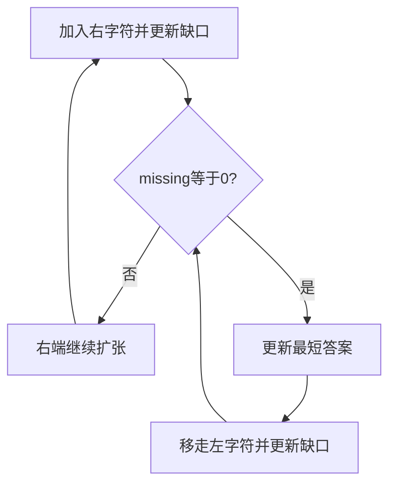

# 04 子串

本专题共3题。按简单、中等、困难稳定排序；同难度保留官方顺序。先复习算法附录中的对应结构，再学习各题的变量不变量与边界。

[560 和为 K 的子数组](#p560) | [239 滑动窗口最大值](#p239) | [76 最小覆盖子串](#p76)

<a id="p560"></a>
## 560. 和为 K 的子数组

### 1. 题目基本信息

|字段|内容|
|---|---|
|力扣题号|560|
|中文名称|和为 K 的子数组|
|难度|中等|
|算法专题|子串|
|官方原题|[和为 K 的子数组](https://leetcode.cn/problems/subarray-sum-equals-k/)|
|推荐前置知识|数组与下标、循环、方法与返回值、对象、引用与null、Map、HashMap、Map.getOrDefault(key, defaultValue)|

验证状态：已编译：是；本地测试：通过；LeetCode官方测试：未提交，未验证。

### 2. 题目描述

统计整数数组中和恰好等于k的连续子数组个数。允许负数和0；子数组非空。

输入与输出示例：`nums=[1,1,1], k=2 → 2`

### 3. 解题思路详细分析

**从直观方案开始**：枚举每个起点并累加到各终点，O(n²)。负数存在时不能使用普通伸缩窗口。

**推荐方案、变量含义与正确性依据**：前缀和sum表示当前之前所有数的总和。若历史前缀为sum-k，两者之间的子数组和就是k。Map保存各历史前缀出现次数，先查询再登记当前前缀；最初前缀0出现一次，以便统计从下标0开始的答案。

### 4. 完整 Java 解题代码

标准库导入列在代码开头；没有import表示仅使用java.lang自动导入类型及力扣节点。普通题使用`class Solution`，设计题保留指定类名。

```java
import java.util.*;
class Solution {
    public int subarraySum(int[] nums,int k) {
        Map<Integer,Integer> count=new HashMap<>();
        count.put(0,1); // 空前缀用于匹配从下标0开始的子数组
        int sum=0,ans=0;
        for(int x:nums) {
            sum+=x;
            ans+=count.getOrDefault(sum-k,0); // 统计所有匹配的历史前缀
            count.put(sum,count.getOrDefault(sum,0)+1);
        }
        return ans;
    }
}
```

### 5. Java 知识点详解

以下只复习本题实际出现的语法和关键API；数字锚点对应前面的Java基础章节。

- **数组与下标**（[基础第2节](../Java基础知识附录.md#java-2)）：固定长度容器；new int[n]初值为0，boolean初值false；a[i]读取或写入第i项。本题用数组承载输入或索引状态，索引必须在0..length-1；a.length是字段，不是方法。示例：int[] a={2,7}; a[0]为2。
- **循环**（[基础第3节](../Java基础知识附录.md#java-3)）：for控制初始化、条件、更新；while先判断再执行。本题循环反复处理元素或缩小区间；必须保证每轮有进展。i++先产生旧值再加1，例如a[i++]使用旧下标。增强for读取元素副本，给基本类型循环变量赋值不会改数组。
- **方法与返回值**（[基础第4节](../Java基础知识附录.md#java-4)）：方法参数声明输入类型，return表达式交还结果并结束当前调用，void方法可只写return。public入口供力扣调用，private辅助方法只供本类使用。递归时每层局部变量独立，集合参数传的是同一对象的引用值副本。
- **对象、引用与null**（[基础第21节](../Java基础知识附录.md#java-21)）：new创建对象；赋值p=q复制引用，不复制节点或集合。本题经引用修改对象内容，调用者可见；重新给参数赋new只改变局部参数。null没有可访问的字段或方法。对象==比较身份，String等内容要用equals。
- **Map、HashMap**（[基础第12节](../Java基础知识附录.md#java-12)）：Map<K,V>把每个键映射到一个值；put(k,v)写入并返回旧值，get(k)读取或返回null，containsKey(k)检查存在。本题按键快速定位信息；平均查找O(1)，遍历不保序。get缺失后直接拆箱int会空指针。
- **Map.getOrDefault(key, defaultValue)**（[基础第12节](../Java基础知识附录.md#java-12)）：键不存在时返回defaultValue，存在时返回其值，不自动修改Map。本题用默认0统计次数，例如count.put(x,count.getOrDefault(x,0)+1)。不能误以为查询默认值就已经插入了键。

### 6. 示例执行过程

对应本题示例或文中明确标出的同类小例子：

|步骤|扫描位置、变量或数据结构变化|
|---|---|
|1|初始{0:1}|
|2|第一个1，sum=1查-1无，存1|
|3|第二个1，sum=2查0有1个，ans=1|
|4|第三个1，sum=3查1有1个，ans=2|

### 7. 复杂度分析

- **时间**：O(n) 平均时间，单次遍历加平均 O(1) 哈希操作。
- **空间**：O(n) 空间保存前缀和频次。

复杂度中返回结果是否计入已明确说明；树高h、层宽w、总节点数N等规模按本题语境取值。哈希表相关分析使用平均情况；代码调用栈也计入辅助空间。

### 8. 常见错误和注意事项

1. 忘记初始0前缀。
2. Map必须存次数而非仅存是否出现。
3. 先登记会在k=0时统计空子数组。

### 9. 本题知识总结

- 核心思想：前缀和sum表示当前之前所有数的总和。
- Java重点：数组与下标、Map、HashMap、Map.getOrDefault(key, defaultValue)。
- 必会技巧：忘记初始0前缀。
- 推荐复习：遮住代码，用第6节的示例重走变量变化，再解释第3节的边界或状态含义，最后独立写出提交方法。

---

<a id="p239"></a>
## 239. 滑动窗口最大值

### 1. 题目基本信息

|字段|内容|
|---|---|
|力扣题号|239|
|中文名称|滑动窗口最大值|
|难度|困难|
|算法专题|子串|
|官方原题|[滑动窗口最大值](https://leetcode.cn/problems/sliding-window-maximum/)|
|推荐前置知识|数组与下标、循环、条件与短路、方法与返回值、对象、引用与null、Deque、ArrayDeque、双端队列的首尾API|

验证状态：已编译：是；本地测试：通过；LeetCode官方测试：未提交，未验证。

### 2. 题目描述

窗口长度k每次右移一格，返回每个完整窗口的最大值。1≤k≤数组长度。

输入与输出示例：`[1,3,-1,-3,5,3,6,7], k=3 → [3,3,5,5,6,7]`

### 3. 解题思路详细分析

**从直观方案开始**：每个窗口重新扫描 O(nk)。

**推荐方案、变量含义与正确性依据**：双端队列存下标，并让对应值从队首到队尾递减。队首过期就弹出；新值比队尾大或相等时，旧队尾既更小又更早过期，可以永久删除。当前下标入队，窗口形成后队首就是最大值。

### 4. 完整 Java 解题代码

标准库导入列在代码开头；没有import表示仅使用java.lang自动导入类型及力扣节点。普通题使用`class Solution`，设计题保留指定类名。

```java
import java.util.*;
class Solution {
    public int[] maxSlidingWindow(int[] nums,int k) {
        int[] ans=new int[nums.length-k+1];
        Deque<Integer> q=new ArrayDeque<>();
        for(int i=0;i<nums.length;i++) {
            while(!q.isEmpty() && q.peekFirst()<=i-k) q.removeFirst(); // 去掉过期下标
            while(!q.isEmpty() && nums[q.peekLast()]<=nums[i]) q.removeLast();
            q.addLast(i); // 保留从大到小的候选
            if(i>=k-1) ans[i-k+1]=nums[q.peekFirst()];
        }
        return ans;
    }
}
```

### 5. Java 知识点详解

以下只复习本题实际出现的语法和关键API；数字锚点对应前面的Java基础章节。

- **数组与下标**（[基础第2节](../Java基础知识附录.md#java-2)）：固定长度容器；new int[n]初值为0，boolean初值false；a[i]读取或写入第i项。本题用数组承载输入或索引状态，索引必须在0..length-1；a.length是字段，不是方法。示例：int[] a={2,7}; a[0]为2。
- **循环**（[基础第3节](../Java基础知识附录.md#java-3)）：for控制初始化、条件、更新；while先判断再执行。本题循环反复处理元素或缩小区间；必须保证每轮有进展。i++先产生旧值再加1，例如a[i++]使用旧下标。增强for读取元素副本，给基本类型循环变量赋值不会改数组。
- **条件与短路**（[基础第3节](../Java基础知识附录.md#java-3)）：if仅在boolean条件为true时执行；条件?A:B只求被选择的一个分支。&&左侧false不算右侧，||左侧true不算右侧；本题利用它们保护边界或选择算法分支。检查p!=null须放在读取p.next之前。
- **方法与返回值**（[基础第4节](../Java基础知识附录.md#java-4)）：方法参数声明输入类型，return表达式交还结果并结束当前调用，void方法可只写return。public入口供力扣调用，private辅助方法只供本类使用。递归时每层局部变量独立，集合参数传的是同一对象的引用值副本。
- **对象、引用与null**（[基础第21节](../Java基础知识附录.md#java-21)）：new创建对象；赋值p=q复制引用，不复制节点或集合。本题经引用修改对象内容，调用者可见；重新给参数赋new只改变局部参数。null没有可访问的字段或方法。对象==比较身份，String等内容要用equals。
- **Deque、ArrayDeque**（[基础第14节](../Java基础知识附录.md#java-14)）：Deque支持两端操作，ArrayDeque是数组实现且不能存null。本题将其作为栈、队列或单调候选容器。isEmpty()检查是否为空，size()返回元素数；两端写操作摊还O(1)，不要在中间位置做线性删除来破坏复杂度。
- **双端队列的首尾API**（[基础第14节](../Java基础知识附录.md#java-14)）：addLast(x)尾部加入，removeFirst()/removeLast()删除并返回首/尾，peekFirst()/peekLast()只读取首/尾。本题分别淘汰过期队首和较差队尾，必须保持两端含义一致；remove前先检查非空。

### 6. 示例执行过程

对应本题示例或文中明确标出的同类小例子：

|步骤|扫描位置、变量或数据结构变化|
|---|---|
|1|i=0队列[0]|
|2|i=1值3淘汰值1，队列[1]|
|3|i=2队列[1,2]，输出3|
|4|i=4值5淘汰所有较小尾部，输出5|

### 7. 复杂度分析

- **时间**：O(n) 时间，每个下标入队一次、出队至多一次。
- **空间**：O(k) 空间保存窗口候选，不含输出。

复杂度中返回结果是否计入已明确说明；树高h、层宽w、总节点数N等规模按本题语境取值。哈希表相关分析使用平均情况；代码调用栈也计入辅助空间。

### 8. 常见错误和注意事项

1. 必须保存下标才能判断过期。
2. 过期条件是下标≤i-k。
3. 结果从i=k-1开始写。

### 9. 本题知识总结

- 核心思想：双端队列存下标，并让对应值从队首到队尾递减。
- Java重点：数组与下标、Deque、ArrayDeque、双端队列的首尾API。
- 必会技巧：必须保存下标才能判断过期。
- 推荐复习：遮住代码，用第6节的示例重走变量变化，再解释第3节的边界或状态含义，最后独立写出提交方法。

---

<a id="p76"></a>
## 76. 最小覆盖子串

### 1. 题目基本信息

|字段|内容|
|---|---|
|力扣题号|76|
|中文名称|最小覆盖子串|
|难度|困难|
|算法专题|子串|
|官方原题|[最小覆盖子串](https://leetcode.cn/problems/minimum-window-substring/)|
|推荐前置知识|数组与下标、循环、条件与短路、方法与返回值、对象、引用与null、String、String.charAt(index)|

验证状态：已编译：是；本地测试：通过；LeetCode官方测试：未提交，未验证。

### 2. 题目描述

在s中找最短连续子串，覆盖t中的全部字符及其重复次数。无解返回空串；字符按题目英文字母范围计数。

输入与输出示例：`s="ADOBECODEBANC", t="ABC" → "BANC"`

### 3. 解题思路详细分析

**从直观方案开始**：枚举所有子串再检查覆盖，代价很高。

**推荐方案、变量含义与正确性依据**：need[c]记录还缺多少个字符c，missing记录缺少字符总数。扩张右端时，若need[c]>0就满足一个缺口，然后递减need[c]。missing为0时窗口覆盖成功，循环收缩左端并更新最短答案；移出字符后need变正，说明丢失了必要字符，停止收缩。负计数代表多余字符。

执行流程图：



### 4. 完整 Java 解题代码

标准库导入列在代码开头；没有import表示仅使用java.lang自动导入类型及力扣节点。普通题使用`class Solution`，设计题保留指定类名。

```java
class Solution {
    public String minWindow(String s,String t) {
        if(t.isEmpty()) return "";
        int[] need=new int[128];
        for(char c:t.toCharArray()) need[c]++;
        int missing=t.length(),left=0,start=0,best=Integer.MAX_VALUE;
        for(int right=0;right<s.length();right++) {
            char c=s.charAt(right);
            if(need[c]>0) missing--;
            need[c]--; // 负数代表窗口中有富余
            while(missing==0) {
                if(right-left+1<best) { best=right-left+1; start=left; }
                char out=s.charAt(left++);
                need[out]++;
                if(need[out]>0) missing++; // 移出了必要字符，覆盖失效
            }
        }
        return best==Integer.MAX_VALUE ? "" : s.substring(start,start+best);
    }
}
```

### 5. Java 知识点详解

以下只复习本题实际出现的语法和关键API；数字锚点对应前面的Java基础章节。

- **数组与下标**（[基础第2节](../Java基础知识附录.md#java-2)）：固定长度容器；new int[n]初值为0，boolean初值false；a[i]读取或写入第i项。本题用数组承载输入或索引状态，索引必须在0..length-1；a.length是字段，不是方法。示例：int[] a={2,7}; a[0]为2。
- **循环**（[基础第3节](../Java基础知识附录.md#java-3)）：for控制初始化、条件、更新；while先判断再执行。本题循环反复处理元素或缩小区间；必须保证每轮有进展。i++先产生旧值再加1，例如a[i++]使用旧下标。增强for读取元素副本，给基本类型循环变量赋值不会改数组。
- **条件与短路**（[基础第3节](../Java基础知识附录.md#java-3)）：if仅在boolean条件为true时执行；条件?A:B只求被选择的一个分支。&&左侧false不算右侧，||左侧true不算右侧；本题利用它们保护边界或选择算法分支。检查p!=null须放在读取p.next之前。
- **方法与返回值**（[基础第4节](../Java基础知识附录.md#java-4)）：方法参数声明输入类型，return表达式交还结果并结束当前调用，void方法可只写return。public入口供力扣调用，private辅助方法只供本类使用。递归时每层局部变量独立，集合参数传的是同一对象的引用值副本。
- **对象、引用与null**（[基础第21节](../Java基础知识附录.md#java-21)）：new创建对象；赋值p=q复制引用，不复制节点或集合。本题经引用修改对象内容，调用者可见；重新给参数赋new只改变局部参数。null没有可访问的字段或方法。对象==比较身份，String等内容要用equals。
- **String**（[基础第10节](../Java基础知识附录.md#java-10)）：不可变字符序列；length()返回字符单元数，equals比较文本。作为本题输入、键或结果；修改内容须创建新String或用StringBuilder。String==只比较引用，不能替代内容比较。
- **String.charAt(index)**（[基础第10节](../Java基础知识附录.md#java-10)）：传入0到length()-1的下标，返回对应char。本题逐字符扫描或检查两端。越界抛异常；char是UTF-16单元，本题实现按题目保证的字符范围处理，不声称覆盖任意Unicode字符。
- **String.toCharArray()**（[基础第10节](../Java基础知识附录.md#java-10)）：把字符串复制为新的char[]，可修改或排序。本题用增强for遍历字符或排序生成特征键；排序数组不会修改原字符串。char数组直接toString()不是内容，要new String(chars)。
- **String.substring(begin, end)**（[基础第10节](../Java基础知识附录.md#java-10)）：返回左闭右开[begin,end)的子串，长度end-begin。本题构造结果片段或查询候选单词；闭区间结尾j需传j+1。Java 17会复制子串内容，不能把创建与哈希代价一概算成O(1)。
- **整数边界与数值提升**（[基础第1节](../Java基础知识附录.md#java-1)）：Integer常量为32位上下界，Long为64位上下界。本题作为初始最优值、哨兵或安全边界。MIN_VALUE取负会溢出；相加前转long/double而非运算后再转换，例如((double)a+b)/2避免int加法溢出。

### 6. 示例执行过程

对应本题示例或文中明确标出的同类小例子：

|步骤|扫描位置、变量或数据结构变化|
|---|---|
|1|右端到C时ADOBEC首次覆盖ABC，记录长度6|
|2|收缩丢掉A后不再覆盖|
|3|后面补A再次收缩|
|4|最终BANC长度4，继续收缩会丢B|

### 7. 复杂度分析

- **时间**：O(|s|+|t|) 时间，每个字符进出窗口至多一次。
- **空间**：O(128)=O(1) 空间，依赖英文字母输入约束。

复杂度中返回结果是否计入已明确说明；树高h、层宽w、总节点数N等规模按本题语境取值。哈希表相关分析使用平均情况；代码调用栈也计入辅助空间。

### 8. 常见错误和注意事项

1. 不能只比较不同字符种类，t可重复。
2. 收缩须使用while。
3. 返回substring的右端是排他下标。

### 9. 本题知识总结

- 核心思想：need[c]记录还缺多少个字符c，missing记录缺少字符总数。
- Java重点：数组与下标、String、String.charAt(index)、String.toCharArray()、String.substring(begin, end)、整数边界与数值提升。
- 必会技巧：不能只比较不同字符种类，t可重复。
- 推荐复习：遮住代码，用第6节的示例重走变量变化，再解释第3节的边界或状态含义，最后独立写出提交方法。

---

