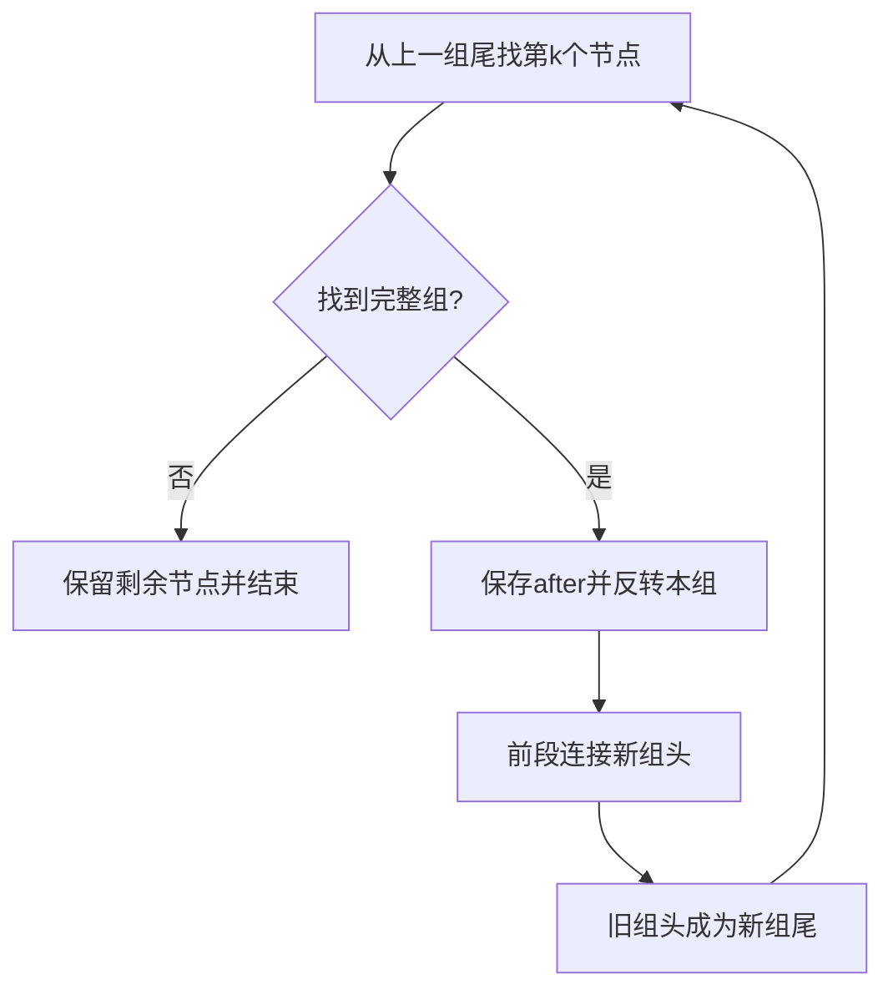

# 07 链表

本专题共14题。按简单、中等、困难稳定排序；同难度保留官方顺序。先复习算法附录中的对应结构，再学习各题的变量不变量与边界。

[160 相交链表](#p160) | [206 反转链表](#p206) | [234 回文链表](#p234) | [141 环形链表](#p141) | [21 合并两个有序链表](#p21) | [142 环形链表 II](#p142) | [2 两数相加](#p2) | [19 删除链表的倒数第 N 个结点](#p19) | [24 两两交换链表中的节点](#p24) | [138 随机链表的复制](#p138) | [148 排序链表](#p148) | [146 LRU 缓存](#p146) | [25 K 个一组翻转链表](#p25) | [23 合并 K 个升序链表](#p23)

<a id="p160"></a>
## 160. 相交链表

### 1. 题目基本信息

|字段|内容|
|---|---|
|力扣题号|160|
|中文名称|相交链表|
|难度|简单|
|算法专题|链表|
|官方原题|[相交链表](https://leetcode.cn/problems/intersection-of-two-linked-lists/)|
|推荐前置知识|循环、条件与短路、方法与返回值、对象、引用与null|

验证状态：已编译：是；本地测试：通过；LeetCode官方测试：未提交，未验证。

### 2. 题目描述

给两个无环单链表，返回第一个公共节点对象；没有交点返回null。公共指的是同一对象，不只是值相等。

输入与输出示例：`A=1→8→9，B=2→3→8→9，其中8节点共享 → 返回共享8节点`

### 3. 解题思路详细分析

**从直观方案开始**：用集合存A的节点，再扫描B，额外空间O(m)。

**推荐方案、变量含义与正确性依据**：指针p走完A后改走B，q走完B后改走A。两人走过总长度相同，前段长度差被抵消；有交点时在公共后缀入口相遇，无交点时最终同时为null。循环比较节点引用。

### 4. 完整 Java 解题代码

标准库导入列在代码开头；没有import表示仅使用java.lang自动导入类型及力扣节点。普通题使用`class Solution`，设计题保留指定类名。

力扣提供`ListNode`节点，核心字段为`int val`和`ListNode next`，常用构造为`ListNode(int val)`及`ListNode(int val, ListNode next)`。`next==null`表示尾部。下面的提交代码直接引用它；本地测试定义在tests文件中，提交时不要重复粘贴。

```java
class Solution {
    public ListNode getIntersectionNode(ListNode headA,ListNode headB) {
        ListNode p=headA,q=headB;
        while(p!=q) {
            p=(p==null)?headB:p.next; // 走完自己的链后换另一条链
            q=(q==null)?headA:q.next;
        }
        return p; // 无交点时两者都为null
    }
}
```

### 5. Java 知识点详解

以下只复习本题实际出现的语法和关键API；数字锚点对应前面的Java基础章节。

- **循环**（[基础第3节](../Java基础知识附录.md#java-3)）：for控制初始化、条件、更新；while先判断再执行。本题循环反复处理元素或缩小区间；必须保证每轮有进展。i++先产生旧值再加1，例如a[i++]使用旧下标。增强for读取元素副本，给基本类型循环变量赋值不会改数组。
- **条件与短路**（[基础第3节](../Java基础知识附录.md#java-3)）：if仅在boolean条件为true时执行；条件?A:B只求被选择的一个分支。&&左侧false不算右侧，||左侧true不算右侧；本题利用它们保护边界或选择算法分支。检查p!=null须放在读取p.next之前。
- **方法与返回值**（[基础第4节](../Java基础知识附录.md#java-4)）：方法参数声明输入类型，return表达式交还结果并结束当前调用，void方法可只写return。public入口供力扣调用，private辅助方法只供本类使用。递归时每层局部变量独立，集合参数传的是同一对象的引用值副本。
- **对象、引用与null**（[基础第21节](../Java基础知识附录.md#java-21)）：new创建对象；赋值p=q复制引用，不复制节点或集合。本题经引用修改对象内容，调用者可见；重新给参数赋new只改变局部参数。null没有可访问的字段或方法。对象==比较身份，String等内容要用equals。

### 6. 示例执行过程

对应本题示例或文中明确标出的同类小例子：

|步骤|扫描位置、变量或数据结构变化|
|---|---|
|1|A独有1个节点，B独有2个|
|2|p先经过公共8、9再切B，q走完B再切A|
|3|第二轮进入共享8时同步，返回该对象|

### 7. 复杂度分析

- **时间**：O(m+n) 时间，每个指针至多走两条链。
- **空间**：O(1) 空间。

复杂度中返回结果是否计入已明确说明；树高h、层宽w、总节点数N等规模按本题语境取值。哈希表相关分析使用平均情况；代码调用栈也计入辅助空间。

### 8. 常见错误和注意事项

1. 用==比较对象引用而非val。
2. 切换应发生在指针为null时。
3. 题目要求链表无环。

### 9. 本题知识总结

- 核心思想：指针p走完A后改走B，q走完B后改走A。
- Java重点：。
- 必会技巧：用==比较对象引用而非val。
- 推荐复习：遮住代码，用第6节的示例重走变量变化，再解释第3节的边界或状态含义，最后独立写出提交方法。

---

<a id="p206"></a>
## 206. 反转链表

### 1. 题目基本信息

|字段|内容|
|---|---|
|力扣题号|206|
|中文名称|反转链表|
|难度|简单|
|算法专题|链表|
|官方原题|[反转链表](https://leetcode.cn/problems/reverse-linked-list/)|
|推荐前置知识|循环、方法与返回值、对象、引用与null|

验证状态：已编译：是；本地测试：通过；LeetCode官方测试：未提交，未验证。

### 2. 题目描述

反转单链表，返回新头节点；空链表返回null。节点对象沿用原链表。

输入与输出示例：`1→2→3 → 3→2→1`

### 3. 解题思路详细分析

**从直观方案开始**：把节点放栈后重新连接可行，但多用O(n)空间。

**推荐方案、变量含义与正确性依据**：prev是已经反转的前段头，cur是未处理后段头。先保存next，再令cur.next指向prev，最后一起向前推进。终止时cur为null，prev就是新头。

### 4. 完整 Java 解题代码

标准库导入列在代码开头；没有import表示仅使用java.lang自动导入类型及力扣节点。普通题使用`class Solution`，设计题保留指定类名。

力扣提供`ListNode`节点，核心字段为`int val`和`ListNode next`，常用构造为`ListNode(int val)`及`ListNode(int val, ListNode next)`。`next==null`表示尾部。下面的提交代码直接引用它；本地测试定义在tests文件中，提交时不要重复粘贴。

```java
class Solution {
    public ListNode reverseList(ListNode head) {
        ListNode prev=null,cur=head;
        while(cur!=null) {
            ListNode next=cur.next; // 修改链接前保存后继
            cur.next=prev;
            prev=cur; cur=next; // 已反转区域向右扩展一个节点
        }
        return prev;
    }
}
```

### 5. Java 知识点详解

以下只复习本题实际出现的语法和关键API；数字锚点对应前面的Java基础章节。

- **循环**（[基础第3节](../Java基础知识附录.md#java-3)）：for控制初始化、条件、更新；while先判断再执行。本题循环反复处理元素或缩小区间；必须保证每轮有进展。i++先产生旧值再加1，例如a[i++]使用旧下标。增强for读取元素副本，给基本类型循环变量赋值不会改数组。
- **方法与返回值**（[基础第4节](../Java基础知识附录.md#java-4)）：方法参数声明输入类型，return表达式交还结果并结束当前调用，void方法可只写return。public入口供力扣调用，private辅助方法只供本类使用。递归时每层局部变量独立，集合参数传的是同一对象的引用值副本。
- **对象、引用与null**（[基础第21节](../Java基础知识附录.md#java-21)）：new创建对象；赋值p=q复制引用，不复制节点或集合。本题经引用修改对象内容，调用者可见；重新给参数赋new只改变局部参数。null没有可访问的字段或方法。对象==比较身份，String等内容要用equals。

### 6. 示例执行过程

对应本题示例或文中明确标出的同类小例子：

|步骤|扫描位置、变量或数据结构变化|
|---|---|
|1|初始prev=null,cur=1|
|2|处理1后1→null|
|3|处理2后2→1|
|4|处理3后3→2→1，cur=null返回3|

### 7. 复杂度分析

- **时间**：O(n) 时间，每个节点修改一次next。
- **空间**：O(1) 空间，只存三个引用。

复杂度中返回结果是否计入已明确说明；树高h、层宽w、总节点数N等规模按本题语境取值。哈希表相关分析使用平均情况；代码调用栈也计入辅助空间。

### 8. 常见错误和注意事项

1. 必须先保存next否则丢失后半段。
2. 返回prev而非旧head。
3. 尾节点next要最终变为null。

### 9. 本题知识总结

- 核心思想：prev是已经反转的前段头，cur是未处理后段头。
- Java重点：。
- 必会技巧：必须先保存next否则丢失后半段。
- 推荐复习：遮住代码，用第6节的示例重走变量变化，再解释第3节的边界或状态含义，最后独立写出提交方法。

---

<a id="p234"></a>
## 234. 回文链表

### 1. 题目基本信息

|字段|内容|
|---|---|
|力扣题号|234|
|中文名称|回文链表|
|难度|简单|
|算法专题|链表|
|官方原题|[回文链表](https://leetcode.cn/problems/palindrome-linked-list/)|
|推荐前置知识|循环、条件与短路、方法与返回值、对象、引用与null|

验证状态：已编译：是；本地测试：通过；LeetCode官方测试：未提交，未验证。

### 2. 题目描述

判断单链表的值序列是否回文。返回布尔值，空链表也视为回文。

输入与输出示例：`1→2→2→1 → true`

### 3. 解题思路详细分析

**从直观方案开始**：复制值到数组再双指针比较，空间O(n)。

**推荐方案、变量含义与正确性依据**：快慢指针找前半段尾节点；反转后半段，用左右指针逐个比较；无论相等与否都把后半段再反转接回，恢复输入。只比较后半段长度，奇数链表中点自然忽略。

### 4. 完整 Java 解题代码

标准库导入列在代码开头；没有import表示仅使用java.lang自动导入类型及力扣节点。普通题使用`class Solution`，设计题保留指定类名。

力扣提供`ListNode`节点，核心字段为`int val`和`ListNode next`，常用构造为`ListNode(int val)`及`ListNode(int val, ListNode next)`。`next==null`表示尾部。下面的提交代码直接引用它；本地测试定义在tests文件中，提交时不要重复粘贴。

```java
class Solution {
    public boolean isPalindrome(ListNode head) {
        if(head==null || head.next==null) return true;
        ListNode slow=head,fast=head;
        while(fast.next!=null && fast.next.next!=null) { slow=slow.next; fast=fast.next.next; }
        ListNode right=reverse(slow.next),p=head,q=right;
        boolean ok=true;
        while(q!=null) {
            if(p.val!=q.val) ok=false;
            p=p.next; q=q.next;
        }
        slow.next=reverse(right); // 判断后恢复原链表
        return ok;
    }
    private ListNode reverse(ListNode cur) {
        ListNode prev=null;
        while(cur!=null) { ListNode next=cur.next; cur.next=prev; prev=cur; cur=next; }
        return prev;
    }
}
```

### 5. Java 知识点详解

以下只复习本题实际出现的语法和关键API；数字锚点对应前面的Java基础章节。

- **循环**（[基础第3节](../Java基础知识附录.md#java-3)）：for控制初始化、条件、更新；while先判断再执行。本题循环反复处理元素或缩小区间；必须保证每轮有进展。i++先产生旧值再加1，例如a[i++]使用旧下标。增强for读取元素副本，给基本类型循环变量赋值不会改数组。
- **条件与短路**（[基础第3节](../Java基础知识附录.md#java-3)）：if仅在boolean条件为true时执行；条件?A:B只求被选择的一个分支。&&左侧false不算右侧，||左侧true不算右侧；本题利用它们保护边界或选择算法分支。检查p!=null须放在读取p.next之前。
- **方法与返回值**（[基础第4节](../Java基础知识附录.md#java-4)）：方法参数声明输入类型，return表达式交还结果并结束当前调用，void方法可只写return。public入口供力扣调用，private辅助方法只供本类使用。递归时每层局部变量独立，集合参数传的是同一对象的引用值副本。
- **对象、引用与null**（[基础第21节](../Java基础知识附录.md#java-21)）：new创建对象；赋值p=q复制引用，不复制节点或集合。本题经引用修改对象内容，调用者可见；重新给参数赋new只改变局部参数。null没有可访问的字段或方法。对象==比较身份，String等内容要用equals。

### 6. 示例执行过程

对应本题示例或文中明确标出的同类小例子：

|步骤|扫描位置、变量或数据结构变化|
|---|---|
|1|1→2→2→1中slow停前一个2|
|2|后半段2→1反转成1→2|
|3|比较1=1、2=2|
|4|反转回来，返回true|

### 7. 复杂度分析

- **时间**：O(n) 时间，找中点、两次反转和比较均线性。
- **空间**：O(1) 额外空间。

复杂度中返回结果是否计入已明确说明；树高h、层宽w、总节点数N等规模按本题语境取值。哈希表相关分析使用平均情况；代码调用栈也计入辅助空间。

### 8. 常见错误和注意事项

1. 奇数中点不参与配对。
2. 不能反转前丢失后半段入口。
3. 提前return会跳过恢复操作。

### 9. 本题知识总结

- 核心思想：快慢指针找前半段尾节点；反转后半段，用左右指针逐个比较；无论相等与否都把后半段再反转接回，恢复输入。
- Java重点：。
- 必会技巧：奇数中点不参与配对。
- 推荐复习：遮住代码，用第6节的示例重走变量变化，再解释第3节的边界或状态含义，最后独立写出提交方法。

---

<a id="p141"></a>
## 141. 环形链表

### 1. 题目基本信息

|字段|内容|
|---|---|
|力扣题号|141|
|中文名称|环形链表|
|难度|简单|
|算法专题|链表|
|官方原题|[环形链表](https://leetcode.cn/problems/linked-list-cycle/)|
|推荐前置知识|循环、条件与短路、方法与返回值、对象、引用与null|

验证状态：已编译：是；本地测试：通过；LeetCode官方测试：未提交，未验证。

### 2. 题目描述

判断单链表是否有环。环指沿next最终回到之前的同一节点。不能根据重复值判断。

输入与输出示例：`1→2→3，3.next指向2 → true`

### 3. 解题思路详细分析

**从直观方案开始**：集合记录访问过的节点，空间O(n)。

**推荐方案、变量含义与正确性依据**：慢指针每次一步，快指针两步。若没有环，快指针先到null；若有环，两者在环内的相对距离每轮缩小一格，必然相遇。先移动再比较，避免初始都在头部被误判。

### 4. 完整 Java 解题代码

标准库导入列在代码开头；没有import表示仅使用java.lang自动导入类型及力扣节点。普通题使用`class Solution`，设计题保留指定类名。

力扣提供`ListNode`节点，核心字段为`int val`和`ListNode next`，常用构造为`ListNode(int val)`及`ListNode(int val, ListNode next)`。`next==null`表示尾部。下面的提交代码直接引用它；本地测试定义在tests文件中，提交时不要重复粘贴。

```java
class Solution {
    public boolean hasCycle(ListNode head) {
        ListNode slow=head,fast=head;
        while(fast!=null && fast.next!=null) {
            slow=slow.next; fast=fast.next.next;
            if(slow==fast) return true; // 移动后才判断是否相遇
        }
        return false;
    }
}
```

### 5. Java 知识点详解

以下只复习本题实际出现的语法和关键API；数字锚点对应前面的Java基础章节。

- **循环**（[基础第3节](../Java基础知识附录.md#java-3)）：for控制初始化、条件、更新；while先判断再执行。本题循环反复处理元素或缩小区间；必须保证每轮有进展。i++先产生旧值再加1，例如a[i++]使用旧下标。增强for读取元素副本，给基本类型循环变量赋值不会改数组。
- **条件与短路**（[基础第3节](../Java基础知识附录.md#java-3)）：if仅在boolean条件为true时执行；条件?A:B只求被选择的一个分支。&&左侧false不算右侧，||左侧true不算右侧；本题利用它们保护边界或选择算法分支。检查p!=null须放在读取p.next之前。
- **方法与返回值**（[基础第4节](../Java基础知识附录.md#java-4)）：方法参数声明输入类型，return表达式交还结果并结束当前调用，void方法可只写return。public入口供力扣调用，private辅助方法只供本类使用。递归时每层局部变量独立，集合参数传的是同一对象的引用值副本。
- **对象、引用与null**（[基础第21节](../Java基础知识附录.md#java-21)）：new创建对象；赋值p=q复制引用，不复制节点或集合。本题经引用修改对象内容，调用者可见；重新给参数赋new只改变局部参数。null没有可访问的字段或方法。对象==比较身份，String等内容要用equals。

### 6. 示例执行过程

对应本题示例或文中明确标出的同类小例子：

|步骤|扫描位置、变量或数据结构变化|
|---|---|
|1|环2→3→2：第一轮slow=2,fast=3|
|2|第二轮slow=3,fast=3，相遇返回true|

### 7. 复杂度分析

- **时间**：O(n) 时间，入环及追赶均线性。
- **空间**：O(1) 空间。

复杂度中返回结果是否计入已明确说明；树高h、层宽w、总节点数N等规模按本题语境取值。哈希表相关分析使用平均情况；代码调用栈也计入辅助空间。

### 8. 常见错误和注意事项

1. 先检查fast及fast.next再走两步。
2. 比较引用。
3. 初始相同不代表有环。

### 9. 本题知识总结

- 核心思想：慢指针每次一步，快指针两步。
- Java重点：。
- 必会技巧：先检查fast及fast.next再走两步。
- 推荐复习：遮住代码，用第6节的示例重走变量变化，再解释第3节的边界或状态含义，最后独立写出提交方法。

---

<a id="p21"></a>
## 21. 合并两个有序链表

### 1. 题目基本信息

|字段|内容|
|---|---|
|力扣题号|21|
|中文名称|合并两个有序链表|
|难度|简单|
|算法专题|链表|
|官方原题|[合并两个有序链表](https://leetcode.cn/problems/merge-two-sorted-lists/)|
|推荐前置知识|循环、条件与短路、方法与返回值、对象、引用与null|

验证状态：已编译：是；本地测试：通过；LeetCode官方测试：未提交，未验证。

### 2. 题目描述

合并两条升序链表并返回升序新链的头。可以重连原节点；任一输入可为空。

输入与输出示例：`1→2→4 与 1→3→4 → 1→1→2→3→4→4`

### 3. 解题思路详细分析

**从直观方案开始**：把所有值收集排序再建链，额外成本更高。

**推荐方案、变量含义与正确性依据**：使用虚拟头dummy和尾指针tail，每轮比较两条链的头，把较小者接到tail后并推进该链；tail向后移。某条链为空后，剩余链本来有序，直接整体接上。

### 4. 完整 Java 解题代码

标准库导入列在代码开头；没有import表示仅使用java.lang自动导入类型及力扣节点。普通题使用`class Solution`，设计题保留指定类名。

力扣提供`ListNode`节点，核心字段为`int val`和`ListNode next`，常用构造为`ListNode(int val)`及`ListNode(int val, ListNode next)`。`next==null`表示尾部。下面的提交代码直接引用它；本地测试定义在tests文件中，提交时不要重复粘贴。

```java
class Solution {
    public ListNode mergeTwoLists(ListNode list1,ListNode list2) {
        ListNode dummy=new ListNode(0),tail=dummy;
        while(list1!=null && list2!=null) {
            if(list1.val<=list2.val) { tail.next=list1; list1=list1.next; }
            else { tail.next=list2; list2=list2.next; }
            tail=tail.next; // 保持tail为已经合并部分的尾
        }
        tail.next=(list1!=null)?list1:list2;
        return dummy.next;
    }
}
```

### 5. Java 知识点详解

以下只复习本题实际出现的语法和关键API；数字锚点对应前面的Java基础章节。

- **循环**（[基础第3节](../Java基础知识附录.md#java-3)）：for控制初始化、条件、更新；while先判断再执行。本题循环反复处理元素或缩小区间；必须保证每轮有进展。i++先产生旧值再加1，例如a[i++]使用旧下标。增强for读取元素副本，给基本类型循环变量赋值不会改数组。
- **条件与短路**（[基础第3节](../Java基础知识附录.md#java-3)）：if仅在boolean条件为true时执行；条件?A:B只求被选择的一个分支。&&左侧false不算右侧，||左侧true不算右侧；本题利用它们保护边界或选择算法分支。检查p!=null须放在读取p.next之前。
- **方法与返回值**（[基础第4节](../Java基础知识附录.md#java-4)）：方法参数声明输入类型，return表达式交还结果并结束当前调用，void方法可只写return。public入口供力扣调用，private辅助方法只供本类使用。递归时每层局部变量独立，集合参数传的是同一对象的引用值副本。
- **对象、引用与null**（[基础第21节](../Java基础知识附录.md#java-21)）：new创建对象；赋值p=q复制引用，不复制节点或集合。本题经引用修改对象内容，调用者可见；重新给参数赋new只改变局部参数。null没有可访问的字段或方法。对象==比较身份，String等内容要用equals。

### 6. 示例执行过程

对应本题示例或文中明确标出的同类小例子：

|步骤|扫描位置、变量或数据结构变化|
|---|---|
|1|先取第一条的1，再取第二条的1，再2、3、4|
|2|剩余4直接接尾，dummy.next指向第一个1|

### 7. 复杂度分析

- **时间**：O(m+n) 时间，每个节点至多被比较连接一次。
- **空间**：O(1) 额外空间，复用节点。

复杂度中返回结果是否计入已明确说明；树高h、层宽w、总节点数N等规模按本题语境取值。哈希表相关分析使用平均情况；代码调用栈也计入辅助空间。

### 8. 常见错误和注意事项

1. 返回dummy.next。
2. 接节点后要推进来源链。
3. 输入应是两条独立无环链。

### 9. 本题知识总结

- 核心思想：使用虚拟头dummy和尾指针tail，每轮比较两条链的头，把较小者接到tail后并推进该链；tail向后移。
- Java重点：。
- 必会技巧：返回dummy.next。
- 推荐复习：遮住代码，用第6节的示例重走变量变化，再解释第3节的边界或状态含义，最后独立写出提交方法。

---

<a id="p142"></a>
## 142. 环形链表 II

### 1. 题目基本信息

|字段|内容|
|---|---|
|力扣题号|142|
|中文名称|环形链表 II|
|难度|中等|
|算法专题|链表|
|官方原题|[环形链表 II](https://leetcode.cn/problems/linked-list-cycle-ii/)|
|推荐前置知识|循环、条件与短路、方法与返回值、对象、引用与null|

验证状态：已编译：是；本地测试：通过；LeetCode官方测试：未提交，未验证。

### 2. 题目描述

有环则返回环的入口节点，无环返回null；不允许修改链表结构。

输入与输出示例：`1→2→3→4，4.next指向2 → 返回节点2`

### 3. 解题思路详细分析

**从直观方案开始**：用集合找到第一次重复访问的节点，空间O(n)。

**推荐方案、变量含义与正确性依据**：第一阶段快慢指针相遇；第二阶段把一个指针放回head，另一个留在相遇点，两者每次走一步，再次相遇处是入口。若入口前距离a、相遇点到入口沿环剩余距离c，则快慢步数关系推出a与c模环长同余，因此同步走到入口。无环时直接返回null。

### 4. 完整 Java 解题代码

标准库导入列在代码开头；没有import表示仅使用java.lang自动导入类型及力扣节点。普通题使用`class Solution`，设计题保留指定类名。

力扣提供`ListNode`节点，核心字段为`int val`和`ListNode next`，常用构造为`ListNode(int val)`及`ListNode(int val, ListNode next)`。`next==null`表示尾部。下面的提交代码直接引用它；本地测试定义在tests文件中，提交时不要重复粘贴。

```java
class Solution {
    public ListNode detectCycle(ListNode head) {
        ListNode slow=head,fast=head;
        while(fast!=null && fast.next!=null) {
            slow=slow.next; fast=fast.next.next;
            if(slow==fast) {
                ListNode p=head;
                while(p!=slow) { p=p.next; slow=slow.next; } // 同速定位入口
                return p;
            }
        }
        return null;
    }
}
```

### 5. Java 知识点详解

以下只复习本题实际出现的语法和关键API；数字锚点对应前面的Java基础章节。

- **循环**（[基础第3节](../Java基础知识附录.md#java-3)）：for控制初始化、条件、更新；while先判断再执行。本题循环反复处理元素或缩小区间；必须保证每轮有进展。i++先产生旧值再加1，例如a[i++]使用旧下标。增强for读取元素副本，给基本类型循环变量赋值不会改数组。
- **条件与短路**（[基础第3节](../Java基础知识附录.md#java-3)）：if仅在boolean条件为true时执行；条件?A:B只求被选择的一个分支。&&左侧false不算右侧，||左侧true不算右侧；本题利用它们保护边界或选择算法分支。检查p!=null须放在读取p.next之前。
- **方法与返回值**（[基础第4节](../Java基础知识附录.md#java-4)）：方法参数声明输入类型，return表达式交还结果并结束当前调用，void方法可只写return。public入口供力扣调用，private辅助方法只供本类使用。递归时每层局部变量独立，集合参数传的是同一对象的引用值副本。
- **对象、引用与null**（[基础第21节](../Java基础知识附录.md#java-21)）：new创建对象；赋值p=q复制引用，不复制节点或集合。本题经引用修改对象内容，调用者可见；重新给参数赋new只改变局部参数。null没有可访问的字段或方法。对象==比较身份，String等内容要用equals。

### 6. 示例执行过程

对应本题示例或文中明确标出的同类小例子：

|步骤|扫描位置、变量或数据结构变化|
|---|---|
|1|1→2→3→4→2，快慢在4相遇|
|2|p回1，slow留4|
|3|同时一步后均到2，因此返回2|

### 7. 复杂度分析

- **时间**：O(n) 时间，两次有限追赶。
- **空间**：O(1) 空间。

复杂度中返回结果是否计入已明确说明；树高h、层宽w、总节点数N等规模按本题语境取值。哈希表相关分析使用平均情况；代码调用栈也计入辅助空间。

### 8. 常见错误和注意事项

1. 第二阶段两者都走一步。
2. 必须先确认有环。
3. 入口是对象引用而非入口值。

### 9. 本题知识总结

- 核心思想：第一阶段快慢指针相遇；第二阶段把一个指针放回head，另一个留在相遇点，两者每次走一步，再次相遇处是入口。
- Java重点：。
- 必会技巧：第二阶段两者都走一步。
- 推荐复习：遮住代码，用第6节的示例重走变量变化，再解释第3节的边界或状态含义，最后独立写出提交方法。

---

<a id="p2"></a>
## 2. 两数相加

### 1. 题目基本信息

|字段|内容|
|---|---|
|力扣题号|2|
|中文名称|两数相加|
|难度|中等|
|算法专题|链表|
|官方原题|[两数相加](https://leetcode.cn/problems/add-two-numbers/)|
|推荐前置知识|循环、条件与短路、方法与返回值、对象、引用与null|

验证状态：已编译：是；本地测试：通过；LeetCode官方测试：未提交，未验证。

### 2. 题目描述

两条链表按低位在前保存两个非负整数，返回同样格式的和。每节点是一位0..9，输入至少有一个节点。

输入与输出示例：`2→4→3 与 5→6→4 → 7→0→8（342+465=807）`

### 3. 解题思路详细分析

**从直观方案开始**：转成int后相加可能溢出，链表长度不受int位数限制。

**推荐方案、变量含义与正确性依据**：模拟竖式。循环条件包含任一链未结束或还有进位；把存在的位相加，加上carry，结果位为sum%10，新进位为sum/10。构造全新节点并连接。

### 4. 完整 Java 解题代码

标准库导入列在代码开头；没有import表示仅使用java.lang自动导入类型及力扣节点。普通题使用`class Solution`，设计题保留指定类名。

力扣提供`ListNode`节点，核心字段为`int val`和`ListNode next`，常用构造为`ListNode(int val)`及`ListNode(int val, ListNode next)`。`next==null`表示尾部。下面的提交代码直接引用它；本地测试定义在tests文件中，提交时不要重复粘贴。

```java
class Solution {
    public ListNode addTwoNumbers(ListNode l1,ListNode l2) {
        ListNode dummy=new ListNode(0),tail=dummy;
        int carry=0;
        while(l1!=null || l2!=null || carry!=0) {
            int sum=carry;
            if(l1!=null) { sum+=l1.val; l1=l1.next; }
            if(l2!=null) { sum+=l2.val; l2=l2.next; }
            tail.next=new ListNode(sum%10); // 当前十进制位
            tail=tail.next; carry=sum/10; // 进位传给下一轮
        }
        return dummy.next;
    }
}
```

### 5. Java 知识点详解

以下只复习本题实际出现的语法和关键API；数字锚点对应前面的Java基础章节。

- **循环**（[基础第3节](../Java基础知识附录.md#java-3)）：for控制初始化、条件、更新；while先判断再执行。本题循环反复处理元素或缩小区间；必须保证每轮有进展。i++先产生旧值再加1，例如a[i++]使用旧下标。增强for读取元素副本，给基本类型循环变量赋值不会改数组。
- **条件与短路**（[基础第3节](../Java基础知识附录.md#java-3)）：if仅在boolean条件为true时执行；条件?A:B只求被选择的一个分支。&&左侧false不算右侧，||左侧true不算右侧；本题利用它们保护边界或选择算法分支。检查p!=null须放在读取p.next之前。
- **方法与返回值**（[基础第4节](../Java基础知识附录.md#java-4)）：方法参数声明输入类型，return表达式交还结果并结束当前调用，void方法可只写return。public入口供力扣调用，private辅助方法只供本类使用。递归时每层局部变量独立，集合参数传的是同一对象的引用值副本。
- **对象、引用与null**（[基础第21节](../Java基础知识附录.md#java-21)）：new创建对象；赋值p=q复制引用，不复制节点或集合。本题经引用修改对象内容，调用者可见；重新给参数赋new只改变局部参数。null没有可访问的字段或方法。对象==比较身份，String等内容要用equals。

### 6. 示例执行过程

对应本题示例或文中明确标出的同类小例子：

|步骤|扫描位置、变量或数据结构变化|
|---|---|
|1|2+5=7写7进位0|
|2|4+6=10写0进位1|
|3|3+4+1=8写8|
|4|结束，返回7→0→8|

### 7. 复杂度分析

- **时间**：O(max(m,n)) 时间，逐位加法。
- **空间**：O(max(m,n)) 输出空间，除输出外O(1)。

复杂度中返回结果是否计入已明确说明；树高h、层宽w、总节点数N等规模按本题语境取值。哈希表相关分析使用平均情况；代码调用栈也计入辅助空间。

### 8. 常见错误和注意事项

1. 最后一位进位不能丢。
2. 链长可能不同。
3. 整数不能代替任意长数字链表。

### 9. 本题知识总结

- 核心思想：模拟竖式。
- Java重点：。
- 必会技巧：最后一位进位不能丢。
- 推荐复习：遮住代码，用第6节的示例重走变量变化，再解释第3节的边界或状态含义，最后独立写出提交方法。

---

<a id="p19"></a>
## 19. 删除链表的倒数第 N 个结点

### 1. 题目基本信息

|字段|内容|
|---|---|
|力扣题号|19|
|中文名称|删除链表的倒数第 N 个结点|
|难度|中等|
|算法专题|链表|
|官方原题|[删除链表的倒数第 N 个结点](https://leetcode.cn/problems/remove-nth-node-from-end-of-list/)|
|推荐前置知识|循环、方法与返回值、对象、引用与null|

验证状态：已编译：是；本地测试：通过；LeetCode官方测试：未提交，未验证。

### 2. 题目描述

删除单链表倒数第n个节点并返回头部，保证1≤n≤链表长度。可能删除原头节点。

输入与输出示例：`1→2→3→4→5, n=2 → 1→2→3→5`

### 3. 解题思路详细分析

**从直观方案开始**：先数长度，再定位正数第length-n+1个节点，需要两次遍历。

**推荐方案、变量含义与正确性依据**：建立dummy，fast和slow从dummy出发。fast先走n步，然后两个指针同时前进，直到fast位于尾节点；此时slow是待删节点的前驱。令slow.next跳过下一个节点。

### 4. 完整 Java 解题代码

标准库导入列在代码开头；没有import表示仅使用java.lang自动导入类型及力扣节点。普通题使用`class Solution`，设计题保留指定类名。

力扣提供`ListNode`节点，核心字段为`int val`和`ListNode next`，常用构造为`ListNode(int val)`及`ListNode(int val, ListNode next)`。`next==null`表示尾部。下面的提交代码直接引用它；本地测试定义在tests文件中，提交时不要重复粘贴。

```java
class Solution {
    public ListNode removeNthFromEnd(ListNode head,int n) {
        ListNode dummy=new ListNode(0,head),fast=dummy,slow=dummy;
        for(int i=0;i<n;i++) fast=fast.next; // 保持n个节点的间隔
        while(fast.next!=null) { fast=fast.next; slow=slow.next; }
        slow.next=slow.next.next; // slow指向被删除节点的前驱
        return dummy.next;
    }
}
```

### 5. Java 知识点详解

以下只复习本题实际出现的语法和关键API；数字锚点对应前面的Java基础章节。

- **循环**（[基础第3节](../Java基础知识附录.md#java-3)）：for控制初始化、条件、更新；while先判断再执行。本题循环反复处理元素或缩小区间；必须保证每轮有进展。i++先产生旧值再加1，例如a[i++]使用旧下标。增强for读取元素副本，给基本类型循环变量赋值不会改数组。
- **方法与返回值**（[基础第4节](../Java基础知识附录.md#java-4)）：方法参数声明输入类型，return表达式交还结果并结束当前调用，void方法可只写return。public入口供力扣调用，private辅助方法只供本类使用。递归时每层局部变量独立，集合参数传的是同一对象的引用值副本。
- **对象、引用与null**（[基础第21节](../Java基础知识附录.md#java-21)）：new创建对象；赋值p=q复制引用，不复制节点或集合。本题经引用修改对象内容，调用者可见；重新给参数赋new只改变局部参数。null没有可访问的字段或方法。对象==比较身份，String等内容要用equals。

### 6. 示例执行过程

对应本题示例或文中明确标出的同类小例子：

|步骤|扫描位置、变量或数据结构变化|
|---|---|
|1|n=2，fast先到2|
|2|同步三步后fast=5，slow=3|
|3|令3.next=5，删除4|

### 7. 复杂度分析

- **时间**：O(n链长) 时间，fast总共走完整条链。
- **空间**：O(1) 空间。

复杂度中返回结果是否计入已明确说明；树高h、层宽w、总节点数N等规模按本题语境取值。哈希表相关分析使用平均情况；代码调用栈也计入辅助空间。

### 8. 常见错误和注意事项

1. 虚拟头解决删除头节点。
2. 快慢间隔与循环终点需配套。
3. n按倒数计数从1开始。

### 9. 本题知识总结

- 核心思想：建立dummy，fast和slow从dummy出发。
- Java重点：。
- 必会技巧：虚拟头解决删除头节点。
- 推荐复习：遮住代码，用第6节的示例重走变量变化，再解释第3节的边界或状态含义，最后独立写出提交方法。

---

<a id="p24"></a>
## 24. 两两交换链表中的节点

### 1. 题目基本信息

|字段|内容|
|---|---|
|力扣题号|24|
|中文名称|两两交换链表中的节点|
|难度|中等|
|算法专题|链表|
|官方原题|[两两交换链表中的节点](https://leetcode.cn/problems/swap-nodes-in-pairs/)|
|推荐前置知识|循环、方法与返回值、对象、引用与null|

验证状态：已编译：是；本地测试：通过；LeetCode官方测试：未提交，未验证。

### 2. 题目描述

把链表每两个相邻节点交换，返回新头。必须交换节点链接，不能仅交换数值；奇数尾节点保留。

输入与输出示例：`1→2→3→4 → 2→1→4→3`

### 3. 解题思路详细分析

**从直观方案开始**：把所有节点存数组再重连可行，但多用空间。

**推荐方案、变量含义与正确性依据**：dummy前驱p指向待处理一对之前。保存a=p.next、b=a.next；先把a接到b后继，再让b指向a，最后p指向b。完成后p移到a，作为下一对的前驱。

### 4. 完整 Java 解题代码

标准库导入列在代码开头；没有import表示仅使用java.lang自动导入类型及力扣节点。普通题使用`class Solution`，设计题保留指定类名。

力扣提供`ListNode`节点，核心字段为`int val`和`ListNode next`，常用构造为`ListNode(int val)`及`ListNode(int val, ListNode next)`。`next==null`表示尾部。下面的提交代码直接引用它；本地测试定义在tests文件中，提交时不要重复粘贴。

```java
class Solution {
    public ListNode swapPairs(ListNode head) {
        ListNode dummy=new ListNode(0,head),p=dummy;
        while(p.next!=null && p.next.next!=null) {
            ListNode a=p.next,b=a.next;
            a.next=b.next; b.next=a; p.next=b; // 一次重连完整的一对
            p=a; // 原第一个节点现在是本对尾部
        }
        return dummy.next;
    }
}
```

### 5. Java 知识点详解

以下只复习本题实际出现的语法和关键API；数字锚点对应前面的Java基础章节。

- **循环**（[基础第3节](../Java基础知识附录.md#java-3)）：for控制初始化、条件、更新；while先判断再执行。本题循环反复处理元素或缩小区间；必须保证每轮有进展。i++先产生旧值再加1，例如a[i++]使用旧下标。增强for读取元素副本，给基本类型循环变量赋值不会改数组。
- **方法与返回值**（[基础第4节](../Java基础知识附录.md#java-4)）：方法参数声明输入类型，return表达式交还结果并结束当前调用，void方法可只写return。public入口供力扣调用，private辅助方法只供本类使用。递归时每层局部变量独立，集合参数传的是同一对象的引用值副本。
- **对象、引用与null**（[基础第21节](../Java基础知识附录.md#java-21)）：new创建对象；赋值p=q复制引用，不复制节点或集合。本题经引用修改对象内容，调用者可见；重新给参数赋new只改变局部参数。null没有可访问的字段或方法。对象==比较身份，String等内容要用equals。

### 6. 示例执行过程

对应本题示例或文中明确标出的同类小例子：

|步骤|扫描位置、变量或数据结构变化|
|---|---|
|1|dummy→1→2→3→4：先让1.next=3，2.next=1，dummy.next=2|
|2|p移到1，再交换3、4，得到2→1→4→3|

### 7. 复杂度分析

- **时间**：O(n) 时间，每个节点重连常数次。
- **空间**：O(1) 空间。

复杂度中返回结果是否计入已明确说明；树高h、层宽w、总节点数N等规模按本题语境取值。哈希表相关分析使用平均情况；代码调用栈也计入辅助空间。

### 8. 常见错误和注意事项

1. 要检查下一对是否有两个节点。
2. 不能忘记上一段与新头的连接。
3. p应移到交换后的尾节点a。

### 9. 本题知识总结

- 核心思想：dummy前驱p指向待处理一对之前。
- Java重点：。
- 必会技巧：要检查下一对是否有两个节点。
- 推荐复习：遮住代码，用第6节的示例重走变量变化，再解释第3节的边界或状态含义，最后独立写出提交方法。

---

<a id="p138"></a>
## 138. 随机链表的复制

### 1. 题目基本信息

|字段|内容|
|---|---|
|力扣题号|138|
|中文名称|随机链表的复制|
|难度|中等|
|算法专题|链表|
|官方原题|[随机链表的复制](https://leetcode.cn/problems/copy-list-with-random-pointer/)|
|推荐前置知识|循环、方法与返回值、对象、引用与null、Map、HashMap|

验证状态：已编译：是；本地测试：通过；LeetCode官方测试：未提交，未验证。

### 2. 题目描述

深拷贝带next与random指针的链表。新链所有节点都必须是新对象，random指向对应的新节点或null。

输入与输出示例：`A(7).next=B(13)，B.random=A → 复制后B′.random=A′，且A′≠A`

### 3. 解题思路详细分析

**从直观方案开始**：复制next链后，每个random都从头寻找对应位置，可能O(n²)。

**推荐方案、变量含义与正确性依据**：用Map<旧节点,新节点>分两遍。第一遍仅创建全部新节点；第二遍根据旧next和random查表连接。Map查null会返回null，因此空指针自然处理。先造全体对象才能正确连接向前和向后的random。

### 4. 完整 Java 解题代码

标准库导入列在代码开头；没有import表示仅使用java.lang自动导入类型及力扣节点。普通题使用`class Solution`，设计题保留指定类名。

本题的`Node`由力扣提供：`int val; Node next; Node random;`，构造`Node(int val)`。random可为空、指向自身或指向链上任意节点；不要与其他题的同名节点类型混用。

```java
import java.util.*;
class Solution {
    public Node copyRandomList(Node head) {
        Map<Node,Node> copies=new HashMap<>();
        for(Node p=head;p!=null;p=p.next) copies.put(p,new Node(p.val));
        for(Node p=head;p!=null;p=p.next) {
            Node copy=copies.get(p);
            copy.next=copies.get(p.next);
            copy.random=copies.get(p.random); // 用映射连接到新对象
        }
        return copies.get(head);
    }
}
```

### 5. Java 知识点详解

以下只复习本题实际出现的语法和关键API；数字锚点对应前面的Java基础章节。

- **循环**（[基础第3节](../Java基础知识附录.md#java-3)）：for控制初始化、条件、更新；while先判断再执行。本题循环反复处理元素或缩小区间；必须保证每轮有进展。i++先产生旧值再加1，例如a[i++]使用旧下标。增强for读取元素副本，给基本类型循环变量赋值不会改数组。
- **方法与返回值**（[基础第4节](../Java基础知识附录.md#java-4)）：方法参数声明输入类型，return表达式交还结果并结束当前调用，void方法可只写return。public入口供力扣调用，private辅助方法只供本类使用。递归时每层局部变量独立，集合参数传的是同一对象的引用值副本。
- **对象、引用与null**（[基础第21节](../Java基础知识附录.md#java-21)）：new创建对象；赋值p=q复制引用，不复制节点或集合。本题经引用修改对象内容，调用者可见；重新给参数赋new只改变局部参数。null没有可访问的字段或方法。对象==比较身份，String等内容要用equals。
- **Map、HashMap**（[基础第12节](../Java基础知识附录.md#java-12)）：Map<K,V>把每个键映射到一个值；put(k,v)写入并返回旧值，get(k)读取或返回null，containsKey(k)检查存在。本题按键快速定位信息；平均查找O(1)，遍历不保序。get缺失后直接拆箱int会空指针。

### 6. 示例执行过程

对应本题示例或文中明确标出的同类小例子：

|步骤|扫描位置、变量或数据结构变化|
|---|---|
|1|先建立A→A′、B→B′映射|
|2|再令A′.next=B′，B′.random=A′|
|3|返回map.get(head)|
|4|旧链不变|

### 7. 复杂度分析

- **时间**：O(n) 平均时间，两遍遍历与哈希查找。
- **空间**：O(n) 辅助映射，另有O(n)输出节点。

复杂度中返回结果是否计入已明确说明；树高h、层宽w、总节点数N等规模按本题语境取值。哈希表相关分析使用平均情况；代码调用栈也计入辅助空间。

### 8. 常见错误和注意事项

1. 不能让新random指向旧节点。
2. 键必须是节点对象，值可重复。
3. 空head返回null。

### 9. 本题知识总结

- 核心思想：用Map<旧节点,新节点>分两遍。
- Java重点：Map、HashMap。
- 必会技巧：不能让新random指向旧节点。
- 推荐复习：遮住代码，用第6节的示例重走变量变化，再解释第3节的边界或状态含义，最后独立写出提交方法。

---

<a id="p148"></a>
## 148. 排序链表

### 1. 题目基本信息

|字段|内容|
|---|---|
|力扣题号|148|
|中文名称|排序链表|
|难度|中等|
|算法专题|链表|
|官方原题|[排序链表](https://leetcode.cn/problems/sort-list/)|
|推荐前置知识|循环、条件与短路、方法与返回值、对象、引用与null|

验证状态：已编译：是；本地测试：通过；LeetCode官方测试：未提交，未验证。

### 2. 题目描述

把单链表按值升序排列并返回新头。使用归并排序，空链表和单节点直接返回。

输入与输出示例：`4→2→1→3 → 1→2→3→4`

### 3. 解题思路详细分析

**从直观方案开始**：收集数组排序再重建要额外O(n)；链表插入排序最坏O(n²)。

**推荐方案、变量含义与正确性依据**：递归归并：快慢指针找中点，把链切为两段；分别递归得到有序左链和右链；双指针合并。终止条件是空链或单节点，递归返回已排序子链的头。代码选择易懂的自顶向下版本，栈空间O(log n)，并非严格常量空间；若进一步要求O(1)可学习自底向上归并。

### 4. 完整 Java 解题代码

标准库导入列在代码开头；没有import表示仅使用java.lang自动导入类型及力扣节点。普通题使用`class Solution`，设计题保留指定类名。

力扣提供`ListNode`节点，核心字段为`int val`和`ListNode next`，常用构造为`ListNode(int val)`及`ListNode(int val, ListNode next)`。`next==null`表示尾部。下面的提交代码直接引用它；本地测试定义在tests文件中，提交时不要重复粘贴。

```java
class Solution {
    public ListNode sortList(ListNode head) {
        if(head==null || head.next==null) return head; // 最小有序子问题
        ListNode slow=head,fast=head.next;
        while(fast!=null && fast.next!=null) { slow=slow.next; fast=fast.next.next; }
        ListNode right=slow.next; slow.next=null; // 断开，保证子问题严格变小
        return merge(sortList(head),sortList(right));
    }
    private ListNode merge(ListNode a,ListNode b) {
        ListNode dummy=new ListNode(0),tail=dummy;
        while(a!=null && b!=null) {
            if(a.val<=b.val) { tail.next=a; a=a.next; }
            else { tail.next=b; b=b.next; }
            tail=tail.next;
        }
        tail.next=a!=null?a:b;
        return dummy.next;
    }
}
```

### 5. Java 知识点详解

以下只复习本题实际出现的语法和关键API；数字锚点对应前面的Java基础章节。

- **循环**（[基础第3节](../Java基础知识附录.md#java-3)）：for控制初始化、条件、更新；while先判断再执行。本题循环反复处理元素或缩小区间；必须保证每轮有进展。i++先产生旧值再加1，例如a[i++]使用旧下标。增强for读取元素副本，给基本类型循环变量赋值不会改数组。
- **条件与短路**（[基础第3节](../Java基础知识附录.md#java-3)）：if仅在boolean条件为true时执行；条件?A:B只求被选择的一个分支。&&左侧false不算右侧，||左侧true不算右侧；本题利用它们保护边界或选择算法分支。检查p!=null须放在读取p.next之前。
- **方法与返回值**（[基础第4节](../Java基础知识附录.md#java-4)）：方法参数声明输入类型，return表达式交还结果并结束当前调用，void方法可只写return。public入口供力扣调用，private辅助方法只供本类使用。递归时每层局部变量独立，集合参数传的是同一对象的引用值副本。
- **对象、引用与null**（[基础第21节](../Java基础知识附录.md#java-21)）：new创建对象；赋值p=q复制引用，不复制节点或集合。本题经引用修改对象内容，调用者可见；重新给参数赋new只改变局部参数。null没有可访问的字段或方法。对象==比较身份，String等内容要用equals。

### 6. 示例执行过程

对应本题示例或文中明确标出的同类小例子：

|步骤|扫描位置、变量或数据结构变化|
|---|---|
|1|4,2,1,3拆为[4,2]和[1,3]|
|2|再拆到单节点|
|3|合并成[2,4]和[1,3]|
|4|最后依次选1、2、3、4|

### 7. 复杂度分析

- **时间**：O(n log n) 时间，每层合并共O(n)，有log n层。
- **空间**：O(log n) 递归栈，合并自身O(1)。

复杂度中返回结果是否计入已明确说明；树高h、层宽w、总节点数N等规模按本题语境取值。哈希表相关分析使用平均情况；代码调用栈也计入辅助空间。

### 8. 常见错误和注意事项

1. 必须切断左链，否则无限递归。
2. fast从head.next开始保证双节点能平分。
3. 空间不能误写O(1)。

### 9. 本题知识总结

- 核心思想：递归归并：快慢指针找中点，把链切为两段；分别递归得到有序左链和右链；双指针合并。
- Java重点：。
- 必会技巧：必须切断左链，否则无限递归。
- 推荐复习：遮住代码，用第6节的示例重走变量变化，再解释第3节的边界或状态含义，最后独立写出提交方法。

---

<a id="p146"></a>
## 146. LRU 缓存

### 1. 题目基本信息

|字段|内容|
|---|---|
|力扣题号|146|
|中文名称|LRU 缓存|
|难度|中等|
|算法专题|链表|
|官方原题|[LRU 缓存](https://leetcode.cn/problems/lru-cache/)|
|推荐前置知识|条件与短路、方法与返回值、对象、引用与null、Map、HashMap、Map.remove(key)、this、static、final|

验证状态：已编译：是；本地测试：通过；LeetCode官方测试：未提交，未验证。

### 2. 题目描述

实现固定正容量的LRU缓存：get不存在返回-1，存在则提升最近使用；put插入或更新并提升，超容量删除最久未使用键。

输入与输出示例：`容量2；put(1,1),put(2,2),get(1),put(3,3) → get(2)=-1`

### 3. 解题思路详细分析

**从直观方案开始**：用列表记录顺序，每次查找或移动都可能O(n)。

**推荐方案、变量含义与正确性依据**：Map定位双向链表节点，head后为最近使用，tail前为最旧。get命中后摘下节点并插头；put更新也提升，新键插头，超限删除tail.prev并从Map移除。两个哨兵免去空表首尾的特殊判断。设计题类名为LRUCache。

### 4. 完整 Java 解题代码

标准库导入列在代码开头；没有import表示仅使用java.lang自动导入类型及力扣节点。普通题使用`class Solution`，设计题保留指定类名。

```java
import java.util.*;
class LRUCache {
    private static class Entry {
        int key,value; Entry prev,next;
        Entry(int k,int v) { key=k; value=v; }
    }
    private final int capacity;
    private final Map<Integer,Entry> map=new HashMap<>();
    private final Entry head=new Entry(0,0),tail=new Entry(0,0);
    public LRUCache(int capacity) { this.capacity=capacity; head.next=tail; tail.prev=head; }
    public int get(int key) {
        Entry e=map.get(key);
        if(e==null) return -1;
        remove(e); front(e); // 命中后提升为最近使用
        return e.value;
    }
    public void put(int key,int value) {
        Entry e=map.get(key);
        if(e!=null) { e.value=value; remove(e); front(e); return; }
        e=new Entry(key,value); map.put(key,e); front(e);
        if(map.size()>capacity) {
            Entry oldest=tail.prev;
            remove(oldest); map.remove(oldest.key); // 两种结构同步淘汰
        }
    }
    private void remove(Entry e) { e.prev.next=e.next; e.next.prev=e.prev; }
    private void front(Entry e) {
        e.next=head.next; e.prev=head; head.next.prev=e; head.next=e;
    }
}
```

### 5. Java 知识点详解

以下只复习本题实际出现的语法和关键API；数字锚点对应前面的Java基础章节。

- **条件与短路**（[基础第3节](../Java基础知识附录.md#java-3)）：if仅在boolean条件为true时执行；条件?A:B只求被选择的一个分支。&&左侧false不算右侧，||左侧true不算右侧；本题利用它们保护边界或选择算法分支。检查p!=null须放在读取p.next之前。
- **方法与返回值**（[基础第4节](../Java基础知识附录.md#java-4)）：方法参数声明输入类型，return表达式交还结果并结束当前调用，void方法可只写return。public入口供力扣调用，private辅助方法只供本类使用。递归时每层局部变量独立，集合参数传的是同一对象的引用值副本。
- **对象、引用与null**（[基础第21节](../Java基础知识附录.md#java-21)）：new创建对象；赋值p=q复制引用，不复制节点或集合。本题经引用修改对象内容，调用者可见；重新给参数赋new只改变局部参数。null没有可访问的字段或方法。对象==比较身份，String等内容要用equals。
- **Map、HashMap**（[基础第12节](../Java基础知识附录.md#java-12)）：Map<K,V>把每个键映射到一个值；put(k,v)写入并返回旧值，get(k)读取或返回null，containsKey(k)检查存在。本题按键快速定位信息；平均查找O(1)，遍历不保序。get缺失后直接拆箱int会空指针。
- **Map.remove(key)**（[基础第12节](../Java基础知识附录.md#java-12)）：删除指定键并返回旧值或null。本题用它撤销已失效状态或淘汰缓存键。只改链表、不删缓存Map会留下可查询的旧记录；前缀和中移除零频键还能控制当前路径空间。
- **this、static、final**（[基础第7节](../Java基础知识附录.md#java-7)）：this表示当前对象，可区分字段与参数。static成员属于类；final字段仅允许初始化一次，若指向集合仍能增删内容。本题用它们保存对象结构或固定配置，不能把可变结果错误地当所有调用共享的全局状态。

### 6. 示例执行过程

对应本题示例或文中明确标出的同类小例子：

|步骤|扫描位置、变量或数据结构变化|
|---|---|
|1|put1后顺序[1]|
|2|put2后[2,1]|
|3|get1后[1,2]|
|4|put3后[3,1,2]，淘汰尾2，剩[3,1]|

### 7. 复杂度分析

- **时间**：get/put平均O(1) 时间，Map查找平均常数且链表摘插常数。
- **空间**：O(capacity) 空间。

复杂度中返回结果是否计入已明确说明；树高h、层宽w、总节点数N等规模按本题语境取值。哈希表相关分析使用平均情况；代码调用栈也计入辅助空间。

### 8. 常见错误和注意事项

1. 更新已有键也算访问。
2. 摘链必须双向都修改。
3. 淘汰同时删Map，否则出现幽灵键。

### 9. 本题知识总结

- 核心思想：Map定位双向链表节点，head后为最近使用，tail前为最旧。
- Java重点：Map、HashMap、Map.remove(key)、this、static、final。
- 必会技巧：更新已有键也算访问。
- 推荐复习：遮住代码，用第6节的示例重走变量变化，再解释第3节的边界或状态含义，最后独立写出提交方法。

---

<a id="p25"></a>
## 25. K 个一组翻转链表

### 1. 题目基本信息

|字段|内容|
|---|---|
|力扣题号|25|
|中文名称|K 个一组翻转链表|
|难度|困难|
|算法专题|链表|
|官方原题|[K 个一组翻转链表](https://leetcode.cn/problems/reverse-nodes-in-k-group/)|
|推荐前置知识|循环、条件与短路、方法与返回值、对象、引用与null|

验证状态：已编译：是；本地测试：通过；LeetCode官方测试：未提交，未验证。

### 2. 题目描述

每k个节点一组反转链表，不满k个的最后一组保持原样。只能改变链接，1≤k≤链长。

输入与输出示例：`1→2→3→4→5, k=2 → 2→1→4→3→5`

### 3. 解题思路详细分析

**从直观方案开始**：每组放入栈再输出可行，但额外空间O(k)。

**推荐方案、变量含义与正确性依据**：before是上一组尾。先从before向前找第k个节点kth，找不到就结束。保存after=kth.next，以after为反转初始prev，逐个反转直到cur=after。将before接新头kth，再把before移到原组头（现在的组尾）。

执行流程图：



### 4. 完整 Java 解题代码

标准库导入列在代码开头；没有import表示仅使用java.lang自动导入类型及力扣节点。普通题使用`class Solution`，设计题保留指定类名。

力扣提供`ListNode`节点，核心字段为`int val`和`ListNode next`，常用构造为`ListNode(int val)`及`ListNode(int val, ListNode next)`。`next==null`表示尾部。下面的提交代码直接引用它；本地测试定义在tests文件中，提交时不要重复粘贴。

```java
class Solution {
    public ListNode reverseKGroup(ListNode head,int k) {
        ListNode dummy=new ListNode(0,head),before=dummy;
        while(true) {
            ListNode kth=before;
            for(int i=0;i<k && kth!=null;i++) kth=kth.next;
            if(kth==null) break; // 剩余不足k个，保持原顺序
            ListNode after=kth.next,cur=before.next,prev=after,oldHead=cur;
            while(cur!=after) {
                ListNode next=cur.next; cur.next=prev; prev=cur; cur=next;
            }
            before.next=kth; before=oldHead; // 接回前段，并准备下一组
        }
        return dummy.next;
    }
}
```

### 5. Java 知识点详解

以下只复习本题实际出现的语法和关键API；数字锚点对应前面的Java基础章节。

- **循环**（[基础第3节](../Java基础知识附录.md#java-3)）：for控制初始化、条件、更新；while先判断再执行。本题循环反复处理元素或缩小区间；必须保证每轮有进展。i++先产生旧值再加1，例如a[i++]使用旧下标。增强for读取元素副本，给基本类型循环变量赋值不会改数组。
- **条件与短路**（[基础第3节](../Java基础知识附录.md#java-3)）：if仅在boolean条件为true时执行；条件?A:B只求被选择的一个分支。&&左侧false不算右侧，||左侧true不算右侧；本题利用它们保护边界或选择算法分支。检查p!=null须放在读取p.next之前。
- **方法与返回值**（[基础第4节](../Java基础知识附录.md#java-4)）：方法参数声明输入类型，return表达式交还结果并结束当前调用，void方法可只写return。public入口供力扣调用，private辅助方法只供本类使用。递归时每层局部变量独立，集合参数传的是同一对象的引用值副本。
- **对象、引用与null**（[基础第21节](../Java基础知识附录.md#java-21)）：new创建对象；赋值p=q复制引用，不复制节点或集合。本题经引用修改对象内容，调用者可见；重新给参数赋new只改变局部参数。null没有可访问的字段或方法。对象==比较身份，String等内容要用equals。

### 6. 示例执行过程

对应本题示例或文中明确标出的同类小例子：

|步骤|扫描位置、变量或数据结构变化|
|---|---|
|1|第一组[1,2]，after=3，反转后2→1→3|
|2|before移到1|
|3|第二组[3,4]反转为4→3→5|
|4|最后5不足一组，保留|

### 7. 复杂度分析

- **时间**：O(n) 时间，每组寻找边界和反转各扫描一次。
- **空间**：O(1) 空间。

复杂度中返回结果是否计入已明确说明；树高h、层宽w、总节点数N等规模按本题语境取值。哈希表相关分析使用平均情况；代码调用栈也计入辅助空间。

### 8. 常见错误和注意事项

1. 反转前先确认足够k个。
2. 保存after防止丢后段。
3. before须更新到旧组头。

### 9. 本题知识总结

- 核心思想：before是上一组尾。
- Java重点：。
- 必会技巧：反转前先确认足够k个。
- 推荐复习：遮住代码，用第6节的示例重走变量变化，再解释第3节的边界或状态含义，最后独立写出提交方法。

---

<a id="p23"></a>
## 23. 合并 K 个升序链表

### 1. 题目基本信息

|字段|内容|
|---|---|
|力扣题号|23|
|中文名称|合并 K 个升序链表|
|难度|困难|
|算法专题|链表|
|官方原题|[合并 K 个升序链表](https://leetcode.cn/problems/merge-k-sorted-lists/)|
|推荐前置知识|循环、条件与短路、方法与返回值、对象、引用与null、Queue.offer / poll / peek、PriorityQueue、比较器、Lambda|

验证状态：已编译：是；本地测试：通过；LeetCode官方测试：未提交，未验证。

### 2. 题目描述

合并k条升序链表，返回包含全部节点的升序链表。列表可为空，各链也可为空。

输入与输出示例：`[1→4→5, 1→3→4, 2→6] → 1→1→2→3→4→4→5→6`

### 3. 解题思路详细分析

**从直观方案开始**：反复扫描k个当前链头找最小值，O(Nk)。

**推荐方案、变量含义与正确性依据**：最小堆只保存各条链当前未合并的首节点。弹出全局最小节点接到结果，若它有后继就把后继入堆。堆中每条非空链至多一个节点，保证全局顺序。

### 4. 完整 Java 解题代码

标准库导入列在代码开头；没有import表示仅使用java.lang自动导入类型及力扣节点。普通题使用`class Solution`，设计题保留指定类名。

力扣提供`ListNode`节点，核心字段为`int val`和`ListNode next`，常用构造为`ListNode(int val)`及`ListNode(int val, ListNode next)`。`next==null`表示尾部。下面的提交代码直接引用它；本地测试定义在tests文件中，提交时不要重复粘贴。

```java
import java.util.*;
class Solution {
    public ListNode mergeKLists(ListNode[] lists) {
        PriorityQueue<ListNode> heap=new PriorityQueue<>((a,b)->Integer.compare(a.val,b.val));
        for(ListNode node:lists) if(node!=null) heap.offer(node);
        ListNode dummy=new ListNode(0),tail=dummy;
        while(!heap.isEmpty()) {
            ListNode node=heap.poll(); // 取所有候选链头中最小者
            if(node.next!=null) heap.offer(node.next);
            tail.next=node; tail=node;
        }
        return dummy.next;
    }
}
```

### 5. Java 知识点详解

以下只复习本题实际出现的语法和关键API；数字锚点对应前面的Java基础章节。

- **循环**（[基础第3节](../Java基础知识附录.md#java-3)）：for控制初始化、条件、更新；while先判断再执行。本题循环反复处理元素或缩小区间；必须保证每轮有进展。i++先产生旧值再加1，例如a[i++]使用旧下标。增强for读取元素副本，给基本类型循环变量赋值不会改数组。
- **条件与短路**（[基础第3节](../Java基础知识附录.md#java-3)）：if仅在boolean条件为true时执行；条件?A:B只求被选择的一个分支。&&左侧false不算右侧，||左侧true不算右侧；本题利用它们保护边界或选择算法分支。检查p!=null须放在读取p.next之前。
- **方法与返回值**（[基础第4节](../Java基础知识附录.md#java-4)）：方法参数声明输入类型，return表达式交还结果并结束当前调用，void方法可只写return。public入口供力扣调用，private辅助方法只供本类使用。递归时每层局部变量独立，集合参数传的是同一对象的引用值副本。
- **对象、引用与null**（[基础第21节](../Java基础知识附录.md#java-21)）：new创建对象；赋值p=q复制引用，不复制节点或集合。本题经引用修改对象内容，调用者可见；重新给参数赋new只改变局部参数。null没有可访问的字段或方法。对象==比较身份，String等内容要用equals。
- **Queue.offer / poll / peek**（[基础第15节](../Java基础知识附录.md#java-15)）：offer(x)加入并返回boolean；poll()删除返回队首，空时null；peek只读。本题使用ArrayDeque时按先进先出，PriorityQueue时按比较规则出堆。BFS需提前固定本层size，不能把刚加入的下一层也在本层处理。
- **PriorityQueue**（[基础第15节](../Java基础知识附录.md#java-15)）：默认自然顺序最小堆，堆顶最小；offer/poll为O(log k)，peek为O(1)。本题保留优先级最高的候选或平衡两半数据。不能用遍历顺序推断全排序，不可加入null。最大堆需反向比较器。
- **比较器、Lambda**（[基础第18节](../Java基础知识附录.md#java-18)）：Comparator.compare(a,b)返回负/零/正分别表示a在前/同序/b在前。(a,b)->Integer.compare(a.val,b.val)是按节点值比较的简写；Integer.compare避免a-b溢出。Comparator.reverseOrder()反转自然顺序。本题把规则交给排序或堆。

### 6. 示例执行过程

对应本题示例或文中明确标出的同类小例子：

|步骤|扫描位置、变量或数据结构变化|
|---|---|
|1|初始堆头值1、1、2|
|2|弹1后加入其后继4|
|3|再弹另一1加入3|
|4|接着2加入6|
|5|继续得到3、4、4、5、6|

### 7. 复杂度分析

- **时间**：O(N log(k+1)) 时间，N为总节点数，每次堆操作至多log k。
- **空间**：O(k) 空间。

复杂度中返回结果是否计入已明确说明；树高h、层宽w、总节点数N等规模按本题语境取值。哈希表相关分析使用平均情况；代码调用栈也计入辅助空间。

### 8. 常见错误和注意事项

1. 堆不能加入null。
2. 比较器不要直接相减。
3. 输入链应独立，不能共享节点或含环。

### 9. 本题知识总结

- 核心思想：最小堆只保存各条链当前未合并的首节点。
- Java重点：Queue.offer / poll / peek、PriorityQueue、比较器、Lambda。
- 必会技巧：堆不能加入null。
- 推荐复习：遮住代码，用第6节的示例重走变量变化，再解释第3节的边界或状态含义，最后独立写出提交方法。

---

