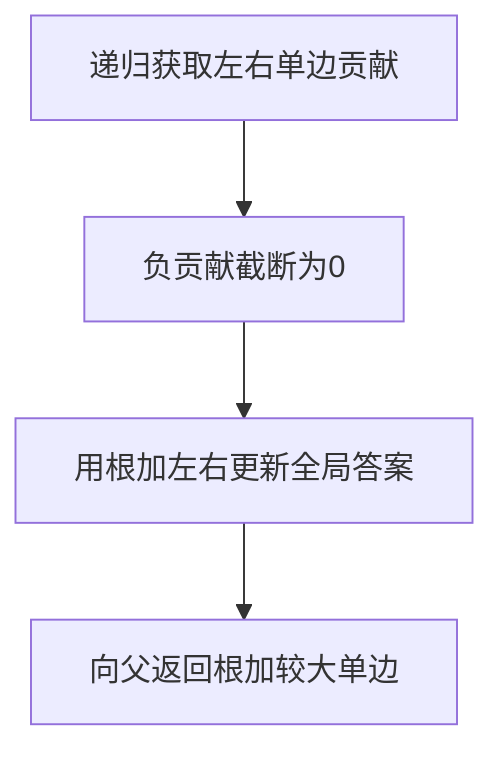

# 08 二叉树

本专题共15题。按简单、中等、困难稳定排序；同难度保留官方顺序。先复习算法附录中的对应结构，再学习各题的变量不变量与边界。

[94 二叉树的中序遍历](#p94) | [104 二叉树的最大深度](#p104) | [226 翻转二叉树](#p226) | [101 对称二叉树](#p101) | [543 二叉树的直径](#p543) | [108 将有序数组转换为二叉搜索树](#p108) | [102 二叉树的层序遍历](#p102) | [98 验证二叉搜索树](#p98) | [230 二叉搜索树中第 K 小的元素](#p230) | [199 二叉树的右视图](#p199) | [114 二叉树展开为链表](#p114) | [105 从前序与中序遍历序列构造二叉树](#p105) | [437 路径总和 III](#p437) | [236 二叉树的最近公共祖先](#p236) | [124 二叉树中的最大路径和](#p124)

<a id="p94"></a>
## 94. 二叉树的中序遍历

### 1. 题目基本信息

|字段|内容|
|---|---|
|力扣题号|94|
|中文名称|二叉树的中序遍历|
|难度|简单|
|算法专题|二叉树|
|官方原题|[二叉树的中序遍历](https://leetcode.cn/problems/binary-tree-inorder-traversal/)|
|推荐前置知识|条件与短路、方法与返回值、对象、引用与null、List、ArrayList与泛型|

验证状态：已编译：是；本地测试：通过；LeetCode官方测试：未提交，未验证。

### 2. 题目描述

返回二叉树按左子树、根、右子树访问得到的值列表。空树返回空列表。

输入与输出示例：`根1，右孩子2，2的左孩子3 → [1,3,2]`

### 3. 解题思路详细分析

**从直观方案开始**：直接照访问定义递归即可；无需先转为其他结构。

**推荐方案、变量含义与正确性依据**：dfs(node)向同一个结果列表追加中序序列；node为null时返回，不追加；先递归左子树，再加入node.val，最后递归右子树。递归方法返回void，结果通过参数列表累积。

### 4. 完整 Java 解题代码

标准库导入列在代码开头；没有import表示仅使用java.lang自动导入类型及力扣节点。普通题使用`class Solution`，设计题保留指定类名。

力扣提供`TreeNode`节点，核心字段为`int val`、`TreeNode left`、`TreeNode right`，可用`new TreeNode(value)`创建。null孩子表示空子树。提交文件不重复定义节点；tests中的同名类只用于独立编译。

```java
import java.util.*;
class Solution {
    public List<Integer> inorderTraversal(TreeNode root) {
        List<Integer> ans=new ArrayList<>(); dfs(root,ans); return ans;
    }
    private void dfs(TreeNode node,List<Integer> ans) {
        if(node==null) return; // 空子树没有待访问节点
        dfs(node.left,ans);
        ans.add(node.val); // 左子树完成后访问根
        dfs(node.right,ans);
    }
}
```

### 5. Java 知识点详解

以下只复习本题实际出现的语法和关键API；数字锚点对应前面的Java基础章节。

- **条件与短路**（[基础第3节](../Java基础知识附录.md#java-3)）：if仅在boolean条件为true时执行；条件?A:B只求被选择的一个分支。&&左侧false不算右侧，||左侧true不算右侧；本题利用它们保护边界或选择算法分支。检查p!=null须放在读取p.next之前。
- **方法与返回值**（[基础第4节](../Java基础知识附录.md#java-4)）：方法参数声明输入类型，return表达式交还结果并结束当前调用，void方法可只写return。public入口供力扣调用，private辅助方法只供本类使用。递归时每层局部变量独立，集合参数传的是同一对象的引用值副本。
- **对象、引用与null**（[基础第21节](../Java基础知识附录.md#java-21)）：new创建对象；赋值p=q复制引用，不复制节点或集合。本题经引用修改对象内容，调用者可见；重新给参数赋new只改变局部参数。null没有可访问的字段或方法。对象==比较身份，String等内容要用equals。
- **List、ArrayList与泛型**（[基础第11节](../Java基础知识附录.md#java-11)）：List<E>是有序可重复列表接口，new ArrayList<>()创建实现；E必须是引用类型，int需用Integer自动装箱。本题收集可变长结果或路径。add(x)尾部追加，get(i)读取，size()给元素数；get越界会抛异常。尾add摊还O(1)。

### 6. 示例执行过程

对应本题示例或文中明确标出的同类小例子：

|步骤|扫描位置、变量或数据结构变化|
|---|---|
|1|访问1先处理空左树|
|2|加入1|
|3|递归2前先递归3并加入3|
|4|再加入2，结果[1,3,2]|

### 7. 复杂度分析

- **时间**：O(n) 时间，每节点访问一次。
- **空间**：O(h) 栈空间，h为树高，最坏O(n)，另有O(n)输出。

复杂度中返回结果是否计入已明确说明；树高h、层宽w、总节点数N等规模按本题语境取值。哈希表相关分析使用平均情况；代码调用栈也计入辅助空间。

### 8. 常见错误和注意事项

1. 空节点不可读取val。
2. 顺序不能混成根左右。
3. 每次调用新建结果列表，避免累积旧答案。

### 9. 本题知识总结

- 核心思想：dfs(node)向同一个结果列表追加中序序列；node为null时返回，不追加；先递归左子树，再加入node.val，最后递归右子树。
- Java重点：List、ArrayList与泛型。
- 必会技巧：空节点不可读取val。
- 推荐复习：遮住代码，用第6节的示例重走变量变化，再解释第3节的边界或状态含义，最后独立写出提交方法。

---

<a id="p104"></a>
## 104. 二叉树的最大深度

### 1. 题目基本信息

|字段|内容|
|---|---|
|力扣题号|104|
|中文名称|二叉树的最大深度|
|难度|简单|
|算法专题|二叉树|
|官方原题|[二叉树的最大深度](https://leetcode.cn/problems/maximum-depth-of-binary-tree/)|
|推荐前置知识|条件与短路、方法与返回值、对象、引用与null、Math.max / Math.min|

验证状态：已编译：是；本地测试：通过；LeetCode官方测试：未提交，未验证。

### 2. 题目描述

求从根到最深叶子的节点数。空树深度0，单节点深度1。

输入与输出示例：`[3,9,20,null,null,15,7] → 3`

### 3. 解题思路详细分析

**从直观方案开始**：按层遍历并数层也可以；递归更直接对应深度定义。

**推荐方案、变量含义与正确性依据**：maxDepth(node)返回该节点为根的子树高度。null返回0；递归获得左右高度，较大值加1。子问题沿子树缩小，最终到达空节点。

### 4. 完整 Java 解题代码

标准库导入列在代码开头；没有import表示仅使用java.lang自动导入类型及力扣节点。普通题使用`class Solution`，设计题保留指定类名。

力扣提供`TreeNode`节点，核心字段为`int val`、`TreeNode left`、`TreeNode right`，可用`new TreeNode(value)`创建。null孩子表示空子树。提交文件不重复定义节点；tests中的同名类只用于独立编译。

```java
class Solution {
    public int maxDepth(TreeNode root) {
        if(root==null) return 0; // 递归终点：空树深度为0
        int left=maxDepth(root.left),right=maxDepth(root.right);
        return Math.max(left,right)+1; // 当前根贡献一层
    }
}
```

### 5. Java 知识点详解

以下只复习本题实际出现的语法和关键API；数字锚点对应前面的Java基础章节。

- **条件与短路**（[基础第3节](../Java基础知识附录.md#java-3)）：if仅在boolean条件为true时执行；条件?A:B只求被选择的一个分支。&&左侧false不算右侧，||左侧true不算右侧；本题利用它们保护边界或选择算法分支。检查p!=null须放在读取p.next之前。
- **方法与返回值**（[基础第4节](../Java基础知识附录.md#java-4)）：方法参数声明输入类型，return表达式交还结果并结束当前调用，void方法可只写return。public入口供力扣调用，private辅助方法只供本类使用。递归时每层局部变量独立，集合参数传的是同一对象的引用值副本。
- **对象、引用与null**（[基础第21节](../Java基础知识附录.md#java-21)）：new创建对象；赋值p=q复制引用，不复制节点或集合。本题经引用修改对象内容，调用者可见；重新给参数赋new只改变局部参数。null没有可访问的字段或方法。对象==比较身份，String等内容要用equals。
- **Math.max / Math.min**（[基础第19节](../Java基础知识附录.md#java-19)）：静态方法传两个同类数值，返回较大/较小值，不修改实参。本题维护最优值、边界或DP转移。必须把结果赋回变量：Math.max(best,x)单独调用不会改变best。

### 6. 示例执行过程

对应本题示例或文中明确标出的同类小例子：

|步骤|扫描位置、变量或数据结构变化|
|---|---|
|1|叶子9、15、7的左右深度都是0，因此各为1|
|2|20高度2|
|3|根3取max(1,2)+1=3|

### 7. 复杂度分析

- **时间**：O(n) 时间，每个节点一次。
- **空间**：O(h) 递归栈，平衡树O(log n)，退化链O(n)。

复杂度中返回结果是否计入已明确说明；树高h、层宽w、总节点数N等规模按本题语境取值。哈希表相关分析使用平均情况；代码调用栈也计入辅助空间。

### 8. 常见错误和注意事项

1. 深度按节点数不是边数。
2. 空树返回0。
3. 不能把左右高度相加。

### 9. 本题知识总结

- 核心思想：maxDepth(node)返回该节点为根的子树高度。
- Java重点：Math.max / Math.min。
- 必会技巧：深度按节点数不是边数。
- 推荐复习：遮住代码，用第6节的示例重走变量变化，再解释第3节的边界或状态含义，最后独立写出提交方法。

---

<a id="p226"></a>
## 226. 翻转二叉树

### 1. 题目基本信息

|字段|内容|
|---|---|
|力扣题号|226|
|中文名称|翻转二叉树|
|难度|简单|
|算法专题|二叉树|
|官方原题|[翻转二叉树](https://leetcode.cn/problems/invert-binary-tree/)|
|推荐前置知识|条件与短路、方法与返回值、对象、引用与null|

验证状态：已编译：是；本地测试：通过；LeetCode官方测试：未提交，未验证。

### 2. 题目描述

把二叉树每个节点的左右孩子互换，返回镜像树根。空树仍为空。

输入与输出示例：`[4,2,7,1,3,6,9] → [4,7,2,9,6,3,1]`

### 3. 解题思路详细分析

**从直观方案开始**：逐层交换也可行；不能只交换根的一对孩子。

**推荐方案、变量含义与正确性依据**：递归函数返回已经翻转的子树根。null直接返回null；保存左右子树各自的翻转结果，再交换赋给root.left和root.right。每个子树递归执行相同规则。

### 4. 完整 Java 解题代码

标准库导入列在代码开头；没有import表示仅使用java.lang自动导入类型及力扣节点。普通题使用`class Solution`，设计题保留指定类名。

力扣提供`TreeNode`节点，核心字段为`int val`、`TreeNode left`、`TreeNode right`，可用`new TreeNode(value)`创建。null孩子表示空子树。提交文件不重复定义节点；tests中的同名类只用于独立编译。

```java
class Solution {
    public TreeNode invertTree(TreeNode root) {
        if(root==null) return null;
        TreeNode left=invertTree(root.left),right=invertTree(root.right);
        root.left=right; root.right=left; // 保存完两侧后再交换
        return root;
    }
}
```

### 5. Java 知识点详解

以下只复习本题实际出现的语法和关键API；数字锚点对应前面的Java基础章节。

- **条件与短路**（[基础第3节](../Java基础知识附录.md#java-3)）：if仅在boolean条件为true时执行；条件?A:B只求被选择的一个分支。&&左侧false不算右侧，||左侧true不算右侧；本题利用它们保护边界或选择算法分支。检查p!=null须放在读取p.next之前。
- **方法与返回值**（[基础第4节](../Java基础知识附录.md#java-4)）：方法参数声明输入类型，return表达式交还结果并结束当前调用，void方法可只写return。public入口供力扣调用，private辅助方法只供本类使用。递归时每层局部变量独立，集合参数传的是同一对象的引用值副本。
- **对象、引用与null**（[基础第21节](../Java基础知识附录.md#java-21)）：new创建对象；赋值p=q复制引用，不复制节点或集合。本题经引用修改对象内容，调用者可见；重新给参数赋new只改变局部参数。null没有可访问的字段或方法。对象==比较身份，String等内容要用equals。

### 6. 示例执行过程

对应本题示例或文中明确标出的同类小例子：

|步骤|扫描位置、变量或数据结构变化|
|---|---|
|1|先将2的孩子1、3交换，将7的孩子6、9交换|
|2|最后根4的左右交换，得到左7(9,6)、右2(3,1)|

### 7. 复杂度分析

- **时间**：O(n) 时间，每节点交换一次。
- **空间**：O(h) 栈空间，最坏O(n)。

复杂度中返回结果是否计入已明确说明；树高h、层宽w、总节点数N等规模按本题语境取值。哈希表相关分析使用平均情况；代码调用栈也计入辅助空间。

### 8. 常见错误和注意事项

1. 赋值前保存两侧结果避免引用覆盖。
2. 必须遍历整树。
3. 该实现原地修改树。

### 9. 本题知识总结

- 核心思想：递归函数返回已经翻转的子树根。
- Java重点：。
- 必会技巧：赋值前保存两侧结果避免引用覆盖。
- 推荐复习：遮住代码，用第6节的示例重走变量变化，再解释第3节的边界或状态含义，最后独立写出提交方法。

---

<a id="p101"></a>
## 101. 对称二叉树

### 1. 题目基本信息

|字段|内容|
|---|---|
|力扣题号|101|
|中文名称|对称二叉树|
|难度|简单|
|算法专题|二叉树|
|官方原题|[对称二叉树](https://leetcode.cn/problems/symmetric-tree/)|
|推荐前置知识|条件与短路、方法与返回值、对象、引用与null|

验证状态：已编译：是；本地测试：通过；LeetCode官方测试：未提交，未验证。

### 2. 题目描述

判断二叉树是否关于根左右镜像对称。对应位置结构和值都要相同。

输入与输出示例：`[1,2,2,3,4,4,3] → true`

### 3. 解题思路详细分析

**从直观方案开始**：只比较每层值的集合会丢失左右位置和空节点信息。

**推荐方案、变量含义与正确性依据**：mirror(a,b)判断两棵子树互为镜像：都空返回true，仅一个空返回false；值相同且a.left对b.right、a.right对b.left都镜像才成功。入口比较root.left和root.right。

### 4. 完整 Java 解题代码

标准库导入列在代码开头；没有import表示仅使用java.lang自动导入类型及力扣节点。普通题使用`class Solution`，设计题保留指定类名。

力扣提供`TreeNode`节点，核心字段为`int val`、`TreeNode left`、`TreeNode right`，可用`new TreeNode(value)`创建。null孩子表示空子树。提交文件不重复定义节点；tests中的同名类只用于独立编译。

```java
class Solution {
    public boolean isSymmetric(TreeNode root) { return root==null || mirror(root.left,root.right); }
    private boolean mirror(TreeNode a,TreeNode b) {
        if(a==null || b==null) return a==b; // 只有同时为空才匹配
        return a.val==b.val && mirror(a.left,b.right) && mirror(a.right,b.left);
    }
}
```

### 5. Java 知识点详解

以下只复习本题实际出现的语法和关键API；数字锚点对应前面的Java基础章节。

- **条件与短路**（[基础第3节](../Java基础知识附录.md#java-3)）：if仅在boolean条件为true时执行；条件?A:B只求被选择的一个分支。&&左侧false不算右侧，||左侧true不算右侧；本题利用它们保护边界或选择算法分支。检查p!=null须放在读取p.next之前。
- **方法与返回值**（[基础第4节](../Java基础知识附录.md#java-4)）：方法参数声明输入类型，return表达式交还结果并结束当前调用，void方法可只写return。public入口供力扣调用，private辅助方法只供本类使用。递归时每层局部变量独立，集合参数传的是同一对象的引用值副本。
- **对象、引用与null**（[基础第21节](../Java基础知识附录.md#java-21)）：new创建对象；赋值p=q复制引用，不复制节点或集合。本题经引用修改对象内容，调用者可见；重新给参数赋new只改变局部参数。null没有可访问的字段或方法。对象==比较身份，String等内容要用equals。

### 6. 示例执行过程

对应本题示例或文中明确标出的同类小例子：

|步骤|扫描位置、变量或数据结构变化|
|---|---|
|1|比较左右2|
|2|再比较外侧3与3、内侧4与4|
|3|叶子下的空节点成对匹配，因此true|

### 7. 复杂度分析

- **时间**：O(n) 时间，每节点参与一次配对。
- **空间**：O(h) 栈空间，最坏O(n)。

复杂度中返回结果是否计入已明确说明；树高h、层宽w、总节点数N等规模按本题语境取值。哈希表相关分析使用平均情况；代码调用栈也计入辅助空间。

### 8. 常见错误和注意事项

1. 两个空与一个空分开处理。
2. 不是同侧孩子配对。
3. 相同值但结构不同仍不对称。

### 9. 本题知识总结

- 核心思想：mirror(a,b)判断两棵子树互为镜像：都空返回true，仅一个空返回false；值相同且a.left对b.right、a.right对b.left都镜像才成功。
- Java重点：。
- 必会技巧：两个空与一个空分开处理。
- 推荐复习：遮住代码，用第6节的示例重走变量变化，再解释第3节的边界或状态含义，最后独立写出提交方法。

---

<a id="p543"></a>
## 543. 二叉树的直径

### 1. 题目基本信息

|字段|内容|
|---|---|
|力扣题号|543|
|中文名称|二叉树的直径|
|难度|简单|
|算法专题|二叉树|
|官方原题|[二叉树的直径](https://leetcode.cn/problems/diameter-of-binary-tree/)|
|推荐前置知识|条件与短路、方法与返回值、对象、引用与null、Math.max / Math.min|

验证状态：已编译：是；本地测试：通过；LeetCode官方测试：未提交，未验证。

### 2. 题目描述

求树中任意两节点之间最长路径的边数，路径不一定经过根；空树返回0。

输入与输出示例：`[1,2,3,4,5] → 3（4→2→1→3）`

### 3. 解题思路详细分析

**从直观方案开始**：对每个节点重新计算左右深度，会重复访问子树，最坏O(n²)。

**推荐方案、变量含义与正确性依据**：后序递归height(node)返回子树高度，空树0。获得左右高度l、r后，经过当前节点的最长路径边数为l+r，更新全局best；向父节点返回max(l,r)+1，因为延伸路径只能选一个分支。每次公开调用重置best。

### 4. 完整 Java 解题代码

标准库导入列在代码开头；没有import表示仅使用java.lang自动导入类型及力扣节点。普通题使用`class Solution`，设计题保留指定类名。

力扣提供`TreeNode`节点，核心字段为`int val`、`TreeNode left`、`TreeNode right`，可用`new TreeNode(value)`创建。null孩子表示空子树。提交文件不重复定义节点；tests中的同名类只用于独立编译。

```java
class Solution {
    private int best;
    public int diameterOfBinaryTree(TreeNode root) { best=0; height(root); return best; }
    private int height(TreeNode node) {
        if(node==null) return 0;
        int l=height(node.left),r=height(node.right);
        best=Math.max(best,l+r); // 当前节点连接左右分支的路径
        return Math.max(l,r)+1; // 向父节点只返回一条分支
    }
}
```

### 5. Java 知识点详解

以下只复习本题实际出现的语法和关键API；数字锚点对应前面的Java基础章节。

- **条件与短路**（[基础第3节](../Java基础知识附录.md#java-3)）：if仅在boolean条件为true时执行；条件?A:B只求被选择的一个分支。&&左侧false不算右侧，||左侧true不算右侧；本题利用它们保护边界或选择算法分支。检查p!=null须放在读取p.next之前。
- **方法与返回值**（[基础第4节](../Java基础知识附录.md#java-4)）：方法参数声明输入类型，return表达式交还结果并结束当前调用，void方法可只写return。public入口供力扣调用，private辅助方法只供本类使用。递归时每层局部变量独立，集合参数传的是同一对象的引用值副本。
- **对象、引用与null**（[基础第21节](../Java基础知识附录.md#java-21)）：new创建对象；赋值p=q复制引用，不复制节点或集合。本题经引用修改对象内容，调用者可见；重新给参数赋new只改变局部参数。null没有可访问的字段或方法。对象==比较身份，String等内容要用equals。
- **Math.max / Math.min**（[基础第19节](../Java基础知识附录.md#java-19)）：静态方法传两个同类数值，返回较大/较小值，不修改实参。本题维护最优值、边界或DP转移。必须把结果赋回变量：Math.max(best,x)单独调用不会改变best。

### 6. 示例执行过程

对应本题示例或文中明确标出的同类小例子：

|步骤|扫描位置、变量或数据结构变化|
|---|---|
|1|叶4、5高度1|
|2|节点2有l=r=1，候选直径2，高度2|
|3|根1有l=2,r=1，候选3，答案3|

### 7. 复杂度分析

- **时间**：O(n) 时间，同一后序同时算高度和直径。
- **空间**：O(h) 栈，最坏O(n)。

复杂度中返回结果是否计入已明确说明；树高h、层宽w、总节点数N等规模按本题语境取值。哈希表相关分析使用平均情况；代码调用栈也计入辅助空间。

### 8. 常见错误和注意事项

1. 返回给父节点的高度不能是l+r。
2. 直径按边数。
3. 不能只计算经过根的路径。

### 9. 本题知识总结

- 核心思想：后序递归height(node)返回子树高度，空树0。
- Java重点：Math.max / Math.min。
- 必会技巧：返回给父节点的高度不能是l+r。
- 推荐复习：遮住代码，用第6节的示例重走变量变化，再解释第3节的边界或状态含义，最后独立写出提交方法。

---

<a id="p108"></a>
## 108. 将有序数组转换为二叉搜索树

### 1. 题目基本信息

|字段|内容|
|---|---|
|力扣题号|108|
|中文名称|将有序数组转换为二叉搜索树|
|难度|简单|
|算法专题|二叉树|
|官方原题|[将有序数组转换为二叉搜索树](https://leetcode.cn/problems/convert-sorted-array-to-binary-search-tree/)|
|推荐前置知识|数组与下标、条件与短路、方法与返回值、对象、引用与null|

验证状态：已编译：是；本地测试：通过；LeetCode官方测试：未提交，未验证。

### 2. 题目描述

把严格递增数组转换为高度平衡的二叉搜索树。返回任意合法树，空数组返回null。

输入与输出示例：`[-10,-3,0,5,9] → 可取根0，左右分别由[-10,-3]和[5,9]构造`

### 3. 解题思路详细分析

**从直观方案开始**：依次按搜索树插入递增值会得到链，不能保证平衡。

**推荐方案、变量含义与正确性依据**：build(l,r)处理闭区间；l>r返回null。取中点m作根，递归[l,m-1]构造左树、[m+1,r]构造右树。数组有序保证搜索树性质，两段大小至多差1保证平衡。返回当前根。

### 4. 完整 Java 解题代码

标准库导入列在代码开头；没有import表示仅使用java.lang自动导入类型及力扣节点。普通题使用`class Solution`，设计题保留指定类名。

力扣提供`TreeNode`节点，核心字段为`int val`、`TreeNode left`、`TreeNode right`，可用`new TreeNode(value)`创建。null孩子表示空子树。提交文件不重复定义节点；tests中的同名类只用于独立编译。

```java
class Solution {
    public TreeNode sortedArrayToBST(int[] nums) { return build(nums,0,nums.length-1); }
    private TreeNode build(int[] a,int l,int r) {
        if(l>r) return null; // 空区间对应空子树
        int m=l+(r-l)/2;
        TreeNode node=new TreeNode(a[m]);
        node.left=build(a,l,m-1); node.right=build(a,m+1,r);
        return node; // 返回构造好的子树根
    }
}
```

### 5. Java 知识点详解

以下只复习本题实际出现的语法和关键API；数字锚点对应前面的Java基础章节。

- **数组与下标**（[基础第2节](../Java基础知识附录.md#java-2)）：固定长度容器；new int[n]初值为0，boolean初值false；a[i]读取或写入第i项。本题用数组承载输入或索引状态，索引必须在0..length-1；a.length是字段，不是方法。示例：int[] a={2,7}; a[0]为2。
- **条件与短路**（[基础第3节](../Java基础知识附录.md#java-3)）：if仅在boolean条件为true时执行；条件?A:B只求被选择的一个分支。&&左侧false不算右侧，||左侧true不算右侧；本题利用它们保护边界或选择算法分支。检查p!=null须放在读取p.next之前。
- **方法与返回值**（[基础第4节](../Java基础知识附录.md#java-4)）：方法参数声明输入类型，return表达式交还结果并结束当前调用，void方法可只写return。public入口供力扣调用，private辅助方法只供本类使用。递归时每层局部变量独立，集合参数传的是同一对象的引用值副本。
- **对象、引用与null**（[基础第21节](../Java基础知识附录.md#java-21)）：new创建对象；赋值p=q复制引用，不复制节点或集合。本题经引用修改对象内容，调用者可见；重新给参数赋new只改变局部参数。null没有可访问的字段或方法。对象==比较身份，String等内容要用equals。

### 6. 示例执行过程

对应本题示例或文中明确标出的同类小例子：

|步骤|扫描位置、变量或数据结构变化|
|---|---|
|1|区间[0,4]取m=2根0|
|2|左[0,1]取-10并把-3放其右|
|3|右[3,4]取5并把9放其右，所有子树高度差≤1|

### 7. 复杂度分析

- **时间**：O(n) 时间，每个元素创建一个节点。
- **空间**：O(log n) 递归栈，另有O(n)输出树。

复杂度中返回结果是否计入已明确说明；树高h、层宽w、总节点数N等规模按本题语境取值。哈希表相关分析使用平均情况；代码调用栈也计入辅助空间。

### 8. 常见错误和注意事项

1. 不能把中点再次包含进子区间。
2. 有序中序序列是验证依据。
3. 树形答案不唯一。

### 9. 本题知识总结

- 核心思想：build(l,r)处理闭区间；l>r返回null。
- Java重点：数组与下标。
- 必会技巧：不能把中点再次包含进子区间。
- 推荐复习：遮住代码，用第6节的示例重走变量变化，再解释第3节的边界或状态含义，最后独立写出提交方法。

---

<a id="p102"></a>
## 102. 二叉树的层序遍历

### 1. 题目基本信息

|字段|内容|
|---|---|
|力扣题号|102|
|中文名称|二叉树的层序遍历|
|难度|中等|
|算法专题|二叉树|
|官方原题|[二叉树的层序遍历](https://leetcode.cn/problems/binary-tree-level-order-traversal/)|
|推荐前置知识|循环、条件与短路、方法与返回值、对象、引用与null、List、ArrayList与泛型、Deque、ArrayDeque、Queue.offer / poll / peek|

验证状态：已编译：是；本地测试：通过；LeetCode官方测试：未提交，未验证。

### 2. 题目描述

按从上到下、同层从左到右返回节点值的二维列表。空树返回空列表。

输入与输出示例：`[3,9,20,null,null,15,7] → [[3],[9,20],[15,7]]`

### 3. 解题思路详细分析

**从直观方案开始**：DFS记录深度也可以；队列更自然对应逐层访问。

**推荐方案、变量含义与正确性依据**：BFS队列保存待处理节点。每轮开始固定size=q.size()，只弹出这size个作为本层；把其非空左右孩子加入队尾，留给下一轮。队列不存null。

### 4. 完整 Java 解题代码

标准库导入列在代码开头；没有import表示仅使用java.lang自动导入类型及力扣节点。普通题使用`class Solution`，设计题保留指定类名。

力扣提供`TreeNode`节点，核心字段为`int val`、`TreeNode left`、`TreeNode right`，可用`new TreeNode(value)`创建。null孩子表示空子树。提交文件不重复定义节点；tests中的同名类只用于独立编译。

```java
import java.util.*;
class Solution {
    public List<List<Integer>> levelOrder(TreeNode root) {
        List<List<Integer>> ans=new ArrayList<>();
        if(root==null) return ans;
        Queue<TreeNode> q=new ArrayDeque<>(); q.offer(root);
        while(!q.isEmpty()) {
            int size=q.size(); List<Integer> row=new ArrayList<>();
            for(int i=0;i<size;i++) {
                TreeNode node=q.poll(); row.add(node.val);
                if(node.left!=null) q.offer(node.left);
                if(node.right!=null) q.offer(node.right);
            }
            ans.add(row); // 本层完成，队列只剩下一层
        }
        return ans;
    }
}
```

### 5. Java 知识点详解

以下只复习本题实际出现的语法和关键API；数字锚点对应前面的Java基础章节。

- **循环**（[基础第3节](../Java基础知识附录.md#java-3)）：for控制初始化、条件、更新；while先判断再执行。本题循环反复处理元素或缩小区间；必须保证每轮有进展。i++先产生旧值再加1，例如a[i++]使用旧下标。增强for读取元素副本，给基本类型循环变量赋值不会改数组。
- **条件与短路**（[基础第3节](../Java基础知识附录.md#java-3)）：if仅在boolean条件为true时执行；条件?A:B只求被选择的一个分支。&&左侧false不算右侧，||左侧true不算右侧；本题利用它们保护边界或选择算法分支。检查p!=null须放在读取p.next之前。
- **方法与返回值**（[基础第4节](../Java基础知识附录.md#java-4)）：方法参数声明输入类型，return表达式交还结果并结束当前调用，void方法可只写return。public入口供力扣调用，private辅助方法只供本类使用。递归时每层局部变量独立，集合参数传的是同一对象的引用值副本。
- **对象、引用与null**（[基础第21节](../Java基础知识附录.md#java-21)）：new创建对象；赋值p=q复制引用，不复制节点或集合。本题经引用修改对象内容，调用者可见；重新给参数赋new只改变局部参数。null没有可访问的字段或方法。对象==比较身份，String等内容要用equals。
- **List、ArrayList与泛型**（[基础第11节](../Java基础知识附录.md#java-11)）：List<E>是有序可重复列表接口，new ArrayList<>()创建实现；E必须是引用类型，int需用Integer自动装箱。本题收集可变长结果或路径。add(x)尾部追加，get(i)读取，size()给元素数；get越界会抛异常。尾add摊还O(1)。
- **Deque、ArrayDeque**（[基础第14节](../Java基础知识附录.md#java-14)）：Deque支持两端操作，ArrayDeque是数组实现且不能存null。本题将其作为栈、队列或单调候选容器。isEmpty()检查是否为空，size()返回元素数；两端写操作摊还O(1)，不要在中间位置做线性删除来破坏复杂度。
- **Queue.offer / poll / peek**（[基础第15节](../Java基础知识附录.md#java-15)）：offer(x)加入并返回boolean；poll()删除返回队首，空时null；peek只读。本题使用ArrayDeque时按先进先出，PriorityQueue时按比较规则出堆。BFS需提前固定本层size，不能把刚加入的下一层也在本层处理。

### 6. 示例执行过程

对应本题示例或文中明确标出的同类小例子：

|步骤|扫描位置、变量或数据结构变化|
|---|---|
|1|队列[3]，size1输出[3]并入9、20|
|2|下一层size2输出[9,20]并入15、7|
|3|下一层输出[15,7]|

### 7. 复杂度分析

- **时间**：O(n) 时间，每节点入出队各一次。
- **空间**：O(w) 队列空间，w是最大层宽，另有O(n)输出。

复杂度中返回结果是否计入已明确说明；树高h、层宽w、总节点数N等规模按本题语境取值。哈希表相关分析使用平均情况；代码调用栈也计入辅助空间。

### 8. 常见错误和注意事项

1. 本层size必须提前固定。
2. ArrayDeque不允许null。
3. 左右入队顺序决定层内顺序。

### 9. 本题知识总结

- 核心思想：BFS队列保存待处理节点。
- Java重点：List、ArrayList与泛型、Deque、ArrayDeque、Queue.offer / poll / peek。
- 必会技巧：本层size必须提前固定。
- 推荐复习：遮住代码，用第6节的示例重走变量变化，再解释第3节的边界或状态含义，最后独立写出提交方法。

---

<a id="p98"></a>
## 98. 验证二叉搜索树

### 1. 题目基本信息

|字段|内容|
|---|---|
|力扣题号|98|
|中文名称|验证二叉搜索树|
|难度|中等|
|算法专题|二叉树|
|官方原题|[验证二叉搜索树](https://leetcode.cn/problems/validate-binary-search-tree/)|
|推荐前置知识|条件与短路、方法与返回值、对象、引用与null、整数边界与数值提升、long与L后缀|

验证状态：已编译：是；本地测试：通过；LeetCode官方测试：未提交，未验证。

### 2. 题目描述

判断树是否为严格二叉搜索树：每个节点的整个左子树都小于它，整个右子树都大于它，不允许相等。

输入与输出示例：`[5,1,4,null,null,3,6] → false`

### 3. 解题思路详细分析

**从直观方案开始**：只比较直接孩子不够，远端后代也受祖先边界限制。

**推荐方案、变量含义与正确性依据**：递归传开区间(low,high)。空节点返回true；当前值不在区间立即false；左树上界缩到当前值，右树下界升到当前值。用long上下界涵盖Integer极值。返回两侧判断的逻辑与。

### 4. 完整 Java 解题代码

标准库导入列在代码开头；没有import表示仅使用java.lang自动导入类型及力扣节点。普通题使用`class Solution`，设计题保留指定类名。

力扣提供`TreeNode`节点，核心字段为`int val`、`TreeNode left`、`TreeNode right`，可用`new TreeNode(value)`创建。null孩子表示空子树。提交文件不重复定义节点；tests中的同名类只用于独立编译。

```java
class Solution {
    public boolean isValidBST(TreeNode root) { return valid(root,Long.MIN_VALUE,Long.MAX_VALUE); }
    private boolean valid(TreeNode node,long low,long high) {
        if(node==null) return true;
        if(node.val<=low || node.val>=high) return false;
        // 当前值成为两侧子树的新边界
        return valid(node.left,low,node.val) && valid(node.right,node.val,high);
    }
}
```

### 5. Java 知识点详解

以下只复习本题实际出现的语法和关键API；数字锚点对应前面的Java基础章节。

- **条件与短路**（[基础第3节](../Java基础知识附录.md#java-3)）：if仅在boolean条件为true时执行；条件?A:B只求被选择的一个分支。&&左侧false不算右侧，||左侧true不算右侧；本题利用它们保护边界或选择算法分支。检查p!=null须放在读取p.next之前。
- **方法与返回值**（[基础第4节](../Java基础知识附录.md#java-4)）：方法参数声明输入类型，return表达式交还结果并结束当前调用，void方法可只写return。public入口供力扣调用，private辅助方法只供本类使用。递归时每层局部变量独立，集合参数传的是同一对象的引用值副本。
- **对象、引用与null**（[基础第21节](../Java基础知识附录.md#java-21)）：new创建对象；赋值p=q复制引用，不复制节点或集合。本题经引用修改对象内容，调用者可见；重新给参数赋new只改变局部参数。null没有可访问的字段或方法。对象==比较身份，String等内容要用equals。
- **整数边界与数值提升**（[基础第1节](../Java基础知识附录.md#java-1)）：Integer常量为32位上下界，Long为64位上下界。本题作为初始最优值、哨兵或安全边界。MIN_VALUE取负会溢出；相加前转long/double而非运算后再转换，例如((double)a+b)/2避免int加法溢出。
- **long与L后缀**（[基础第1节](../Java基础知识附录.md#java-1)）：long保存64位有符号整数，0L是long字面量。本题累计路径前缀避免int溢出；Map<Long,Integer>的键要用Long，0与0L装箱类型不同。赋值给long前的int表达式仍可能先溢出，应提前提升操作数。

### 6. 示例执行过程

对应本题示例或文中明确标出的同类小例子：

|步骤|扫描位置、变量或数据结构变化|
|---|---|
|1|根5允许(-∞,+∞)|
|2|右节点4应处于(5,+∞)，4≤5直接失败，即使它与自己的孩子关系正确也无效|

### 7. 复杂度分析

- **时间**：O(n) 时间，每个节点一次检查。
- **空间**：O(h) 栈空间，最坏O(n)。

复杂度中返回结果是否计入已明确说明；树高h、层宽w、总节点数N等规模按本题语境取值。哈希表相关分析使用平均情况；代码调用栈也计入辅助空间。

### 8. 常见错误和注意事项

1. 必须传祖先约束。
2. 严格不等不接受重复。
3. 初始int极值边界会错误排除合法极值节点。

### 9. 本题知识总结

- 核心思想：递归传开区间(low,high)。
- Java重点：整数边界与数值提升、long与L后缀。
- 必会技巧：必须传祖先约束。
- 推荐复习：遮住代码，用第6节的示例重走变量变化，再解释第3节的边界或状态含义，最后独立写出提交方法。

---

<a id="p230"></a>
## 230. 二叉搜索树中第 K 小的元素

### 1. 题目基本信息

|字段|内容|
|---|---|
|力扣题号|230|
|中文名称|二叉搜索树中第 K 小的元素|
|难度|中等|
|算法专题|二叉树|
|官方原题|[二叉搜索树中第 K 小的元素](https://leetcode.cn/problems/kth-smallest-element-in-a-bst/)|
|推荐前置知识|循环、条件与短路、方法与返回值、对象、引用与null、Deque、ArrayDeque、push / pop / peek|

验证状态：已编译：是；本地测试：通过；LeetCode官方测试：未提交，未验证。

### 2. 题目描述

在有n个节点的二叉搜索树中求第k小的值，保证1≤k≤n。

输入与输出示例：`[3,1,4,null,2], k=1 → 1`

### 3. 解题思路详细分析

**从直观方案开始**：把所有值排序可以得到答案，但没利用BST已有顺序。

**推荐方案、变量含义与正确性依据**：BST中序遍历严格递增。用显式栈模拟递归：不断沿左孩子入栈，弹出最左未处理节点，k减1；若为0返回值，再转向右子树。栈保存回溯时还要访问的祖先。

### 4. 完整 Java 解题代码

标准库导入列在代码开头；没有import表示仅使用java.lang自动导入类型及力扣节点。普通题使用`class Solution`，设计题保留指定类名。

力扣提供`TreeNode`节点，核心字段为`int val`、`TreeNode left`、`TreeNode right`，可用`new TreeNode(value)`创建。null孩子表示空子树。提交文件不重复定义节点；tests中的同名类只用于独立编译。

```java
import java.util.*;
class Solution {
    public int kthSmallest(TreeNode root,int k) {
        Deque<TreeNode> stack=new ArrayDeque<>(); TreeNode cur=root;
        while(cur!=null || !stack.isEmpty()) {
            while(cur!=null) { stack.push(cur); cur=cur.left; }
            cur=stack.pop();
            if(--k==0) return cur.val; // 中序第k次弹出即第k小
            cur=cur.right;
        }
        throw new IllegalArgumentException("k超出节点数量");
    }
}
```

### 5. Java 知识点详解

以下只复习本题实际出现的语法和关键API；数字锚点对应前面的Java基础章节。

- **循环**（[基础第3节](../Java基础知识附录.md#java-3)）：for控制初始化、条件、更新；while先判断再执行。本题循环反复处理元素或缩小区间；必须保证每轮有进展。i++先产生旧值再加1，例如a[i++]使用旧下标。增强for读取元素副本，给基本类型循环变量赋值不会改数组。
- **条件与短路**（[基础第3节](../Java基础知识附录.md#java-3)）：if仅在boolean条件为true时执行；条件?A:B只求被选择的一个分支。&&左侧false不算右侧，||左侧true不算右侧；本题利用它们保护边界或选择算法分支。检查p!=null须放在读取p.next之前。
- **方法与返回值**（[基础第4节](../Java基础知识附录.md#java-4)）：方法参数声明输入类型，return表达式交还结果并结束当前调用，void方法可只写return。public入口供力扣调用，private辅助方法只供本类使用。递归时每层局部变量独立，集合参数传的是同一对象的引用值副本。
- **对象、引用与null**（[基础第21节](../Java基础知识附录.md#java-21)）：new创建对象；赋值p=q复制引用，不复制节点或集合。本题经引用修改对象内容，调用者可见；重新给参数赋new只改变局部参数。null没有可访问的字段或方法。对象==比较身份，String等内容要用equals。
- **Deque、ArrayDeque**（[基础第14节](../Java基础知识附录.md#java-14)）：Deque支持两端操作，ArrayDeque是数组实现且不能存null。本题将其作为栈、队列或单调候选容器。isEmpty()检查是否为空，size()返回元素数；两端写操作摊还O(1)，不要在中间位置做线性删除来破坏复杂度。
- **push / pop / peek**（[基础第14节](../Java基础知识附录.md#java-14)）：push(x)把x压入头部，pop()删除并返回头部，peek()只读头部。用于本题栈或读取堆顶（PriorityQueue也有peek）。pop空栈抛异常；peek空时null，拆箱前必须确认非空。例：压3再压5，弹出5。

### 6. 示例执行过程

对应本题示例或文中明确标出的同类小例子：

|步骤|扫描位置、变量或数据结构变化|
|---|---|
|1|根3入栈，左1入栈|
|2|1的左为空，弹1，k从1降0，返回1，无需访问剩余节点|

### 7. 复杂度分析

- **时间**：O(h+k) 时间，沿左链并访问前k个节点，最坏O(n)。
- **空间**：O(h) 栈空间。

复杂度中返回结果是否计入已明确说明；树高h、层宽w、总节点数N等规模按本题语境取值。哈希表相关分析使用平均情况；代码调用栈也计入辅助空间。

### 8. 常见错误和注意事项

1. k从1计数。
2. 弹栈后再转右子树。
3. 必须是BST才能利用中序排序性质。

### 9. 本题知识总结

- 核心思想：BST中序遍历严格递增。
- Java重点：Deque、ArrayDeque、push / pop / peek。
- 必会技巧：k从1计数。
- 推荐复习：遮住代码，用第6节的示例重走变量变化，再解释第3节的边界或状态含义，最后独立写出提交方法。

---

<a id="p199"></a>
## 199. 二叉树的右视图

### 1. 题目基本信息

|字段|内容|
|---|---|
|力扣题号|199|
|中文名称|二叉树的右视图|
|难度|中等|
|算法专题|二叉树|
|官方原题|[二叉树的右视图](https://leetcode.cn/problems/binary-tree-right-side-view/)|
|推荐前置知识|循环、条件与短路、方法与返回值、对象、引用与null、List、ArrayList与泛型、Deque、ArrayDeque、Queue.offer / poll / peek|

验证状态：已编译：是；本地测试：通过；LeetCode官方测试：未提交，未验证。

### 2. 题目描述

从树的右侧观察，每层只看到最右边存在的节点，按层返回其值。

输入与输出示例：`[1,2,3,null,5,null,4] → [1,3,4]`

### 3. 解题思路详细分析

**从直观方案开始**：层序遍历保留每层全部值，再取最后一个；可在遍历时直接收集。

**推荐方案、变量含义与正确性依据**：BFS从左到右入队，固定本层size；处理本层最后一个节点（i=size-1）时加入答案。右侧缺失时，左子树的更深节点也可能出现在视图里，所以不能只沿right走。

### 4. 完整 Java 解题代码

标准库导入列在代码开头；没有import表示仅使用java.lang自动导入类型及力扣节点。普通题使用`class Solution`，设计题保留指定类名。

力扣提供`TreeNode`节点，核心字段为`int val`、`TreeNode left`、`TreeNode right`，可用`new TreeNode(value)`创建。null孩子表示空子树。提交文件不重复定义节点；tests中的同名类只用于独立编译。

```java
import java.util.*;
class Solution {
    public List<Integer> rightSideView(TreeNode root) {
        List<Integer> ans=new ArrayList<>();
        if(root==null) return ans;
        Queue<TreeNode> q=new ArrayDeque<>(); q.offer(root);
        while(!q.isEmpty()) {
            int size=q.size();
            for(int i=0;i<size;i++) {
                TreeNode node=q.poll();
                if(i==size-1) ans.add(node.val); // 本层最右节点
                if(node.left!=null) q.offer(node.left);
                if(node.right!=null) q.offer(node.right);
            }
        }
        return ans;
    }
}
```

### 5. Java 知识点详解

以下只复习本题实际出现的语法和关键API；数字锚点对应前面的Java基础章节。

- **循环**（[基础第3节](../Java基础知识附录.md#java-3)）：for控制初始化、条件、更新；while先判断再执行。本题循环反复处理元素或缩小区间；必须保证每轮有进展。i++先产生旧值再加1，例如a[i++]使用旧下标。增强for读取元素副本，给基本类型循环变量赋值不会改数组。
- **条件与短路**（[基础第3节](../Java基础知识附录.md#java-3)）：if仅在boolean条件为true时执行；条件?A:B只求被选择的一个分支。&&左侧false不算右侧，||左侧true不算右侧；本题利用它们保护边界或选择算法分支。检查p!=null须放在读取p.next之前。
- **方法与返回值**（[基础第4节](../Java基础知识附录.md#java-4)）：方法参数声明输入类型，return表达式交还结果并结束当前调用，void方法可只写return。public入口供力扣调用，private辅助方法只供本类使用。递归时每层局部变量独立，集合参数传的是同一对象的引用值副本。
- **对象、引用与null**（[基础第21节](../Java基础知识附录.md#java-21)）：new创建对象；赋值p=q复制引用，不复制节点或集合。本题经引用修改对象内容，调用者可见；重新给参数赋new只改变局部参数。null没有可访问的字段或方法。对象==比较身份，String等内容要用equals。
- **List、ArrayList与泛型**（[基础第11节](../Java基础知识附录.md#java-11)）：List<E>是有序可重复列表接口，new ArrayList<>()创建实现；E必须是引用类型，int需用Integer自动装箱。本题收集可变长结果或路径。add(x)尾部追加，get(i)读取，size()给元素数；get越界会抛异常。尾add摊还O(1)。
- **Deque、ArrayDeque**（[基础第14节](../Java基础知识附录.md#java-14)）：Deque支持两端操作，ArrayDeque是数组实现且不能存null。本题将其作为栈、队列或单调候选容器。isEmpty()检查是否为空，size()返回元素数；两端写操作摊还O(1)，不要在中间位置做线性删除来破坏复杂度。
- **Queue.offer / poll / peek**（[基础第15节](../Java基础知识附录.md#java-15)）：offer(x)加入并返回boolean；poll()删除返回队首，空时null；peek只读。本题使用ArrayDeque时按先进先出，PriorityQueue时按比较规则出堆。BFS需提前固定本层size，不能把刚加入的下一层也在本层处理。

### 6. 示例执行过程

对应本题示例或文中明确标出的同类小例子：

|步骤|扫描位置、变量或数据结构变化|
|---|---|
|1|层1只输出1|
|2|层2队列2、3，最后输出3|
|3|层3队列5、4，最后输出4|

### 7. 复杂度分析

- **时间**：O(n) 时间，每节点一次。
- **空间**：O(w) 队列空间，另有O(h)答案。

复杂度中返回结果是否计入已明确说明；树高h、层宽w、总节点数N等规模按本题语境取值。哈希表相关分析使用平均情况；代码调用栈也计入辅助空间。

### 8. 常见错误和注意事项

1. 不能仅走右孩子。
2. 固定每层size。
3. 没有右节点时左侧节点可见。

### 9. 本题知识总结

- 核心思想：BFS从左到右入队，固定本层size；处理本层最后一个节点（i=size-1）时加入答案。
- Java重点：List、ArrayList与泛型、Deque、ArrayDeque、Queue.offer / poll / peek。
- 必会技巧：不能仅走右孩子。
- 推荐复习：遮住代码，用第6节的示例重走变量变化，再解释第3节的边界或状态含义，最后独立写出提交方法。

---

<a id="p114"></a>
## 114. 二叉树展开为链表

### 1. 题目基本信息

|字段|内容|
|---|---|
|力扣题号|114|
|中文名称|二叉树展开为链表|
|难度|中等|
|算法专题|二叉树|
|官方原题|[二叉树展开为链表](https://leetcode.cn/problems/flatten-binary-tree-to-linked-list/)|
|推荐前置知识|循环、条件与短路、对象、引用与null|

验证状态：已编译：是；本地测试：通过；LeetCode官方测试：未提交，未验证。

### 2. 题目描述

原地把树按先序（根左右）展开为只使用right的链，所有left置null。

输入与输出示例：`[1,2,5,3,4,null,6] → 1→2→3→4→5→6`

### 3. 解题思路详细分析

**从直观方案开始**：先序收集节点再重连可行，但额外空间O(n)。

**推荐方案、变量含义与正确性依据**：若当前节点有左树，找到左树最右节点pre，把原右树接到pre.right；再把整个左树搬到cur.right并将cur.left置空。然后沿right前进。左树在原右树之前，保持先序；最右节点提供安全连接位置。

### 4. 完整 Java 解题代码

标准库导入列在代码开头；没有import表示仅使用java.lang自动导入类型及力扣节点。普通题使用`class Solution`，设计题保留指定类名。

力扣提供`TreeNode`节点，核心字段为`int val`、`TreeNode left`、`TreeNode right`，可用`new TreeNode(value)`创建。null孩子表示空子树。提交文件不重复定义节点；tests中的同名类只用于独立编译。

```java
class Solution {
    public void flatten(TreeNode root) {
        for(TreeNode cur=root;cur!=null;cur=cur.right) {
            if(cur.left!=null) {
                TreeNode pre=cur.left;
                while(pre.right!=null) pre=pre.right;
                pre.right=cur.right; // 原右树接到左树末端
                cur.right=cur.left; cur.left=null;
            }
        }
    }
}
```

### 5. Java 知识点详解

以下只复习本题实际出现的语法和关键API；数字锚点对应前面的Java基础章节。

- **循环**（[基础第3节](../Java基础知识附录.md#java-3)）：for控制初始化、条件、更新；while先判断再执行。本题循环反复处理元素或缩小区间；必须保证每轮有进展。i++先产生旧值再加1，例如a[i++]使用旧下标。增强for读取元素副本，给基本类型循环变量赋值不会改数组。
- **条件与短路**（[基础第3节](../Java基础知识附录.md#java-3)）：if仅在boolean条件为true时执行；条件?A:B只求被选择的一个分支。&&左侧false不算右侧，||左侧true不算右侧；本题利用它们保护边界或选择算法分支。检查p!=null须放在读取p.next之前。
- **对象、引用与null**（[基础第21节](../Java基础知识附录.md#java-21)）：new创建对象；赋值p=q复制引用，不复制节点或集合。本题经引用修改对象内容，调用者可见；重新给参数赋new只改变局部参数。null没有可访问的字段或方法。对象==比较身份，String等内容要用equals。

### 6. 示例执行过程

对应本题示例或文中明确标出的同类小例子：

|步骤|扫描位置、变量或数据结构变化|
|---|---|
|1|根1的左树最右为4，把5→6接到4后|
|2|把2接到1右边|
|3|处理2时把其右4接到左3后，形成1→2→3→4→5→6|

### 7. 复杂度分析

- **时间**：O(n) 时间，外层沿最终链走一次，找前驱的右边路径总计线性。
- **空间**：O(1) 空间。

复杂度中返回结果是否计入已明确说明；树高h、层宽w、总节点数N等规模按本题语境取值。哈希表相关分析使用平均情况；代码调用栈也计入辅助空间。

### 8. 常见错误和注意事项

1. 搬左树前保存并接好原右树。
2. left必须清空。
3. 不能复制节点代替原地展开。

### 9. 本题知识总结

- 核心思想：若当前节点有左树，找到左树最右节点pre，把原右树接到pre.right；再把整个左树搬到cur.right并将cur.left置空。
- Java重点：。
- 必会技巧：搬左树前保存并接好原右树。
- 推荐复习：遮住代码，用第6节的示例重走变量变化，再解释第3节的边界或状态含义，最后独立写出提交方法。

---

<a id="p105"></a>
## 105. 从前序与中序遍历序列构造二叉树

### 1. 题目基本信息

|字段|内容|
|---|---|
|力扣题号|105|
|中文名称|从前序与中序遍历序列构造二叉树|
|难度|中等|
|算法专题|二叉树|
|官方原题|[从前序与中序遍历序列构造二叉树](https://leetcode.cn/problems/construct-binary-tree-from-preorder-and-inorder-traversal/)|
|推荐前置知识|数组与下标、循环、条件与短路、方法与返回值、对象、引用与null、Map、HashMap|

验证状态：已编译：是；本地测试：通过；LeetCode官方测试：未提交，未验证。

### 2. 题目描述

由无重复值的先序和中序序列重建二叉树。保证两个序列合法且描述同一棵树。

输入与输出示例：`pre=[3,9,20,15,7], in=[9,3,15,20,7] → [3,9,20,null,null,15,7]`

### 3. 解题思路详细分析

**从直观方案开始**：每次线性搜索根在中序的位置，最坏O(n²)。

**推荐方案、变量含义与正确性依据**：Map预存中序值到下标。递归build(l,r)处理一段中序区间，空区间返回null；先序游标取当前根并前进，在中序下标mid处分割；必须先构造左树再右树，保持先序消费顺序。返回当前根。

### 4. 完整 Java 解题代码

标准库导入列在代码开头；没有import表示仅使用java.lang自动导入类型及力扣节点。普通题使用`class Solution`，设计题保留指定类名。

力扣提供`TreeNode`节点，核心字段为`int val`、`TreeNode left`、`TreeNode right`，可用`new TreeNode(value)`创建。null孩子表示空子树。提交文件不重复定义节点；tests中的同名类只用于独立编译。

```java
import java.util.*;
class Solution {
    private int index;
    private Map<Integer,Integer> positions;
    public TreeNode buildTree(int[] preorder,int[] inorder) {
        index=0; positions=new HashMap<>();
        for(int i=0;i<inorder.length;i++) positions.put(inorder[i],i);
        return build(preorder,0,inorder.length-1);
    }
    private TreeNode build(int[] pre,int l,int r) {
        if(l>r) return null;
        TreeNode node=new TreeNode(pre[index++]); int mid=positions.get(node.val);
        node.left=build(pre,l,mid-1); // 先序游标先消费完整左树
        node.right=build(pre,mid+1,r);
        return node;
    }
}
```

### 5. Java 知识点详解

以下只复习本题实际出现的语法和关键API；数字锚点对应前面的Java基础章节。

- **数组与下标**（[基础第2节](../Java基础知识附录.md#java-2)）：固定长度容器；new int[n]初值为0，boolean初值false；a[i]读取或写入第i项。本题用数组承载输入或索引状态，索引必须在0..length-1；a.length是字段，不是方法。示例：int[] a={2,7}; a[0]为2。
- **循环**（[基础第3节](../Java基础知识附录.md#java-3)）：for控制初始化、条件、更新；while先判断再执行。本题循环反复处理元素或缩小区间；必须保证每轮有进展。i++先产生旧值再加1，例如a[i++]使用旧下标。增强for读取元素副本，给基本类型循环变量赋值不会改数组。
- **条件与短路**（[基础第3节](../Java基础知识附录.md#java-3)）：if仅在boolean条件为true时执行；条件?A:B只求被选择的一个分支。&&左侧false不算右侧，||左侧true不算右侧；本题利用它们保护边界或选择算法分支。检查p!=null须放在读取p.next之前。
- **方法与返回值**（[基础第4节](../Java基础知识附录.md#java-4)）：方法参数声明输入类型，return表达式交还结果并结束当前调用，void方法可只写return。public入口供力扣调用，private辅助方法只供本类使用。递归时每层局部变量独立，集合参数传的是同一对象的引用值副本。
- **对象、引用与null**（[基础第21节](../Java基础知识附录.md#java-21)）：new创建对象；赋值p=q复制引用，不复制节点或集合。本题经引用修改对象内容，调用者可见；重新给参数赋new只改变局部参数。null没有可访问的字段或方法。对象==比较身份，String等内容要用equals。
- **Map、HashMap**（[基础第12节](../Java基础知识附录.md#java-12)）：Map<K,V>把每个键映射到一个值；put(k,v)写入并返回旧值，get(k)读取或返回null，containsKey(k)检查存在。本题按键快速定位信息；平均查找O(1)，遍历不保序。get缺失后直接拆箱int会空指针。

### 6. 示例执行过程

对应本题示例或文中明确标出的同类小例子：

|步骤|扫描位置、变量或数据结构变化|
|---|---|
|1|先序取3，中序中3在1：左区间只含9，右含15,20,7|
|2|先造9，再取20，分出15和7，连接回3|

### 7. 复杂度分析

- **时间**：O(n) 平均时间，索引查找平均O(1)，每节点创建一次。
- **空间**：O(n) Map加最坏O(n)栈。

复杂度中返回结果是否计入已明确说明；树高h、层宽w、总节点数N等规模按本题语境取值。哈希表相关分析使用平均情况；代码调用栈也计入辅助空间。

### 8. 常见错误和注意事项

1. 游标每次公开调用重置。
2. 先左后右不可颠倒。
3. 重复值会让单一下标映射失效，题目排除了重复。

### 9. 本题知识总结

- 核心思想：Map预存中序值到下标。
- Java重点：数组与下标、Map、HashMap。
- 必会技巧：游标每次公开调用重置。
- 推荐复习：遮住代码，用第6节的示例重走变量变化，再解释第3节的边界或状态含义，最后独立写出提交方法。

---

<a id="p437"></a>
## 437. 路径总和 III

### 1. 题目基本信息

|字段|内容|
|---|---|
|力扣题号|437|
|中文名称|路径总和 III|
|难度|中等|
|算法专题|二叉树|
|官方原题|[路径总和 III](https://leetcode.cn/problems/path-sum-iii/)|
|推荐前置知识|条件与短路、方法与返回值、对象、引用与null、Map、HashMap、Map.getOrDefault(key, defaultValue)、Map.remove(key)、long与L后缀|

验证状态：已编译：是；本地测试：通过；LeetCode官方测试：未提交，未验证。

### 2. 题目描述

统计树中自上而下、节点连续且和为targetSum的非空路径数。起点不必是根，终点不必是叶。

输入与输出示例：`[10,5,-3,3,2,null,11,3,-2,null,1], target=8 → 3`

### 3. 解题思路详细分析

**从直观方案开始**：从每个节点出发DFS累加，最坏O(n²)。

**推荐方案、变量含义与正确性依据**：在根到当前节点的路径上维护前缀和频次。当前和sum出现后，历史sum-target的次数就是以当前节点结尾的答案数。加入当前sum，递归左右树，返回前将频次减1撤销，防止把不同分支拼成路径。空树返回0，递归返回子树内匹配总数；前缀用long防溢出。

### 4. 完整 Java 解题代码

标准库导入列在代码开头；没有import表示仅使用java.lang自动导入类型及力扣节点。普通题使用`class Solution`，设计题保留指定类名。

力扣提供`TreeNode`节点，核心字段为`int val`、`TreeNode left`、`TreeNode right`，可用`new TreeNode(value)`创建。null孩子表示空子树。提交文件不重复定义节点；tests中的同名类只用于独立编译。

```java
import java.util.*;
class Solution {
    public int pathSum(TreeNode root,int targetSum) {
        Map<Long,Integer> count=new HashMap<>(); count.put(0L,1);
        return dfs(root,0L,targetSum,count);
    }
    private int dfs(TreeNode node,long sum,int target,Map<Long,Integer> count) {
        if(node==null) return 0;
        sum+=node.val;
        int ans=count.getOrDefault(sum-target,0);
        count.put(sum,count.getOrDefault(sum,0)+1); // 只记录当前祖先路径
        ans+=dfs(node.left,sum,target,count)+dfs(node.right,sum,target,count);
        int remaining=count.get(sum)-1;
        if(remaining==0) count.remove(sum); else count.put(sum,remaining); // 撤销当前节点
        return ans;
    }
}
```

### 5. Java 知识点详解

以下只复习本题实际出现的语法和关键API；数字锚点对应前面的Java基础章节。

- **条件与短路**（[基础第3节](../Java基础知识附录.md#java-3)）：if仅在boolean条件为true时执行；条件?A:B只求被选择的一个分支。&&左侧false不算右侧，||左侧true不算右侧；本题利用它们保护边界或选择算法分支。检查p!=null须放在读取p.next之前。
- **方法与返回值**（[基础第4节](../Java基础知识附录.md#java-4)）：方法参数声明输入类型，return表达式交还结果并结束当前调用，void方法可只写return。public入口供力扣调用，private辅助方法只供本类使用。递归时每层局部变量独立，集合参数传的是同一对象的引用值副本。
- **对象、引用与null**（[基础第21节](../Java基础知识附录.md#java-21)）：new创建对象；赋值p=q复制引用，不复制节点或集合。本题经引用修改对象内容，调用者可见；重新给参数赋new只改变局部参数。null没有可访问的字段或方法。对象==比较身份，String等内容要用equals。
- **Map、HashMap**（[基础第12节](../Java基础知识附录.md#java-12)）：Map<K,V>把每个键映射到一个值；put(k,v)写入并返回旧值，get(k)读取或返回null，containsKey(k)检查存在。本题按键快速定位信息；平均查找O(1)，遍历不保序。get缺失后直接拆箱int会空指针。
- **Map.getOrDefault(key, defaultValue)**（[基础第12节](../Java基础知识附录.md#java-12)）：键不存在时返回defaultValue，存在时返回其值，不自动修改Map。本题用默认0统计次数，例如count.put(x,count.getOrDefault(x,0)+1)。不能误以为查询默认值就已经插入了键。
- **Map.remove(key)**（[基础第12节](../Java基础知识附录.md#java-12)）：删除指定键并返回旧值或null。本题用它撤销已失效状态或淘汰缓存键。只改链表、不删缓存Map会留下可查询的旧记录；前缀和中移除零频键还能控制当前路径空间。
- **long与L后缀**（[基础第1节](../Java基础知识附录.md#java-1)）：long保存64位有符号整数，0L是long字面量。本题累计路径前缀避免int溢出；Map<Long,Integer>的键要用Long，0与0L装箱类型不同。赋值给long前的int表达式仍可能先溢出，应提前提升操作数。

### 6. 示例执行过程

对应本题示例或文中明确标出的同类小例子：

|步骤|扫描位置、变量或数据结构变化|
|---|---|
|1|根前缀0|
|2|到10前缀10|
|3|到5前缀15|
|4|到3前缀18，查18-8=10存在，得到路径5→3|
|5|退回5后撤销18|
|6|右支2→1也匹配一条|
|7|另一条-3→11|

### 7. 复杂度分析

- **时间**：O(n) 平均时间，每节点常数次哈希操作。
- **空间**：O(h) 路径频次与递归栈，代码删除零频键，最坏O(n)。

复杂度中返回结果是否计入已明确说明；树高h、层宽w、总节点数N等规模按本题语境取值。哈希表相关分析使用平均情况；代码调用栈也计入辅助空间。

### 8. 常见错误和注意事项

1. 递归返回时一定撤销频次。
2. sum用long。
3. 初始0频次为1，路径不能跨兄弟子树。

### 9. 本题知识总结

- 核心思想：在根到当前节点的路径上维护前缀和频次。
- Java重点：Map、HashMap、Map.getOrDefault(key, defaultValue)、Map.remove(key)、long与L后缀。
- 必会技巧：递归返回时一定撤销频次。
- 推荐复习：遮住代码，用第6节的示例重走变量变化，再解释第3节的边界或状态含义，最后独立写出提交方法。

---

<a id="p236"></a>
## 236. 二叉树的最近公共祖先

### 1. 题目基本信息

|字段|内容|
|---|---|
|力扣题号|236|
|中文名称|二叉树的最近公共祖先|
|难度|中等|
|算法专题|二叉树|
|官方原题|[二叉树的最近公共祖先](https://leetcode.cn/problems/lowest-common-ancestor-of-a-binary-tree/)|
|推荐前置知识|条件与短路、方法与返回值、对象、引用与null|

验证状态：已编译：是；本地测试：通过；LeetCode官方测试：未提交，未验证。

### 2. 题目描述

在普通二叉树中找给定两个不同节点p、q的最近公共祖先。保证两个节点都在树中；节点自己也可作为祖先。

输入与输出示例：`[3,5,1,6,2,0,8,null,null,7,4]，p=5,q=4 → 节点5`

### 3. 解题思路详细分析

**从直观方案开始**：记录每个节点父指针后求祖先交集可行，但要额外Map。

**推荐方案、变量含义与正确性依据**：递归返回在当前子树找到的目标节点或共同祖先。null、p、q直接返回自身；递归左右，若都非空，说明两目标分居两侧，返回当前根；仅一侧非空就向上传该侧。两个目标保证存在，使该返回语义成立。

### 4. 完整 Java 解题代码

标准库导入列在代码开头；没有import表示仅使用java.lang自动导入类型及力扣节点。普通题使用`class Solution`，设计题保留指定类名。

力扣提供`TreeNode`节点，核心字段为`int val`、`TreeNode left`、`TreeNode right`，可用`new TreeNode(value)`创建。null孩子表示空子树。提交文件不重复定义节点；tests中的同名类只用于独立编译。

```java
class Solution {
    public TreeNode lowestCommonAncestor(TreeNode root,TreeNode p,TreeNode q) {
        if(root==null || root==p || root==q) return root;
        TreeNode l=lowestCommonAncestor(root.left,p,q),r=lowestCommonAncestor(root.right,p,q);
        if(l!=null && r!=null) return root; // 两侧各找到一个目标
        return l!=null?l:r; // 单侧找到的结果继续向上传递
    }
}
```

### 5. Java 知识点详解

以下只复习本题实际出现的语法和关键API；数字锚点对应前面的Java基础章节。

- **条件与短路**（[基础第3节](../Java基础知识附录.md#java-3)）：if仅在boolean条件为true时执行；条件?A:B只求被选择的一个分支。&&左侧false不算右侧，||左侧true不算右侧；本题利用它们保护边界或选择算法分支。检查p!=null须放在读取p.next之前。
- **方法与返回值**（[基础第4节](../Java基础知识附录.md#java-4)）：方法参数声明输入类型，return表达式交还结果并结束当前调用，void方法可只写return。public入口供力扣调用，private辅助方法只供本类使用。递归时每层局部变量独立，集合参数传的是同一对象的引用值副本。
- **对象、引用与null**（[基础第21节](../Java基础知识附录.md#java-21)）：new创建对象；赋值p=q复制引用，不复制节点或集合。本题经引用修改对象内容，调用者可见；重新给参数赋new只改变局部参数。null没有可访问的字段或方法。对象==比较身份，String等内容要用equals。

### 6. 示例执行过程

对应本题示例或文中明确标出的同类小例子：

|步骤|扫描位置、变量或数据结构变化|
|---|---|
|1|5是目标之一，递归到5立即返回5|
|2|另一个目标4在它内部，所以5本身即祖先|
|3|根3右树无目标，向上传回5|

### 7. 复杂度分析

- **时间**：O(n) 时间，每节点至多一次。
- **空间**：O(h) 栈，最坏O(n)。

复杂度中返回结果是否计入已明确说明；树高h、层宽w、总节点数N等规模按本题语境取值。哈希表相关分析使用平均情况；代码调用栈也计入辅助空间。

### 8. 常见错误和注意事项

1. 比较节点引用。
2. 普通树不能按大小找方向。
3. 若不保证节点存在，需要额外存在性检查。

### 9. 本题知识总结

- 核心思想：递归返回在当前子树找到的目标节点或共同祖先。
- Java重点：。
- 必会技巧：比较节点引用。
- 推荐复习：遮住代码，用第6节的示例重走变量变化，再解释第3节的边界或状态含义，最后独立写出提交方法。

---

<a id="p124"></a>
## 124. 二叉树中的最大路径和

### 1. 题目基本信息

|字段|内容|
|---|---|
|力扣题号|124|
|中文名称|二叉树中的最大路径和|
|难度|困难|
|算法专题|二叉树|
|官方原题|[二叉树中的最大路径和](https://leetcode.cn/problems/binary-tree-maximum-path-sum/)|
|推荐前置知识|条件与短路、方法与返回值、对象、引用与null、Math.max / Math.min、整数边界与数值提升|

验证状态：已编译：是；本地测试：通过；LeetCode官方测试：未提交，未验证。

### 2. 题目描述

求非空二叉树任意两节点之间非空路径的最大节点和。路径不能重复节点，也不能分叉成三条。全负树必须选择一个节点。

输入与输出示例：`[-10,9,20,null,null,15,7] → 42（15→20→7）`

### 3. 解题思路详细分析

**从直观方案开始**：从每个节点枚举所有路径会重复计算。

**推荐方案、变量含义与正确性依据**：gain(node)返回从该节点向下只选一边的最大贡献；空节点贡献0。左右贡献若为负就舍弃为0，用node.val+l+r更新全局best；向父节点返回node.val+max(l,r)。全局best从最小整数开始，确保全负也取节点。

执行流程图：



### 4. 完整 Java 解题代码

标准库导入列在代码开头；没有import表示仅使用java.lang自动导入类型及力扣节点。普通题使用`class Solution`，设计题保留指定类名。

力扣提供`TreeNode`节点，核心字段为`int val`、`TreeNode left`、`TreeNode right`，可用`new TreeNode(value)`创建。null孩子表示空子树。提交文件不重复定义节点；tests中的同名类只用于独立编译。

```java
class Solution {
    private int best;
    public int maxPathSum(TreeNode root) { best=Integer.MIN_VALUE; gain(root); return best; }
    private int gain(TreeNode node) {
        if(node==null) return 0;
        int l=Math.max(0,gain(node.left)),r=Math.max(0,gain(node.right));
        best=Math.max(best,node.val+l+r); // 在当前节点把两条分支接起来
        return node.val+Math.max(l,r); // 父节点只能接上一条分支
    }
}
```

### 5. Java 知识点详解

以下只复习本题实际出现的语法和关键API；数字锚点对应前面的Java基础章节。

- **条件与短路**（[基础第3节](../Java基础知识附录.md#java-3)）：if仅在boolean条件为true时执行；条件?A:B只求被选择的一个分支。&&左侧false不算右侧，||左侧true不算右侧；本题利用它们保护边界或选择算法分支。检查p!=null须放在读取p.next之前。
- **方法与返回值**（[基础第4节](../Java基础知识附录.md#java-4)）：方法参数声明输入类型，return表达式交还结果并结束当前调用，void方法可只写return。public入口供力扣调用，private辅助方法只供本类使用。递归时每层局部变量独立，集合参数传的是同一对象的引用值副本。
- **对象、引用与null**（[基础第21节](../Java基础知识附录.md#java-21)）：new创建对象；赋值p=q复制引用，不复制节点或集合。本题经引用修改对象内容，调用者可见；重新给参数赋new只改变局部参数。null没有可访问的字段或方法。对象==比较身份，String等内容要用equals。
- **Math.max / Math.min**（[基础第19节](../Java基础知识附录.md#java-19)）：静态方法传两个同类数值，返回较大/较小值，不修改实参。本题维护最优值、边界或DP转移。必须把结果赋回变量：Math.max(best,x)单独调用不会改变best。
- **整数边界与数值提升**（[基础第1节](../Java基础知识附录.md#java-1)）：Integer常量为32位上下界，Long为64位上下界。本题作为初始最优值、哨兵或安全边界。MIN_VALUE取负会溢出；相加前转long/double而非运算后再转换，例如((double)a+b)/2避免int加法溢出。

### 6. 示例执行过程

对应本题示例或文中明确标出的同类小例子：

|步骤|扫描位置、变量或数据结构变化|
|---|---|
|1|15和7贡献分别15、7|
|2|20处候选42，向上返回35|
|3|根-10候选-10+9+35=34，无法超过42|

### 7. 复杂度分析

- **时间**：O(n) 时间，一次后序。
- **空间**：O(h) 栈，最坏O(n)。

复杂度中返回结果是否计入已明确说明；树高h、层宽w、总节点数N等规模按本题语境取值。哈希表相关分析使用平均情况；代码调用栈也计入辅助空间。

### 8. 常见错误和注意事项

1. 向上传递不能带两条分支。
2. 全局答案不能初始化0。
3. 负贡献要截断，节点自身不能整体舍弃导致空路径。

### 9. 本题知识总结

- 核心思想：gain(node)返回从该节点向下只选一边的最大贡献；空节点贡献0。
- Java重点：Math.max / Math.min、整数边界与数值提升。
- 必会技巧：向上传递不能带两条分支。
- 推荐复习：遮住代码，用第6节的示例重走变量变化，再解释第3节的边界或状态含义，最后独立写出提交方法。

---

