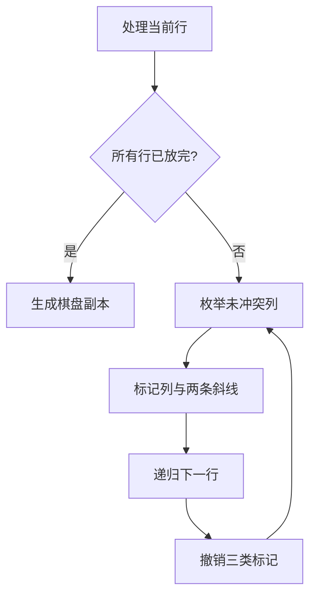

# 10 回溯

本专题共8题。按简单、中等、困难稳定排序；同难度保留官方顺序。先复习算法附录中的对应结构，再学习各题的变量不变量与边界。

[46 全排列](#p46) | [78 子集](#p78) | [17 电话号码的字母组合](#p17) | [39 组合总和](#p39) | [22 括号生成](#p22) | [79 单词搜索](#p79) | [131 分割回文串](#p131) | [51 N 皇后](#p51)

<a id="p46"></a>
## 46. 全排列

### 1. 题目基本信息

|字段|内容|
|---|---|
|力扣题号|46|
|中文名称|全排列|
|难度|中等|
|算法专题|回溯|
|官方原题|[全排列](https://leetcode.cn/problems/permutations/)|
|推荐前置知识|数组与下标、循环、条件与短路、方法与返回值、对象、引用与null、List、ArrayList与泛型、列表快照与集合构造器|

验证状态：已编译：是；本地测试：通过；LeetCode官方测试：未提交，未验证。

### 2. 题目描述

给互不相同的整数，返回所有排列，每个元素恰好用一次。

输入与输出示例：`[1,2,3] → 6个排列，如[1,2,3]、[1,3,2]等`

### 3. 解题思路详细分析

**从直观方案开始**：硬写n重循环不适用于变化的n。

**推荐方案、变量含义与正确性依据**：回溯路径path保存已选顺序，used标记每个下标是否已用；选择列表是所有未用元素。路径长度等于n时复制入结果并返回；否则依次选择，递归后删除末项并恢复used。递归返回void，结果参数收集所有叶子。

### 4. 完整 Java 解题代码

标准库导入列在代码开头；没有import表示仅使用java.lang自动导入类型及力扣节点。普通题使用`class Solution`，设计题保留指定类名。

```java
import java.util.*;
class Solution {
    public List<List<Integer>> permute(int[] nums) {
        List<List<Integer>> ans=new ArrayList<>();
        dfs(nums,new boolean[nums.length],new ArrayList<>(),ans); return ans;
    }
    private void dfs(int[] a,boolean[] used,List<Integer> path,List<List<Integer>> ans) {
        if(path.size()==a.length) { ans.add(new ArrayList<>(path)); return; }
        for(int i=0;i<a.length;i++) {
            if(used[i]) continue;
            used[i]=true; path.add(a[i]); // 做选择
            dfs(a,used,path,ans);
            path.remove(path.size()-1); used[i]=false; // 撤销选择
        }
    }
}
```

### 5. Java 知识点详解

以下只复习本题实际出现的语法和关键API；数字锚点对应前面的Java基础章节。

- **数组与下标**（[基础第2节](../Java基础知识附录.md#java-2)）：固定长度容器；new int[n]初值为0，boolean初值false；a[i]读取或写入第i项。本题用数组承载输入或索引状态，索引必须在0..length-1；a.length是字段，不是方法。示例：int[] a={2,7}; a[0]为2。
- **循环**（[基础第3节](../Java基础知识附录.md#java-3)）：for控制初始化、条件、更新；while先判断再执行。本题循环反复处理元素或缩小区间；必须保证每轮有进展。i++先产生旧值再加1，例如a[i++]使用旧下标。增强for读取元素副本，给基本类型循环变量赋值不会改数组。
- **条件与短路**（[基础第3节](../Java基础知识附录.md#java-3)）：if仅在boolean条件为true时执行；条件?A:B只求被选择的一个分支。&&左侧false不算右侧，||左侧true不算右侧；本题利用它们保护边界或选择算法分支。检查p!=null须放在读取p.next之前。
- **方法与返回值**（[基础第4节](../Java基础知识附录.md#java-4)）：方法参数声明输入类型，return表达式交还结果并结束当前调用，void方法可只写return。public入口供力扣调用，private辅助方法只供本类使用。递归时每层局部变量独立，集合参数传的是同一对象的引用值副本。
- **对象、引用与null**（[基础第21节](../Java基础知识附录.md#java-21)）：new创建对象；赋值p=q复制引用，不复制节点或集合。本题经引用修改对象内容，调用者可见；重新给参数赋new只改变局部参数。null没有可访问的字段或方法。对象==比较身份，String等内容要用equals。
- **List、ArrayList与泛型**（[基础第11节](../Java基础知识附录.md#java-11)）：List<E>是有序可重复列表接口，new ArrayList<>()创建实现；E必须是引用类型，int需用Integer自动装箱。本题收集可变长结果或路径。add(x)尾部追加，get(i)读取，size()给元素数；get越界会抛异常。尾add摊还O(1)。
- **列表快照与集合构造器**（[基础第11节](../Java基础知识附录.md#java-11)）：new ArrayList<>(collection)把集合元素复制到新列表；本题用来保留当前路径或导出分组。复制的是元素引用，属于浅复制。回溯不能直接ans.add(path)，否则多个结果共享随后被清空的路径对象。
- **List.remove(int)**（[基础第11节](../Java基础知识附录.md#java-11)）：remove(index)按下标删除并返回被删元素，后面的元素左移。本题传path.size()-1撤销最后一次选择，尾删除O(1)。List<Integer>的remove(1)是删下标1，删值1要写remove(Integer.valueOf(1))。

### 6. 示例执行过程

对应本题示例或文中明确标出的同类小例子：

|步骤|扫描位置、变量或数据结构变化|
|---|---|
|1|path=[]选1→[1]|
|2|再选2→[1,2]|
|3|选3→完整[1,2,3]并复制|
|4|撤销3、2，改选3再选2得到[1,3,2]|
|5|最终撤销1换2开头|

### 7. 复杂度分析

- **时间**：O(n·n!) 时间，共n!个结果且每次复制n项。
- **空间**：O(n) 递归与路径辅助空间，不含O(n·n!)输出。

复杂度中返回结果是否计入已明确说明；树高h、层宽w、总节点数N等规模按本题语境取值。哈希表相关分析使用平均情况；代码调用栈也计入辅助空间。

### 8. 常见错误和注意事项

1. 必须复制path，不能把可变对象直接加入。
2. used按下标。
3. 递归返回必须撤销选择。

### 9. 本题知识总结

- 核心思想：回溯路径path保存已选顺序，used标记每个下标是否已用；选择列表是所有未用元素。
- Java重点：数组与下标、List、ArrayList与泛型、列表快照与集合构造器、List.remove(int)。
- 必会技巧：必须复制path，不能把可变对象直接加入。
- 推荐复习：遮住代码，用第6节的示例重走变量变化，再解释第3节的边界或状态含义，最后独立写出提交方法。

---

<a id="p78"></a>
## 78. 子集

### 1. 题目基本信息

|字段|内容|
|---|---|
|力扣题号|78|
|中文名称|子集|
|难度|中等|
|算法专题|回溯|
|官方原题|[子集](https://leetcode.cn/problems/subsets/)|
|推荐前置知识|数组与下标、循环、方法与返回值、对象、引用与null、List、ArrayList与泛型、列表快照与集合构造器、List.remove(int)|

验证状态：已编译：是；本地测试：通过；LeetCode官方测试：未提交，未验证。

### 2. 题目描述

给互不相同整数，返回全部子集，含空集与全集；元素顺序不必变化。

输入与输出示例：`[1,2] → [[],[1],[1,2],[2]]（顺序不限）`

### 3. 解题思路详细分析

**从直观方案开始**：用二进制掩码枚举也可以；回溯便于理解如何避免重复。

**推荐方案、变量含义与正确性依据**：path是当前子集，start是下一次可选的最小下标。每到一个递归节点就复制当前path入答案；选择列表为[start,n)。选i后递归i+1，结束返回后删除末项。start=n时循环不执行，自然终止。

### 4. 完整 Java 解题代码

标准库导入列在代码开头；没有import表示仅使用java.lang自动导入类型及力扣节点。普通题使用`class Solution`，设计题保留指定类名。

```java
import java.util.*;
class Solution {
    public List<List<Integer>> subsets(int[] nums) {
        List<List<Integer>> ans=new ArrayList<>(); dfs(nums,0,new ArrayList<>(),ans); return ans;
    }
    private void dfs(int[] a,int start,List<Integer> path,List<List<Integer>> ans) {
        ans.add(new ArrayList<>(path)); // 每个节点本身就是一个合法子集
        for(int i=start;i<a.length;i++) {
            path.add(a[i]); dfs(a,i+1,path,ans);
            path.remove(path.size()-1); // 回到本层状态，尝试下一个数
        }
    }
}
```

### 5. Java 知识点详解

以下只复习本题实际出现的语法和关键API；数字锚点对应前面的Java基础章节。

- **数组与下标**（[基础第2节](../Java基础知识附录.md#java-2)）：固定长度容器；new int[n]初值为0，boolean初值false；a[i]读取或写入第i项。本题用数组承载输入或索引状态，索引必须在0..length-1；a.length是字段，不是方法。示例：int[] a={2,7}; a[0]为2。
- **循环**（[基础第3节](../Java基础知识附录.md#java-3)）：for控制初始化、条件、更新；while先判断再执行。本题循环反复处理元素或缩小区间；必须保证每轮有进展。i++先产生旧值再加1，例如a[i++]使用旧下标。增强for读取元素副本，给基本类型循环变量赋值不会改数组。
- **方法与返回值**（[基础第4节](../Java基础知识附录.md#java-4)）：方法参数声明输入类型，return表达式交还结果并结束当前调用，void方法可只写return。public入口供力扣调用，private辅助方法只供本类使用。递归时每层局部变量独立，集合参数传的是同一对象的引用值副本。
- **对象、引用与null**（[基础第21节](../Java基础知识附录.md#java-21)）：new创建对象；赋值p=q复制引用，不复制节点或集合。本题经引用修改对象内容，调用者可见；重新给参数赋new只改变局部参数。null没有可访问的字段或方法。对象==比较身份，String等内容要用equals。
- **List、ArrayList与泛型**（[基础第11节](../Java基础知识附录.md#java-11)）：List<E>是有序可重复列表接口，new ArrayList<>()创建实现；E必须是引用类型，int需用Integer自动装箱。本题收集可变长结果或路径。add(x)尾部追加，get(i)读取，size()给元素数；get越界会抛异常。尾add摊还O(1)。
- **列表快照与集合构造器**（[基础第11节](../Java基础知识附录.md#java-11)）：new ArrayList<>(collection)把集合元素复制到新列表；本题用来保留当前路径或导出分组。复制的是元素引用，属于浅复制。回溯不能直接ans.add(path)，否则多个结果共享随后被清空的路径对象。
- **List.remove(int)**（[基础第11节](../Java基础知识附录.md#java-11)）：remove(index)按下标删除并返回被删元素，后面的元素左移。本题传path.size()-1撤销最后一次选择，尾删除O(1)。List<Integer>的remove(1)是删下标1，删值1要写remove(Integer.valueOf(1))。

### 6. 示例执行过程

对应本题示例或文中明确标出的同类小例子：

|步骤|扫描位置、变量或数据结构变化|
|---|---|
|1|[]先入答案|
|2|选1记录[1]|
|3|再选2记录[1,2]|
|4|退回[]后选2记录[2]|
|5|严格递增下标避免[2,1]重复表示同一集合|

### 7. 复杂度分析

- **时间**：O(n·2^n) 时间，2^n个子集各复制至多n项。
- **空间**：O(n) 辅助空间，输出O(n·2^n)。

复杂度中返回结果是否计入已明确说明；树高h、层宽w、总节点数N等规模按本题语境取值。哈希表相关分析使用平均情况；代码调用栈也计入辅助空间。

### 8. 常见错误和注意事项

1. 空集不能遗漏。
2. 递归参数是i+1不是start+1。
3. 加入答案时必须复制。

### 9. 本题知识总结

- 核心思想：path是当前子集，start是下一次可选的最小下标。
- Java重点：数组与下标、List、ArrayList与泛型、列表快照与集合构造器、List.remove(int)。
- 必会技巧：空集不能遗漏。
- 推荐复习：遮住代码，用第6节的示例重走变量变化，再解释第3节的边界或状态含义，最后独立写出提交方法。

---

<a id="p17"></a>
## 17. 电话号码的字母组合

### 1. 题目基本信息

|字段|内容|
|---|---|
|力扣题号|17|
|中文名称|电话号码的字母组合|
|难度|中等|
|算法专题|回溯|
|官方原题|[电话号码的字母组合](https://leetcode.cn/problems/letter-combinations-of-a-phone-number/)|
|推荐前置知识|循环、条件与短路、方法与返回值、对象、引用与null、List、ArrayList与泛型、String、String.charAt(index)|

验证状态：已编译：是；本地测试：通过；LeetCode官方测试：未提交，未验证。

### 2. 题目描述

输入只含2..9的数字串，返回电话键盘对应的全部字母组合。空输入返回空列表。

输入与输出示例：`"23" → ["ad","ae","af","bd","be","bf","cd","ce","cf"]`

### 3. 解题思路详细分析

**从直观方案开始**：逐层列表拼接可行，但反复创建中间字符串。

**推荐方案、变量含义与正确性依据**：回溯路径使用StringBuilder；index表示当前要处理的数字，选择列表是该数字映射的3或4个字母。选一个append，递归index+1；返回后删末字符。index==digits.length时toString保存完整结果。

### 4. 完整 Java 解题代码

标准库导入列在代码开头；没有import表示仅使用java.lang自动导入类型及力扣节点。普通题使用`class Solution`，设计题保留指定类名。

```java
import java.util.*;
class Solution {
    private static final String[] LETTERS={"","","abc","def","ghi","jkl","mno","pqrs","tuv","wxyz"};
    public List<String> letterCombinations(String digits) {
        List<String> ans=new ArrayList<>();
        if(!digits.isEmpty()) dfs(digits,0,new StringBuilder(),ans);
        return ans;
    }
    private void dfs(String s,int index,StringBuilder path,List<String> ans) {
        if(index==s.length()) { ans.add(path.toString()); return; }
        for(char c:LETTERS[s.charAt(index)-'0'].toCharArray()) {
            path.append(c); dfs(s,index+1,path,ans);
            path.deleteCharAt(path.length()-1); // 删除本层选择，保留前缀
        }
    }
}
```

### 5. Java 知识点详解

以下只复习本题实际出现的语法和关键API；数字锚点对应前面的Java基础章节。

- **循环**（[基础第3节](../Java基础知识附录.md#java-3)）：for控制初始化、条件、更新；while先判断再执行。本题循环反复处理元素或缩小区间；必须保证每轮有进展。i++先产生旧值再加1，例如a[i++]使用旧下标。增强for读取元素副本，给基本类型循环变量赋值不会改数组。
- **条件与短路**（[基础第3节](../Java基础知识附录.md#java-3)）：if仅在boolean条件为true时执行；条件?A:B只求被选择的一个分支。&&左侧false不算右侧，||左侧true不算右侧；本题利用它们保护边界或选择算法分支。检查p!=null须放在读取p.next之前。
- **方法与返回值**（[基础第4节](../Java基础知识附录.md#java-4)）：方法参数声明输入类型，return表达式交还结果并结束当前调用，void方法可只写return。public入口供力扣调用，private辅助方法只供本类使用。递归时每层局部变量独立，集合参数传的是同一对象的引用值副本。
- **对象、引用与null**（[基础第21节](../Java基础知识附录.md#java-21)）：new创建对象；赋值p=q复制引用，不复制节点或集合。本题经引用修改对象内容，调用者可见；重新给参数赋new只改变局部参数。null没有可访问的字段或方法。对象==比较身份，String等内容要用equals。
- **List、ArrayList与泛型**（[基础第11节](../Java基础知识附录.md#java-11)）：List<E>是有序可重复列表接口，new ArrayList<>()创建实现；E必须是引用类型，int需用Integer自动装箱。本题收集可变长结果或路径。add(x)尾部追加，get(i)读取，size()给元素数；get越界会抛异常。尾add摊还O(1)。
- **String**（[基础第10节](../Java基础知识附录.md#java-10)）：不可变字符序列；length()返回字符单元数，equals比较文本。作为本题输入、键或结果；修改内容须创建新String或用StringBuilder。String==只比较引用，不能替代内容比较。
- **String.charAt(index)**（[基础第10节](../Java基础知识附录.md#java-10)）：传入0到length()-1的下标，返回对应char。本题逐字符扫描或检查两端。越界抛异常；char是UTF-16单元，本题实现按题目保证的字符范围处理，不声称覆盖任意Unicode字符。
- **String.toCharArray()**（[基础第10节](../Java基础知识附录.md#java-10)）：把字符串复制为新的char[]，可修改或排序。本题用增强for遍历字符或排序生成特征键；排序数组不会修改原字符串。char数组直接toString()不是内容，要new String(chars)。
- **StringBuilder**（[基础第10节](../Java基础知识附录.md#java-10)）：可变字符串缓冲；append(x)追加且返回同一builder；deleteCharAt(i)删除字符；toString()返回不可变快照。本题反复追加并可能撤销末字符，避免大量短命String。删除前确保length()>0。
- **this、static、final**（[基础第7节](../Java基础知识附录.md#java-7)）：this表示当前对象，可区分字段与参数。static成员属于类；final字段仅允许初始化一次，若指向集合仍能增删内容。本题用它们保存对象结构或固定配置，不能把可变结果错误地当所有调用共享的全局状态。

### 6. 示例执行过程

对应本题示例或文中明确标出的同类小例子：

|步骤|扫描位置、变量或数据结构变化|
|---|---|
|1|先给2选a，再为3依次选d、e、f，得到ad、ae、af|
|2|撤销a，换b得到bd、be、bf|
|3|最后c开头三组|

### 7. 复杂度分析

- **时间**：O(L·4^L) 最坏时间，L为数字数，结果复制长L。
- **空间**：O(L) 辅助空间，不含输出。

复杂度中返回结果是否计入已明确说明；树高h、层宽w、总节点数N等规模按本题语境取值。哈希表相关分析使用平均情况；代码调用栈也计入辅助空间。

### 8. 常见错误和注意事项

1. 空串应返回空列表而非包含空串。
2. 数字字符减'0'转索引。
3. StringBuilder共享要撤销。

### 9. 本题知识总结

- 核心思想：回溯路径使用StringBuilder；index表示当前要处理的数字，选择列表是该数字映射的3或4个字母。
- Java重点：List、ArrayList与泛型、String、String.charAt(index)、String.toCharArray()、StringBuilder、this、static、final。
- 必会技巧：空串应返回空列表而非包含空串。
- 推荐复习：遮住代码，用第6节的示例重走变量变化，再解释第3节的边界或状态含义，最后独立写出提交方法。

---

<a id="p39"></a>
## 39. 组合总和

### 1. 题目基本信息

|字段|内容|
|---|---|
|力扣题号|39|
|中文名称|组合总和|
|难度|中等|
|算法专题|回溯|
|官方原题|[组合总和](https://leetcode.cn/problems/combination-sum/)|
|推荐前置知识|数组与下标、循环、条件与短路、方法与返回值、对象、引用与null、List、ArrayList与泛型、列表快照与集合构造器|

验证状态：已编译：是；本地测试：通过；LeetCode官方测试：未提交，未验证。

### 2. 题目描述

给不重复正整数candidates和正目标值，返回和为目标的所有组合。每个候选数可重复使用，组合不考虑顺序。

输入与输出示例：`[2,3,6,7], target=7 → [[2,2,3],[7]]`

### 3. 解题思路详细分析

**从直观方案开始**：任意挑选会生成同一组合的许多排列，还可能无限尝试。

**推荐方案、变量含义与正确性依据**：排序后回溯。path为已选组合，remain为还差的和，选择列表从start开始，保证非递减下标。remain=0复制并返回；候选值大于remain时后面更大，直接break剪枝。选i后仍传i允许复用，返回删除末项。正数保证remain严格减少。

### 4. 完整 Java 解题代码

标准库导入列在代码开头；没有import表示仅使用java.lang自动导入类型及力扣节点。普通题使用`class Solution`，设计题保留指定类名。

```java
import java.util.*;
class Solution {
    public List<List<Integer>> combinationSum(int[] candidates,int target) {
        Arrays.sort(candidates); List<List<Integer>> ans=new ArrayList<>();
        dfs(candidates,0,target,new ArrayList<>(),ans); return ans;
    }
    private void dfs(int[] a,int start,int remain,List<Integer> path,List<List<Integer>> ans) {
        if(remain==0) { ans.add(new ArrayList<>(path)); return; }
        for(int i=start;i<a.length;i++) {
            if(a[i]>remain) break; // 后续更大，不可能补足
            path.add(a[i]); dfs(a,i,remain-a[i],path,ans);
            path.remove(path.size()-1); // 撤销当前数
        }
    }
}
```

### 5. Java 知识点详解

以下只复习本题实际出现的语法和关键API；数字锚点对应前面的Java基础章节。

- **数组与下标**（[基础第2节](../Java基础知识附录.md#java-2)）：固定长度容器；new int[n]初值为0，boolean初值false；a[i]读取或写入第i项。本题用数组承载输入或索引状态，索引必须在0..length-1；a.length是字段，不是方法。示例：int[] a={2,7}; a[0]为2。
- **循环**（[基础第3节](../Java基础知识附录.md#java-3)）：for控制初始化、条件、更新；while先判断再执行。本题循环反复处理元素或缩小区间；必须保证每轮有进展。i++先产生旧值再加1，例如a[i++]使用旧下标。增强for读取元素副本，给基本类型循环变量赋值不会改数组。
- **条件与短路**（[基础第3节](../Java基础知识附录.md#java-3)）：if仅在boolean条件为true时执行；条件?A:B只求被选择的一个分支。&&左侧false不算右侧，||左侧true不算右侧；本题利用它们保护边界或选择算法分支。检查p!=null须放在读取p.next之前。
- **方法与返回值**（[基础第4节](../Java基础知识附录.md#java-4)）：方法参数声明输入类型，return表达式交还结果并结束当前调用，void方法可只写return。public入口供力扣调用，private辅助方法只供本类使用。递归时每层局部变量独立，集合参数传的是同一对象的引用值副本。
- **对象、引用与null**（[基础第21节](../Java基础知识附录.md#java-21)）：new创建对象；赋值p=q复制引用，不复制节点或集合。本题经引用修改对象内容，调用者可见；重新给参数赋new只改变局部参数。null没有可访问的字段或方法。对象==比较身份，String等内容要用equals。
- **List、ArrayList与泛型**（[基础第11节](../Java基础知识附录.md#java-11)）：List<E>是有序可重复列表接口，new ArrayList<>()创建实现；E必须是引用类型，int需用Integer自动装箱。本题收集可变长结果或路径。add(x)尾部追加，get(i)读取，size()给元素数；get越界会抛异常。尾add摊还O(1)。
- **列表快照与集合构造器**（[基础第11节](../Java基础知识附录.md#java-11)）：new ArrayList<>(collection)把集合元素复制到新列表；本题用来保留当前路径或导出分组。复制的是元素引用，属于浅复制。回溯不能直接ans.add(path)，否则多个结果共享随后被清空的路径对象。
- **List.remove(int)**（[基础第11节](../Java基础知识附录.md#java-11)）：remove(index)按下标删除并返回被删元素，后面的元素左移。本题传path.size()-1撤销最后一次选择，尾删除O(1)。List<Integer>的remove(1)是删下标1，删值1要写remove(Integer.valueOf(1))。
- **Arrays.sort(array[, comparator])**（[基础第19节](../Java基础知识附录.md#java-19)）：原地排序且无返回值。原生char/int数组按自然顺序，对象数组可传Comparator。本题用排序建立单调性或统一特征；排序会改变输入。通常O(n log n)，不同数组类型的辅助空间不同，见本题复杂度。

### 6. 示例执行过程

对应本题示例或文中明确标出的同类小例子：

|步骤|扫描位置、变量或数据结构变化|
|---|---|
|1|remain7先选2剩5，再选2剩3，再选2剩1无解退回|
|2|换3剩0得到[2,2,3]|
|3|根分支选7直接得[7]|

### 7. 复杂度分析

- **时间**：设T为target、c为最小候选、N为候选数，深度D=⌊T/c⌋。
- **空间**：O((N+1)^(D+1)·(D+1)) 为宽松搜索及复制上界，另有排序O(N log N)；辅助O(D+log N)，输出另计。

复杂度中返回结果是否计入已明确说明；树高h、层宽w、总节点数N等规模按本题语境取值。哈希表相关分析使用平均情况；代码调用栈也计入辅助空间。

### 8. 常见错误和注意事项

1. 允许复用时递归传i。
2. 候选必须为正才终止。
3. 去重依靠递增下标而不是结果contains。

### 9. 本题知识总结

- 核心思想：排序后回溯。
- Java重点：数组与下标、List、ArrayList与泛型、列表快照与集合构造器、List.remove(int)、Arrays.sort(array[, comparator])。
- 必会技巧：允许复用时递归传i。
- 推荐复习：遮住代码，用第6节的示例重走变量变化，再解释第3节的边界或状态含义，最后独立写出提交方法。

---

<a id="p22"></a>
## 22. 括号生成

### 1. 题目基本信息

|字段|内容|
|---|---|
|力扣题号|22|
|中文名称|括号生成|
|难度|中等|
|算法专题|回溯|
|官方原题|[括号生成](https://leetcode.cn/problems/generate-parentheses/)|
|推荐前置知识|条件与短路、方法与返回值、对象、引用与null、List、ArrayList与泛型、String、StringBuilder|

验证状态：已编译：是；本地测试：通过；LeetCode官方测试：未提交，未验证。

### 2. 题目描述

给n对括号，生成所有完整且合法的括号字符串。任何前缀的右括号数不能超过左括号数。

输入与输出示例：`n=3 → ["((()))","(()())","(())()","()(())","()()()"]`

### 3. 解题思路详细分析

**从直观方案开始**：枚举所有2^(2n)字符串再判合法，浪费大量非法前缀。

**推荐方案、变量含义与正确性依据**：回溯path、已用左括号left、右括号right。left<n可以选左括号，right<left才可选右括号。路径长2n即结束并复制。每次append后递归再删末字符。前缀始终合法，避免生成后再过滤。

### 4. 完整 Java 解题代码

标准库导入列在代码开头；没有import表示仅使用java.lang自动导入类型及力扣节点。普通题使用`class Solution`，设计题保留指定类名。

```java
import java.util.*;
class Solution {
    public List<String> generateParenthesis(int n) {
        List<String> ans=new ArrayList<>(); dfs(n,0,0,new StringBuilder(),ans); return ans;
    }
    private void dfs(int n,int left,int right,StringBuilder path,List<String> ans) {
        if(path.length()==2*n) { ans.add(path.toString()); return; }
        if(left<n) {
            path.append('('); dfs(n,left+1,right,path,ans); path.deleteCharAt(path.length()-1);
        }
        if(right<left) { // 只允许用已有的左括号来匹配
            path.append(')'); dfs(n,left,right+1,path,ans); path.deleteCharAt(path.length()-1);
        }
    }
}
```

### 5. Java 知识点详解

以下只复习本题实际出现的语法和关键API；数字锚点对应前面的Java基础章节。

- **条件与短路**（[基础第3节](../Java基础知识附录.md#java-3)）：if仅在boolean条件为true时执行；条件?A:B只求被选择的一个分支。&&左侧false不算右侧，||左侧true不算右侧；本题利用它们保护边界或选择算法分支。检查p!=null须放在读取p.next之前。
- **方法与返回值**（[基础第4节](../Java基础知识附录.md#java-4)）：方法参数声明输入类型，return表达式交还结果并结束当前调用，void方法可只写return。public入口供力扣调用，private辅助方法只供本类使用。递归时每层局部变量独立，集合参数传的是同一对象的引用值副本。
- **对象、引用与null**（[基础第21节](../Java基础知识附录.md#java-21)）：new创建对象；赋值p=q复制引用，不复制节点或集合。本题经引用修改对象内容，调用者可见；重新给参数赋new只改变局部参数。null没有可访问的字段或方法。对象==比较身份，String等内容要用equals。
- **List、ArrayList与泛型**（[基础第11节](../Java基础知识附录.md#java-11)）：List<E>是有序可重复列表接口，new ArrayList<>()创建实现；E必须是引用类型，int需用Integer自动装箱。本题收集可变长结果或路径。add(x)尾部追加，get(i)读取，size()给元素数；get越界会抛异常。尾add摊还O(1)。
- **String**（[基础第10节](../Java基础知识附录.md#java-10)）：不可变字符序列；length()返回字符单元数，equals比较文本。作为本题输入、键或结果；修改内容须创建新String或用StringBuilder。String==只比较引用，不能替代内容比较。
- **StringBuilder**（[基础第10节](../Java基础知识附录.md#java-10)）：可变字符串缓冲；append(x)追加且返回同一builder；deleteCharAt(i)删除字符；toString()返回不可变快照。本题反复追加并可能撤销末字符，避免大量短命String。删除前确保length()>0。

### 6. 示例执行过程

对应本题示例或文中明确标出的同类小例子：

|步骤|扫描位置、变量或数据结构变化|
|---|---|
|1|n=2：[]只能选(|
|2|之后可选(形成((，只能补))得到(())|
|3|退回第一个(后选)得()，再补()得到()()|

### 7. 复杂度分析

- **时间**：O(n·C_n) 时间，C_n为第n个卡特兰数，保存每个长2n的结果。
- **空间**：O(n) 辅助栈和路径，输出另计。

复杂度中返回结果是否计入已明确说明；树高h、层宽w、总节点数N等规模按本题语境取值。哈希表相关分析使用平均情况；代码调用栈也计入辅助空间。

### 8. 常见错误和注意事项

1. right<n并不足以合法。
2. 必须right<left。
3. 两条分支都需要撤销。
4. 终点应复制字符串。

### 9. 本题知识总结

- 核心思想：回溯path、已用左括号left、右括号right。
- Java重点：List、ArrayList与泛型、String、StringBuilder。
- 必会技巧：right<n并不足以合法。
- 推荐复习：遮住代码，用第6节的示例重走变量变化，再解释第3节的边界或状态含义，最后独立写出提交方法。

---

<a id="p79"></a>
## 79. 单词搜索

### 1. 题目基本信息

|字段|内容|
|---|---|
|力扣题号|79|
|中文名称|单词搜索|
|难度|中等|
|算法专题|回溯|
|官方原题|[单词搜索](https://leetcode.cn/problems/word-search/)|
|推荐前置知识|数组与下标、二维数组、循环、条件与短路、方法与返回值、String、String.charAt(index)|

验证状态：已编译：是；本地测试：通过；LeetCode官方测试：未提交，未验证。

### 2. 题目描述

在字符矩阵中沿上下左右寻找单词路径，同一格在一条路径中不可重复使用。返回是否存在，单词非空。

输入与输出示例：`[[A,B,C,E],[S,F,C,S],[A,D,E,E]], word="ABCCED" → true`

### 3. 解题思路详细分析

**从直观方案开始**：从每格尝试所有邻接路线是基本搜索；用访问标记剪掉重复使用。

**推荐方案、变量含义与正确性依据**：从每格启动dfs(r,c,k)，表示要匹配word[k]。越界或字符不符返回false；匹配最后一个字符返回true。否则保存字符，把当前格临时标成#，尝试四邻匹配k+1，再恢复原字符。路径是被标记的格子，选择列表是未使用四邻，返回值表示存在一条成功分支。即使成功也先恢复再返回。

### 4. 完整 Java 解题代码

标准库导入列在代码开头；没有import表示仅使用java.lang自动导入类型及力扣节点。普通题使用`class Solution`，设计题保留指定类名。

```java
class Solution {
    public boolean exist(char[][] board,String word) {
        for(int r=0;r<board.length;r++) for(int c=0;c<board[0].length;c++) {
            if(dfs(board,word,r,c,0)) return true;
        }
        return false;
    }
    private boolean dfs(char[][] b,String s,int r,int c,int k) {
        if(r<0 || r>=b.length || c<0 || c>=b[0].length || b[r][c]!=s.charAt(k)) return false;
        if(k==s.length()-1) return true;
        char saved=b[r][c]; b[r][c]='#'; // 本路径禁止重复使用当前格
        boolean ok=dfs(b,s,r+1,c,k+1)||dfs(b,s,r-1,c,k+1)||dfs(b,s,r,c+1,k+1)||dfs(b,s,r,c-1,k+1);
        b[r][c]=saved; // 无论成功失败，都恢复供其他分支使用
        return ok;
    }
}
```

### 5. Java 知识点详解

以下只复习本题实际出现的语法和关键API；数字锚点对应前面的Java基础章节。

- **数组与下标**（[基础第2节](../Java基础知识附录.md#java-2)）：固定长度容器；new int[n]初值为0，boolean初值false；a[i]读取或写入第i项。本题用数组承载输入或索引状态，索引必须在0..length-1；a.length是字段，不是方法。示例：int[] a={2,7}; a[0]为2。
- **二维数组**（[基础第2节](../Java基础知识附录.md#java-2)）：a[r][c]先取第r行再取第c列；行数a.length，列数a[0].length。本题用它表示矩阵或二维状态。不要把行列维度写反，空外数组不能访问a[0]。
- **循环**（[基础第3节](../Java基础知识附录.md#java-3)）：for控制初始化、条件、更新；while先判断再执行。本题循环反复处理元素或缩小区间；必须保证每轮有进展。i++先产生旧值再加1，例如a[i++]使用旧下标。增强for读取元素副本，给基本类型循环变量赋值不会改数组。
- **条件与短路**（[基础第3节](../Java基础知识附录.md#java-3)）：if仅在boolean条件为true时执行；条件?A:B只求被选择的一个分支。&&左侧false不算右侧，||左侧true不算右侧；本题利用它们保护边界或选择算法分支。检查p!=null须放在读取p.next之前。
- **方法与返回值**（[基础第4节](../Java基础知识附录.md#java-4)）：方法参数声明输入类型，return表达式交还结果并结束当前调用，void方法可只写return。public入口供力扣调用，private辅助方法只供本类使用。递归时每层局部变量独立，集合参数传的是同一对象的引用值副本。
- **String**（[基础第10节](../Java基础知识附录.md#java-10)）：不可变字符序列；length()返回字符单元数，equals比较文本。作为本题输入、键或结果；修改内容须创建新String或用StringBuilder。String==只比较引用，不能替代内容比较。
- **String.charAt(index)**（[基础第10节](../Java基础知识附录.md#java-10)）：传入0到length()-1的下标，返回对应char。本题逐字符扫描或检查两端。越界抛异常；char是UTF-16单元，本题实现按题目保证的字符范围处理，不声称覆盖任意Unicode字符。

### 6. 示例执行过程

对应本题示例或文中明确标出的同类小例子：

|步骤|扫描位置、变量或数据结构变化|
|---|---|
|1|从(0,0)A走右B、右C、下C、下E、左D，逐个匹配ABCCED|
|2|沿途格子临时禁用，函数退出时逐个恢复|

### 7. 复杂度分析

- **时间**：宽松O(mn·4^L) 时间，L为单词长度，每格作起点、每层至多4分支。
- **空间**：O(L) 递归栈，实际深度不超过mn。

复杂度中返回结果是否计入已明确说明；树高h、层宽w、总节点数N等规模按本题语境取值。哈希表相关分析使用平均情况；代码调用栈也计入辅助空间。

### 8. 常见错误和注意事项

1. 每个起点尝试后须恢复。
2. 不能对角走。
3. 不能用同一格多次，标记字符须不在输入字母集。

### 9. 本题知识总结

- 核心思想：从每格启动dfs(r,c,k)，表示要匹配word[k]。
- Java重点：数组与下标、二维数组、String、String.charAt(index)。
- 必会技巧：每个起点尝试后须恢复。
- 推荐复习：遮住代码，用第6节的示例重走变量变化，再解释第3节的边界或状态含义，最后独立写出提交方法。

---

<a id="p131"></a>
## 131. 分割回文串

### 1. 题目基本信息

|字段|内容|
|---|---|
|力扣题号|131|
|中文名称|分割回文串|
|难度|中等|
|算法专题|回溯|
|官方原题|[分割回文串](https://leetcode.cn/problems/palindrome-partitioning/)|
|推荐前置知识|数组与下标、二维数组、循环、条件与短路、方法与返回值、对象、引用与null、List、ArrayList与泛型|

验证状态：已编译：是；本地测试：通过；LeetCode官方测试：未提交，未验证。

### 2. 题目描述

把字符串切成若干连续片段，每片都必须回文，返回所有切法。

输入与输出示例：`"aab" → [["a","a","b"],["aa","b"]]`

### 3. 解题思路详细分析

**从直观方案开始**：枚举所有切点再逐段判断回文，会重复判断同一片段。

**推荐方案、变量含义与正确性依据**：先预计算pal[i][j]表示闭区间回文：首尾相等且长度≤2或pal[i+1][j-1]为真。i倒序、j正序以保证内区间已知。回溯路径是已切片段，start为剩余串开头，选择所有pal[start][end]为真的end；start到串尾复制结果，否则选substring后递归end+1，再删除末片。

### 4. 完整 Java 解题代码

标准库导入列在代码开头；没有import表示仅使用java.lang自动导入类型及力扣节点。普通题使用`class Solution`，设计题保留指定类名。

```java
import java.util.*;
class Solution {
    public List<List<String>> partition(String s) {
        int n=s.length(); boolean[][] pal=new boolean[n][n];
        for(int i=n-1;i>=0;i--) for(int j=i;j<n;j++) {
            pal[i][j]=s.charAt(i)==s.charAt(j) && (j-i<2 || pal[i+1][j-1]);
        }
        List<List<String>> ans=new ArrayList<>(); dfs(s,0,pal,new ArrayList<>(),ans); return ans;
    }
    private void dfs(String s,int start,boolean[][] pal,List<String> path,List<List<String>> ans) {
        if(start==s.length()) { ans.add(new ArrayList<>(path)); return; }
        for(int end=start;end<s.length();end++) if(pal[start][end]) {
            path.add(s.substring(start,end+1)); dfs(s,end+1,pal,path,ans);
            path.remove(path.size()-1); // 撤销本次切片
        }
    }
}
```

### 5. Java 知识点详解

以下只复习本题实际出现的语法和关键API；数字锚点对应前面的Java基础章节。

- **数组与下标**（[基础第2节](../Java基础知识附录.md#java-2)）：固定长度容器；new int[n]初值为0，boolean初值false；a[i]读取或写入第i项。本题用数组承载输入或索引状态，索引必须在0..length-1；a.length是字段，不是方法。示例：int[] a={2,7}; a[0]为2。
- **二维数组**（[基础第2节](../Java基础知识附录.md#java-2)）：a[r][c]先取第r行再取第c列；行数a.length，列数a[0].length。本题用它表示矩阵或二维状态。不要把行列维度写反，空外数组不能访问a[0]。
- **循环**（[基础第3节](../Java基础知识附录.md#java-3)）：for控制初始化、条件、更新；while先判断再执行。本题循环反复处理元素或缩小区间；必须保证每轮有进展。i++先产生旧值再加1，例如a[i++]使用旧下标。增强for读取元素副本，给基本类型循环变量赋值不会改数组。
- **条件与短路**（[基础第3节](../Java基础知识附录.md#java-3)）：if仅在boolean条件为true时执行；条件?A:B只求被选择的一个分支。&&左侧false不算右侧，||左侧true不算右侧；本题利用它们保护边界或选择算法分支。检查p!=null须放在读取p.next之前。
- **方法与返回值**（[基础第4节](../Java基础知识附录.md#java-4)）：方法参数声明输入类型，return表达式交还结果并结束当前调用，void方法可只写return。public入口供力扣调用，private辅助方法只供本类使用。递归时每层局部变量独立，集合参数传的是同一对象的引用值副本。
- **对象、引用与null**（[基础第21节](../Java基础知识附录.md#java-21)）：new创建对象；赋值p=q复制引用，不复制节点或集合。本题经引用修改对象内容，调用者可见；重新给参数赋new只改变局部参数。null没有可访问的字段或方法。对象==比较身份，String等内容要用equals。
- **List、ArrayList与泛型**（[基础第11节](../Java基础知识附录.md#java-11)）：List<E>是有序可重复列表接口，new ArrayList<>()创建实现；E必须是引用类型，int需用Integer自动装箱。本题收集可变长结果或路径。add(x)尾部追加，get(i)读取，size()给元素数；get越界会抛异常。尾add摊还O(1)。
- **列表快照与集合构造器**（[基础第11节](../Java基础知识附录.md#java-11)）：new ArrayList<>(collection)把集合元素复制到新列表；本题用来保留当前路径或导出分组。复制的是元素引用，属于浅复制。回溯不能直接ans.add(path)，否则多个结果共享随后被清空的路径对象。
- **List.remove(int)**（[基础第11节](../Java基础知识附录.md#java-11)）：remove(index)按下标删除并返回被删元素，后面的元素左移。本题传path.size()-1撤销最后一次选择，尾删除O(1)。List<Integer>的remove(1)是删下标1，删值1要写remove(Integer.valueOf(1))。
- **String**（[基础第10节](../Java基础知识附录.md#java-10)）：不可变字符序列；length()返回字符单元数，equals比较文本。作为本题输入、键或结果；修改内容须创建新String或用StringBuilder。String==只比较引用，不能替代内容比较。
- **String.charAt(index)**（[基础第10节](../Java基础知识附录.md#java-10)）：传入0到length()-1的下标，返回对应char。本题逐字符扫描或检查两端。越界抛异常；char是UTF-16单元，本题实现按题目保证的字符范围处理，不声称覆盖任意Unicode字符。
- **String.substring(begin, end)**（[基础第10节](../Java基础知识附录.md#java-10)）：返回左闭右开[begin,end)的子串，长度end-begin。本题构造结果片段或查询候选单词；闭区间结尾j需传j+1。Java 17会复制子串内容，不能把创建与哈希代价一概算成O(1)。

### 6. 示例执行过程

对应本题示例或文中明确标出的同类小例子：

|步骤|扫描位置、变量或数据结构变化|
|---|---|
|1|pal[0][1]=true因为aa|
|2|从start0先选a，再选a、b得[a,a,b]|
|3|回根选aa，再选b得[aa,b]|

### 7. 复杂度分析

- **时间**：O(n²+n·2^n) 时间，预处理加全部切分与字符串复制的上界。
- **空间**：O(n²) 回文表加O(n)栈，输出另计。

复杂度中返回结果是否计入已明确说明；树高h、层宽w、总节点数N等规模按本题语境取值。哈希表相关分析使用平均情况；代码调用栈也计入辅助空间。

### 8. 常见错误和注意事项

1. substring右端要end+1。
2. 表的i倒序。
3. 只复制path还要注意其中字符串不可变，所以浅复制足够。

### 9. 本题知识总结

- 核心思想：先预计算pal[i][j]表示闭区间回文：首尾相等且长度≤2或pal[i+1][j-1]为真。
- Java重点：数组与下标、二维数组、List、ArrayList与泛型、列表快照与集合构造器、List.remove(int)、String、String.charAt(index)、String.substring(begin, end)。
- 必会技巧：substring右端要end+1。
- 推荐复习：遮住代码，用第6节的示例重走变量变化，再解释第3节的边界或状态含义，最后独立写出提交方法。

---

<a id="p51"></a>
## 51. N 皇后

### 1. 题目基本信息

|字段|内容|
|---|---|
|力扣题号|51|
|中文名称|N 皇后|
|难度|困难|
|算法专题|回溯|
|官方原题|[N 皇后](https://leetcode.cn/problems/n-queens/)|
|推荐前置知识|数组与下标、循环、条件与短路、方法与返回值、对象、引用与null、List、ArrayList与泛型、String|

验证状态：已编译：是；本地测试：通过；LeetCode官方测试：未提交，未验证。

### 2. 题目描述

在n×n棋盘放n个皇后，任意两个不同行、列或斜线。返回全部棋盘，Q为皇后、.为空位。

输入与输出示例：`n=4 → 2种棋盘，其中一种为[".Q..","...Q","Q...","..Q."]`

### 3. 解题思路详细分析

**从直观方案开始**：枚举n²个格子任意放置后检查，空间分支巨大。

**推荐方案、变量含义与正确性依据**：逐行回溯，path由每行皇后列号pos组成。选择列表是当前行未被占列及两条斜线攻击的列。列用col[c]，主斜线用diag1[r-c+n-1]，副斜线用diag2[r+c]。放下后标记，递归下一行，返回全部撤销；r=n时按pos创建字符串棋盘。

执行流程图：



### 4. 完整 Java 解题代码

标准库导入列在代码开头；没有import表示仅使用java.lang自动导入类型及力扣节点。普通题使用`class Solution`，设计题保留指定类名。

```java
import java.util.*;
class Solution {
    public List<List<String>> solveNQueens(int n) {
        List<List<String>> ans=new ArrayList<>();
        dfs(0,n,new int[n],new boolean[n],new boolean[2*n-1],new boolean[2*n-1],ans); return ans;
    }
    private void dfs(int r,int n,int[] pos,boolean[] col,boolean[] d1,boolean[] d2,List<List<String>> ans) {
        if(r==n) {
            List<String> board=new ArrayList<>();
            for(int c:pos) { char[] row=new char[n]; Arrays.fill(row,'.'); row[c]='Q'; board.add(new String(row)); }
            ans.add(board); return;
        }
        for(int c=0;c<n;c++) {
            int a=r-c+n-1,b=r+c;
            if(col[c] || d1[a] || d2[b]) continue;
            pos[r]=c; col[c]=d1[a]=d2[b]=true;
            dfs(r+1,n,pos,col,d1,d2,ans);
            col[c]=d1[a]=d2[b]=false; // 离开当前放置，撤销所有占用标记
        }
    }
}
```

### 5. Java 知识点详解

以下只复习本题实际出现的语法和关键API；数字锚点对应前面的Java基础章节。

- **数组与下标**（[基础第2节](../Java基础知识附录.md#java-2)）：固定长度容器；new int[n]初值为0，boolean初值false；a[i]读取或写入第i项。本题用数组承载输入或索引状态，索引必须在0..length-1；a.length是字段，不是方法。示例：int[] a={2,7}; a[0]为2。
- **循环**（[基础第3节](../Java基础知识附录.md#java-3)）：for控制初始化、条件、更新；while先判断再执行。本题循环反复处理元素或缩小区间；必须保证每轮有进展。i++先产生旧值再加1，例如a[i++]使用旧下标。增强for读取元素副本，给基本类型循环变量赋值不会改数组。
- **条件与短路**（[基础第3节](../Java基础知识附录.md#java-3)）：if仅在boolean条件为true时执行；条件?A:B只求被选择的一个分支。&&左侧false不算右侧，||左侧true不算右侧；本题利用它们保护边界或选择算法分支。检查p!=null须放在读取p.next之前。
- **方法与返回值**（[基础第4节](../Java基础知识附录.md#java-4)）：方法参数声明输入类型，return表达式交还结果并结束当前调用，void方法可只写return。public入口供力扣调用，private辅助方法只供本类使用。递归时每层局部变量独立，集合参数传的是同一对象的引用值副本。
- **对象、引用与null**（[基础第21节](../Java基础知识附录.md#java-21)）：new创建对象；赋值p=q复制引用，不复制节点或集合。本题经引用修改对象内容，调用者可见；重新给参数赋new只改变局部参数。null没有可访问的字段或方法。对象==比较身份，String等内容要用equals。
- **List、ArrayList与泛型**（[基础第11节](../Java基础知识附录.md#java-11)）：List<E>是有序可重复列表接口，new ArrayList<>()创建实现；E必须是引用类型，int需用Integer自动装箱。本题收集可变长结果或路径。add(x)尾部追加，get(i)读取，size()给元素数；get越界会抛异常。尾add摊还O(1)。
- **String**（[基础第10节](../Java基础知识附录.md#java-10)）：不可变字符序列；length()返回字符单元数，equals比较文本。作为本题输入、键或结果；修改内容须创建新String或用StringBuilder。String==只比较引用，不能替代内容比较。
- **Arrays.fill(array, value)**（[基础第19节](../Java基础知识附录.md#java-19)）：把数组每格设为value，无返回值。本题用于DP不可达初值、单位元或棋盘空格。new int[n]默认0不一定符合状态语义；二维数组不能靠一次fill深度填充所有内部基本元素。

### 6. 示例执行过程

对应本题示例或文中明确标出的同类小例子：

|步骤|扫描位置、变量或数据结构变化|
|---|---|
|1|n=4时从第0行列0出发均失败|
|2|改列1，第1行可列3，第2行列0，第3行列2，得到第一解|
|3|恢复标记后继续找到镜像解|

### 7. 复杂度分析

- **时间**：宽松O(n·n!+n²S) 时间，每层至多检查n列，S为解数且每棋盘构建n²字符。
- **空间**：O(n) 标记、路径、栈辅助空间，输出O(n²S)。

复杂度中返回结果是否计入已明确说明；树高h、层宽w、总节点数N等规模按本题语境取值。哈希表相关分析使用平均情况；代码调用栈也计入辅助空间。

### 8. 常见错误和注意事项

1. r-c可能负须平移n-1。
2. 每次返回恢复三类标记。
3. 棋盘每行都要独立创建。

### 9. 本题知识总结

- 核心思想：逐行回溯，path由每行皇后列号pos组成。
- Java重点：数组与下标、List、ArrayList与泛型、String、Arrays.fill(array, value)。
- 必会技巧：r-c可能负须平移n-1。
- 推荐复习：遮住代码，用第6节的示例重走变量变化，再解释第3节的边界或状态含义，最后独立写出提交方法。

---

