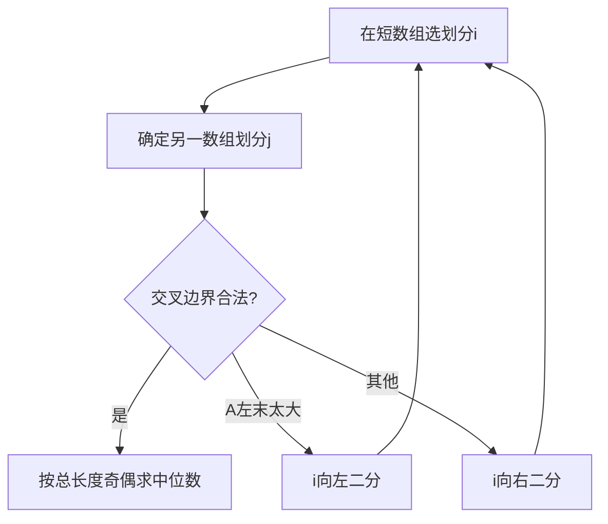

# 11 二分查找

本专题共6题。按简单、中等、困难稳定排序；同难度保留官方顺序。先复习算法附录中的对应结构，再学习各题的变量不变量与边界。

[35 搜索插入位置](#p35) | [74 搜索二维矩阵](#p74) | [34 在排序数组中查找元素的第一个和最后一个位置](#p34) | [33 搜索旋转排序数组](#p33) | [153 寻找旋转排序数组中的最小值](#p153) | [4 寻找两个正序数组的中位数](#p4)

<a id="p35"></a>
## 35. 搜索插入位置

### 1. 题目基本信息

|字段|内容|
|---|---|
|力扣题号|35|
|中文名称|搜索插入位置|
|难度|简单|
|算法专题|二分查找|
|官方原题|[搜索插入位置](https://leetcode.cn/problems/search-insert-position/)|
|推荐前置知识|数组与下标、循环、条件与短路、方法与返回值|

验证状态：已编译：是；本地测试：通过；LeetCode官方测试：未提交，未验证。

### 2. 题目描述

在严格升序数组找target；存在返回下标，否则返回保持有序时应插入的位置，可以等于数组长度。

输入与输出示例：`[1,3,5,6], target=2 → 1`

### 3. 解题思路详细分析

**从直观方案开始**：顺序找第一个≥target的元素需O(n)。

**推荐方案、变量含义与正确性依据**：二分维护半开区间[l,r)，答案是第一个≥target的位置。mid值偏小就令l=mid+1，否则r=mid。l==r时搜索结束，该位置即插入点。r初始n允许返回末尾。

### 4. 完整 Java 解题代码

标准库导入列在代码开头；没有import表示仅使用java.lang自动导入类型及力扣节点。普通题使用`class Solution`，设计题保留指定类名。

```java
class Solution {
    public int searchInsert(int[] nums,int target) {
        int l=0,r=nums.length;
        while(l<r) {
            int m=l+(r-l)/2;
            if(nums[m]<target) l=m+1; else r=m; // 保留第一个不小于target的位置
        }
        return l;
    }
}
```

### 5. Java 知识点详解

以下只复习本题实际出现的语法和关键API；数字锚点对应前面的Java基础章节。

- **数组与下标**（[基础第2节](../Java基础知识附录.md#java-2)）：固定长度容器；new int[n]初值为0，boolean初值false；a[i]读取或写入第i项。本题用数组承载输入或索引状态，索引必须在0..length-1；a.length是字段，不是方法。示例：int[] a={2,7}; a[0]为2。
- **循环**（[基础第3节](../Java基础知识附录.md#java-3)）：for控制初始化、条件、更新；while先判断再执行。本题循环反复处理元素或缩小区间；必须保证每轮有进展。i++先产生旧值再加1，例如a[i++]使用旧下标。增强for读取元素副本，给基本类型循环变量赋值不会改数组。
- **条件与短路**（[基础第3节](../Java基础知识附录.md#java-3)）：if仅在boolean条件为true时执行；条件?A:B只求被选择的一个分支。&&左侧false不算右侧，||左侧true不算右侧；本题利用它们保护边界或选择算法分支。检查p!=null须放在读取p.next之前。
- **方法与返回值**（[基础第4节](../Java基础知识附录.md#java-4)）：方法参数声明输入类型，return表达式交还结果并结束当前调用，void方法可只写return。public入口供力扣调用，private辅助方法只供本类使用。递归时每层局部变量独立，集合参数传的是同一对象的引用值副本。

### 6. 示例执行过程

对应本题示例或文中明确标出的同类小例子：

|步骤|扫描位置、变量或数据结构变化|
|---|---|
|1|[1,3,5,6]找2：l0,r4,m2值5，r2|
|2|m1值3，r1|
|3|m0值1，l1|
|4|收敛到1|

### 7. 复杂度分析

- **时间**：O(log n) 时间，每轮剩余区间约减半。
- **空间**：O(1) 空间。

复杂度中返回结果是否计入已明确说明；树高h、层宽w、总节点数N等规模按本题语境取值。哈希表相关分析使用平均情况；代码调用栈也计入辅助空间。

### 8. 常见错误和注意事项

1. 半开区间不能混用r=mid-1。
2. 插入位置可以是n。
3. 中点用l+(r-l)/2。

### 9. 本题知识总结

- 核心思想：二分维护半开区间[l,r)，答案是第一个≥target的位置。
- Java重点：数组与下标。
- 必会技巧：半开区间不能混用r=mid-1。
- 推荐复习：遮住代码，用第6节的示例重走变量变化，再解释第3节的边界或状态含义，最后独立写出提交方法。

---

<a id="p74"></a>
## 74. 搜索二维矩阵

### 1. 题目基本信息

|字段|内容|
|---|---|
|力扣题号|74|
|中文名称|搜索二维矩阵|
|难度|中等|
|算法专题|二分查找|
|官方原题|[搜索二维矩阵](https://leetcode.cn/problems/search-a-2d-matrix/)|
|推荐前置知识|数组与下标、二维数组、循环、条件与短路、方法与返回值|

验证状态：已编译：是；本地测试：通过；LeetCode官方测试：未提交，未验证。

### 2. 题目描述

矩阵每行递增，且下一行首元素大于上一行尾元素。判断target是否出现。

输入与输出示例：`[[1,3,5],[7,9,11]], target=9 → true`

### 3. 解题思路详细分析

**从直观方案开始**：逐格找O(mn)，但整体实际上有序。

**推荐方案、变量含义与正确性依据**：把矩阵视为长度m*n的有序一维数组。逻辑下标mid对应行mid/n、列mid%n。用闭区间二分，命中返回true，偏小舍左半，偏大舍右半；区间空返回false。

### 4. 完整 Java 解题代码

标准库导入列在代码开头；没有import表示仅使用java.lang自动导入类型及力扣节点。普通题使用`class Solution`，设计题保留指定类名。

```java
class Solution {
    public boolean searchMatrix(int[][] matrix,int target) {
        int n=matrix[0].length,l=0,r=matrix.length*n-1;
        while(l<=r) {
            int mid=l+(r-l)/2,value=matrix[mid/n][mid%n]; // 一维下标映射回行列
            if(value==target) return true;
            if(value<target) l=mid+1; else r=mid-1;
        }
        return false;
    }
}
```

### 5. Java 知识点详解

以下只复习本题实际出现的语法和关键API；数字锚点对应前面的Java基础章节。

- **数组与下标**（[基础第2节](../Java基础知识附录.md#java-2)）：固定长度容器；new int[n]初值为0，boolean初值false；a[i]读取或写入第i项。本题用数组承载输入或索引状态，索引必须在0..length-1；a.length是字段，不是方法。示例：int[] a={2,7}; a[0]为2。
- **二维数组**（[基础第2节](../Java基础知识附录.md#java-2)）：a[r][c]先取第r行再取第c列；行数a.length，列数a[0].length。本题用它表示矩阵或二维状态。不要把行列维度写反，空外数组不能访问a[0]。
- **循环**（[基础第3节](../Java基础知识附录.md#java-3)）：for控制初始化、条件、更新；while先判断再执行。本题循环反复处理元素或缩小区间；必须保证每轮有进展。i++先产生旧值再加1，例如a[i++]使用旧下标。增强for读取元素副本，给基本类型循环变量赋值不会改数组。
- **条件与短路**（[基础第3节](../Java基础知识附录.md#java-3)）：if仅在boolean条件为true时执行；条件?A:B只求被选择的一个分支。&&左侧false不算右侧，||左侧true不算右侧；本题利用它们保护边界或选择算法分支。检查p!=null须放在读取p.next之前。
- **方法与返回值**（[基础第4节](../Java基础知识附录.md#java-4)）：方法参数声明输入类型，return表达式交还结果并结束当前调用，void方法可只写return。public入口供力扣调用，private辅助方法只供本类使用。递归时每层局部变量独立，集合参数传的是同一对象的引用值副本。

### 6. 示例执行过程

对应本题示例或文中明确标出的同类小例子：

|步骤|扫描位置、变量或数据结构变化|
|---|---|
|1|6个元素找9：mid2对应(0,2)=5，左界升3|
|2|mid4对应(1,1)=9，命中|

### 7. 复杂度分析

- **时间**：O(log(mn)) 时间，每轮减半。
- **空间**：O(1) 空间，没有真正展开矩阵。

复杂度中返回结果是否计入已明确说明；树高h、层宽w、总节点数N等规模按本题语境取值。哈希表相关分析使用平均情况；代码调用栈也计入辅助空间。

### 8. 常见错误和注意事项

1. 坐标除数是列数n。
2. 只行列各自有序的240题不适用此法。
3. 闭区间循环用l<=r。

### 9. 本题知识总结

- 核心思想：把矩阵视为长度m*n的有序一维数组。
- Java重点：数组与下标、二维数组。
- 必会技巧：坐标除数是列数n。
- 推荐复习：遮住代码，用第6节的示例重走变量变化，再解释第3节的边界或状态含义，最后独立写出提交方法。

---

<a id="p34"></a>
## 34. 在排序数组中查找元素的第一个和最后一个位置

### 1. 题目基本信息

|字段|内容|
|---|---|
|力扣题号|34|
|中文名称|在排序数组中查找元素的第一个和最后一个位置|
|难度|中等|
|算法专题|二分查找|
|官方原题|[在排序数组中查找元素的第一个和最后一个位置](https://leetcode.cn/problems/find-first-and-last-position-of-element-in-sorted-array/)|
|推荐前置知识|数组与下标、循环、条件与短路、方法与返回值、对象、引用与null|

验证状态：已编译：是；本地测试：通过；LeetCode官方测试：未提交，未验证。

### 2. 题目描述

非递减数组可能有重复，返回target首次和末次出现的下标；不存在返回[-1,-1]。

输入与输出示例：`[5,7,7,8,8,10], target=8 → [3,4]`

### 3. 解题思路详细分析

**从直观方案开始**：线性扫描能找到，但要求O(log n)。

**推荐方案、变量含义与正确性依据**：分别二分求第一个≥target的lower和第一个>target的upper。两个半开区间搜索仅在相等时的移动方向不同。若lower==n或该位置不等target则无解，否则答案[lower,upper-1]。不用target+1，避免最大整数溢出。

### 4. 完整 Java 解题代码

标准库导入列在代码开头；没有import表示仅使用java.lang自动导入类型及力扣节点。普通题使用`class Solution`，设计题保留指定类名。

```java
class Solution {
    public int[] searchRange(int[] nums,int target) {
        int first=bound(nums,target,false);
        if(first==nums.length || nums[first]!=target) return new int[]{-1,-1};
        return new int[]{first,bound(nums,target,true)-1};
    }
    private int bound(int[] a,int target,boolean upper) {
        int l=0,r=a.length;
        while(l<r) {
            int m=l+(r-l)/2;
            // upper为true时，相等元素也要排除到左边
            if(a[m]<target || (upper && a[m]==target)) l=m+1; else r=m;
        }
        return l;
    }
}
```

### 5. Java 知识点详解

以下只复习本题实际出现的语法和关键API；数字锚点对应前面的Java基础章节。

- **数组与下标**（[基础第2节](../Java基础知识附录.md#java-2)）：固定长度容器；new int[n]初值为0，boolean初值false；a[i]读取或写入第i项。本题用数组承载输入或索引状态，索引必须在0..length-1；a.length是字段，不是方法。示例：int[] a={2,7}; a[0]为2。
- **循环**（[基础第3节](../Java基础知识附录.md#java-3)）：for控制初始化、条件、更新；while先判断再执行。本题循环反复处理元素或缩小区间；必须保证每轮有进展。i++先产生旧值再加1，例如a[i++]使用旧下标。增强for读取元素副本，给基本类型循环变量赋值不会改数组。
- **条件与短路**（[基础第3节](../Java基础知识附录.md#java-3)）：if仅在boolean条件为true时执行；条件?A:B只求被选择的一个分支。&&左侧false不算右侧，||左侧true不算右侧；本题利用它们保护边界或选择算法分支。检查p!=null须放在读取p.next之前。
- **方法与返回值**（[基础第4节](../Java基础知识附录.md#java-4)）：方法参数声明输入类型，return表达式交还结果并结束当前调用，void方法可只写return。public入口供力扣调用，private辅助方法只供本类使用。递归时每层局部变量独立，集合参数传的是同一对象的引用值副本。
- **对象、引用与null**（[基础第21节](../Java基础知识附录.md#java-21)）：new创建对象；赋值p=q复制引用，不复制节点或集合。本题经引用修改对象内容，调用者可见；重新给参数赋new只改变局部参数。null没有可访问的字段或方法。对象==比较身份，String等内容要用equals。

### 6. 示例执行过程

对应本题示例或文中明确标出的同类小例子：

|步骤|扫描位置、变量或数据结构变化|
|---|---|
|1|找8的lower收敛3，upper收敛5|
|2|覆盖下标3、4，返回[3,4]|
|3|找6时lower为1但nums[1]=7，返回无解|

### 7. 复杂度分析

- **时间**：O(log n) 时间，两次二分。
- **空间**：O(1) 空间。

复杂度中返回结果是否计入已明确说明；树高h、层宽w、总节点数N等规模按本题语境取值。哈希表相关分析使用平均情况；代码调用栈也计入辅助空间。

### 8. 常见错误和注意事项

1. 先检查lower是否越界。
2. upper是排他位置需减1。
3. 不要用target+1实现上界而忽略溢出。

### 9. 本题知识总结

- 核心思想：分别二分求第一个≥target的lower和第一个>target的upper。
- Java重点：数组与下标。
- 必会技巧：先检查lower是否越界。
- 推荐复习：遮住代码，用第6节的示例重走变量变化，再解释第3节的边界或状态含义，最后独立写出提交方法。

---

<a id="p33"></a>
## 33. 搜索旋转排序数组

### 1. 题目基本信息

|字段|内容|
|---|---|
|力扣题号|33|
|中文名称|搜索旋转排序数组|
|难度|中等|
|算法专题|二分查找|
|官方原题|[搜索旋转排序数组](https://leetcode.cn/problems/search-in-rotated-sorted-array/)|
|推荐前置知识|数组与下标、循环、条件与短路、方法与返回值|

验证状态：已编译：是；本地测试：通过；LeetCode官方测试：未提交，未验证。

### 2. 题目描述

原本严格递增的数组经一次旋转，返回target下标，不存在返回-1。元素互不相同。

输入与输出示例：`[4,5,6,7,0,1,2], target=0 → 4`

### 3. 解题思路详细分析

**从直观方案开始**：遍历O(n)，题目要求对数时间。

**推荐方案、变量含义与正确性依据**：闭区间二分，每次mid把区间分开，其中至少一半有序。若nums[l]<=nums[mid]则左半有序，判断target是否处于[l,mid)值域；否则右半有序，判断是否位于(mid,r]值域。只保留可能含目标的一半。

### 4. 完整 Java 解题代码

标准库导入列在代码开头；没有import表示仅使用java.lang自动导入类型及力扣节点。普通题使用`class Solution`，设计题保留指定类名。

```java
class Solution {
    public int search(int[] nums,int target) {
        int l=0,r=nums.length-1;
        while(l<=r) {
            int m=l+(r-l)/2;
            if(nums[m]==target) return m;
            if(nums[l]<=nums[m]) { // 左半有序
                if(nums[l]<=target && target<nums[m]) r=m-1; else l=m+1;
            } else {
                if(nums[m]<target && target<=nums[r]) l=m+1; else r=m-1;
            }
        }
        return -1;
    }
}
```

### 5. Java 知识点详解

以下只复习本题实际出现的语法和关键API；数字锚点对应前面的Java基础章节。

- **数组与下标**（[基础第2节](../Java基础知识附录.md#java-2)）：固定长度容器；new int[n]初值为0，boolean初值false；a[i]读取或写入第i项。本题用数组承载输入或索引状态，索引必须在0..length-1；a.length是字段，不是方法。示例：int[] a={2,7}; a[0]为2。
- **循环**（[基础第3节](../Java基础知识附录.md#java-3)）：for控制初始化、条件、更新；while先判断再执行。本题循环反复处理元素或缩小区间；必须保证每轮有进展。i++先产生旧值再加1，例如a[i++]使用旧下标。增强for读取元素副本，给基本类型循环变量赋值不会改数组。
- **条件与短路**（[基础第3节](../Java基础知识附录.md#java-3)）：if仅在boolean条件为true时执行；条件?A:B只求被选择的一个分支。&&左侧false不算右侧，||左侧true不算右侧；本题利用它们保护边界或选择算法分支。检查p!=null须放在读取p.next之前。
- **方法与返回值**（[基础第4节](../Java基础知识附录.md#java-4)）：方法参数声明输入类型，return表达式交还结果并结束当前调用，void方法可只写return。public入口供力扣调用，private辅助方法只供本类使用。递归时每层局部变量独立，集合参数传的是同一对象的引用值副本。

### 6. 示例执行过程

对应本题示例或文中明确标出的同类小例子：

|步骤|扫描位置、变量或数据结构变化|
|---|---|
|1|l0,r6,mid3值7，左半有序但0不在[4,7)，保留右半|
|2|l4,r6,mid5值1，0位于左半，r4|
|3|命中下标4|

### 7. 复杂度分析

- **时间**：O(log n) 时间，每轮减半。
- **空间**：O(1) 空间。

复杂度中返回结果是否计入已明确说明；树高h、层宽w、总节点数N等规模按本题语境取值。哈希表相关分析使用平均情况；代码调用栈也计入辅助空间。

### 8. 常见错误和注意事项

1. 有序判断含等号才能覆盖单元素半段。
2. 目标区间端点开闭配套。
3. 重复值场景不满足本题前提。

### 9. 本题知识总结

- 核心思想：闭区间二分，每次mid把区间分开，其中至少一半有序。
- Java重点：数组与下标。
- 必会技巧：有序判断含等号才能覆盖单元素半段。
- 推荐复习：遮住代码，用第6节的示例重走变量变化，再解释第3节的边界或状态含义，最后独立写出提交方法。

---

<a id="p153"></a>
## 153. 寻找旋转排序数组中的最小值

### 1. 题目基本信息

|字段|内容|
|---|---|
|力扣题号|153|
|中文名称|寻找旋转排序数组中的最小值|
|难度|中等|
|算法专题|二分查找|
|官方原题|[寻找旋转排序数组中的最小值](https://leetcode.cn/problems/find-minimum-in-rotated-sorted-array/)|
|推荐前置知识|数组与下标、循环、条件与短路、方法与返回值|

验证状态：已编译：是；本地测试：通过；LeetCode官方测试：未提交，未验证。

### 2. 题目描述

在旋转后的严格递增非空数组中求最小值，无重复元素，未旋转也合法。

输入与输出示例：`[3,4,5,1,2] → 1`

### 3. 解题思路详细分析

**从直观方案开始**：遍历取最小O(n)。

**推荐方案、变量含义与正确性依据**：比较mid与当前右端：nums[mid]>nums[r]说明旋转断点在右侧，l=mid+1；否则mid处于有序右段，最小值在左边或就是mid，r=mid。l==r时唯一候选即最小值。

### 4. 完整 Java 解题代码

标准库导入列在代码开头；没有import表示仅使用java.lang自动导入类型及力扣节点。普通题使用`class Solution`，设计题保留指定类名。

```java
class Solution {
    public int findMin(int[] nums) {
        int l=0,r=nums.length-1;
        while(l<r) {
            int mid=l+(r-l)/2;
            if(nums[mid]>nums[r]) l=mid+1;
            else r=mid; // mid自身仍是最小值候选
        }
        return nums[l];
    }
}
```

### 5. Java 知识点详解

以下只复习本题实际出现的语法和关键API；数字锚点对应前面的Java基础章节。

- **数组与下标**（[基础第2节](../Java基础知识附录.md#java-2)）：固定长度容器；new int[n]初值为0，boolean初值false；a[i]读取或写入第i项。本题用数组承载输入或索引状态，索引必须在0..length-1；a.length是字段，不是方法。示例：int[] a={2,7}; a[0]为2。
- **循环**（[基础第3节](../Java基础知识附录.md#java-3)）：for控制初始化、条件、更新；while先判断再执行。本题循环反复处理元素或缩小区间；必须保证每轮有进展。i++先产生旧值再加1，例如a[i++]使用旧下标。增强for读取元素副本，给基本类型循环变量赋值不会改数组。
- **条件与短路**（[基础第3节](../Java基础知识附录.md#java-3)）：if仅在boolean条件为true时执行；条件?A:B只求被选择的一个分支。&&左侧false不算右侧，||左侧true不算右侧；本题利用它们保护边界或选择算法分支。检查p!=null须放在读取p.next之前。
- **方法与返回值**（[基础第4节](../Java基础知识附录.md#java-4)）：方法参数声明输入类型，return表达式交还结果并结束当前调用，void方法可只写return。public入口供力扣调用，private辅助方法只供本类使用。递归时每层局部变量独立，集合参数传的是同一对象的引用值副本。

### 6. 示例执行过程

对应本题示例或文中明确标出的同类小例子：

|步骤|扫描位置、变量或数据结构变化|
|---|---|
|1|[3,4,5,1,2]，mid2值5>右2，l3|
|2|mid3值1≤右2，r3|
|3|返回nums[3]=1|

### 7. 复杂度分析

- **时间**：O(log n) 时间，区间每轮约减半。
- **空间**：O(1) 空间。

复杂度中返回结果是否计入已明确说明；树高h、层宽w、总节点数N等规模按本题语境取值。哈希表相关分析使用平均情况；代码调用栈也计入辅助空间。

### 8. 常见错误和注意事项

1. 右界不能写mid-1，mid可能就是最小。
2. 以当前nums[r]比较。
3. 重复元素需不同处理。

### 9. 本题知识总结

- 核心思想：比较mid与当前右端：nums[mid]>nums[r]说明旋转断点在右侧，l=mid+1；否则mid处于有序右段，最小值在左边或就是mid，r=mid。
- Java重点：数组与下标。
- 必会技巧：右界不能写mid-1，mid可能就是最小。
- 推荐复习：遮住代码，用第6节的示例重走变量变化，再解释第3节的边界或状态含义，最后独立写出提交方法。

---

<a id="p4"></a>
## 4. 寻找两个正序数组的中位数

### 1. 题目基本信息

|字段|内容|
|---|---|
|力扣题号|4|
|中文名称|寻找两个正序数组的中位数|
|难度|困难|
|算法专题|二分查找|
|官方原题|[寻找两个正序数组的中位数](https://leetcode.cn/problems/median-of-two-sorted-arrays/)|
|推荐前置知识|数组与下标、循环、条件与短路、方法与返回值、对象、引用与null、Math.max / Math.min、整数边界与数值提升|

验证状态：已编译：是；本地测试：通过；LeetCode官方测试：未提交，未验证。

### 2. 题目描述

两个各自升序数组，至少一个非空，求合并序列中位数。偶数长度返回中间两数平均值。

输入与输出示例：`[1,3] 与 [2] → 2.0；[1,2]与[3,4] → 2.5`

### 3. 解题思路详细分析

**从直观方案开始**：真正合并需O(m+n)时间和线性空间，不满足对数时间要求。

**推荐方案、变量含义与正确性依据**：在较短数组A二分划分i，B划分j=(m+n+1)/2-i，让左侧总数比右侧相等或多1。需要A左末≤B右首且B左末≤A右首；过界用整数极值作哨兵。若A左末过大则i左移，否则右移。合法后奇数取左侧最大，偶数取左最大与右最小的平均。较短数组保证j不会越界。

执行流程图：



### 4. 完整 Java 解题代码

标准库导入列在代码开头；没有import表示仅使用java.lang自动导入类型及力扣节点。普通题使用`class Solution`，设计题保留指定类名。

```java
class Solution {
    public double findMedianSortedArrays(int[] a,int[] b) {
        if(a.length>b.length) return findMedianSortedArrays(b,a);
        int m=a.length,n=b.length,l=0,r=m;
        while(l<=r) {
            int i=l+(r-l)/2,j=(m+n+1)/2-i;
            int al=i==0?Integer.MIN_VALUE:a[i-1],ar=i==m?Integer.MAX_VALUE:a[i];
            int bl=j==0?Integer.MIN_VALUE:b[j-1],br=j==n?Integer.MAX_VALUE:b[j];
            if(al<=br && bl<=ar) { // 两侧交叉边界都满足整体有序
                if((m+n)%2==1) return Math.max(al,bl);
                return ((double)Math.max(al,bl)+Math.min(ar,br))/2;
            }
            if(al>br) r=i-1; else l=i+1;
        }
        throw new IllegalArgumentException("输入必须为有序数组");
    }
}
```

### 5. Java 知识点详解

以下只复习本题实际出现的语法和关键API；数字锚点对应前面的Java基础章节。

- **数组与下标**（[基础第2节](../Java基础知识附录.md#java-2)）：固定长度容器；new int[n]初值为0，boolean初值false；a[i]读取或写入第i项。本题用数组承载输入或索引状态，索引必须在0..length-1；a.length是字段，不是方法。示例：int[] a={2,7}; a[0]为2。
- **循环**（[基础第3节](../Java基础知识附录.md#java-3)）：for控制初始化、条件、更新；while先判断再执行。本题循环反复处理元素或缩小区间；必须保证每轮有进展。i++先产生旧值再加1，例如a[i++]使用旧下标。增强for读取元素副本，给基本类型循环变量赋值不会改数组。
- **条件与短路**（[基础第3节](../Java基础知识附录.md#java-3)）：if仅在boolean条件为true时执行；条件?A:B只求被选择的一个分支。&&左侧false不算右侧，||左侧true不算右侧；本题利用它们保护边界或选择算法分支。检查p!=null须放在读取p.next之前。
- **方法与返回值**（[基础第4节](../Java基础知识附录.md#java-4)）：方法参数声明输入类型，return表达式交还结果并结束当前调用，void方法可只写return。public入口供力扣调用，private辅助方法只供本类使用。递归时每层局部变量独立，集合参数传的是同一对象的引用值副本。
- **对象、引用与null**（[基础第21节](../Java基础知识附录.md#java-21)）：new创建对象；赋值p=q复制引用，不复制节点或集合。本题经引用修改对象内容，调用者可见；重新给参数赋new只改变局部参数。null没有可访问的字段或方法。对象==比较身份，String等内容要用equals。
- **Math.max / Math.min**（[基础第19节](../Java基础知识附录.md#java-19)）：静态方法传两个同类数值，返回较大/较小值，不修改实参。本题维护最优值、边界或DP转移。必须把结果赋回变量：Math.max(best,x)单独调用不会改变best。
- **整数边界与数值提升**（[基础第1节](../Java基础知识附录.md#java-1)）：Integer常量为32位上下界，Long为64位上下界。本题作为初始最优值、哨兵或安全边界。MIN_VALUE取负会溢出；相加前转long/double而非运算后再转换，例如((double)a+b)/2避免int加法溢出。

### 6. 示例执行过程

对应本题示例或文中明确标出的同类小例子：

|步骤|扫描位置、变量或数据结构变化|
|---|---|
|1|A=[1,2],B=[3,4]，先i1,j1：B左3>A右2，i右移|
|2|i2,j0后左为1,2，右为3,4，跨边界合法，中位数(2+3)/2=2.5|

### 7. 复杂度分析

- **时间**：O(log(min(m,n)+1)) 时间，只二分较短数组。
- **空间**：O(1) 额外空间，交换参数最多一次递归。

复杂度中返回结果是否计入已明确说明；树高h、层宽w、总节点数N等规模按本题语境取值。哈希表相关分析使用平均情况；代码调用栈也计入辅助空间。

### 8. 常见错误和注意事项

1. 先确保A较短。
2. 偶数求和前转double防int溢出。
3. 空侧需要边界哨兵。

### 9. 本题知识总结

- 核心思想：在较短数组A二分划分i，B划分j=(m+n+1)/2-i，让左侧总数比右侧相等或多1。
- Java重点：数组与下标、Math.max / Math.min、整数边界与数值提升。
- 必会技巧：先确保A较短。
- 推荐复习：遮住代码，用第6节的示例重走变量变化，再解释第3节的边界或状态含义，最后独立写出提交方法。

---

