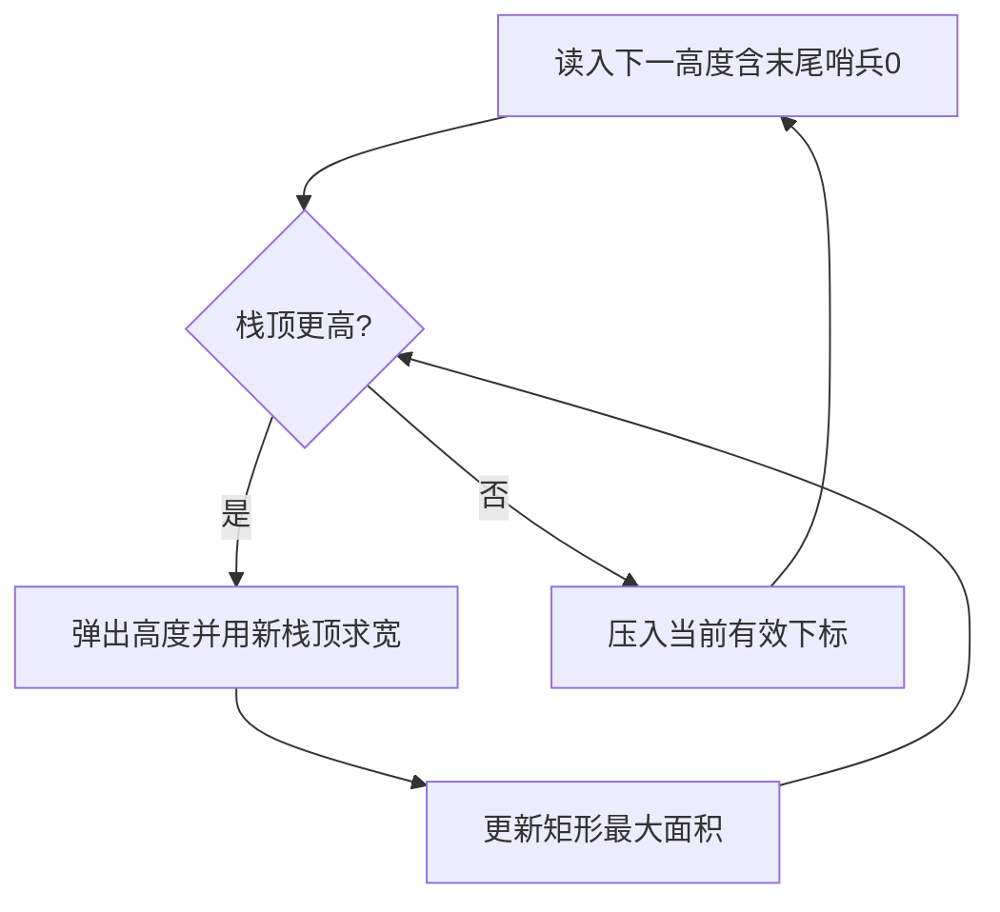

# 12 栈

本专题共5题。按简单、中等、困难稳定排序；同难度保留官方顺序。先复习算法附录中的对应结构，再学习各题的变量不变量与边界。

[20 有效的括号](#p20) | [155 最小栈](#p155) | [394 字符串解码](#p394) | [739 每日温度](#p739) | [84 柱状图中最大的矩形](#p84)

<a id="p20"></a>
## 20. 有效的括号

### 1. 题目基本信息

|字段|内容|
|---|---|
|力扣题号|20|
|中文名称|有效的括号|
|难度|简单|
|算法专题|栈|
|官方原题|[有效的括号](https://leetcode.cn/problems/valid-parentheses/)|
|推荐前置知识|循环、条件与短路、方法与返回值、对象、引用与null、Deque、ArrayDeque、push / pop / peek、String|

验证状态：已编译：是；本地测试：通过；LeetCode官方测试：未提交，未验证。

### 2. 题目描述

只含三类括号的字符串，判断是否按类型及嵌套顺序完全配对。

输入与输出示例：`"([])" → true；"([)]" → false`

### 3. 解题思路详细分析

**从直观方案开始**：统计左右括号数量相同不能保证嵌套合法。

**推荐方案、变量含义与正确性依据**：栈保存尚未闭合的左括号。遇左括号入栈；遇右括号必须与栈顶类型匹配，否则false；匹配则弹栈。最后栈为空才合法。栈的后进先出恰好对应最内层先闭合。

### 4. 完整 Java 解题代码

标准库导入列在代码开头；没有import表示仅使用java.lang自动导入类型及力扣节点。普通题使用`class Solution`，设计题保留指定类名。

```java
import java.util.*;
class Solution {
    public boolean isValid(String s) {
        Deque<Character> stack=new ArrayDeque<>();
        for(char c:s.toCharArray()) {
            if(c=='(' || c=='[' || c=='{') stack.push(c);
            else {
                if(stack.isEmpty()) return false;
                char open=stack.pop();
                if((c==')' && open!='(')||(c==']' && open!='[')||(c=='}' && open!='{')) return false;
            }
        }
        return stack.isEmpty(); // 不能遗留未闭合的左括号
    }
}
```

### 5. Java 知识点详解

以下只复习本题实际出现的语法和关键API；数字锚点对应前面的Java基础章节。

- **循环**（[基础第3节](../Java基础知识附录.md#java-3)）：for控制初始化、条件、更新；while先判断再执行。本题循环反复处理元素或缩小区间；必须保证每轮有进展。i++先产生旧值再加1，例如a[i++]使用旧下标。增强for读取元素副本，给基本类型循环变量赋值不会改数组。
- **条件与短路**（[基础第3节](../Java基础知识附录.md#java-3)）：if仅在boolean条件为true时执行；条件?A:B只求被选择的一个分支。&&左侧false不算右侧，||左侧true不算右侧；本题利用它们保护边界或选择算法分支。检查p!=null须放在读取p.next之前。
- **方法与返回值**（[基础第4节](../Java基础知识附录.md#java-4)）：方法参数声明输入类型，return表达式交还结果并结束当前调用，void方法可只写return。public入口供力扣调用，private辅助方法只供本类使用。递归时每层局部变量独立，集合参数传的是同一对象的引用值副本。
- **对象、引用与null**（[基础第21节](../Java基础知识附录.md#java-21)）：new创建对象；赋值p=q复制引用，不复制节点或集合。本题经引用修改对象内容，调用者可见；重新给参数赋new只改变局部参数。null没有可访问的字段或方法。对象==比较身份，String等内容要用equals。
- **Deque、ArrayDeque**（[基础第14节](../Java基础知识附录.md#java-14)）：Deque支持两端操作，ArrayDeque是数组实现且不能存null。本题将其作为栈、队列或单调候选容器。isEmpty()检查是否为空，size()返回元素数；两端写操作摊还O(1)，不要在中间位置做线性删除来破坏复杂度。
- **push / pop / peek**（[基础第14节](../Java基础知识附录.md#java-14)）：push(x)把x压入头部，pop()删除并返回头部，peek()只读头部。用于本题栈或读取堆顶（PriorityQueue也有peek）。pop空栈抛异常；peek空时null，拆箱前必须确认非空。例：压3再压5，弹出5。
- **String**（[基础第10节](../Java基础知识附录.md#java-10)）：不可变字符序列；length()返回字符单元数，equals比较文本。作为本题输入、键或结果；修改内容须创建新String或用StringBuilder。String==只比较引用，不能替代内容比较。
- **String.toCharArray()**（[基础第10节](../Java基础知识附录.md#java-10)）：把字符串复制为新的char[]，可修改或排序。本题用增强for遍历字符或排序生成特征键；排序数组不会修改原字符串。char数组直接toString()不是内容，要new String(chars)。

### 6. 示例执行过程

对应本题示例或文中明确标出的同类小例子：

|步骤|扫描位置、变量或数据结构变化|
|---|---|
|1|(入栈，再[入栈|
|2|]弹出[|
|3|)弹出(|
|4|结束空栈，true|
|5|([)]在遇)时栈顶是[，立即false|

### 7. 复杂度分析

- **时间**：O(n) 时间，每字符入出栈至多一次。
- **空间**：O(n) 最坏栈空间。

复杂度中返回结果是否计入已明确说明；树高h、层宽w、总节点数N等规模按本题语境取值。哈希表相关分析使用平均情况；代码调用栈也计入辅助空间。

### 8. 常见错误和注意事项

1. 弹栈前检查空。
2. 数量一致不够。
3. 结束还要检查剩余左括号。

### 9. 本题知识总结

- 核心思想：栈保存尚未闭合的左括号。
- Java重点：Deque、ArrayDeque、push / pop / peek、String、String.toCharArray()。
- 必会技巧：弹栈前检查空。
- 推荐复习：遮住代码，用第6节的示例重走变量变化，再解释第3节的边界或状态含义，最后独立写出提交方法。

---

<a id="p155"></a>
## 155. 最小栈

### 1. 题目基本信息

|字段|内容|
|---|---|
|力扣题号|155|
|中文名称|最小栈|
|难度|中等|
|算法专题|栈|
|官方原题|[最小栈](https://leetcode.cn/problems/min-stack/)|
|推荐前置知识|条件与短路、方法与返回值、对象、引用与null、Deque、ArrayDeque、push / pop / peek、Math.max / Math.min、this、static、final|

验证状态：已编译：是；本地测试：通过；LeetCode官方测试：未提交，未验证。

### 2. 题目描述

设计栈，支持push、pop、top、getMin，每个操作常数时间。题目保证后三类操作调用时非空。

输入与输出示例：`push(-2),push(0),push(-3),getMin()=-3,pop(),getMin()=-2`

### 3. 解题思路详细分析

**从直观方案开始**：每次getMin遍历全栈要O(n)。

**推荐方案、变量含义与正确性依据**：数据栈保存实际值，辅助栈在每一层保存从底到这一层的最小值。push时把min(新值,原最小)压入辅助栈；pop时两栈同步弹出。这样重复最小值也能正确恢复。

### 4. 完整 Java 解题代码

标准库导入列在代码开头；没有import表示仅使用java.lang自动导入类型及力扣节点。普通题使用`class Solution`，设计题保留指定类名。

```java
import java.util.*;
class MinStack {
    private final Deque<Integer> data=new ArrayDeque<>(),mins=new ArrayDeque<>();
    public MinStack() {}
    public void push(int val) {
        data.push(val);
        mins.push(mins.isEmpty()?val:Math.min(val,mins.peek())); // 为本层保存最小值
    }
    public void pop() { data.pop(); mins.pop(); }
    public int top() { return data.peek(); }
    public int getMin() { return mins.peek(); }
}
```

### 5. Java 知识点详解

以下只复习本题实际出现的语法和关键API；数字锚点对应前面的Java基础章节。

- **条件与短路**（[基础第3节](../Java基础知识附录.md#java-3)）：if仅在boolean条件为true时执行；条件?A:B只求被选择的一个分支。&&左侧false不算右侧，||左侧true不算右侧；本题利用它们保护边界或选择算法分支。检查p!=null须放在读取p.next之前。
- **方法与返回值**（[基础第4节](../Java基础知识附录.md#java-4)）：方法参数声明输入类型，return表达式交还结果并结束当前调用，void方法可只写return。public入口供力扣调用，private辅助方法只供本类使用。递归时每层局部变量独立，集合参数传的是同一对象的引用值副本。
- **对象、引用与null**（[基础第21节](../Java基础知识附录.md#java-21)）：new创建对象；赋值p=q复制引用，不复制节点或集合。本题经引用修改对象内容，调用者可见；重新给参数赋new只改变局部参数。null没有可访问的字段或方法。对象==比较身份，String等内容要用equals。
- **Deque、ArrayDeque**（[基础第14节](../Java基础知识附录.md#java-14)）：Deque支持两端操作，ArrayDeque是数组实现且不能存null。本题将其作为栈、队列或单调候选容器。isEmpty()检查是否为空，size()返回元素数；两端写操作摊还O(1)，不要在中间位置做线性删除来破坏复杂度。
- **push / pop / peek**（[基础第14节](../Java基础知识附录.md#java-14)）：push(x)把x压入头部，pop()删除并返回头部，peek()只读头部。用于本题栈或读取堆顶（PriorityQueue也有peek）。pop空栈抛异常；peek空时null，拆箱前必须确认非空。例：压3再压5，弹出5。
- **Math.max / Math.min**（[基础第19节](../Java基础知识附录.md#java-19)）：静态方法传两个同类数值，返回较大/较小值，不修改实参。本题维护最优值、边界或DP转移。必须把结果赋回变量：Math.max(best,x)单独调用不会改变best。
- **this、static、final**（[基础第7节](../Java基础知识附录.md#java-7)）：this表示当前对象，可区分字段与参数。static成员属于类；final字段仅允许初始化一次，若指向集合仍能增删内容。本题用它们保存对象结构或固定配置，不能把可变结果错误地当所有调用共享的全局状态。

### 6. 示例执行过程

对应本题示例或文中明确标出的同类小例子：

|步骤|扫描位置、变量或数据结构变化|
|---|---|
|1|压-2后min栈[-2]|
|2|压0后顶部仍-2|
|3|压-3后顶部-3|
|4|弹一次后两个栈回退，最小恢复-2|

### 7. 复杂度分析

- **时间**：push/pop摊还O(1)时间（ArrayDeque扩容偶尔O(n)），getMin/top最坏O(1)。
- **空间**：O(n)总空间，两个栈各保存n层状态。

复杂度中返回结果是否计入已明确说明；树高h、层宽w、总节点数N等规模按本题语境取值。哈希表相关分析使用平均情况；代码调用栈也计入辅助空间。

### 8. 常见错误和注意事项

1. 重复最小值也必须有一层记录。
2. 两栈同步pop。
3. 空栈操作不在题目合法输入内。

### 9. 本题知识总结

- 核心思想：数据栈保存实际值，辅助栈在每一层保存从底到这一层的最小值。
- Java重点：Deque、ArrayDeque、push / pop / peek、Math.max / Math.min、this、static、final。
- 必会技巧：重复最小值也必须有一层记录。
- 推荐复习：遮住代码，用第6节的示例重走变量变化，再解释第3节的边界或状态含义，最后独立写出提交方法。

---

<a id="p394"></a>
## 394. 字符串解码

### 1. 题目基本信息

|字段|内容|
|---|---|
|力扣题号|394|
|中文名称|字符串解码|
|难度|中等|
|算法专题|栈|
|官方原题|[字符串解码](https://leetcode.cn/problems/decode-string/)|
|推荐前置知识|循环、条件与短路、方法与返回值、对象、引用与null、Deque、ArrayDeque、push / pop / peek、String|

验证状态：已编译：是；本地测试：通过；LeetCode官方测试：未提交，未验证。

### 2. 题目描述

解码形如k[子串]的嵌套字符串，表示子串重复k次。输入合法，数字只代表重复次数。

输入与输出示例：`"3[a2[c]]" → "accaccacc"`

### 3. 解题思路详细分析

**从直观方案开始**：不断找最内层括号替换可以做，但频繁复制难以管理。

**推荐方案、变量含义与正确性依据**：遇数字累积多位count；遇[把当前前缀和重复次数分别压栈，然后清空当前层；遇]弹出父层，重复追加当前层，再把父层设为当前字符串。普通字母直接追加。两栈对应一层嵌套上下文。

### 4. 完整 Java 解题代码

标准库导入列在代码开头；没有import表示仅使用java.lang自动导入类型及力扣节点。普通题使用`class Solution`，设计题保留指定类名。

```java
import java.util.*;
class Solution {
    public String decodeString(String s) {
        Deque<Integer> counts=new ArrayDeque<>();
        Deque<StringBuilder> parents=new ArrayDeque<>();
        StringBuilder cur=new StringBuilder(); int count=0;
        for(char c:s.toCharArray()) {
            if(c>='0' && c<='9') count=count*10+c-'0';
            else if(c=='[') {
                counts.push(count); parents.push(cur); count=0; cur=new StringBuilder();
            } else if(c==']') {
                int times=counts.pop(); StringBuilder parent=parents.pop();
                for(int i=0;i<times;i++) parent.append(cur); // 把本层展开结果接回父层
                cur=parent;
            } else cur.append(c);
        }
        return cur.toString();
    }
}
```

### 5. Java 知识点详解

以下只复习本题实际出现的语法和关键API；数字锚点对应前面的Java基础章节。

- **循环**（[基础第3节](../Java基础知识附录.md#java-3)）：for控制初始化、条件、更新；while先判断再执行。本题循环反复处理元素或缩小区间；必须保证每轮有进展。i++先产生旧值再加1，例如a[i++]使用旧下标。增强for读取元素副本，给基本类型循环变量赋值不会改数组。
- **条件与短路**（[基础第3节](../Java基础知识附录.md#java-3)）：if仅在boolean条件为true时执行；条件?A:B只求被选择的一个分支。&&左侧false不算右侧，||左侧true不算右侧；本题利用它们保护边界或选择算法分支。检查p!=null须放在读取p.next之前。
- **方法与返回值**（[基础第4节](../Java基础知识附录.md#java-4)）：方法参数声明输入类型，return表达式交还结果并结束当前调用，void方法可只写return。public入口供力扣调用，private辅助方法只供本类使用。递归时每层局部变量独立，集合参数传的是同一对象的引用值副本。
- **对象、引用与null**（[基础第21节](../Java基础知识附录.md#java-21)）：new创建对象；赋值p=q复制引用，不复制节点或集合。本题经引用修改对象内容，调用者可见；重新给参数赋new只改变局部参数。null没有可访问的字段或方法。对象==比较身份，String等内容要用equals。
- **Deque、ArrayDeque**（[基础第14节](../Java基础知识附录.md#java-14)）：Deque支持两端操作，ArrayDeque是数组实现且不能存null。本题将其作为栈、队列或单调候选容器。isEmpty()检查是否为空，size()返回元素数；两端写操作摊还O(1)，不要在中间位置做线性删除来破坏复杂度。
- **push / pop / peek**（[基础第14节](../Java基础知识附录.md#java-14)）：push(x)把x压入头部，pop()删除并返回头部，peek()只读头部。用于本题栈或读取堆顶（PriorityQueue也有peek）。pop空栈抛异常；peek空时null，拆箱前必须确认非空。例：压3再压5，弹出5。
- **String**（[基础第10节](../Java基础知识附录.md#java-10)）：不可变字符序列；length()返回字符单元数，equals比较文本。作为本题输入、键或结果；修改内容须创建新String或用StringBuilder。String==只比较引用，不能替代内容比较。
- **String.toCharArray()**（[基础第10节](../Java基础知识附录.md#java-10)）：把字符串复制为新的char[]，可修改或排序。本题用增强for遍历字符或排序生成特征键；排序数组不会修改原字符串。char数组直接toString()不是内容，要new String(chars)。
- **StringBuilder**（[基础第10节](../Java基础知识附录.md#java-10)）：可变字符串缓冲；append(x)追加且返回同一builder；deleteCharAt(i)删除字符；toString()返回不可变快照。本题反复追加并可能撤销末字符，避免大量短命String。删除前确保length()>0。

### 6. 示例执行过程

对应本题示例或文中明确标出的同类小例子：

|步骤|扫描位置、变量或数据结构变化|
|---|---|
|1|读3[保存次数3和空前缀|
|2|读a2[保存次数2和前缀a|
|3|读c]得到acc|
|4|外层]把acc重复3次，得到目标|

### 7. 复杂度分析

- **时间**：设L为最终长度、D为最大嵌套深度，保守O(n+LD)时间，字符可能跨多层复制。
- **空间**：O(n+LD)保守空间上界（含各层缓冲与输出），不能简单宣称仅O(n)。

复杂度中返回结果是否计入已明确说明；树高h、层宽w、总节点数N等规模按本题语境取值。哈希表相关分析使用平均情况；代码调用栈也计入辅助空间。

### 8. 常见错误和注意事项

1. 多位数用count*10+digit。
2. 进入新层count清0。
3. 嵌套时必须保留父层前缀。

### 9. 本题知识总结

- 核心思想：遇数字累积多位count；遇[把当前前缀和重复次数分别压栈，然后清空当前层；遇]弹出父层，重复追加当前层，再把父层设为当前字符串。
- Java重点：Deque、ArrayDeque、push / pop / peek、String、String.toCharArray()、StringBuilder。
- 必会技巧：多位数用count*10+digit。
- 推荐复习：遮住代码，用第6节的示例重走变量变化，再解释第3节的边界或状态含义，最后独立写出提交方法。

---

<a id="p739"></a>
## 739. 每日温度

### 1. 题目基本信息

|字段|内容|
|---|---|
|力扣题号|739|
|中文名称|每日温度|
|难度|中等|
|算法专题|栈|
|官方原题|[每日温度](https://leetcode.cn/problems/daily-temperatures/)|
|推荐前置知识|数组与下标、循环、方法与返回值、对象、引用与null、Deque、ArrayDeque、push / pop / peek|

验证状态：已编译：是；本地测试：通过；LeetCode官方测试：未提交，未验证。

### 2. 题目描述

对每天温度，求还要等待多少天才出现严格更高的温度；之后没有更高则0。

输入与输出示例：`[73,74,75,71,69,72,76,73] → [1,1,4,2,1,1,0,0]`

### 3. 解题思路详细分析

**从直观方案开始**：每个位置往后找第一个更大，最坏O(n²)。

**推荐方案、变量含义与正确性依据**：单调栈存还未找到答案的日期下标，对应温度从底到顶非递增。当前温度严格高于栈顶时弹出旧日期p，答案i-p；循环处理所有被当前温度解决的日期，最后当前下标入栈。

### 4. 完整 Java 解题代码

标准库导入列在代码开头；没有import表示仅使用java.lang自动导入类型及力扣节点。普通题使用`class Solution`，设计题保留指定类名。

```java
import java.util.*;
class Solution {
    public int[] dailyTemperatures(int[] temperatures) {
        int[] ans=new int[temperatures.length]; Deque<Integer> stack=new ArrayDeque<>();
        for(int i=0;i<temperatures.length;i++) {
            while(!stack.isEmpty() && temperatures[i]>temperatures[stack.peek()]) {
                int p=stack.pop(); ans[p]=i-p; // 当前日是旧日期遇到的第一个更暖日
            }
            stack.push(i);
        }
        return ans;
    }
}
```

### 5. Java 知识点详解

以下只复习本题实际出现的语法和关键API；数字锚点对应前面的Java基础章节。

- **数组与下标**（[基础第2节](../Java基础知识附录.md#java-2)）：固定长度容器；new int[n]初值为0，boolean初值false；a[i]读取或写入第i项。本题用数组承载输入或索引状态，索引必须在0..length-1；a.length是字段，不是方法。示例：int[] a={2,7}; a[0]为2。
- **循环**（[基础第3节](../Java基础知识附录.md#java-3)）：for控制初始化、条件、更新；while先判断再执行。本题循环反复处理元素或缩小区间；必须保证每轮有进展。i++先产生旧值再加1，例如a[i++]使用旧下标。增强for读取元素副本，给基本类型循环变量赋值不会改数组。
- **方法与返回值**（[基础第4节](../Java基础知识附录.md#java-4)）：方法参数声明输入类型，return表达式交还结果并结束当前调用，void方法可只写return。public入口供力扣调用，private辅助方法只供本类使用。递归时每层局部变量独立，集合参数传的是同一对象的引用值副本。
- **对象、引用与null**（[基础第21节](../Java基础知识附录.md#java-21)）：new创建对象；赋值p=q复制引用，不复制节点或集合。本题经引用修改对象内容，调用者可见；重新给参数赋new只改变局部参数。null没有可访问的字段或方法。对象==比较身份，String等内容要用equals。
- **Deque、ArrayDeque**（[基础第14节](../Java基础知识附录.md#java-14)）：Deque支持两端操作，ArrayDeque是数组实现且不能存null。本题将其作为栈、队列或单调候选容器。isEmpty()检查是否为空，size()返回元素数；两端写操作摊还O(1)，不要在中间位置做线性删除来破坏复杂度。
- **push / pop / peek**（[基础第14节](../Java基础知识附录.md#java-14)）：push(x)把x压入头部，pop()删除并返回头部，peek()只读头部。用于本题栈或读取堆顶（PriorityQueue也有peek）。pop空栈抛异常；peek空时null，拆箱前必须确认非空。例：压3再压5，弹出5。

### 6. 示例执行过程

对应本题示例或文中明确标出的同类小例子：

|步骤|扫描位置、变量或数据结构变化|
|---|---|
|1|第1天74解决第0天73，等待1|
|2|第5天72依次解决69、71，等待1和2|
|3|第6天76解决72、75，等待1和4|

### 7. 复杂度分析

- **时间**：O(n) 时间，每个下标入出栈一次。
- **空间**：O(n) 栈空间，另有O(n)输出。

复杂度中返回结果是否计入已明确说明；树高h、层宽w、总节点数N等规模按本题语境取值。哈希表相关分析使用平均情况；代码调用栈也计入辅助空间。

### 8. 常见错误和注意事项

1. 相等温度不算更暖。
2. 栈存下标不是温度。
3. 未弹出的答案保留默认0。

### 9. 本题知识总结

- 核心思想：单调栈存还未找到答案的日期下标，对应温度从底到顶非递增。
- Java重点：数组与下标、Deque、ArrayDeque、push / pop / peek。
- 必会技巧：相等温度不算更暖。
- 推荐复习：遮住代码，用第6节的示例重走变量变化，再解释第3节的边界或状态含义，最后独立写出提交方法。

---

<a id="p84"></a>
## 84. 柱状图中最大的矩形

### 1. 题目基本信息

|字段|内容|
|---|---|
|力扣题号|84|
|中文名称|柱状图中最大的矩形|
|难度|困难|
|算法专题|栈|
|官方原题|[柱状图中最大的矩形](https://leetcode.cn/problems/largest-rectangle-in-histogram/)|
|推荐前置知识|数组与下标、循环、条件与短路、方法与返回值、对象、引用与null、Deque、ArrayDeque、push / pop / peek|

验证状态：已编译：是；本地测试：通过；LeetCode官方测试：未提交，未验证。

### 2. 题目描述

柱状图每根宽1，找连续若干柱可围成的最大矩形面积。高度非负。

输入与输出示例：`[2,1,5,6,2,3] → 10`

### 3. 解题思路详细分析

**从直观方案开始**：对每段枚举最低高度，O(n²)；需要快速确定每根柱的左右更矮边界。

**推荐方案、变量含义与正确性依据**：单调栈存高度非递减的下标。遇更矮柱时，弹出高度h，它的右边界是i，左边界是弹出后的栈顶，宽度i-left-1。末尾额外处理虚拟高度0清栈。相等高度允许留栈，较早的相等柱最终获得完整宽度。

执行流程图：



### 4. 完整 Java 解题代码

标准库导入列在代码开头；没有import表示仅使用java.lang自动导入类型及力扣节点。普通题使用`class Solution`，设计题保留指定类名。

```java
import java.util.*;
class Solution {
    public int largestRectangleArea(int[] heights) {
        Deque<Integer> stack=new ArrayDeque<>(); int best=0,n=heights.length;
        for(int i=0;i<=n;i++) {
            int h=i==n?0:heights[i]; // 末尾虚拟0触发所有正高度结算
            while(!stack.isEmpty() && heights[stack.peek()]>h) {
                int height=heights[stack.pop()];
                int left=stack.isEmpty()?-1:stack.peek();
                best=Math.max(best,height*(i-left-1));
            }
            if(i<n) stack.push(i); // 不把虚拟下标压栈
        }
        return best;
    }
}
```

### 5. Java 知识点详解

以下只复习本题实际出现的语法和关键API；数字锚点对应前面的Java基础章节。

- **数组与下标**（[基础第2节](../Java基础知识附录.md#java-2)）：固定长度容器；new int[n]初值为0，boolean初值false；a[i]读取或写入第i项。本题用数组承载输入或索引状态，索引必须在0..length-1；a.length是字段，不是方法。示例：int[] a={2,7}; a[0]为2。
- **循环**（[基础第3节](../Java基础知识附录.md#java-3)）：for控制初始化、条件、更新；while先判断再执行。本题循环反复处理元素或缩小区间；必须保证每轮有进展。i++先产生旧值再加1，例如a[i++]使用旧下标。增强for读取元素副本，给基本类型循环变量赋值不会改数组。
- **条件与短路**（[基础第3节](../Java基础知识附录.md#java-3)）：if仅在boolean条件为true时执行；条件?A:B只求被选择的一个分支。&&左侧false不算右侧，||左侧true不算右侧；本题利用它们保护边界或选择算法分支。检查p!=null须放在读取p.next之前。
- **方法与返回值**（[基础第4节](../Java基础知识附录.md#java-4)）：方法参数声明输入类型，return表达式交还结果并结束当前调用，void方法可只写return。public入口供力扣调用，private辅助方法只供本类使用。递归时每层局部变量独立，集合参数传的是同一对象的引用值副本。
- **对象、引用与null**（[基础第21节](../Java基础知识附录.md#java-21)）：new创建对象；赋值p=q复制引用，不复制节点或集合。本题经引用修改对象内容，调用者可见；重新给参数赋new只改变局部参数。null没有可访问的字段或方法。对象==比较身份，String等内容要用equals。
- **Deque、ArrayDeque**（[基础第14节](../Java基础知识附录.md#java-14)）：Deque支持两端操作，ArrayDeque是数组实现且不能存null。本题将其作为栈、队列或单调候选容器。isEmpty()检查是否为空，size()返回元素数；两端写操作摊还O(1)，不要在中间位置做线性删除来破坏复杂度。
- **push / pop / peek**（[基础第14节](../Java基础知识附录.md#java-14)）：push(x)把x压入头部，pop()删除并返回头部，peek()只读头部。用于本题栈或读取堆顶（PriorityQueue也有peek）。pop空栈抛异常；peek空时null，拆箱前必须确认非空。例：压3再压5，弹出5。
- **Math.max / Math.min**（[基础第19节](../Java基础知识附录.md#java-19)）：静态方法传两个同类数值，返回较大/较小值，不修改实参。本题维护最优值、边界或DP转移。必须把结果赋回变量：Math.max(best,x)单独调用不会改变best。

### 6. 示例执行过程

对应本题示例或文中明确标出的同类小例子：

|步骤|扫描位置、变量或数据结构变化|
|---|---|
|1|读到下标4高度2时，弹出6，宽1面积6|
|2|再弹5，此时栈顶下标1，宽4-1-1=2，面积10|
|3|最后哨兵清栈，没有超过10|

### 7. 复杂度分析

- **时间**：O(n) 时间，每个下标入出栈至多一次。
- **空间**：O(n) 栈空间。

复杂度中返回结果是否计入已明确说明；树高h、层宽w、总节点数N等规模按本题语境取值。哈希表相关分析使用平均情况；代码调用栈也计入辅助空间。

### 8. 常见错误和注意事项

1. 宽度要减1。
2. 弹出后再读左边界。
3. 末尾须清栈，否则递增数组答案缺失。

### 9. 本题知识总结

- 核心思想：单调栈存高度非递减的下标。
- Java重点：数组与下标、Deque、ArrayDeque、push / pop / peek、Math.max / Math.min。
- 必会技巧：宽度要减1。
- 推荐复习：遮住代码，用第6节的示例重走变量变化，再解释第3节的边界或状态含义，最后独立写出提交方法。

---

