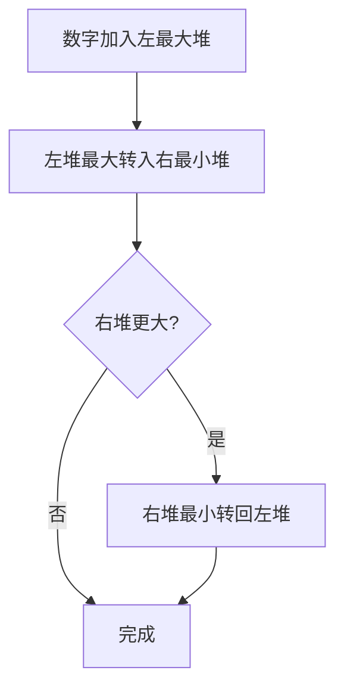

# 13 堆

本专题共3题。按简单、中等、困难稳定排序；同难度保留官方顺序。先复习算法附录中的对应结构，再学习各题的变量不变量与边界。

[215 数组中的第K个最大元素](#p215) | [347 前 K 个高频元素](#p347) | [295 数据流的中位数](#p295)

<a id="p215"></a>
## 215. 数组中的第K个最大元素

### 1. 题目基本信息

|字段|内容|
|---|---|
|力扣题号|215|
|中文名称|数组中的第K个最大元素|
|难度|中等|
|算法专题|堆|
|官方原题|[数组中的第K个最大元素](https://leetcode.cn/problems/kth-largest-element-in-an-array/)|
|推荐前置知识|数组与下标、循环、条件与短路、方法与返回值、对象、引用与null、push / pop / peek、Queue.offer / poll / peek|

验证状态：已编译：是；本地测试：通过；LeetCode官方测试：未提交，未验证。

### 2. 题目描述

返回数组按降序排列的第k个元素，重复元素分别计数，1≤k≤n。

输入与输出示例：`[3,2,1,5,6,4], k=2 → 5`

### 3. 解题思路详细分析

**从直观方案开始**：排序后取nums[n-k]，O(n log n)。

**推荐方案、变量含义与正确性依据**：维护容量至多k的最小堆。每个元素入堆，若超k就弹出最小值；这样堆始终保留目前最大的k个数。扫描完堆顶就是第k大。此版比随机快速选择更易理解，但时间O(n log k)。

### 4. 完整 Java 解题代码

标准库导入列在代码开头；没有import表示仅使用java.lang自动导入类型及力扣节点。普通题使用`class Solution`，设计题保留指定类名。

```java
import java.util.*;
class Solution {
    public int findKthLargest(int[] nums,int k) {
        PriorityQueue<Integer> heap=new PriorityQueue<>();
        for(int x:nums) {
            heap.offer(x);
            if(heap.size()>k) heap.poll(); // 丢弃较小数，只留下最大的k个
        }
        return heap.peek();
    }
}
```

### 5. Java 知识点详解

以下只复习本题实际出现的语法和关键API；数字锚点对应前面的Java基础章节。

- **数组与下标**（[基础第2节](../Java基础知识附录.md#java-2)）：固定长度容器；new int[n]初值为0，boolean初值false；a[i]读取或写入第i项。本题用数组承载输入或索引状态，索引必须在0..length-1；a.length是字段，不是方法。示例：int[] a={2,7}; a[0]为2。
- **循环**（[基础第3节](../Java基础知识附录.md#java-3)）：for控制初始化、条件、更新；while先判断再执行。本题循环反复处理元素或缩小区间；必须保证每轮有进展。i++先产生旧值再加1，例如a[i++]使用旧下标。增强for读取元素副本，给基本类型循环变量赋值不会改数组。
- **条件与短路**（[基础第3节](../Java基础知识附录.md#java-3)）：if仅在boolean条件为true时执行；条件?A:B只求被选择的一个分支。&&左侧false不算右侧，||左侧true不算右侧；本题利用它们保护边界或选择算法分支。检查p!=null须放在读取p.next之前。
- **方法与返回值**（[基础第4节](../Java基础知识附录.md#java-4)）：方法参数声明输入类型，return表达式交还结果并结束当前调用，void方法可只写return。public入口供力扣调用，private辅助方法只供本类使用。递归时每层局部变量独立，集合参数传的是同一对象的引用值副本。
- **对象、引用与null**（[基础第21节](../Java基础知识附录.md#java-21)）：new创建对象；赋值p=q复制引用，不复制节点或集合。本题经引用修改对象内容，调用者可见；重新给参数赋new只改变局部参数。null没有可访问的字段或方法。对象==比较身份，String等内容要用equals。
- **push / pop / peek**（[基础第14节](../Java基础知识附录.md#java-14)）：push(x)把x压入头部，pop()删除并返回头部，peek()只读头部。用于本题栈或读取堆顶（PriorityQueue也有peek）。pop空栈抛异常；peek空时null，拆箱前必须确认非空。例：压3再压5，弹出5。
- **Queue.offer / poll / peek**（[基础第15节](../Java基础知识附录.md#java-15)）：offer(x)加入并返回boolean；poll()删除返回队首，空时null；peek只读。本题使用ArrayDeque时按先进先出，PriorityQueue时按比较规则出堆。BFS需提前固定本层size，不能把刚加入的下一层也在本层处理。
- **PriorityQueue**（[基础第15节](../Java基础知识附录.md#java-15)）：默认自然顺序最小堆，堆顶最小；offer/poll为O(log k)，peek为O(1)。本题保留优先级最高的候选或平衡两半数据。不能用遍历顺序推断全排序，不可加入null。最大堆需反向比较器。

### 6. 示例执行过程

对应本题示例或文中明确标出的同类小例子：

|步骤|扫描位置、变量或数据结构变化|
|---|---|
|1|k2：读3、2，堆保留2,3|
|2|读1后弹1|
|3|读5后弹2，保留3,5|
|4|读6后弹3，保留5,6|
|5|读4后弹4，堆顶5|

### 7. 复杂度分析

- **时间**：O(n log(k+1)) 时间，每元素入堆并可能出堆。
- **空间**：O(k) 空间。

复杂度中返回结果是否计入已明确说明；树高h、层宽w、总节点数N等规模按本题语境取值。哈希表相关分析使用平均情况；代码调用栈也计入辅助空间。

### 8. 常见错误和注意事项

1. 第k大不是第k个不同值。
2. Java默认最小堆恰好适用。
3. 不要提前读取空堆。

### 9. 本题知识总结

- 核心思想：维护容量至多k的最小堆。
- Java重点：数组与下标、push / pop / peek、Queue.offer / poll / peek、PriorityQueue。
- 必会技巧：第k大不是第k个不同值。
- 推荐复习：遮住代码，用第6节的示例重走变量变化，再解释第3节的边界或状态含义，最后独立写出提交方法。

---

<a id="p347"></a>
## 347. 前 K 个高频元素

### 1. 题目基本信息

|字段|内容|
|---|---|
|力扣题号|347|
|中文名称|前 K 个高频元素|
|难度|中等|
|算法专题|堆|
|官方原题|[前 K 个高频元素](https://leetcode.cn/problems/top-k-frequent-elements/)|
|推荐前置知识|数组与下标、循环、条件与短路、方法与返回值、对象、引用与null、List、ArrayList与泛型、Map、HashMap|

验证状态：已编译：是；本地测试：通过；LeetCode官方测试：未提交，未验证。

### 2. 题目描述

返回出现频率最高的k种整数，保证答案唯一，结果顺序不限。k不超过不同整数个数。

输入与输出示例：`[1,1,1,2,2,3], k=2 → [1,2]`

### 3. 解题思路详细分析

**从直观方案开始**：统计后对所有不同数字按频率排序，O(n+u log u)。

**推荐方案、变量含义与正确性依据**：先用Map计频，再建大小n+1的桶，bucket[f]存出现f次的数字。频率范围只在1..n，因此从高频桶向低频桶收集，满k即结束。这是桶方法，满足比O(n log n)更好的题目要求；堆解法可作后续练习。

### 4. 完整 Java 解题代码

标准库导入列在代码开头；没有import表示仅使用java.lang自动导入类型及力扣节点。普通题使用`class Solution`，设计题保留指定类名。

```java
import java.util.*;
class Solution {
    public int[] topKFrequent(int[] nums,int k) {
        Map<Integer,Integer> count=new HashMap<>();
        for(int x:nums) count.put(x,count.getOrDefault(x,0)+1);
        List<List<Integer>> buckets=new ArrayList<>();
        for(int i=0;i<=nums.length;i++) buckets.add(new ArrayList<>());
        for(Map.Entry<Integer,Integer> e:count.entrySet()) buckets.get(e.getValue()).add(e.getKey());
        int[] ans=new int[k]; int index=0;
        for(int f=nums.length;f>=1 && index<k;f--) {
            for(int x:buckets.get(f)) {
                ans[index++]=x;
                if(index==k) break; // 收满k种后不再写入
            }
        }
        return ans;
    }
}
```

### 5. Java 知识点详解

以下只复习本题实际出现的语法和关键API；数字锚点对应前面的Java基础章节。

- **数组与下标**（[基础第2节](../Java基础知识附录.md#java-2)）：固定长度容器；new int[n]初值为0，boolean初值false；a[i]读取或写入第i项。本题用数组承载输入或索引状态，索引必须在0..length-1；a.length是字段，不是方法。示例：int[] a={2,7}; a[0]为2。
- **循环**（[基础第3节](../Java基础知识附录.md#java-3)）：for控制初始化、条件、更新；while先判断再执行。本题循环反复处理元素或缩小区间；必须保证每轮有进展。i++先产生旧值再加1，例如a[i++]使用旧下标。增强for读取元素副本，给基本类型循环变量赋值不会改数组。
- **条件与短路**（[基础第3节](../Java基础知识附录.md#java-3)）：if仅在boolean条件为true时执行；条件?A:B只求被选择的一个分支。&&左侧false不算右侧，||左侧true不算右侧；本题利用它们保护边界或选择算法分支。检查p!=null须放在读取p.next之前。
- **方法与返回值**（[基础第4节](../Java基础知识附录.md#java-4)）：方法参数声明输入类型，return表达式交还结果并结束当前调用，void方法可只写return。public入口供力扣调用，private辅助方法只供本类使用。递归时每层局部变量独立，集合参数传的是同一对象的引用值副本。
- **对象、引用与null**（[基础第21节](../Java基础知识附录.md#java-21)）：new创建对象；赋值p=q复制引用，不复制节点或集合。本题经引用修改对象内容，调用者可见；重新给参数赋new只改变局部参数。null没有可访问的字段或方法。对象==比较身份，String等内容要用equals。
- **List、ArrayList与泛型**（[基础第11节](../Java基础知识附录.md#java-11)）：List<E>是有序可重复列表接口，new ArrayList<>()创建实现；E必须是引用类型，int需用Integer自动装箱。本题收集可变长结果或路径。add(x)尾部追加，get(i)读取，size()给元素数；get越界会抛异常。尾add摊还O(1)。
- **Map、HashMap**（[基础第12节](../Java基础知识附录.md#java-12)）：Map<K,V>把每个键映射到一个值；put(k,v)写入并返回旧值，get(k)读取或返回null，containsKey(k)检查存在。本题按键快速定位信息；平均查找O(1)，遍历不保序。get缺失后直接拆箱int会空指针。
- **Map.getOrDefault(key, defaultValue)**（[基础第12节](../Java基础知识附录.md#java-12)）：键不存在时返回defaultValue，存在时返回其值，不自动修改Map。本题用默认0统计次数，例如count.put(x,count.getOrDefault(x,0)+1)。不能误以为查询默认值就已经插入了键。
- **Map.Entry与entrySet()**（[基础第12节](../Java基础知识附录.md#java-12)）：entrySet()返回键值对集合视图；Entry.getKey()/getValue()读取键和值。本题遍历计频结果建立频率桶。泛型限定键值类型，遍历时不要随意结构性修改同一个Map。

### 6. 示例执行过程

对应本题示例或文中明确标出的同类小例子：

|步骤|扫描位置、变量或数据结构变化|
|---|---|
|1|频次{1:3,2:2,3:1}|
|2|桶3放1，桶2放2，桶1放3|
|3|从桶6往下扫，取到1和2，结束|

### 7. 复杂度分析

- **时间**：O(n) 平均时间，计频、入桶、扫描桶均线性。
- **空间**：O(n) 空间。

复杂度中返回结果是否计入已明确说明；树高h、层宽w、总节点数N等规模按本题语境取值。哈希表相关分析使用平均情况；代码调用栈也计入辅助空间。

### 8. 常见错误和注意事项

1. 桶下标是频率而非数值。
2. k是种类数。
3. 输出无序，测试先排序再比较。

### 9. 本题知识总结

- 核心思想：先用Map计频，再建大小n+1的桶，bucket[f]存出现f次的数字。
- Java重点：数组与下标、List、ArrayList与泛型、Map、HashMap、Map.getOrDefault(key, defaultValue)、Map.Entry与entrySet()。
- 必会技巧：桶下标是频率而非数值。
- 推荐复习：遮住代码，用第6节的示例重走变量变化，再解释第3节的边界或状态含义，最后独立写出提交方法。

---

<a id="p295"></a>
## 295. 数据流的中位数

### 1. 题目基本信息

|字段|内容|
|---|---|
|力扣题号|295|
|中文名称|数据流的中位数|
|难度|困难|
|算法专题|堆|
|官方原题|[数据流的中位数](https://leetcode.cn/problems/find-median-from-data-stream/)|
|推荐前置知识|条件与短路、方法与返回值、对象、引用与null、push / pop / peek、Queue.offer / poll / peek、PriorityQueue、比较器、Lambda|

验证状态：已编译：是；本地测试：通过；LeetCode官方测试：未提交，未验证。

### 2. 题目描述

维护整数数据流，支持addNum加入数字与findMedian查询当前中位数。保证查询时至少有一个数。

输入与输出示例：`加入1、2后中位数1.5；再加入3后2.0`

### 3. 解题思路详细分析

**从直观方案开始**：每次加入排序数组成本O(n)，每次查询再排序也慢。

**推荐方案、变量含义与正确性依据**：左半用最大堆low，右半用最小堆high。保持low大小等于high或多1，且low最大≤high最小。每次先放low，再把low最大转入high，若high更大再转回最小值。奇数取low堆顶，偶数求两堆顶平均。

执行流程图：



### 4. 完整 Java 解题代码

标准库导入列在代码开头；没有import表示仅使用java.lang自动导入类型及力扣节点。普通题使用`class Solution`，设计题保留指定类名。

```java
import java.util.*;
class MedianFinder {
    private final PriorityQueue<Integer> low=new PriorityQueue<>(Comparator.reverseOrder());
    private final PriorityQueue<Integer> high=new PriorityQueue<>();
    public MedianFinder() {}
    public void addNum(int num) {
        low.offer(num); high.offer(low.poll()); // 把左半最大值交给右半
        if(high.size()>low.size()) low.offer(high.poll()); // 恢复大小不变量
    }
    public double findMedian() {
        if(low.size()>high.size()) return low.peek();
        return ((double)low.peek()+high.peek())/2;
    }
}
```

### 5. Java 知识点详解

以下只复习本题实际出现的语法和关键API；数字锚点对应前面的Java基础章节。

- **条件与短路**（[基础第3节](../Java基础知识附录.md#java-3)）：if仅在boolean条件为true时执行；条件?A:B只求被选择的一个分支。&&左侧false不算右侧，||左侧true不算右侧；本题利用它们保护边界或选择算法分支。检查p!=null须放在读取p.next之前。
- **方法与返回值**（[基础第4节](../Java基础知识附录.md#java-4)）：方法参数声明输入类型，return表达式交还结果并结束当前调用，void方法可只写return。public入口供力扣调用，private辅助方法只供本类使用。递归时每层局部变量独立，集合参数传的是同一对象的引用值副本。
- **对象、引用与null**（[基础第21节](../Java基础知识附录.md#java-21)）：new创建对象；赋值p=q复制引用，不复制节点或集合。本题经引用修改对象内容，调用者可见；重新给参数赋new只改变局部参数。null没有可访问的字段或方法。对象==比较身份，String等内容要用equals。
- **push / pop / peek**（[基础第14节](../Java基础知识附录.md#java-14)）：push(x)把x压入头部，pop()删除并返回头部，peek()只读头部。用于本题栈或读取堆顶（PriorityQueue也有peek）。pop空栈抛异常；peek空时null，拆箱前必须确认非空。例：压3再压5，弹出5。
- **Queue.offer / poll / peek**（[基础第15节](../Java基础知识附录.md#java-15)）：offer(x)加入并返回boolean；poll()删除返回队首，空时null；peek只读。本题使用ArrayDeque时按先进先出，PriorityQueue时按比较规则出堆。BFS需提前固定本层size，不能把刚加入的下一层也在本层处理。
- **PriorityQueue**（[基础第15节](../Java基础知识附录.md#java-15)）：默认自然顺序最小堆，堆顶最小；offer/poll为O(log k)，peek为O(1)。本题保留优先级最高的候选或平衡两半数据。不能用遍历顺序推断全排序，不可加入null。最大堆需反向比较器。
- **比较器、Lambda**（[基础第18节](../Java基础知识附录.md#java-18)）：Comparator.compare(a,b)返回负/零/正分别表示a在前/同序/b在前。(a,b)->Integer.compare(a.val,b.val)是按节点值比较的简写；Integer.compare避免a-b溢出。Comparator.reverseOrder()反转自然顺序。本题把规则交给排序或堆。
- **this、static、final**（[基础第7节](../Java基础知识附录.md#java-7)）：this表示当前对象，可区分字段与参数。static成员属于类；final字段仅允许初始化一次，若指向集合仍能增删内容。本题用它们保存对象结构或固定配置，不能把可变结果错误地当所有调用共享的全局状态。

### 6. 示例执行过程

对应本题示例或文中明确标出的同类小例子：

|步骤|扫描位置、变量或数据结构变化|
|---|---|
|1|加1：low=[1],high=[]|
|2|加2：low=[1],high=[2]，平均1.5|
|3|加3：low含1,2，high含3，中位数2|

### 7. 复杂度分析

- **时间**：addNum为O(log n)时间，常数次堆调整，findMedian为O(1)时间。
- **空间**：总空间O(n)，两个堆合计保存全部已加入数字。

复杂度中返回结果是否计入已明确说明；树高h、层宽w、总节点数N等规模按本题语境取值。哈希表相关分析使用平均情况；代码调用栈也计入辅助空间。

### 8. 常见错误和注意事项

1. low必须是最大堆。
2. 两堆大小差不超过1且low不小。
3. 求平均先转double避免整数溢出。

### 9. 本题知识总结

- 核心思想：左半用最大堆low，右半用最小堆high。
- Java重点：push / pop / peek、Queue.offer / poll / peek、PriorityQueue、比较器、Lambda、this、static、final。
- 必会技巧：low必须是最大堆。
- 推荐复习：遮住代码，用第6节的示例重走变量变化，再解释第3节的边界或状态含义，最后独立写出提交方法。

---

