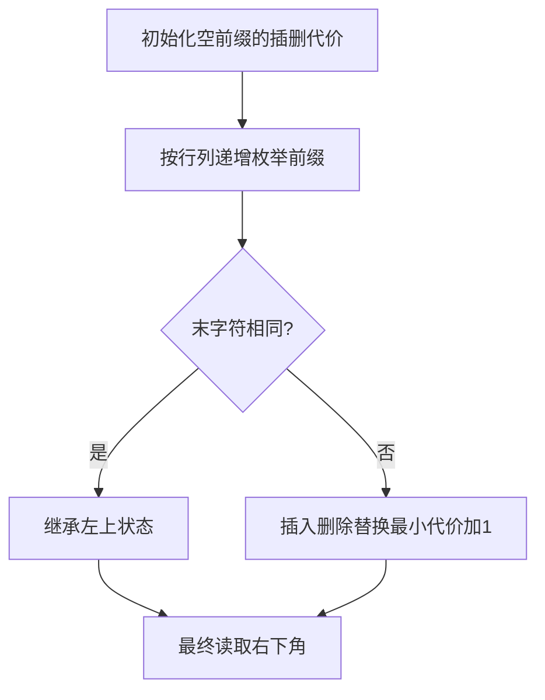

# 16 多维动态规划

本专题共5题。按简单、中等、困难稳定排序；同难度保留官方顺序。先复习算法附录中的对应结构，再学习各题的变量不变量与边界。

[62 不同路径](#p62) | [64 最小路径和](#p64) | [5 最长回文子串](#p5) | [1143 最长公共子序列](#p1143) | [72 编辑距离](#p72)

<a id="p62"></a>
## 62. 不同路径

### 1. 题目基本信息

|字段|内容|
|---|---|
|力扣题号|62|
|中文名称|不同路径|
|难度|中等|
|算法专题|多维动态规划|
|官方原题|[不同路径](https://leetcode.cn/problems/unique-paths/)|
|推荐前置知识|数组与下标、循环、方法与返回值、对象、引用与null、Arrays.fill(array, value)|

验证状态：已编译：是；本地测试：通过；LeetCode官方测试：未提交，未验证。

### 2. 题目描述

在m行n列网格从左上走到右下，每步只可向右或向下，求不同路径数，无障碍。

输入与输出示例：`m=3,n=7 → 28`

### 3. 解题思路详细分析

**从直观方案开始**：枚举每条路线会指数重复到达相同格子的子问题。

**推荐方案、变量含义与正确性依据**：dp[i][j]表示到该格的路径数。首行和首列均为1，其余dp[i][j]=dp[i-1][j]+dp[i][j-1]，从上到下、从左到右计算。代码滚动为一维dp[j]：更新前它是上方路径，dp[j-1]已经是本行左方路径。初始所有列置1，代表第一行。

### 4. 完整 Java 解题代码

标准库导入列在代码开头；没有import表示仅使用java.lang自动导入类型及力扣节点。普通题使用`class Solution`，设计题保留指定类名。

```java
import java.util.*;
class Solution {
    public int uniquePaths(int m,int n) {
        int[] dp=new int[n]; Arrays.fill(dp,1); // 第一行都只有沿右走这一条路线
        for(int i=1;i<m;i++) for(int j=1;j<n;j++) dp[j]+=dp[j-1]; // 上方旧状态加左方新状态
        return dp[n-1];
    }
}
```

### 5. Java 知识点详解

以下只复习本题实际出现的语法和关键API；数字锚点对应前面的Java基础章节。

- **数组与下标**（[基础第2节](../Java基础知识附录.md#java-2)）：固定长度容器；new int[n]初值为0，boolean初值false；a[i]读取或写入第i项。本题用数组承载输入或索引状态，索引必须在0..length-1；a.length是字段，不是方法。示例：int[] a={2,7}; a[0]为2。
- **循环**（[基础第3节](../Java基础知识附录.md#java-3)）：for控制初始化、条件、更新；while先判断再执行。本题循环反复处理元素或缩小区间；必须保证每轮有进展。i++先产生旧值再加1，例如a[i++]使用旧下标。增强for读取元素副本，给基本类型循环变量赋值不会改数组。
- **方法与返回值**（[基础第4节](../Java基础知识附录.md#java-4)）：方法参数声明输入类型，return表达式交还结果并结束当前调用，void方法可只写return。public入口供力扣调用，private辅助方法只供本类使用。递归时每层局部变量独立，集合参数传的是同一对象的引用值副本。
- **对象、引用与null**（[基础第21节](../Java基础知识附录.md#java-21)）：new创建对象；赋值p=q复制引用，不复制节点或集合。本题经引用修改对象内容，调用者可见；重新给参数赋new只改变局部参数。null没有可访问的字段或方法。对象==比较身份，String等内容要用equals。
- **Arrays.fill(array, value)**（[基础第19节](../Java基础知识附录.md#java-19)）：把数组每格设为value，无返回值。本题用于DP不可达初值、单位元或棋盘空格。new int[n]默认0不一定符合状态语义；二维数组不能靠一次fill深度填充所有内部基本元素。

### 6. 示例执行过程

对应本题示例或文中明确标出的同类小例子：

|步骤|扫描位置、变量或数据结构变化|
|---|---|
|1|3×3初始dp=[1,1,1]|
|2|第二行从j1更新到[1,2,3]|
|3|第三行变[1,3,6]|
|4|3×7按同样规则最终28|

### 7. 复杂度分析

- **时间**：O(mn) 时间，每格常数次相加。
- **空间**：O(n) 空间，压缩掉行维度。

复杂度中返回结果是否计入已明确说明；树高h、层宽w、总节点数N等规模按本题语境取值。哈希表相关分析使用平均情况；代码调用栈也计入辅助空间。

### 8. 常见错误和注意事项

1. 滚动数组j必须正序。
2. 边缘路径只有1。
3. 返回dp[n-1]而非整行和。

### 9. 本题知识总结

- 核心思想：dp[i][j]表示到该格的路径数。
- Java重点：数组与下标、Arrays.fill(array, value)。
- 必会技巧：滚动数组j必须正序。
- 推荐复习：遮住代码，用第6节的示例重走变量变化，再解释第3节的边界或状态含义，最后独立写出提交方法。

---

<a id="p64"></a>
## 64. 最小路径和

### 1. 题目基本信息

|字段|内容|
|---|---|
|力扣题号|64|
|中文名称|最小路径和|
|难度|中等|
|算法专题|多维动态规划|
|官方原题|[最小路径和](https://leetcode.cn/problems/minimum-path-sum/)|
|推荐前置知识|数组与下标、二维数组、循环、条件与短路、方法与返回值、对象、引用与null、Math.max / Math.min|

验证状态：已编译：是；本地测试：通过；LeetCode官方测试：未提交，未验证。

### 2. 题目描述

非负矩阵中从左上走到右下，只能向下或向右，求沿途节点值之和最小值，包含起点和终点。

输入与输出示例：`[[1,3,1],[1,5,1],[4,2,1]] → 7`

### 3. 解题思路详细分析

**从直观方案开始**：枚举全部路径再求最小会指数增长。

**推荐方案、变量含义与正确性依据**：dp[i][j]是到达该格的最小和。起点为grid[0][0]；首行只能来自左，首列只能来自上；内部为min(上,左)+当前值。按行正序滚动到一维数组，dp[j]更新前为上方，dp[j-1]为左方。

### 4. 完整 Java 解题代码

标准库导入列在代码开头；没有import表示仅使用java.lang自动导入类型及力扣节点。普通题使用`class Solution`，设计题保留指定类名。

```java
class Solution {
    public int minPathSum(int[][] grid) {
        int m=grid.length,n=grid[0].length; int[] dp=new int[n];
        for(int i=0;i<m;i++) for(int j=0;j<n;j++) {
            if(i==0 && j==0) dp[j]=grid[i][j];
            else if(i==0) dp[j]=dp[j-1]+grid[i][j];
            else if(j==0) dp[j]+=grid[i][j];
            else dp[j]=Math.min(dp[j],dp[j-1])+grid[i][j]; // 两个合法来源中取较小
        }
        return dp[n-1];
    }
}
```

### 5. Java 知识点详解

以下只复习本题实际出现的语法和关键API；数字锚点对应前面的Java基础章节。

- **数组与下标**（[基础第2节](../Java基础知识附录.md#java-2)）：固定长度容器；new int[n]初值为0，boolean初值false；a[i]读取或写入第i项。本题用数组承载输入或索引状态，索引必须在0..length-1；a.length是字段，不是方法。示例：int[] a={2,7}; a[0]为2。
- **二维数组**（[基础第2节](../Java基础知识附录.md#java-2)）：a[r][c]先取第r行再取第c列；行数a.length，列数a[0].length。本题用它表示矩阵或二维状态。不要把行列维度写反，空外数组不能访问a[0]。
- **循环**（[基础第3节](../Java基础知识附录.md#java-3)）：for控制初始化、条件、更新；while先判断再执行。本题循环反复处理元素或缩小区间；必须保证每轮有进展。i++先产生旧值再加1，例如a[i++]使用旧下标。增强for读取元素副本，给基本类型循环变量赋值不会改数组。
- **条件与短路**（[基础第3节](../Java基础知识附录.md#java-3)）：if仅在boolean条件为true时执行；条件?A:B只求被选择的一个分支。&&左侧false不算右侧，||左侧true不算右侧；本题利用它们保护边界或选择算法分支。检查p!=null须放在读取p.next之前。
- **方法与返回值**（[基础第4节](../Java基础知识附录.md#java-4)）：方法参数声明输入类型，return表达式交还结果并结束当前调用，void方法可只写return。public入口供力扣调用，private辅助方法只供本类使用。递归时每层局部变量独立，集合参数传的是同一对象的引用值副本。
- **对象、引用与null**（[基础第21节](../Java基础知识附录.md#java-21)）：new创建对象；赋值p=q复制引用，不复制节点或集合。本题经引用修改对象内容，调用者可见；重新给参数赋new只改变局部参数。null没有可访问的字段或方法。对象==比较身份，String等内容要用equals。
- **Math.max / Math.min**（[基础第19节](../Java基础知识附录.md#java-19)）：静态方法传两个同类数值，返回较大/较小值，不修改实参。本题维护最优值、边界或DP转移。必须把结果赋回变量：Math.max(best,x)单独调用不会改变best。

### 6. 示例执行过程

对应本题示例或文中明确标出的同类小例子：

|步骤|扫描位置、变量或数据结构变化|
|---|---|
|1|第一行dp=[1,4,5]|
|2|第二行dp=[2,7,6]|
|3|第三行dp=[6,8,7]，答案7|
|4|对应1→3→1→1→1|

### 7. 复杂度分析

- **时间**：O(mn) 时间，每格一次转移。
- **空间**：O(n) 空间。

复杂度中返回结果是否计入已明确说明；树高h、层宽w、总节点数N等规模按本题语境取值。哈希表相关分析使用平均情况；代码调用栈也计入辅助空间。

### 8. 常见错误和注意事项

1. 不能默认所有边界为0，否则会从网格外进入。
2. 起点只加一次。
3. 滚动数组更新方向需从左到右。

### 9. 本题知识总结

- 核心思想：dp[i][j]是到达该格的最小和。
- Java重点：数组与下标、二维数组、Math.max / Math.min。
- 必会技巧：不能默认所有边界为0，否则会从网格外进入。
- 推荐复习：遮住代码，用第6节的示例重走变量变化，再解释第3节的边界或状态含义，最后独立写出提交方法。

---

<a id="p5"></a>
## 5. 最长回文子串

### 1. 题目基本信息

|字段|内容|
|---|---|
|力扣题号|5|
|中文名称|最长回文子串|
|难度|中等|
|算法专题|多维动态规划|
|官方原题|[最长回文子串](https://leetcode.cn/problems/longest-palindromic-substring/)|
|推荐前置知识|数组与下标、二维数组、循环、条件与短路、方法与返回值、对象、引用与null、String|

验证状态：已编译：是；本地测试：通过；LeetCode官方测试：未提交，未验证。

### 2. 题目描述

求字符串最长连续回文子串，多个同长答案可返回任意一个。输入非空。

输入与输出示例：`"babad" → "bab"或"aba"`

### 3. 解题思路详细分析

**从直观方案开始**：枚举所有区间再逐字符判断需要O(n³)。

**推荐方案、变量含义与正确性依据**：区间DP：pal[i][j]表示闭区间回文，当两端相等且(j-i<2或pal[i+1][j-1])时为真。初始由长度1、2的条件直接处理。i倒序、j从i正序，保证内部状态已知；每次真且更长则更新start和best，最后截取。可在后续学习中心扩展以节省空间。

### 4. 完整 Java 解题代码

标准库导入列在代码开头；没有import表示仅使用java.lang自动导入类型及力扣节点。普通题使用`class Solution`，设计题保留指定类名。

```java
class Solution {
    public String longestPalindrome(String s) {
        int n=s.length(),start=0,best=0; boolean[][] pal=new boolean[n][n];
        for(int i=n-1;i>=0;i--) for(int j=i;j<n;j++) {
            pal[i][j]=s.charAt(i)==s.charAt(j) && (j-i<2 || pal[i+1][j-1]);
            if(pal[i][j] && j-i+1>best) { start=i; best=j-i+1; } // 保存最长区间
        }
        return s.substring(start,start+best);
    }
}
```

### 5. Java 知识点详解

以下只复习本题实际出现的语法和关键API；数字锚点对应前面的Java基础章节。

- **数组与下标**（[基础第2节](../Java基础知识附录.md#java-2)）：固定长度容器；new int[n]初值为0，boolean初值false；a[i]读取或写入第i项。本题用数组承载输入或索引状态，索引必须在0..length-1；a.length是字段，不是方法。示例：int[] a={2,7}; a[0]为2。
- **二维数组**（[基础第2节](../Java基础知识附录.md#java-2)）：a[r][c]先取第r行再取第c列；行数a.length，列数a[0].length。本题用它表示矩阵或二维状态。不要把行列维度写反，空外数组不能访问a[0]。
- **循环**（[基础第3节](../Java基础知识附录.md#java-3)）：for控制初始化、条件、更新；while先判断再执行。本题循环反复处理元素或缩小区间；必须保证每轮有进展。i++先产生旧值再加1，例如a[i++]使用旧下标。增强for读取元素副本，给基本类型循环变量赋值不会改数组。
- **条件与短路**（[基础第3节](../Java基础知识附录.md#java-3)）：if仅在boolean条件为true时执行；条件?A:B只求被选择的一个分支。&&左侧false不算右侧，||左侧true不算右侧；本题利用它们保护边界或选择算法分支。检查p!=null须放在读取p.next之前。
- **方法与返回值**（[基础第4节](../Java基础知识附录.md#java-4)）：方法参数声明输入类型，return表达式交还结果并结束当前调用，void方法可只写return。public入口供力扣调用，private辅助方法只供本类使用。递归时每层局部变量独立，集合参数传的是同一对象的引用值副本。
- **对象、引用与null**（[基础第21节](../Java基础知识附录.md#java-21)）：new创建对象；赋值p=q复制引用，不复制节点或集合。本题经引用修改对象内容，调用者可见；重新给参数赋new只改变局部参数。null没有可访问的字段或方法。对象==比较身份，String等内容要用equals。
- **String**（[基础第10节](../Java基础知识附录.md#java-10)）：不可变字符序列；length()返回字符单元数，equals比较文本。作为本题输入、键或结果；修改内容须创建新String或用StringBuilder。String==只比较引用，不能替代内容比较。
- **String.charAt(index)**（[基础第10节](../Java基础知识附录.md#java-10)）：传入0到length()-1的下标，返回对应char。本题逐字符扫描或检查两端。越界抛异常；char是UTF-16单元，本题实现按题目保证的字符范围处理，不声称覆盖任意Unicode字符。
- **String.substring(begin, end)**（[基础第10节](../Java基础知识附录.md#java-10)）：返回左闭右开[begin,end)的子串，长度end-begin。本题构造结果片段或查询候选单词；闭区间结尾j需传j+1。Java 17会复制子串内容，不能把创建与哈希代价一概算成O(1)。

### 6. 示例执行过程

对应本题示例或文中明确标出的同类小例子：

|步骤|扫描位置、变量或数据结构变化|
|---|---|
|1|babad从靠右区间开始计算，aba的内区间b已为真，首尾a相等，因此长度3|
|2|之后bab也成立但只在更长时更新，所以可能保留aba|

### 7. 复杂度分析

- **时间**：O(n²) 时间，计算所有i≤j区间。
- **空间**：O(n²) 空间保存回文表，返回字符串O(n)。

复杂度中返回结果是否计入已明确说明；树高h、层宽w、总节点数N等规模按本题语境取值。哈希表相关分析使用平均情况；代码调用栈也计入辅助空间。

### 8. 常见错误和注意事项

1. pal内部区间必须先算。
2. 子串而非子序列。
3. 同长解不固定，测试可接受两种。

### 9. 本题知识总结

- 核心思想：区间DP：pal[i][j]表示闭区间回文，当两端相等且(j-i<2或pal[i+1][j-1])时为真。
- Java重点：数组与下标、二维数组、String、String.charAt(index)、String.substring(begin, end)。
- 必会技巧：pal内部区间必须先算。
- 推荐复习：遮住代码，用第6节的示例重走变量变化，再解释第3节的边界或状态含义，最后独立写出提交方法。

---

<a id="p1143"></a>
## 1143. 最长公共子序列

### 1. 题目基本信息

|字段|内容|
|---|---|
|力扣题号|1143|
|中文名称|最长公共子序列|
|难度|中等|
|算法专题|多维动态规划|
|官方原题|[最长公共子序列](https://leetcode.cn/problems/longest-common-subsequence/)|
|推荐前置知识|数组与下标、二维数组、循环、条件与短路、方法与返回值、对象、引用与null、String|

验证状态：已编译：是；本地测试：通过；LeetCode官方测试：未提交，未验证。

### 2. 题目描述

给两个字符串，求最长公共子序列长度，可跳过字符但不能改变相对顺序。没有公共字符返回0。

输入与输出示例：`text1="abcde",text2="ace" → 3`

### 3. 解题思路详细分析

**从直观方案开始**：尝试所有子序列再判断匹配会指数爆炸。

**推荐方案、变量含义与正确性依据**：dp[i][j]为第一个串前i字符和第二个串前j字符的LCS长度。任一前缀为空时为0；末字符相等则dp[i][j]=dp[i-1][j-1]+1，否则取max(dp[i-1][j],dp[i][j-1])。i、j从1正序，所依赖左、上、左上都已完成。

### 4. 完整 Java 解题代码

标准库导入列在代码开头；没有import表示仅使用java.lang自动导入类型及力扣节点。普通题使用`class Solution`，设计题保留指定类名。

```java
class Solution {
    public int longestCommonSubsequence(String text1,String text2) {
        int m=text1.length(),n=text2.length(); int[][] dp=new int[m+1][n+1];
        for(int i=1;i<=m;i++) for(int j=1;j<=n;j++) {
            if(text1.charAt(i-1)==text2.charAt(j-1)) dp[i][j]=dp[i-1][j-1]+1;
            else dp[i][j]=Math.max(dp[i-1][j],dp[i][j-1]); // 各舍弃一个末字符，选择较优
        }
        return dp[m][n];
    }
}
```

### 5. Java 知识点详解

以下只复习本题实际出现的语法和关键API；数字锚点对应前面的Java基础章节。

- **数组与下标**（[基础第2节](../Java基础知识附录.md#java-2)）：固定长度容器；new int[n]初值为0，boolean初值false；a[i]读取或写入第i项。本题用数组承载输入或索引状态，索引必须在0..length-1；a.length是字段，不是方法。示例：int[] a={2,7}; a[0]为2。
- **二维数组**（[基础第2节](../Java基础知识附录.md#java-2)）：a[r][c]先取第r行再取第c列；行数a.length，列数a[0].length。本题用它表示矩阵或二维状态。不要把行列维度写反，空外数组不能访问a[0]。
- **循环**（[基础第3节](../Java基础知识附录.md#java-3)）：for控制初始化、条件、更新；while先判断再执行。本题循环反复处理元素或缩小区间；必须保证每轮有进展。i++先产生旧值再加1，例如a[i++]使用旧下标。增强for读取元素副本，给基本类型循环变量赋值不会改数组。
- **条件与短路**（[基础第3节](../Java基础知识附录.md#java-3)）：if仅在boolean条件为true时执行；条件?A:B只求被选择的一个分支。&&左侧false不算右侧，||左侧true不算右侧；本题利用它们保护边界或选择算法分支。检查p!=null须放在读取p.next之前。
- **方法与返回值**（[基础第4节](../Java基础知识附录.md#java-4)）：方法参数声明输入类型，return表达式交还结果并结束当前调用，void方法可只写return。public入口供力扣调用，private辅助方法只供本类使用。递归时每层局部变量独立，集合参数传的是同一对象的引用值副本。
- **对象、引用与null**（[基础第21节](../Java基础知识附录.md#java-21)）：new创建对象；赋值p=q复制引用，不复制节点或集合。本题经引用修改对象内容，调用者可见；重新给参数赋new只改变局部参数。null没有可访问的字段或方法。对象==比较身份，String等内容要用equals。
- **String**（[基础第10节](../Java基础知识附录.md#java-10)）：不可变字符序列；length()返回字符单元数，equals比较文本。作为本题输入、键或结果；修改内容须创建新String或用StringBuilder。String==只比较引用，不能替代内容比较。
- **String.charAt(index)**（[基础第10节](../Java基础知识附录.md#java-10)）：传入0到length()-1的下标，返回对应char。本题逐字符扫描或检查两端。越界抛异常；char是UTF-16单元，本题实现按题目保证的字符范围处理，不声称覆盖任意Unicode字符。
- **Math.max / Math.min**（[基础第19节](../Java基础知识附录.md#java-19)）：静态方法传两个同类数值，返回较大/较小值，不修改实参。本题维护最优值、边界或DP转移。必须把结果赋回变量：Math.max(best,x)单独调用不会改变best。

### 6. 示例执行过程

对应本题示例或文中明确标出的同类小例子：

|步骤|扫描位置、变量或数据结构变化|
|---|---|
|1|abcde与ace：遇a/a得到1|
|2|扫描到c/c时左上已有a长度1，转移为2|
|3|到e/e时左上已有ac长度2，转移为3|

### 7. 复杂度分析

- **时间**：O(mn) 时间，所有前缀对各一次。
- **空间**：O(mn) 空间。

复杂度中返回结果是否计入已明确说明；树高h、层宽w、总节点数N等规模按本题语境取值。哈希表相关分析使用平均情况；代码调用栈也计入辅助空间。

### 8. 常见错误和注意事项

1. dp下标对应前缀长度，字符下标要减1。
2. 不相等时不能加1。
3. 公共子序列无需连续。

### 9. 本题知识总结

- 核心思想：dp[i][j]为第一个串前i字符和第二个串前j字符的LCS长度。
- Java重点：数组与下标、二维数组、String、String.charAt(index)、Math.max / Math.min。
- 必会技巧：dp下标对应前缀长度，字符下标要减1。
- 推荐复习：遮住代码，用第6节的示例重走变量变化，再解释第3节的边界或状态含义，最后独立写出提交方法。

---

<a id="p72"></a>
## 72. 编辑距离

### 1. 题目基本信息

|字段|内容|
|---|---|
|力扣题号|72|
|中文名称|编辑距离|
|难度|中等|
|算法专题|多维动态规划|
|官方原题|[编辑距离](https://leetcode.cn/problems/edit-distance/)|
|推荐前置知识|数组与下标、二维数组、循环、条件与短路、方法与返回值、对象、引用与null、String|

验证状态：已编译：是；本地测试：通过；LeetCode官方测试：未提交，未验证。

### 2. 题目描述

把word1转换成word2，每次可插入、删除或替换一个字符，求最少操作次数。字符串可以为空。

输入与输出示例：`"horse" → "ros"，最少3次`

### 3. 解题思路详细分析

**从直观方案开始**：直接枚举编辑序列有大量重复状态，还可能在插删之间循环。

**推荐方案、变量含义与正确性依据**：dp[i][j]为word1前i个字符变为word2前j个字符的最少代价。dp[i][0]=i是删除全部，dp[0][j]=j是插入全部；字符相同直接继承左上，否则取上方删除、左方插入、左上替换三者最小+1。i,j从1递增，答案dp[m][n]。

执行流程图：



### 4. 完整 Java 解题代码

标准库导入列在代码开头；没有import表示仅使用java.lang自动导入类型及力扣节点。普通题使用`class Solution`，设计题保留指定类名。

```java
class Solution {
    public int minDistance(String word1,String word2) {
        int m=word1.length(),n=word2.length(); int[][] dp=new int[m+1][n+1];
        for(int i=0;i<=m;i++) dp[i][0]=i;
        for(int j=0;j<=n;j++) dp[0][j]=j;
        for(int i=1;i<=m;i++) for(int j=1;j<=n;j++) {
            if(word1.charAt(i-1)==word2.charAt(j-1)) dp[i][j]=dp[i-1][j-1];
            else dp[i][j]=1+Math.min(dp[i-1][j-1],Math.min(dp[i-1][j],dp[i][j-1])); // 替换、删除、插入
        }
        return dp[m][n];
    }
}
```

### 5. Java 知识点详解

以下只复习本题实际出现的语法和关键API；数字锚点对应前面的Java基础章节。

- **数组与下标**（[基础第2节](../Java基础知识附录.md#java-2)）：固定长度容器；new int[n]初值为0，boolean初值false；a[i]读取或写入第i项。本题用数组承载输入或索引状态，索引必须在0..length-1；a.length是字段，不是方法。示例：int[] a={2,7}; a[0]为2。
- **二维数组**（[基础第2节](../Java基础知识附录.md#java-2)）：a[r][c]先取第r行再取第c列；行数a.length，列数a[0].length。本题用它表示矩阵或二维状态。不要把行列维度写反，空外数组不能访问a[0]。
- **循环**（[基础第3节](../Java基础知识附录.md#java-3)）：for控制初始化、条件、更新；while先判断再执行。本题循环反复处理元素或缩小区间；必须保证每轮有进展。i++先产生旧值再加1，例如a[i++]使用旧下标。增强for读取元素副本，给基本类型循环变量赋值不会改数组。
- **条件与短路**（[基础第3节](../Java基础知识附录.md#java-3)）：if仅在boolean条件为true时执行；条件?A:B只求被选择的一个分支。&&左侧false不算右侧，||左侧true不算右侧；本题利用它们保护边界或选择算法分支。检查p!=null须放在读取p.next之前。
- **方法与返回值**（[基础第4节](../Java基础知识附录.md#java-4)）：方法参数声明输入类型，return表达式交还结果并结束当前调用，void方法可只写return。public入口供力扣调用，private辅助方法只供本类使用。递归时每层局部变量独立，集合参数传的是同一对象的引用值副本。
- **对象、引用与null**（[基础第21节](../Java基础知识附录.md#java-21)）：new创建对象；赋值p=q复制引用，不复制节点或集合。本题经引用修改对象内容，调用者可见；重新给参数赋new只改变局部参数。null没有可访问的字段或方法。对象==比较身份，String等内容要用equals。
- **String**（[基础第10节](../Java基础知识附录.md#java-10)）：不可变字符序列；length()返回字符单元数，equals比较文本。作为本题输入、键或结果；修改内容须创建新String或用StringBuilder。String==只比较引用，不能替代内容比较。
- **String.charAt(index)**（[基础第10节](../Java基础知识附录.md#java-10)）：传入0到length()-1的下标，返回对应char。本题逐字符扫描或检查两端。越界抛异常；char是UTF-16单元，本题实现按题目保证的字符范围处理，不声称覆盖任意Unicode字符。
- **Math.max / Math.min**（[基础第19节](../Java基础知识附录.md#java-19)）：静态方法传两个同类数值，返回较大/较小值，不修改实参。本题维护最优值、边界或DP转移。必须把结果赋回变量：Math.max(best,x)单独调用不会改变best。

### 6. 示例执行过程

对应本题示例或文中明确标出的同类小例子：

|步骤|扫描位置、变量或数据结构变化|
|---|---|
|1|horse到ros可先h替换r得到rorse，删第二个r得到rose，删e得到ros，共3|
|2|DP每个前缀都取三种操作最小，最后dp[5][3]=3|

### 7. 复杂度分析

- **时间**：O(mn) 时间，(m+1)(n+1)状态各常数操作。
- **空间**：O(mn) 空间。

复杂度中返回结果是否计入已明确说明；树高h、层宽w、总节点数N等规模按本题语境取值。哈希表相关分析使用平均情况；代码调用栈也计入辅助空间。

### 8. 常见错误和注意事项

1. 空前缀要初始化。
2. 相同字符不额外付费。
3. 三种操作不是交换相邻字符。

### 9. 本题知识总结

- 核心思想：dp[i][j]为word1前i个字符变为word2前j个字符的最少代价。
- Java重点：数组与下标、二维数组、String、String.charAt(index)、Math.max / Math.min。
- 必会技巧：空前缀要初始化。
- 推荐复习：遮住代码，用第6节的示例重走变量变化，再解释第3节的边界或状态含义，最后独立写出提交方法。

---

